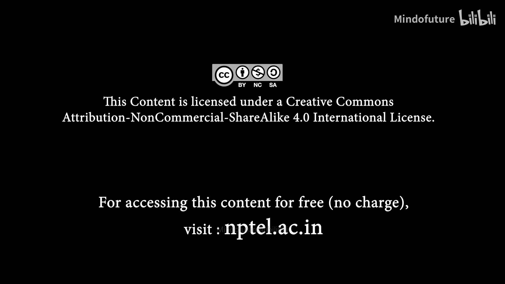
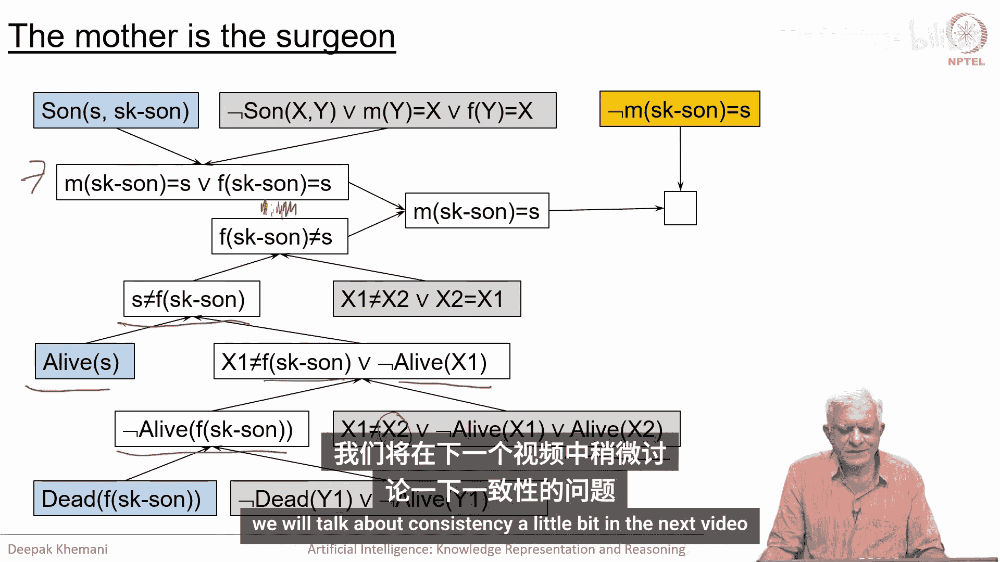

# 【印度理工学院】知识表示与推理 ｜ Knowledge Representation And Reasoning p41 P41_外科医生是谁 -BV1c4zNBmEyF_p41-

So will come back。We have been looking at first order logic。

And we have been looking at the resolution refutation method。

And then we moved on to the resolution refutitation method using equality and we saw that there were certain things that you could show in first of logic with equality。

 which you could not。Show without the axioms equality axioms that we had seen。

You want to come back to that。 but before that I want to come to。A puzzle or a quiz。Or a story。

 something which。Is one of my favorite stories， So let me pose it to you。 Ill pose this。Question。

And you must。Think about it。And come back with an answer。So here' is the story first。

Read this carefully。さ。Were crossing the road。When they met with an accident。

The father died on the spot， unfortunately。And the sun was rushed to the hospital。And into the Op。

But the surgeon had one look at the boy。And set。I cannot operate on this boy， he is my son。small。

 simple story。It has been the subject of experimental research among psychologists。

The question we want to ask。Is。Who was the surgeon？So I will also start with this question with you。

And。Wait for you to come up with an answer so you can pause this video and come back with an answer。

And then we will proceed from there。To see whether you have。Figured out the right answer or not。

But do。Look at this question， read it carefully。And try to answer the question as to who was the surgeon。

 essentially。So， I hope you had paused the video and now you have come back。So the question was。

 who was a surgeon？Now， some people find this to be a trivial question and answer is obvious to them essentially。

But there are some who fail to arrive with the right answer even after some thought essentially。So。

 for the benefit of those who find it difficult to arrive with the right answer。

We will answer this question using first order logic essentially。So。

 you would remember that when we started with first order logic and especially when we started with backward chain we said that we can ask existential queries essentially but this is an existential  query who was the surgeon essentially。

😊，So we had at that time as you know show that somebody is mortal or you know。

 that kind of stuff we said that what logic can do。

Is more than what databases can do databases can retrieve answers。

From a database from records which exist in the database。Deductive which as we called it。

Can retrieve answers which not only exist in the database as facts？Which is trivial in some sense。

Except for the fact that the database may be huge。But also is those which can be deduced from the database and that was directly retrieval。

So here we are asking this question， who was the surgeon and we want to know the answer？

So that let's put this in。First all logic。It took me some time to pose it in a neat fashion so that it could be done easily so maybe you can first have a go at how will you pose this in first a logic。

And what is a query， what is a facts and how will you。Deiv it what is the background knowledge。

 of course there is some background knowledge involved which I will show you here which pieces of background knowledge that you。

Would want to do so， so we will look at representation a little bit later。But， you know， things like。

If x is a child of y， then y is a parent of x， these kind of relations we can capture in logic right for all x child x y。

Is equivalent 2。Parent by x。And then you know we can introduce other relations， mother， father。

 sister， brother and so on and you know come up with all kinds of relations we will come to we will do that exercise week a little bit later。

 but this is what we want to do because here the surgeon is saying he is my son。

So what do you infer from that essentially？So we will use。

 since we are working with for order logic with equality， we will use。This logic。

 so let's pause this so first of all。😊，We know that there was a surgeon， this， the surgeon。

And the fact that we are using the means that we are talking about but specific individual。

And therefore， we can give that individual a name。嗯，S。

And we can make a statement that S is a surgeon。We can define the predicate sun X y。

And we will read as the son of Xes by。Now， that' is one problem that you will encounter when you try to pose problems in logic。

As to what is the meaning？Of sun x y is x the sun of y is y is the sun of x that can be confusing。

 so we will read this as follows the son of x is y。So x is the parent and y is the。Zil。

We will use two function。Here M and F， which will respectively stand for father and mother。

 M for mother and F for father。So M of y will stand for mother of y。

And f of5 will send for further well remember that functions。

Give us terms and terms points to elements in the。Doomain， essentially， So modern is， obviously。

Some element in the domain， father of five is also an element in the domain essentially。

We can add this piece of knowledge。That。You can either be the father or you can be the mother。So。

 if you say that。喂。Mother of Y is X。It's equivalent to saying。That x is not the further of y。

I could have use the equality symbol here， not equally symbol here。Anyway。

 I hope that doesn't cause any confusion。So， we can add this piece of knowledge， we can add it。

 but as we will see it is not really required in the proof that we interested so that is another thing when you are finding proof you know you have lots and lots of facts。

But you have to somehow pick the relevant facts and construct a proof， essentially。

We will not even use the fact that s is a surgeon in the proof that we are。We can write this。

As follows。That if。Son of x is y。Then this is also true。That excess mother of。

Of y or x is farther of y。In fact， it probably would have been better if I had used XO。

 but then XO expands into a larger。CNF formula a+om formula。

 so since I need only this part I have just used the or function here。But as I have said here。

XR would probably be the more accurate representation of the fact that。

You're either the mother or you the father， you can't bebo。But this one says。

In some sense that you can be both。When you convert this into clause form。

 we get three clauses out of which we will only use the one which is there in red。

Which says that you are。That sun， that the sun。Sn of x is by implies。

That x is the mother of y or x is the mother of y， we will use that fact here。

But when you convert it into cloud form， we will get these three clauses so you must do this exercise to verify that。

Then the surgeon said this。He's myson。We will represent this as two things。

 something which is implicit。Ne the surgeon is alive。

So this comes from background knowledge that you know， only。Dead people cannot speak。

So the surgeongeant must be a light。The surgeon is alive。And the surgeon says。

That that boy is my son。 So we had when we read this said the story we said a father and his son。

 So it was， you know kind of some people。 So just for the sake of this thing I have used something like an Sk scum constant It doesn't matter。

 You could have used the constant also。It doesn't change the meaning of the sentence。

When you when you say we are using a scm constant， it basically says that there existed a boy。😊。

Who was crossing the road and who met with an accident？

But when we talk about a surgeon we know that the surgeon came in and so we know which surgeon we are talking about So in that sense it makes sense you talk about the surgeon as a constant and the boy has a variable existential variable and then converted it into a scum constant。

In both cases， they are constants。We know that the father died， so that's easy enough to represent。

Dead father of this boy， essentially。So， we are talking about dead people and alive people。

 so we will also need to capture the relation between them that that implies not alive and vice ver vera。

Both。That dead implies is not alive and a alive implies not dead can be represented using this simple flaws。

which can be read either from left to right or right to left so that y1 implies a lie Y1 or a lie y1 implies that1 not a lie y1 or a lie y1 implies not dead y1。

You will also need to use the equality aoms as we will see try doing this proof without equality axis。

 try to add some more knowledge and and do that I spent about half a day working on this incidentally so maybe it might be worth your effort to also try it out but eventually we do need these equality as and this is how。

These are the ones that we will use so everything that you see in red is what we are going to use in the proof。

What is this equality extreme this is the substitution。Axiom， which is。That x1 equal to x2 implies。

Aive x1 is equivalent to a x2， which when you convert it to close one。Became like this。

Maybe we should do that explicitly。Validate that this is indeed the case。So here we are。

These are the facts that we will use。The answer has been。

Reveilt on the top which would have been clear to most people。But it was not clear to some。

So that's why we had to。Do all this formal procedure。The mother of the boy was a surgeon。So。

 let's prove that。What is given to us？😊，The surgeon says that。That boy is my son。

We know that the surgeon is alive because the surgeon said something。

And we know that the father of the boys did essentially。

So from this tag and with the equality axioms which are standard in。First on the logic with equality。

 we should be able to show。That。The surgeon was the。Or S。 remember。

 S is the surgeon in this case was the mother of the。Wei。😔，So， first， we。

Infer that the boy's father was not alive。That can be done。Using。

This fact that we know that dead people are not alive and alive people are not dead。Din。

We can use the substitution。嗯。Axiom。To conclude。That either as was the mother of the boy。

All else was the father of the boy because that is what we understood to be the meaning of son essentially。

So we know that I is either the mother or the father。Now， we use the。Substitution。Axiom。

 so now we are using the substitution axiom the earlier axiom was not that was。

Doomain knowledge that son means either mother or father。

 this is one is a substitution action axiM we are using。So from this we can infer。That， we know that。

The father of the boy is not alive。So， we can cancel it with this alive x2 in the resolution method and the other two will go forward So x alive x1 not alive x 1 will remain like that and。

Instead of x2。We will get。Father of the son。So that' is our codeon resolution rule。Then， we can。

Match it with the fact that the surgeon is alive。And we can cancel。This in the clause with a live X。

So now we get the fact。That surgeon is not the father of the son。

You can see that this is pretty logical essentially the father of the son is dead。

 the surgeon is alive， the surgeon is。Cannot be the father of the one。Then we use the symmetry axiom。

Because we want to be able to cancel the fact that S is not the father of the son。

Which the fact that S is equal to the father of the sun， So the the clause here said。ね。

Either essay is the mother of the sonn or essay is the father of the So。

We know that s is not the father of the sun， so we have written this here S S is not the father of the sun。

But to match this again we have to use the symmetry。

 we have to flip it by bringing farther of the sun to the left and S to the right so that now we can you know match these two。

Together。They have the same pattern except that negation sign essentially。So， we do that。

And there we have our。Answer。S is the mother of the son，As I said， pretty obvious to most people。But。

If someone refuses to believe it， then you can。Produce this proof essentially。And of course。

 if you are doing the resolution neation method， you would have taken the negation of the goal that you want to produce。

And produce the null clause exactly。So， what this illustrates these two examples that we have seen is that the equality axioms。

Are necessary if you want to exploit the properties of equality which which says that if two terms are equal if t1 equal to t2 then t2 equal to t1 also is true and that kind of stuff essentially more importantly transitivity。

And。The substitution axioms can be used effectively。Okay， so。

I hope you are convinced that the story was consistent。

And we'll talk about consistency a little bit in the next video。

