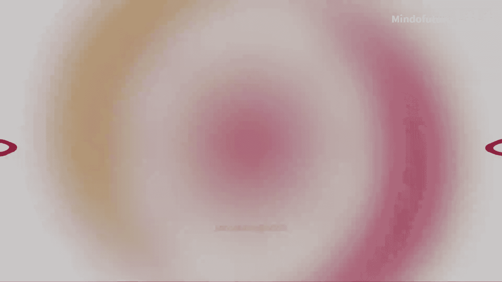
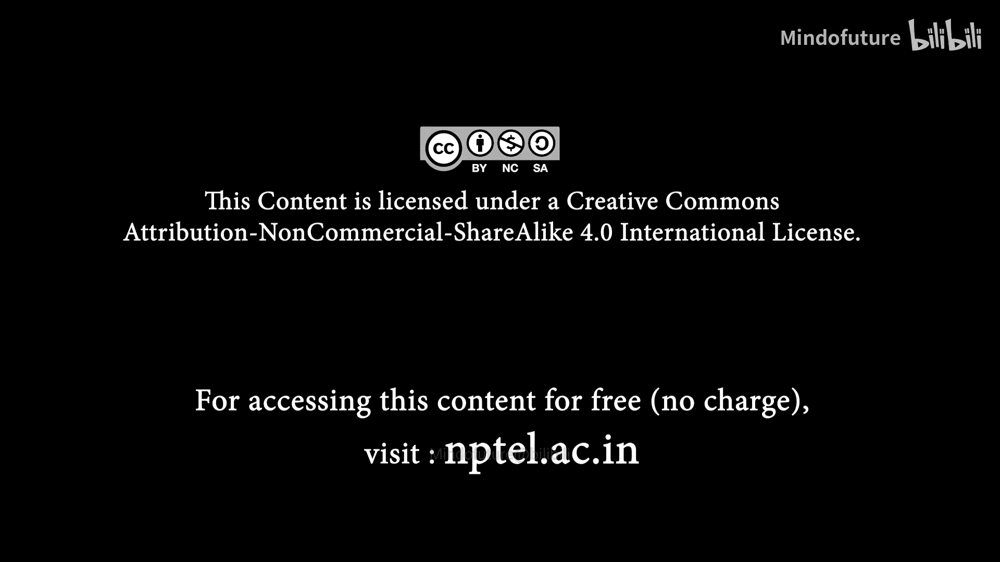
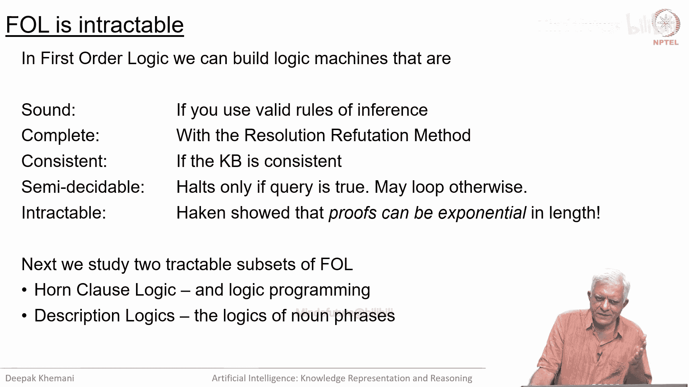

# 【印度理工学院】知识表示与推理 ｜ Knowledge Representation And Reasoning p42 P42_一致性与完备性 -BV1c4zNBmEyF_p42-

So welcome back， we wanted to talk a little bit about consistency。And。

auditics lay a great store in consistency， I mean， if a set of sentences is not consistent。Then。

You know， you can pretty much。Give up on that， essentially。So let's see why that is the case。

Luckily for us， we are convinced that the surgeonge story was consistent。

 So whatever we conclude from that can be。Believed。A knowledge basis is set to be inconsistent。

If you can derive alpha。And also not alpha at the same time。So。

 you are saying that alpha I have a proof of alpha and I have a proof of not alpha this can only happen if the knowledge base is inconsistent。

And the thing is that if you can derive a contradiction。😊。

That alpha is true and not alpha is also true。Then。You know。

 you can practically say anything and get away with it。

We can derive anything from an inconsistent knowledge base and let's see how that' is a very simple process。

Let us say that our knowledge base derives to the sentence P and not p。

So the knowledge base is unsatisfiable， essentially。And somewhere in that derivation。

 we could derive P and we could also derive not p。So if we are given this。

Then we can know that p is2 or we already knew that p true and not p is2。

 but if you are just given p and not p you can use the rule of simplification to say p2 and not p2。

And then。You can use the rule of addition。By saying not p or Q is true， what is Q？

It's some random formula that you can add and logically it would be true as well。

Because if you remember the semantics of the or statement。

All Sa says that either not p must be true or Q must be true。

Not sorry not either one of at least one of not p or Q must be true。

And since not pay is through then this whole set will not p or Q is through。

But if not P or Q is true。And if p is true， so that is where the contradiction comes into clay。

You can infer Q using thisstructum syism or you could have converted this into implication and use mod componentsence。

 but you can prove Q。So， they say that you can derive anything from an inconsistent set of sentences or from an inconsistent knowledge base。

 and therefore we must be very careful that our knowledge base。Consistent。So， let's talk about。

This landmarker。Evenvent in。Logic。In 1931， the German logician， philosopher， mathematician。

 whatever K Godel published his incompleteness theorem。So it call Godels incompness s。Which。

Thatash the hopes of formalizing all mathematical knowledge in one formal system So after that point。

People were。Saing。That how can we formalize all mathematics and put it into one large axiomatic system and so on？

And what？Godll came and。Inflected a big blow on the community and said that this cannot be done you cannot have one large formal system in which you can derive all true statements of mathematics。

We will not have time to go into the intricacies of。What is？

Incompness serum because first of all it does not apply to first neuro logic and we are interested in first neuro logic because most of the stuff that we are doing is in first neuro logic。

 it applies to systems which are more expressive or more powerful than first neuro logic。

But it says that you cannot。Formalize everything into one large exxiometric system。So。

 I am just quoting I will give you the site in a moment。

 this theorem established that it is impossible to use the axiomatic method to construct a formal system for any branch of mathematics containing arithmetic that will un all its tools；

 what does it mean？That you cannot build an axiomatictic system and axitic system is a proof system。

Which will not entail all its truth， which means that it will not be complete。In other words。

 no finite set of axioms can be devised that will produce all possible through mathematical statements。

 so no mechanical or computer like approach will ever be able to exhaust the depths of mathematics。

In those days， when Godel was proving these computers were just on the。Haiison。

There is a second incompleteness theorem that shows that a formal system containing arithmetic cannot prove its own consistency。

😊，So， what Godel was essentially saying。😊，That you cannot have。For awful enough systems。By systems。

 we mean axiometric systems or logic systems。Which are both complete and consistent， essentially。So。

 the keyword is powerful enough， it doesn not apply to first neuro logic。

It doesn not apply to proportional logic in both of them we can construct systems which are consistent and complete essentially complete in the sense that whatever is true can be。

Deraved， essentially。But what Godel said that for powerful enough systems you cannot do that essentially for more expensive systems。

 we will get a feel of that though we won't go into the formal stuff here。

You can look at this Britannica site from which I got this particular quote and here' is another quote I got from another site。

And you can go and look at that site also if you are more interested in good in completeness serumem so as I said they were two serumems。

 the first serumorem says。Any consistent formal system F。

Within which a certain amount of elementary arithmetic can be carried out is incomplete。

There are statements of the language of F which can neither be proved nor disprod in f。So。

 when you say that they can neither be proved nor they can be disproved。

It is not the case that you take the neg of the statement and you would be able to prove it also。

Neither is possible。です。Incompleteness。Most the result of self reference。

 God showed that any powerful enough aximatic system that existed。

ThereThere exist statements that were undecidable。And what are these statements。

 these statements had to do with self reference essentially and Godel gave a procedure of Godal numbering and he showed how you can construct a sentence like that that you give us any any powerful enough axiomatic system and Godel will show you how to construct the sentence。

😊，Whi is undeceable for which you cannot either show that it is true or it is false。

These sentences have to do with cell preference， that is why they are powerful enough you know in less expressive languages。

😊，You cannot talk about self preferences。I keep talking about Hofstov and his book。

 so his book God Lester Bach is an insightful journey into self reference as the title suggests。

It talks about mathematics and that is why Godal。Is there in the title？It is talk about art。

 so there was this artist Es。who did this engravings and his engravings had this property of self preference essentially so he had this figure so just look up as and you will get to see some of this nice。

In paintings， you have things like a never ending staircase。 It looks like your it's a loop。

 but it's also a staircase which is going up and up and up essentially So in some sense the staircase comes back to itself or there is this never ending waterfall。

 The water is falling and then going back and coming back and falling again。 Of course these are。

Kind of deceptive paintings in the sense that they cannot exist in the real world but。

Echer kind of did a lot of this self differential kind of work。And according to offsetfetter。

Back also。Had a lot of self reference in his。Musical compositions。

That there were things that talked about themselves kind of recursively and things like that。

We do not have。Too much time。 to。Go into this， but I would encourage you to look at Guba it is not a small book to read。

 but it is worth your effort。😊，His more recent book。

 which I had mentioned sometime earlier called I am a strange loop goes into this self reference。

In a little bit。More compact fashion。And that I a strange loop refers to this self preference。

And the eye in that refers to this notion of the self that we have， that I am a person， I am talking。

 I you are listening to me and that kind of stuff。Btrand Russell also had Btrand Russell was another the people who was you know involved in formalizing all of mathematics he wrote the inci Mathematica。

And so on。 But he also recognized that there were certain things that would。Lead to contradictions。

 so he has this paradox which shows that every set theory that contains an unrestricted comprehension principle can a set be a member of itself。

 for example。You know， these kind of statements are difficult too。

Deal with essentially they lead to contradictions essentially so I had mentioned some time ago that I am lying is not a sentence because you cant give a truth value to this if you say it is true。

That means you are lying， that means what you are saying is that I am lying that must falses。And。

 you know， the that kind of stuff。Also associated with Russell is the barber's paradox。

 though he himself said that somebody else said。Shown it to him。But you can see it is derived from。

Russells paradox and we often associate it with Russell。What is the bar products it says。

That if the barber is a person who shaves everyone who does not shave themselves。

Then does the Bible shave himself。So you can see this。This subtle cell reference here。So。

 if he is shaving himself， then he cannot shave himself because by definition of a barber。

 it is a person who shaves people who do not shave themselves。So if he is shaving himself。

 then he cannot shave himself， but if he doesn't shave himself。

 then he could have shaved himself because no he' is not shaving himself。 So it's a very。

It's a very interesting kind of paradox that you should kind of。

Wonander over it for a little wineine。So I would like to give you some intuition。

On how this self reference can。Cause a problem in formalal systems。

Imagine that there is a machine which derives all true statements of course that is the goal that we have remember we want to construct a logical machine which is sound and which is complete when you say complete we mean it derives all true statements。

The example that I am about to give you。Was was given by themenmion。

Whose books are another said that I would very strongly recommend that you go and look at the book。

One of the books I have already given a reference and a link to called logical labrinths。

 but he wrote many other interesting books essentially which were to do with logical puzzles and stuff like that。

So in the example thatmian gives。He used the word printed essentially so he says imagine a machine which prints every true statement essentially it is like saying derive every true statement。

 so we will use the word derive though in his example he used the word printed perhaps because he wanted to be careful not to go into。

Mix up things with the more formal meanings of derivation and so on。So， in his world。

 there was a machine that printed all through statements， we will use the term derive。

So here is something。That he started with。He defined。The conjuggate of a sentence。

And he denoted it by。C Alpha C stands for conjugate。So。

 a conjugate of a sentence is basically a sentence of the kind alpha hyphen alpha essentially。

So that he called is the conjuggate sentence。Then。He derived the following formulas。D alpha。

It means it says。That alpha will be eventually derived。If this sentence is true。

 so if d alpha is true， then alpha will be eventually derived essentially。

So you can see that it's talking about sentences in in first a logic。

 we don't talk about sentences in first a logic。We talk about terms which are you know。

 elements in some domain， which map to elements in the domain， but。Here。

Smalian is talking about a language in which you are talking about sentences。

 so it is definitely a more expressive or a higher orderal language。So， D alpha。

Says that alpha will eventually be derived so if d alpha is true then it will be derived so it is like a complete system and that is what we are trying to say。

😊，T he says n alpha。It says that if n alpha is true， then alpha can never be derived。

It cannot be derived。So in some sense， you can see that it is talking about which sentences can be derived。

 which sentences cannot be derived。Then he says。Deivivable or printable as you said on the conjuggate of alpha is that alpha hyphen alpha。

 which is a conjugate of alpha will eventually be derived if this sentence is true。D Z alphaco。So。

 if DC alpha is  true， then at some point alpha hyphen alpha will be derived or printed。

 that is what Sulian said maybe printed is a better analogy too。听过飞。And finally。If you say N alpha。

 it means that。If NL is  true。Then， alpha。Alpha cannot be derived。At all， essentially。

So given these sentences， if you accept that this is your formal system。

 it tells you which sentences will be printed， which sentence will not be printed so you look at a sentence and if it' is true then you know it will be printed if d alpha is true then you know it will be printed if n alpha is no then you know that it will not be printed likewise for the conjuggate of sentences essentially so if alpha if DC alpha is that then you know that alpha or hyphen alpha will be printed at some point if N alpha is true then you know that alpha hyphen alpha will never be printed。

So， what we are going to say now is a kind of insight into the kind of stuff that Godel was talking about is so you know there are certain things that you can produce in a formal system。

Which can kind of leave you stumped。So， here is a question what happens to the N alphapha？

So remember NCL5。That alpha hyphen alpha will never be printed。When。Alpha is N。After all。

 it's just a set of characters， I think。Now， you should think about this a little bit。

 you can see that if you are saying N alpha。And when alpha is。And see。We。And see。

Alpha says that the conjugate of alpha will never be printed。

NC NC says that one cannot derive the conjugate of NC。Okay， so yes， we have substituted。

N for alpha N alpha says the conjugate of its argument can never be printed。But if we say。NC N。

 then we are saying the conjuggate of N cannot be printed。What is the conjugator n。

 the conjugator N is N and itself。So you see what's happening here。If NCnc is true。

It is saying that it can never be printed。That means。

It is not complete and this system is not complete that heres a crew statement。

But it cannot be printed because the statement itself is saying that it cannot be printed or derived essentially。

So， this is just to give you a flavor of you know， this kind of strange loops that Hafsada talks about and Lael talks about and。

Smalian talks about which was originally spoken about by Kurt Good when he gave his incompleteness。

Theorem， it put an end to this whole map。Big exercise of trying to formalize everything in mathematics。

Okay。So， we have talked about proportional logic， we are talking about first logics。

 we look at a couple of more logics in this course as we go along。

Here is a kind of a glimpse as to what else exists。

Second order logics allow us to quantify over predicates essentially。

In first a logics we could quantify our variables we could say for all eggs for all way and things like that in second order logic you can quantify about preicates that for all prediiccate symbols or something like that。

And one。Interesting sentence which has to be classified as second order logic is the principle of mathematical induction。

 the first principle of mathematical induction。What it says we remember is that。

If the piccate is true for some base clause says let's say0 or something if you are talking about natural numbers。

And if you can show。That P of x implies p of successor of x。Then between these two things。

 it is enough to show that for all XBx is true essentially。

This is the principle of mathematical induction。😊，The only thing we are saying here is for all P any。

 if you can show this for any。Peddicate。If you can show that the base is true。

And the induction clause is true， which means that P ofx in place。P of successor of。

Then for all X PX is true。 And you can see that this uses。In some sense， a higher audio logic。

 we are saying for every predicate this is true。There are other logics which are more express than per sort logics。

 so there are model logics sentences have a modality。😊。

And the modality is at of either necessity or possibility so there are two modalities in modelal logic one is that is box alpha which is drawn with a box before alpha。

And it says that the sentence is necessarily true are definitely true。

The other is diamond alpha which is known which is represented by drawing a diamond before alpha。

 so here is diamond alpha and here is box alpha diamond alpha says the sentence is possibly true。

Truth values are still。To valued either you are true or you are not true the sentence。

What this says is that that the sentence may be true or the sentence。

We are not like definite that it's true， essentially。

Then there are these epistemic logics and do doxistic logics， which are useful。

 especially when you talk about multi agent systems。And it has it uses two modalities。

 one is called the knowledge modality， one is called the belief modality。The knowledge mod says。

That K alpha stands for Age A。Nose alpha。The belief modalality says agent a believes alpha so there is a difference between knowledge and belief and from the logic perspective knowledge can only be about true facts that if you know something that it must be true belief can be about facts which are not true so。

 for example I believe that the earth is flat。嗯。That doesnt mean that the earth is flat。

 but if I know some formula alpha。Then that formula better be true in my domain and so there is a subtle difference between these two。

Moralities。Temporlar logics are also logics which talk about modalities and they say this alpha is true at certain time essentially t essentially。

Event calculus。Is a higher order logic which talks about time action and change essentially we will look at event calculus a little bit。

Later in this course。呃。And we will also look at epistemic logics a little bit later in this course。

But let's come get back to。FOL。Which is， as I have been saying， is going to be the main。

Part of our course。In first a logic。We can build logic machines。That are sound。

Provided you use valid rules of inference， and we have seen how to。Deefine valid rules of inference。

They are complete。And we have not proved that the resolution refition method is complete。😊。

But we have accepted the proof。That it is complete essentially。The proof given by Robinson。

In the 1863。So in first a logic， you can build complete systems。

You can build consistent systems as long as the knowledge base is consistent。

 whatever you derive from that will be consistent and you will never be able to derive alpha and not alpha at the same time。

Of course we are not given a proof of that。But we。cannot put too much into one course。

As we will see first our logic is semi decidecidable what do we mean by that？

We said professional logic is decable at some point。Theel means that。You give a knowledge base。

 you give a query。And the algorithm will terminate saying yes or no。

When we say semi is addible and that happens to be the case of partial logic and we will see examples when we try to look at it from the logic programming perspective is that。

The theorem proveover of the algorithm， which is proving theorems will halt。If the query is true。

 so in that sense， it is complete。But if the query that you are asking is not true。Then。

It may never halt and may go into an infinite loop。That's a property of of first logic。

 and it should not be surprising to you， because you can always write programs that go into infinite loops and programs are。

 as we will see， nothing but。Sentences in in personal logic。They do not always look like that。But。

Anything that you can do in。Procedural language， you can also do in logic。

 and we will see this as we go along。What is bold important is？The first of logic is intractable。

That even when we can find proof， so we say that it is semiceible that if there is a proof it will find it。

 but there are situations because a lot language is rich enough。

Is that sometimes proofs themselves can be exponential in length。

So just imagine that if the prove is exponential in length。Then the proof finding process。

 which is searching for that proof。It will be doubly exponential。So。

 sometime in this course a little bit later， we will look at two tractable subsets of first a logic。

And the first one will be hard close logic， which is what we will study next。

Followed by showing that horn Close logic leads logic programming。

 which leads to a language called like prologue。Which is an implementation of logic programming。

And it works well for a subset of clauses called horn clauses， which you will see pretty soon。

Another subset that we will look at is description logics or the logics of noun phrase essentially。

These description logics have become very popular nowadays because of the fact。

That they deal with they are used to build ontologies and ontologies are basically you know。

 collections of noun phrases which talk about。嗯。Categories and subcategories and things like that。So。

 when you say all manner model in some sense we are talking about noun phrases that you know。

 the set of men is a subset of the set of。Martin。Features。

 but ontologies allow you to talk about more more。Well defined categories。

 which are described in this language is called description logics and they have very efficient rules of。

cheing。Whether one category is a subset of another category。

 so we will spend some time looking at description logics and ontologies later essentially。

So we will end with this FL here and then we will come back to。A subset of F， and。

Also kind of draw attention to the fact that what you do in logic is equivalent to what you can do in computing。

So， that's all for no。Well see you soon。