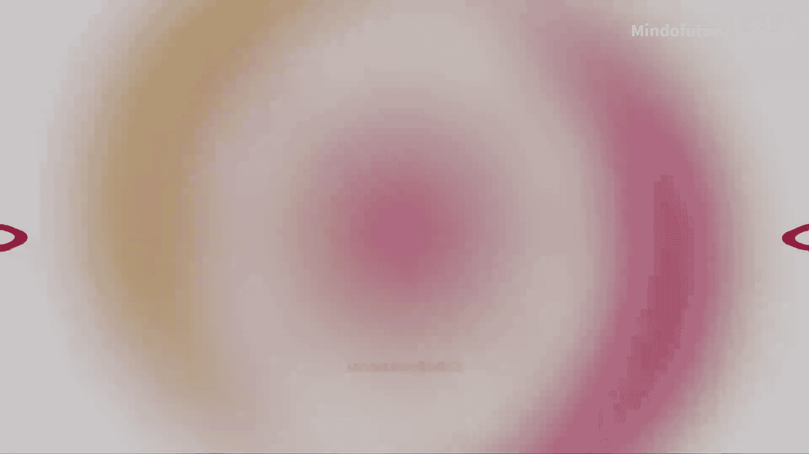
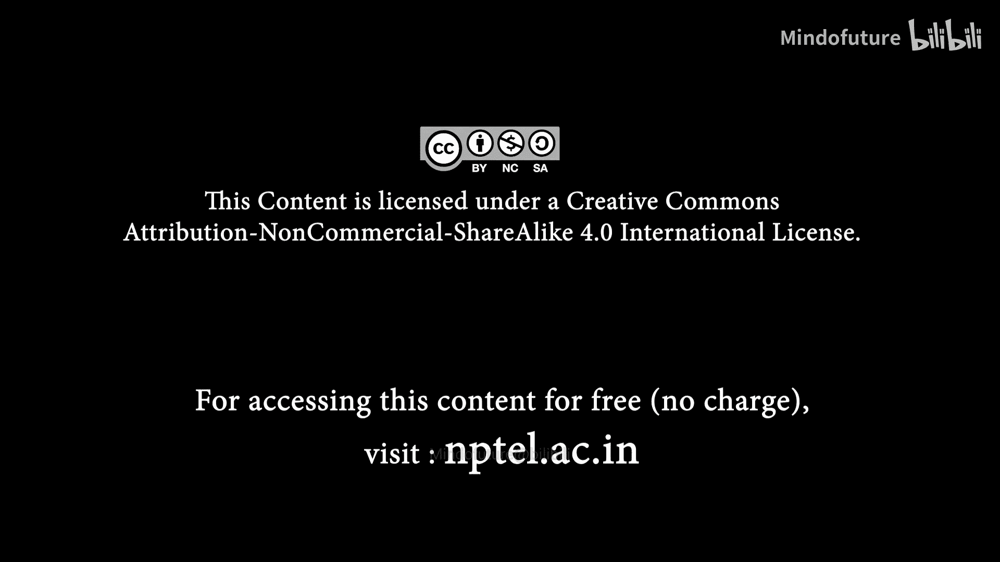
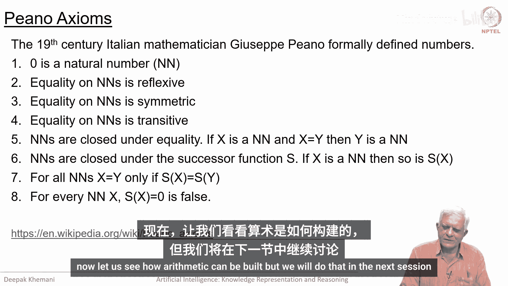

# 【印度理工学院】知识表示与推理 ｜ Knowledge Representation And Reasoning p43 P43_逻辑编程 -BV1c4zNBmEyF_p43-

So welcome back， we have just finished looking at the resolution application method。

And we have seen that that' is an example of a sound and complete method for reasoning in first a logic。

Today we want to spend a little bit of time on this topic called logic programming。

And essentially we want to see and demonstrate。That logical reasoning can be a substitute for computation in general。

And that is a very powerful idea。It says that anything that you can do。In。

Other programming languages you can do in logic。And we will also put forward the idea that logic can be a programming language。

And that area which uses logic as a programming language。It's called logicgic programming。So。

 we give the credit。The logic programming， to a large extent， to。Robert Kolesski。嗯。

Who was at Imperial College of London for a while。For put putting forward this idea that logic can be used as a programming。

Language， essentially。That logic can be used for everyday computing。So， quoting him。He says。

The driving force behind logic programming is the idea that a single formalism suffices for both logic and computation。

And that logic subsumes competition， which means that whatever。

Other means you can use for computation， you can do that in logic itself。No。

It is not just another programming language， it also puts forward an idea which is central to logic programming。

And the idea is that the programmer should only focus on the logical relation between the input and output。

And that a machine。By that， we mean a computer program。Which we often call as an inference engine。

Should figure out the the control of flow essentially。So。

 when you write programs in languages like C essentially and other imperative languages。

 what you do is that you give a sequence of。Statements。

That many of most of them are assignment statements。

 some of them are control statements which check for conditions and do some branching。And you know。

 you have loops and things like that。 So all those are mechanisms for。

Controlling the flow of computation essentially， so typically you would say。Do statement1。

 then do statement2， then do statement 3 and these may be assignment statements but once in a while you might say if this value is less than some other value。

Then do the following or know things like that essentially， so its up to the。

Programr to make sure that things are done in the correct。Coectctor。嗯。Order， essentially。

And what Korsski said was。😊，That the programmer should be。

More worried about the relation between the input and the output and how whether the relation is true or not。

Should be left to a program。that program could typically be a theorem prover。

And we have also seen when we looked at backward chainning that。You can ask existential queries。

And you can dig out the answer from the。Substitution function that is used to prove that query。So。

 we will take that idea forward and work with this notion of logic programming。

So Kalski said that a program is basically the logic。😊，And control。

 he says leave the logic part to the user。or the programmer but very often the users are not programmers。

 very often the users may be managers in some organization who have certain as they call it business logic which they want to implement and they are not to be bothered with writing code which is saying that you know do this first do this next and so on they just want to state。

The relation between the input and the output and。The flow of control is left to。The machine。

In the form of an inference engine。So， the programmer of the user focuses only on logic and this idea of programming is called declarative programming that you just state the relation between。

Input and output and let somebody other compute that relation for a specific instance of a problem。

And this has been the basis of logic programming languages like Polo。It's also been the basis of。

The field of。Rule based expert systems which I had mentioned earlier and we will look at them in more detail later。

We are all in which。Also， the knowledge that the user puts in is in the form of rules essentially。

The rules are just a way of。Categizing certain kinds of statements essentially。So。

 we will look at both these things first we will look at logic programming as is done in Prolo。😊。

And then we will look at rule based export systems， which is used basically forward chain。So。

 we will see that prologue essentially does backward chainning。嗯。

And we will see that backward training is an instance。A special case。Of resolution methods。

 essentially。So， let's。Start that。I said a little while ago that you can dig out the answer from the substitution that is used during the。

Resolution processes essentially so you can figure out that that is the value of a variable we saw examples of that and you said is there somebody who is mortal and then you know the system could do backward training and tell us that yes Socrates is mortal or Plato is mortal or whoever is in the domain who is a man is mortal。

We can also make use of something called an answer predicate to make this process of digging out the answer。

Explicit， so we let us look at the same example about men being mortal。So。

 we have three clauses here， C1 says all men are modelal or which if you remember was all x man implies mortal x which in clause form is that is not of modelal x or mortal x which is where x is a universally quantified variable marked by the fact that we use the question mark there essentially。

Then the second clause was the fact given to us that man Socrates。

And the third clause is a negation of the goal because when you do resolution reputation method。

 you negate the goal， add it to the set of clauses and show that you know it leads to a contradiction。

Which is a nu clause of the empty close Now， what we do is we add another。Another。

Atomic formula to that and the atomic formula is this answer predicate and it says that whatever is that z that you find。

 whatever is the substitution for Z that you find that is the answer that you are looking for essentially。

So， the。Resolution proceeds in the same fashion first we generate mortal Socrates from c1 and c2 which is basically the first mod opponent step that we normally do。

But in the second step， instead of deriving the null flows。😊。

We derive a clause in which there is only the answer predicate and we know that that answer predicate is just。

A convenient mechanism for us to retrieve the answer so that is a point where you can terminate so we will change the termination criteria a little bit and say that terminate when you have a clause in which there is only the answer predicate in this example the answer predicates Socrates is the answer and that means the person that you are talking about whose man and whose mortal is Socrates so value of Z is Socrates and that is what is conveyed to us essentially。

Interestingly， the answer perdicate can also work in areas where you are not sure of what the answer is essentially。

So for example， if in the same example if is instead with the fact that we start with says。

That one of Socrates or man is one of Socrates or Plato is mortal essentially we write this as a logical or which is an inclusive or。

 so by now you are got used to this idea that that statement is true either if Socrates is mortal or if Plato is mortal or if both are mortal。

What will our system do with the answer predicate here， So this is how。I will。

Resolution will proceed。The first two steps are the same， the same R and our to produce， except that。

Man mortal Socrates has been produce has been produced in the first step。

 but it has also produced the fact that。Man。Plato man Plato。

 So earlier we only had mortal men men Socrates， and that gave us the conclusion Mortal Socrates。

 But now we have this man Plato tagged on with that。 And so that also you know。

carriesries forward with that essentially and then instead of deriving the nu clause we derive the answer clause like we did in the last slide but we still have that man plateto hanging around there so again we resolve this with the clause even。

And we get the answer Socrates which is you know carrying forward with everything that we are doing and now we have concluded that Plato is mortal。

And that Plato S model is。No。Cancellled with the query。

 which is that is there somebody model so that that gets nullified， but we are left with the answer。

Perdicate having a dysfunction。That is。That either Socrates is。

Mortal or Plato is mortal and you can see that given this knowledge base that is all that you can entail you cannot say anything specific that Socrates is mortal or Plato is mortal because it is possible that one of them is not mortal。

We should be possible if one of them is not a man or other fact that man Plato for example。

 if it was false that if it was true that God plateto or something and man Plato was false then of course also we will continue conclude this。

 but we will not be able to say whether Socrates is。Motal or laterto is model。So。

 it cannot say definitelyly who is modelt， but it says at least one of the two is model because you have said that one of the two is at least a man essentially now lets get a little bit into representation we have said that。

In first a logic。You work with a domain and then you have a mapping from。

Language that you define to the domain， so that was the interpretation that we talked about。

But then what is there in the domain that can be called a number？Now。

 that is a question which has puzzled many people。Over a long period of time。So。

 we' will start with a story of Warren McKough who was。

Earned his fame in the world of neural networks。But he talks about the time when he was going into college and this is from a lecture that he gave in 1960。

Which goes as follows。That he says in the fall of 1917 I entered Have For College with two strings to my bow that means basically。

He had two goals that he wanted to achieve One was to learn Latin and the other was。

To learn mathematics， to build a strong foundation in mathematics。He says he honored in the letter。

 which mean that was his honors degree and was seduced by it that he fell in love with mathematics as many people have。

Over were the years。He says。That winter Rufus Jones called me and said Warrenren。

What is it what is what is the going to be you know that is what you know kids ask kids are asked by parents and uncles and aunts。

 what are you going to be when you grow？And like many kids。He says， I don't know。He said， he said。

 I don't know。Then Rufus Jones asked him and what is it he going to do？And again I said。

 I have no idea， but there is one question I would like to answer。And the question is。

What is the number？That a man may know it。And a man that he may know a number。

So he's already asking this question that we。Are trying to address。

To which Rufuers jo smiled and said when the will be busy as long as the leaves essentially。

So I will leave that for you to judge as to we know how easy it is to get to the foundations of mathematics and。

Look at the number from the mathematical point of view。Of course， we all have vague ideas of numbers。

 So when you say that。I had two those cells。 then it's clear to me what do you mean by that that you had。

One doa first， and then you had another doa after that。That is a kind of an informal definition。

 but logically what is the number is the question that we are trying to。😊。

Answer and we will see as we go along as we move more towards representation。

 we will see that the domain may be one thing， but the way that we think about the domain or domain that we represent the domain may be another thing。

 so there are certain abstract concepts that we will add to the domain。😊，嗯。

whichch will help us to think about the domain and the notion of as we will see the notion of man itself is an abstract concept because in the domain of course we think of a person as a single entity but you know that single entity is made up of hundreds and thousands of millions of atoms。

😊，Well come to that later。 So if you want to read more about this his his his talk。

 you can go to this website。Let's focus on numbers a little bit。

So they have certainly something to do with sizes of sets of things， essentially I have five apples。

 you have six oranges and that kind of stuff so this something to do with how many you have essentially it is something to do with counting。

Andcount。We can compare two sets by using one to one mapping between the two sets。

 so let's say you have some apples and I have some oranges and we want to find out who has more essentially so what we can do in this one to one correspondence is that you pick one apple and I will pick one orange and keep it out then we will repeat this process。

If both our baskets or sets get empty at the same time then we had the same number So you had some let's say n apples and I had n oranges but if one of us finishes earlier that means we had lesser number of the objects so that kind of captures the notion of。

嗯。The fact that we are we are talking about sizes of set so there are things like or T and orality which mathematicians talk about so numbers the set of numbers is an ordinal set you know that there is the first number the second number the third number and so on。

 and that is what we are trying to define here。How do we express the size of a set so that we can associate a common property when two sets are the same we know that we will say okay you have six apples and I have six oranges so there is this single number which we are trying to lets say invent of course it has been done so long time ago。

And express the differences sign in some quantitative fashion so if I say you have six apples and I have three oranges then I can say that you have three fruits more than I have and you know so arithmetic how do we do arithmetic is the question that also we would want to address。

So， the cardinality of a set， the size of a set is a number and when we compare two sets of the same size we associate a common property with them and that property is also the number essentially。

So， this is we are slowly getting to this idea number。Both Fge and Russell。

Each proposed defining a natural number n。As the collection of all sets with n element。

 so it is a very abstract notion you should think about this and ponder a little over this as what is it that they are saying。

😊，They are saying， for example。You take the number 7。

It corresponds to all the sets which have the same number of elements essentially so this mapping is very important between the different sets essentially that somehow if you take all the sets and all of them you pick one at a time and all of them empty at the same time then they have the same number essentially so this is some way of trying to define what the number is。

We will see that our definition would be。😊，Not very far from here。In fact。

 our definition would correspond to phone no。Nottion of standard set of alls and we will try to define this standard set。

And that is what we will call as numbers。Obviously， I have to start with 0。嗯。Well。

 not obviously but it makes sense to start with0 because much before0 was thought of as a number of people would only start counting from one essentially they didn't have a notion of a number which says that I don't have anything。

And it， it took quite some time for people to get to the idea of。0。

 and it is often attributed to Indian thought that the first known documented use of 0 dates back to 8628 which appeared in this book called Brahma Subbutha Sidhanur。

 the main work of the Indian mathematician Brahma Gupta。

Bma Gpta's book is the first book in that that mentions zero as a number。Hence。

 Burmaappta is usually considered to be the first to formulate the concept of 0。

The use of0 as a number should not be distinguished should be distinguished from its use as a place hold a numeral in place of value value systems so people had new people knew that there is something which corresponds to 0 and typically。

When。You are maintaining accounts or balances then you know， when when the two sides become equal。

 then what is the difference， the difference is something。Which is neither one nor2 nor3 or4。

And that is something they used to use a placeholder which looked like zero。

 so many ancient texts use0。Babylonian and Egyptian tests use use it。

 Egyptians use the word Nphra or NR to denote0 balance in a double entry accounting so one side this one side this and the balance between them is if if they are equal in size then they use this symbol to say they are equal in size they did not think of0 as a number essentially I mean they would think of one and two or three or4 is a number but not0 essentially。

The notion of counting is is， is， is is。Is nothing to be scoffed at essentially。

 I can point you to a book called。1，2， three， infinity。喂。An author called George Gemo。

It is a book on physics。Founds of mathematics and physics it is an interesting book and he starts off with this tale about this tribe。

😊，Who had only three。Things for numbers so one or two or three and then something beyond three large or infinity or something like this。

So， numbers people have have to have had to work to work towards the notion of numbers。

Indian text used the Sankri word should now to refer to the concept of void essentially but in mathematics text this word often refers to the number0 nowadays。

So you can read all this stuff from this Wikipedia page that I have given you a link to。

Now let's define this。Natural numbers as a set。Now， even said that it is a set of ornal numbers。

 this definition is。Attributed to Zelullo and Frankel。So。

 it is known as the Zf set theory the national numbers are defined recursively by letting 0 to be the first number which stands for the empty set。

And the number n plus 1。Or the successor of n。S n union the set containing n for each n。In this way。

 every number。What the set and。The cardinality of set was what that number stood for。So。

 this definition has a property that n is set with n elements。

And you can see that the first few sets numbers of the set， the first number is0。

 it stands for the empty set。 we also use the symbol 5 for the empty set。

The second number is the set containing0。So you can see its a set containing phi。

The second number or the third number which is 2 is a set containing all its predecessors。

 which is0 and1。Which as you can see is phi stands for0 and the set containing phi stands for 1。

 so this is a set which represents 2。In a similar fashion。

 the set 3 is a union of all its three predecessors and you can see that you have0 here。

 one here and2 here， so it is a union of these three sets。The important thing is。

That the number that we are using。As a name for this set。Is also。

Stand for the cardinality of the set for the number of elements in the set so when we say the set is called 3。

What we mean is that it has three elements or the number of elements that it has is is the name 3 we are giving to that。

 So we must kind of think about this a bit and。Number  four is similar。

 it has four subsets which stand for the number 0，1，2 and 3。So。

 the set n of natural numbers is defined as in this system as a smallest set containing0 and close under the successor function What is the successor function the successor function is。

As we have written here， n plus 1 is equal to n union the set n。Okay， we have defined it here also。

The structure of this is a model of。Piano axioms。 So remember we had talked about models models say that something in the domain which makes the axiom true essentially。

 so this structure。Of infinite set of sets。Of increasing size is a model for piano exams and very often we say that logically piano exs are what defined。

Numbers。So let's quickly look at that。Given in the by the 19th century mathematician piano。

He defined。Numbers formally as follows， he said0 is a natural number。So。

 we will use the short form N n for natural numbers。He also。

Stated these as axioms that when you use equality on natural numbers it is reflexive essentially。😊。

So， we studied these properties when we are talking about equality that equality the as a pdicate has to be reflective so what he is saying is that it was reflexive for national numbers in fact we generalized from there and said that equality is reflexive for。

😊，Whatever you are comparing。Equality of natural numbers is also symmetric we have seen that。

Equality is transitive； we have also seen that。And then he says national numbers are close under equality。

 which means if x is a national number。And it' is true that x equal to y。

Then y must be a natural number。So a natural number can only be equal to another natural number。

They close another successor function as if x。Is a natural number。Then so is the successors。

For all natural numbers。X equal to y。Only if their successes are also equal。

X S of x is equal do S of y。And also the fact that for every natural number， the successor of x。

I 0 is a false statement， which means0 is not the successor of any natural number。

But it is a number which is which in some sense builds up the set essentially。

Of course subsequently we have invented other kinds of numbers， so we have invented integer numbers。

 you know integers， then we have fractions， then we have real。

Then we have complex so all kinds of things， but we started with natural numbers and everything else is built upon then that essentially so the whole idea of numbers really builds upon。

Natural numbers。Okay， so I hope this has given you some fruit for thought。😊，About this question。

And to what is the number and how can we think of it as logically？

Having done that now let us see how arithmetic can be built， but we will do that in the next session。

