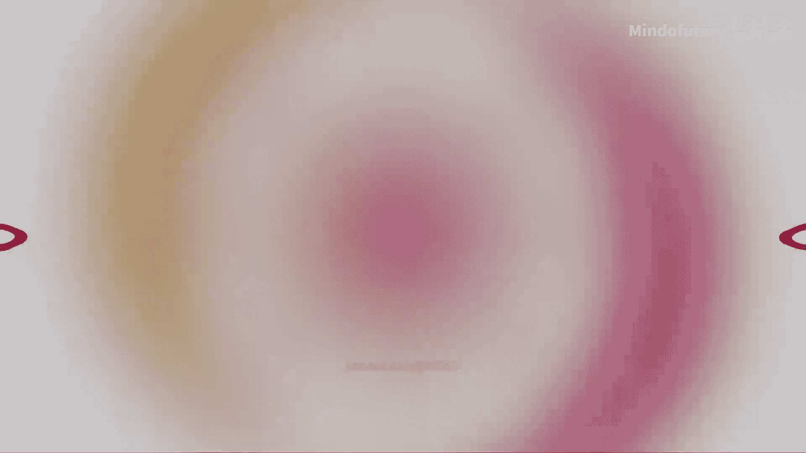
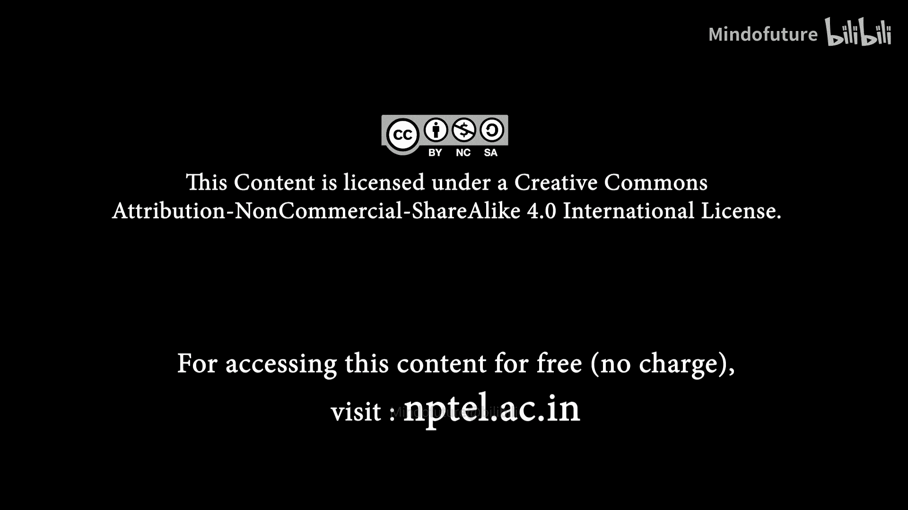
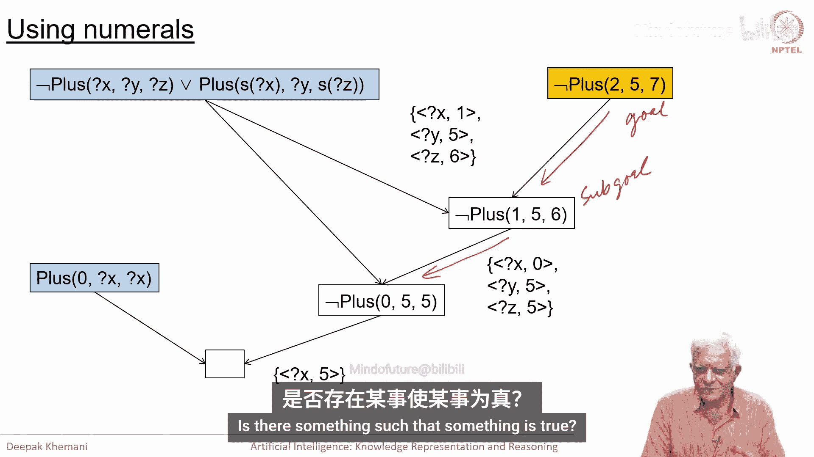

# 【印度理工学院】知识表示与推理 ｜ Knowledge Representation And Reasoning p44 P44_算术 -BV1c4zNBmEyF_p44-

So welcome back， we have started talking about numbers。And how we think of them in logic？

And we saw that we can think of the set of natural numbers。By defining。1 base number of 0。

And then defining a successor function which is the next number and the next number and the next number and so on。

 so once we define that we have the set of natural numbers so we are saying consider an infinite domain consists of one constant who we call0。

And1。Fangsn。Successor function of L 1。 What does it do， It takes any。Element from this domain。

And gives us another element from this domain， which is the next number。Essentially。

 so it does this for every number in the domain， so you start with 0， you get 1， you start with  one。

 you get。Du。And so on， exactly。which is of course the foundation of the first principle of mathematical induction I had not mentioned this when I was talking about pianos axioms but there were more than eight axioms in in the as given by piano and some of them had to do with the principle of first principle of induction which is built upon this set well ordered set which says that we start with the smallest element or the base element0 and then we have a successor function。

😊，It takes you to the next elements and so on。Now we want to talk about addition。

 okay so that is the most basic offer。Arimetic operations。

 So if you remember when we talked about machines made of Ireland。

 then bze Pascal made this machine called pascalline which could add two numbers。 you know。

 so thats one of the basic things we want to start with。And of course， like in all mathematics。

 when children they learn numbers， they start with addition。So let's also look at that。So。

 the elements of our domain is this infinite set。0， S of0， S of S of 0， S of S of S of 0， and so on。

So。You can no doubt astute observe that the number of hes。In every element is a count of that number。

 so 0 has no s so it is 0 s sub 0 has 1 s so it is 1 and so on。

So here we have a representation for numbers which is logical， essentially。

So the numbers are not just arbitrary names that we have given。

 we have now defined this set essentially the first element which is0 the next element。

 the next element， the next element that is very important。😊，We call this domain。

 the domain of natural numbers。The following first logic statement。Define addition of2 numbers。Okay。

 now if you are a strict logician， you would say that these statements。Are not true by themselves。嗯。

But they apply to this set of natural numbers。 So if you could。

Write a function if you could write a predicate which defined， let's say。N then of x。

How could you define N N of， you could define it by saying。0 is that nn of 0 is true。And if。And then。

Of x is true， then。And then。Oh。Succession of x。It's also true。So this is， of course for all X。

 If you are using the language of logic。 So this definition。

Would be a definition of natural numbers I could have added， I should have perhaps added it here。

And once we have the definition， then we can say this as follows。That the。And then。Oh。X。

Impse this and then I would move the quantifier outside。So。The first axiom。

Simply says that if you add0 to something。Then you get that something。

So I should have mentioned this also。That。The way to interpret this plus。And。M or， let's say。Is。That。

N plus m equal to R。So， this predicate of three arguments。

When you interpret it over the domain stands for this relation。

Where you have n n plus m equal to r essentially。So， you can。Imagine。You don't have to。

We of course don't implement numbers like that or we don not define addition like that。

 but this basically defines addition it says that r is the sum of n plus m so we could in principle。

Create a table。Which defines its relation essentially。 And how would we do that， we would say。0，0，0。

Belongs to。Let me use the term plus let's call this relation plus。And then。0，1。1 belongs to plus。

And so on and so forth and somewhere down the line you would have。2 or three and six and9。

Belongs to plus。So， addition is a relation on the domain。Of course。

 we don't explicitly define the relation instead we use this two pieces of。Logic code。

 if you want to call it or logic statements to define the。

Notion of addition the notion of addition is defined by this perdicate plus which says that the first two are the sums that you add and the third one is the result of adding those sums。

So， instead of writing that whole thing explicitly as a table which of course would never end because it would have infinite elements in it。

 we can do that succintly in just two lines or four lines if we count the definition of natural numbers。

😊，So， the first one says that if you add0 to anything then you will get that thing back essentially so in in some sense a lot of the table is described by that where the first element is0 the second element must be same as the third element essentially。

So， when you say this is true， we are saying this is a true statement。嗯。

Remember that when we talk about logic we talk about truth values essentially。

 so we are saying 0 plus x is x is true for all x。And then， we are saying。That。

If it is true that x plus y gives you Z。Then it must be true。

Then the successor of x plus y will give successor of Z。So， if it is true that 2 plus 2 is 4。

It will be true that 3 plus2 is 5。And these two。Lines of code or four lines of code。

 if you want to say。If your domain is only natural numbers， if your domain is only this set。

 then you don't really need this statement to say that it is a natural number。

 but if your domain is more complex and you have natural numbers than other things in the domain then you have to say that addition is defined over natural numbers in this fashion where if x is a natural number then these two axioms hold essentially。

So， you can see that。😊，You can think of this too。Statements as sentences in logic were sentences for all x0 plus x equal to x。

The second sentence is that for all x y z if x plus y is equal to z。

Then x plus 1 plus y will give you z plus 1 because the successor function is plus 1 in natural numbers we are written here little it here as s of x essentially。

So， remember that。This is0 plus。Wen。The plus 1 is a successor function。This is a。

0 plus 1 plus 1 and so on。So you can think of essay saying plus one decision。

This small knowledge base of two lines。 So just let us assume that everything is only in that。

only the domain contains consists only of natural numbers then these two lines define this whole business of addition。

Okay， find the define addition can we use them。😊，To add numbers。The answer is， yes。

So we will talk about that next。So what do we have？We started with this。Program。

Which defines addition。So， like Koalski said。We are defining a relation between x， y and z。

And our job is to only tell you what is the relation between x y and z？

And that is we are telling you about these two lines of code， which says that for all x。

0 plus x is0 x x is true， and for all x。For all x y z plus x y is z is 2。

 if plus sub successor of x y successor of z is 2， so we are telling you that。So like Walalski said。

 we have defined。😊，This notion of addition we have not said how to add the numbers and what logic programming says is that once you have defined this notion you can use this as a program and let us see how that happens。

So， since we are working with resolution， we will convert these into clause form and you can see that this is a clause form for this。

Two sentences。And we will look at two queries to understand how。

We can prove that these statements are true。So， what are the two statements we want to prove to be true the first statement we want to prove is that2 plus 5 is equal to 7。

If you were to use our standard notation， this is how you would write this is。2。

 because as you can see there are two instances of s here。This is5， as you can see。

 there are five instances of S here。And this is 7 because there are seven instances of s here。So。

 that is how we have defined this set， So we are essentially saying that the third number。

 if you add to the sixth number you will get the8 number。The third number is 2， right。

 The first number is 0。 Second number is one。 The third number is 2。

And we want to show that this is true， so we are sticking to logic now we are just talking about proof essentially you have given us a knowledge base。

そる。This is a Kb。And this is the alpha that we want to show to be true， we want to show that Kv。

Entail self， if you can do that。Then we know that this is true what is more interesting。

Is it what if we do not know the sum。So when you start learning to add， you don't always know the。

Some of simple elements。So我。The other one is the existing security that we are interested in it says。

😊，Is this statement true there exists in x such that plus 2，5 x is  true。And the meaning of that。Is。

Is there an x subject that 2 plus 5 is equal to x？So。

 if you can answer this query and also tell you that it is 7。

 that means we have a program to add numbers， right？So。Let's see how we prove these to。

Goals listing so as usual we navigate the queries and then we will use the resolution method。

So this is what we have what you see in this orange pink like color is the。规理。Show that。

2 plus 5 is equal to 7 or in other words we are ned and set。That 2 plus 5 is not equal to 7。And。

Our knowledge base entire knowledge base is this all of these two statements here。

 one statement talks about0， the other statement talks about the successor function。So there we are。

 you have to look at it a little bit carefully。😊，嗯。What are we doing here， We have a。

Remember that in the resolution method。If you have。Not be or Q。And in the other statement， you have。

Not of Q prime。Then， if you can match。Or unify。Q prime with Q， then you can infer P essentially。So。

 we want to unify this whole goal。With the。Consequent side of the。Implication statement。

 remember the implication statement is。For all x， y Z if plus x， y Z is true。

 then plus successor of x y successor of Z is true。 So the consequent we are mapping with the goal。

 So you can see this has a flavor of backward chain as well。

 you are taking the goal matching it with the consequent and inferring the。

Anticcedent as a sub goal and the antecedent is here。Exly。So。

 you should just carefully go over this substitution and see that it is indeed correct。😊，But it is。

At this moment， we will note。That we started out by saying that 2 plus something and now we have reduced it to 1 plus something。

So。We started over saying the show that 2 plus 5 is equal to 7 now we have reduced it to 1 plus。

5 is equal to 6。So this is one， as you can see。This is 5 and this is 6。So。

 we have gone from the goal to the sub goal so this form of resolution。

 this particular pattern of resolution is like backward training we saw that as an example when we were talking about the Socratic argument。

😊，That you can。That resolution subsumes both our chainning and backward chainning and in this pattern that we are constructing it is more like backward chainning。

So， we have got a sub goal that wisheses show that 1 plus。5 is 6。We again use the same goal。

 same rule。And now with a defense substitution here。And now we are saying that show that 0 plus 5。

Is equal to5。How do we show that we have another axiom in system which will allow us to show that and we have derived the nu clause。

So you can see。Then we suppose the query that is it true that 2 plus 5 is equal to 7？😊。

The theorem prover came back and said yes， it is true and it gave us a proof for that。

If I had written the numbers directly， then you can see that。

This is what we are doing essentially those those two clause remain the same。

 but we start with the goal of showing 2 plus 5 is equal to 7。

 reduce it to a goal of 1 plus 5 is equal to 6 so it is like backward chainning we are going from goal。

To sub gold。Of course we are using the resolution method。

 but it we are using that pattern in the resolution method which mimics the backward chain process。😊。

I am repeating this because prologue is essentially a backwards chain language and that is what we are going to do。

And again， we chain to another sub goal which shows that shows that 0 plus 5 is equal to  p。

And that gets resolved because it is directly there in the knowledge base。So。

 let's take a break here and。We will address the second query after。The break in the。Next video。

 the second query， if you remember is about an existential。guili。Is there something？

Such that something is true。

So we' will do that in the next one。