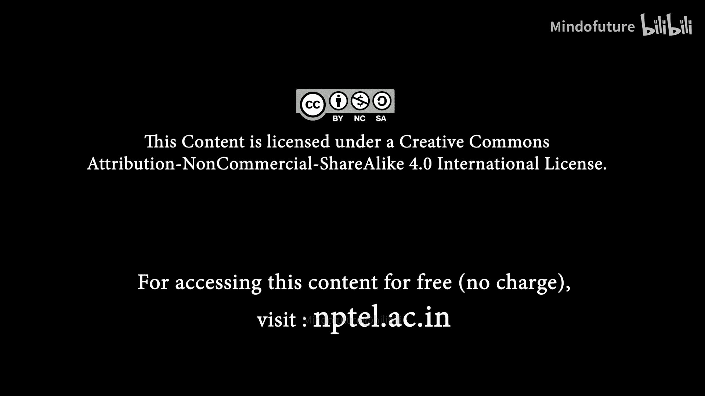
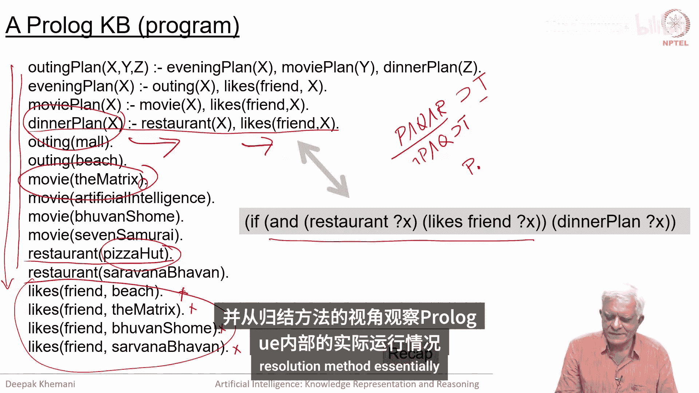

# 【印度理工学院】知识表示与推理 ｜ Knowledge Representation And Reasoning p45 P45_霍恩从句与Prolog -BV1c4zNBmEyF_p45-

So welcome back。We are looking at this very exciting idea。That youre improving in logic。

Can be used to do arithmetic。And of course， this idea that Koalski put forward was more general than that。

He said。That the improving can do computation that any computation that you are interested in doing arithmetic is just one kind of competition that you want to do。

So we saw in this。Last video。好。This is a proof of the fact。That 2 plus 5 is equal to 7。

 so we gave 2 plus 5 is equal to 7 or plus 25，7 as a goal。Connottrate into its。系。Ngated it。

 added it to the set of clauses and eventually。Derve the nu close。

 That's how the resolution repet works， essentially。Now let's answer the query。

Is there an x such that 2 plus 5 is equal to x？Okay。

 so the same thing that the program is still the same。And the only difference is。

The query has a variable。And remember。That variables inqueries are。Existentially quantified。

 essentially。The resolution happens in the same fashion。We start with that query which say that。

Is 2 plus 5 equal to some u？And we reduced it to a query which says is 1 plus 5 equal to some v essentially。

And what is this v。This V is。Such that u is the successor of v essentially so whatever v is you will be you will have to add one to that because u is the successor of v essentially。

And you should look at the unification algorithm and see that you can indeed get this。😊，Substitution。

Then we reduce it to another goal， another sub goal and this goal says that shows that0 plus 5 equal to w again what is this w this w is such that v is the successor of。

So， you can see that if you can get the value of w。

 then if you add1 to it you will get the value of v and if you add1 to this you will get the value of u essentially。

That query succeeds。 It succeeds with the。Fact。That both x and W now。They unify with this number。

 which is。发 you。Essentially。So， the blue man。We get the value of w is equal to 5。

And as a consequence， we get a value that u is equal to5 plus 1 plus 1 as we said here。

 if you are going to add 1 and1， then you will get the answer。So。

 it can answer existential queries essentially right you can instead of using some other code to add to numbers you can。

Jolly will proof。You can generally do addition using theory improving。

But it's obviously not advisable， essentially， just imagine。That if you wanted to add， let's say。

20000 with 11500。Then。Since you are recursing on the left hand side from 20。

000 you will you know have 20，000 steps of derivation。Just to find out the two numbers there。So。

 clearly we do not use logic programming for things like addition。But we。

Show that it is based on the foundations of mathematics essentially。And one of the。

One of the selling points of logic programming is that program correctness is something that we can do much more easily in logic programs than in imperative programs essentially and program correctness is a big big thing because you know if you are writing programs which are doing very important stuff。

Then you have it is very difficult to show that they are correct and。

Instead of showing that they are correct most most software companies， they would rely on testing。

 so they will test it in all kinds of input and then say that。

Okay it does not failed any tests so it must be correct， so there is a leap of faith there。

Whereas the selling point for logic programming is that you can show that it is correct but obviously you would not do things like addition and multiplication by domain name so just think of multiplication logically speaking multiplication would be repeated addition essentially。

So if you want to multiply 3 by5， then you multiply。Five times you。Multiply with three essentially。

F times you add3 to itself。Here is where the answer predcate that we had talked about comes in handy。

So， here。We。Start off by saying。That tell us what is the sum of 2 and 5。And。

Stall that in this answer preddicate essentially。So。

 after the first resolution step we already know that it is a successor of v。

 then we already know that it is a successor of successor of W and by the time we come。

We terminate the program we have the answer readily available in our answer predicate so you can see that this answer predicate can be a good mechanism for extracting the answer essentially because it will be available in that。

Dirly。Im jumping into this lecture a little bit I was in now。Lecture， which is in the future。

And I suddenly remembered that there was something I had forgotten to say and I had to do a bit of time travel to come back to this lecture so Ill quickly say that and then go back to my。

Other lecture。嗯。So， there is a point that we had mentioned sometime that。

First logic is semi decideable。I thought I'll come and give an example about that and it should help clarify things。

So， Robinson had said that the resolution method is refutation complete， so first logic is complete。

 it is both sound and complete。😊，This means that if。The knowledge base entails a sentence alpha。Then。

If you add negation of alpha to the knowledge base。Then it will。Yeah。

Lead to a contradiction which in terms of the resolution refation method。

We said that it would derive the null clause， which we also depicted using a square essentially。

So it is complete， which means that whenever there is a。Whenever the sentence is entailed。

 we will be able to find the proof for that。😊，嗯。Okay。

And what Robinson showed was that there is this new rule of inference called the resolution rule。

And if you use that in the proof by contradiction mode。

 which means you add the negation of the gold as we have done here。嗯。都。Okay。Okay。

To the knowledge base， then it will there will always be a proof。Which will end in the empty close。

The question we want to address is。About termination so thisalibility is to do with termination that given any problem will your program terminate or not。

Now， it has been shown that first circle logic is semi decidecidable。The question is， whether。

A theorem proving algorithm will terminate or not terminate essentially so it turns out that the situation is as follows。

😊，That if the conclusion is entailed。😊，And the logic is a complete logic， for example。

 the resolution reputationation method。😊，Then a proof exists。

And once that happens a search strategy can always be devised to which will find the proof so you can imagine that in the resolution neation method also if you just go down one path like we do in backward chainning you might end up into some infinite loop essentially but you can always on the other hand think of strategies which are closer to what week known as B first search strategies which are guaranteed to find solutions when which exist one we can always devise such a proof strategy which will find the proof。

So， if a proof exists the algorithm we can dev algorithms that will find the proof and more if you want to look at more on search you should look at my course called AI search methods in problem solvinglving which is offered in the alternate semesters in NPT。

😊，So if a proof exists， we can dev。😊，Algorithms which will find the proof。And terminate。

But if the goal is not entailed by the knowledge base。

whichhi means that there is no way of showing that it is true。

 there is no way of proving that it is true then the theorem approvaler can go into an infinite loop essentially and this is special to the first autologic case in proportional logic because there is only a finite number of symbols that you are working with at some point you can say you have exhausted all possibilities and you can terminate by saying that no I cannot find a proof。

That's not the case in first logic， is that。The algorithm will keep searching so I will give you an example of that and hopefully that will help make it clear so look at this very small knowledge base it has only one sentence it says that if the successor of x is less than y。

😊，Then x must be less than y so which I hope you will accept it says for example if the successor of 3 which is 4 it is less than y lets say y is 10 if 4 is less than 10 then 3 is less than 10。

😊，嗯。That we are willing to accept as a true statement。

But which of course in clause form we will represent it like this and by now I hope you are familiar with the clause form representation。

Let's say we have a query which says is0 less than 0， can you show that0 is less than 0？😊，Then。Yeah。

In the resolution theation method， we will take the negation of this query and add it to the knowledge base which is shown here not less than 00。

😊，Now， this is a negative lateral， it is a negative clause。😊。

And it will match this positive clause on the。In the knowledge base。

A positive literal in the knowledge base in that clause， which is also a positive clause。

 a positive definite clause。And we will。Des Ive a sub goal。Which is。Yeah。

That one which is the successor of 0 this is saying it1 is now less than 0 this one is saying0 less than 0 but not because we have ned it essentially。

So what this inference step is saying is that。0 is not less than0 if  one is not less than 0。

This process will continue we always keep matching this positive littleal in in the in that clause in the knowledge base and so we started by saying that0 is not less than 0 then we are saying one is not less than 0。

😊，Then we are saying， two is。Not less than  zero。继续。

Then we are saying3 is not less than 0 so if you look at this carefully you can see that this will be a never ending process and we will never be able to say say that zero is less than 0 so if you look at it from the logic perspective what is this roof thing。

😊，It is saying that0 is less than 0 if 1 is less than 0 and one is less than 0。

 if 2 is less than 0 and2 is less than 0， if 3 is less than 0， remember that we are moving。😊。

In the backward direction， we are moving from the goal to the antecedent。Essentially。

So if we have zero here， then we will have one here。If you have one here。

 we will have two here and so on， so that is how it will keep backward chain and it will never stop obviously said。

Yeah。So that is what I wanted to say and you can continue with your logic programming and horn clauses。

 I will go back to my lecture in the future。Yes。So。

 let's now focus on the fact that we are doing resolution。And we want to look at。

Subet of first logic， which is called horn loss logic。Then the name is due to Alfred Horhn。

 who invented it essentially。So， what is hall close logic？

A horn clause is a clause with at most one positive literature。At most one positive。

 it can have zero electrons。Or it can have one positively。Not more than one。What does that mean？

It means you cannot make statements like S or V。That' not a horn class。

Because it has got two positive literals。So Hol clause we are going to focus on。

Is a subset of what you can express in first solaral logic only a subset can be expressed in horn closed logic。

But the nice thing about ho Close logic is that it' is going to be。Very efficient， essentially。

We had said in passing that it has been shown that resolution proofs can be exponentially long。

 which means the proof finding process can be even more exponential whereas harmer logic makes things very efficient。

But the price you pay is that you cannot express this junction of this kind SUV， SRV or something。

And this is something which computer science has always grappled with essentially not very easy to find。

To tackle destruction。So， these are the clauses so as you can see in this there is only one positive little and if you work with the first order case we can add some arguments it can have more than one arguments it doesn't matter。

 I have just used x here。Which in classlosom is written like what we are shown above， but in。Pin。

In good old first a logic format， we can write it as an implication where P and Q and R and S implies t and that is a form that Plo also uses essentially the same thing is therefore first a logic something implies something so a set of fancy antecedents。

And one consequent， only one con is allowed because we said there is only one。

Positively drill allowly。So such clauses are called positive definite。Hn closes。

A prologue program is essentially a collection of positive definite home clauses。It has， as we said。

 exactly one positive ritual。Facts have no negative literatureals。

 they have only the positive literatureal。And so facts are like this。

T of a or something like that or T of x T of x can be a fact always saying is for all x Tx is true。

 whatever the T predicate is。Rules have some number of negative lits。As we saw。Which can be。

Either written in clause form like this or as an implication like this and as I said prolo chooses a implication form。

So a product program is a collection of positive， definite clauses。 There must be at least one。

Positive clause in every statement of the progue program。So it is a set of positive。

 definite hall clauses。As we said。嗯。It uses those these things the syntax of prologue is different I mentioned this earlier also。

Is that。Capitalized arguments are variables。Arguments that begin with capital letters are variables and arguments which are only in lower case are constants essentially so pulllo distinguishes between variables and constants using capitals versus not capitals。

😊，We should say that anything with her。Question mark is available。

And anything without a question mark is a constant。 So this is Prologue's style of doing things。

The other thing that Pulog does is it reverses the implication sign。

 so instead of writing that that something P and Q and R and S implies t。It writes is as t。

If P and Q and R and is， so you can see。It uses this symbol。And you can read this symbol as if。

T x is true， if。All these are true and you can read this symbol as and。

So if you want to now read this。In first order。Terms you are saying for all eggs。Dx is  true。

If Px is true and QX is true and Rx is true and Sx is true essentially。

The conequ is written on the left hand side。A fact。So。In prologue。

We often distinguish between facts and rules rules are the ones which have implication signs。

 factsact don't have any implication listing。A fact is a consequent without any antecedent essentially so this T of a it does not have any any antecedents。

 so it just stands by itself， so it is true it is not conditionally true when we write a rule like this one we are saying T x is conditionally true。

Provided p axis through Q axis through r axis to an access is through so that is how we like write in prologue notice that we use a full stop this part of the syntax of prolo but we will be covering prologue a little bit more and hopefully you will get an idea of that essentially。

Yes。I have already presented this earlier when we were talking about backward chainning and gold trees and we constructed a gold tree for this which I will not do again but this is just to remind you that when we were looking at gold trees and backward inning this is one of the knowledge bases that we had seen and I had even then said that this is how it would be represented in Pulo so now the thing is clear I hope。

That this statement that we have。That the dinner plan。Is true。If you have a restaurant eggs。

And your friend， like 6。And in logic we wrote that if it is true that x is a restaurant and your friend likes X。

Then you have a dinner plan。 So in prologue you you write the antecedent。

On the right and the constiequent on the left and you can see that that simplifies writing processes for processing prologue。

Because you just have to keep scanning the the knowledge base。

From top to down and you have to keep matching remember we want to use unification。

We keep matching with the left ends the first our first term that we see or the first。

Atomic formula that we see there。We keep matching with that if it matches。

 we move to the right hand if it doesn't match， then we just try the next thing to match essentially So as we will see to log。

😊，Essentially， does。That first search on the gold tree that we had constructed， which translates。

That if you have a text file is that it。If you have something to match。

So supposing you want to show that there is a dinner plan essentially， right？So。

You will start with the top till you find this dinner plan。

 so when you find this dinner plan then you will move to the right hand side。

Then you want to show that there is a restaurant。Then again， it will start searching from the top。

And keep coming down till it comes to a restaurant。

 so it first looks at a restaurant and accepts that essentially。

Then it moves forward to go and check。Whether your friend likes。That restaurant So again。

 it would go down in this knowledge base from top to down till it reaches it like statements So you have this like statement by by the time you have come here you have said that the restaurant is a pizzaizz hut so you are looking for a statement which says that your friend likes pizza Huut so your friend likes beach your friend likes the matrixx。

 your friend likes beon show your friend like likes Saraana bo but doesn't likes pizzaizz Hut so it backtracks and tries the next restaurant which is Saraabbon and then it can succeed essentially。

So， prolonged this。That first search on the gold tree which I have not drawn here。

But you should go back and look at the gold tree it does that first search on that。

And that that first search translates to top to bottom in the text file or in the lexical order。

 as you might say。And within that from left to right。

 so when you have to show the dinner plan you first show that it exites a restaurant。

Then you show that your friends like sex now logically speaking it doesnt matter whether you want to show restaurant first or whether you want to show friends like sex you could search in some arbitrary fashion。

But prologue。Doest do this arbitrary search in prolock the user defines the order in which you will search so in that sense the user has more control。

And therefore， the prolo search space doesn't grow exponentially essentially。So。

The user has a greater say in this method so in pure progue。

All this would not be specified in pure prologue， you would do things in some order。

But in prologues that we implement。This order is implicit。And therefore。

 the user has to be careful in writing programs you know。Certain order， as we will see。

You would always be advised to write base clauses。First and then recursive clauses after that because when you hit the base clause you don't want to get caught in the recursive clause before that essentially so you must first see if the base clause is through then you must go and check for the reserve so these are。

In some sense， there is some amount of procedural control built into that in pure logic programming which。

Where this such a problem would not be there。We would just leave it totally to the machine。

 but we do not do that in practice because。That would be too expensive。

Okay so we will take another break and we will come back and look at horn clauses so remember that horn clauses are clauses of this kind that you are seeing on this slide。

There are。Implication statements of the kind。P and Q and are in place。デ。😊。

There can be only one consequent。Any number of。And。Ened。Atomic formulas。

There is no negation in log and that also we will see here so you cannot write not P andq implies T because if you unravel this you will see that it is not really always a horn clause essentially。

So， these kind of statements and other kind of statements are facts where you say P full stop。

For example， here。Movie metrics， full stuff。And that's a fact， essentially。So， horn clauses up。

Closes of this kind。Well go back to our。Cllause form representation and see what is really happening inside Polock as seen from the perspective of resolution methods essentially。

So we will do that in the next session。