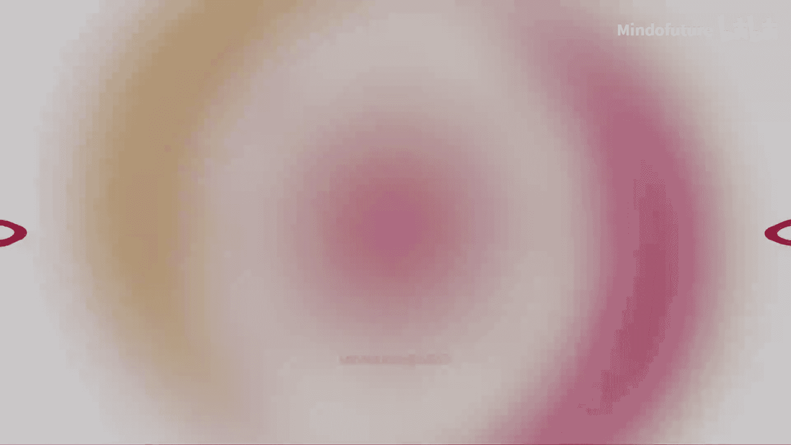
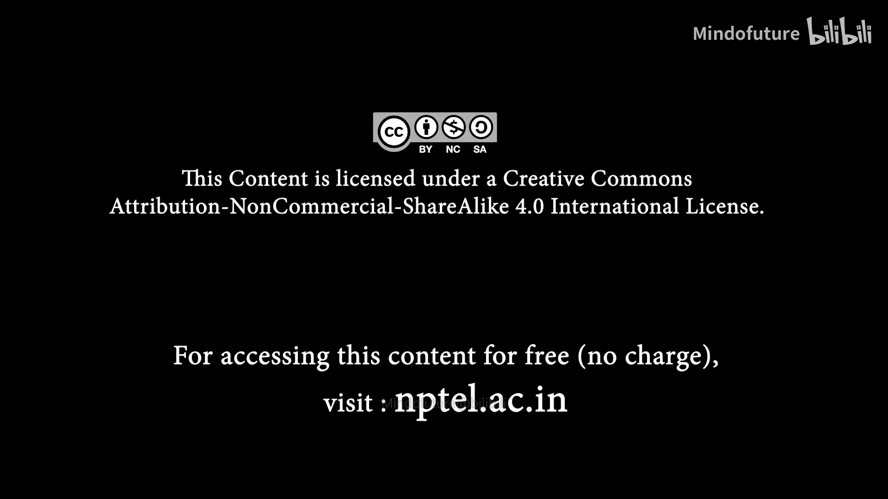
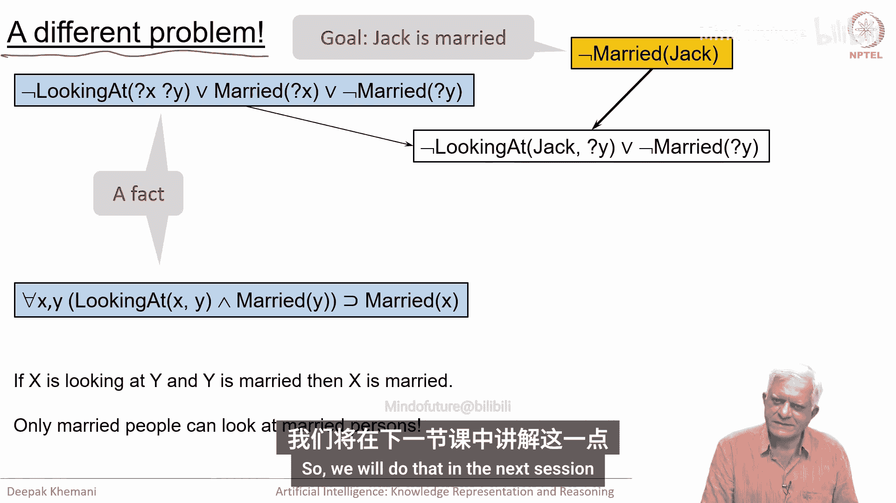

# 【印度理工学院】知识表示与推理 ｜ Knowledge Representation And Reasoning p46 P46_SLD推导=反向链接 -BV1c4zNBmEyF_p46-

So， welcome back we have been looking at a subset of logic subset of first a logic called horn clause logic and we see that horn clauses are those clauses which have at most one positive。

Lial， you can have any number of negative litals。Then we also set that a program。

Is a positive definite horn clause， which means that there has to be at least a positive little in every sentence。

So， what about negative horn clause what what is the meaning of negative horn clauses？

Let's look at that。A horn clause with no positive vitrial is a negative clause。

 obviously by definition a positive clause has at least one positive vitrial。

If it doesn not have any positive lital， then it is a negative loss。

A prologue such clauses come only from the negative goal or the query so the program itself is positive definite term clauses。

 but the goal is negative and added to that。When we talk of resolution。

 when we talk of backward ending we don't do that， but then we have to distinguish between goals and facts when we talk about resolution。

We negate the call and treat it as any other fact essentially and then if you can derive the nu clause then you are done essentially so the infolog such clauses come only from negated goal or the query essentially。

The nu clauses。Or the empty clause is by definition negative clause。

It has no positive literature and it evaluates the fall that we have seen and that is where this whole knowledge base becomes inconsistent once you can derive the nu clause。

The resolution rule has the following possibilities。Either the two clauses。Can be。

Both positive or both negative or one is positive and one is negative。What happens in these cases？

When you resolve a positive clause with a positive clause。

You will get another positive clause because remember that in the resolution step or in the resolution rule you take one positive little from one clause。

With a matching negative literal in the other clause cancel these two and put everything together so after two positive litals which existed in those two positive clauses because both are positive one will get canceled。

And the other one will。Go into the re So if we resolve two positive clause。

Then you will get the positive clause so this is an example here so positive the fact that I have drawn it in red is a positive clause so you can see that this is positive here and this is positive here。

And in the resultant， there is one positive clause。

If you resolve a positive clause with a negative clause you will get a negative clause because there was only one positive lital and that got canceled。

As you can see here。嗯。There is one positive literal here， s of x and that got canceled。

And what you left with。T of x or Q， not of t of x or not of Q of x。And this not canceled with this。

 essentially。So if it is all a positive clause and a negative clause， then you will get a。

Negative loss。And clearly you cannot resolve two negative clauses because。

You need that little to cancel from the other side， essentially。

Now our derivation is called an SLD derivation a prologue program is a set of positive definite clauses This a definition of SD derivation is more general than than horn clauses but we are interested in positive definite clauses horn clauses the negative goal is only negative clause。

😊，And SLD de so S stands for selected little。L stands for linear structure。

And D stands for definite clauses。 So when you are working with。

Definite clauses and use only select a particular kind of lital。

Then you will get a linear structure in the derivation and that is color。SL lead de。

The first is wind。Has one parent from the goal ne it goal。And one from the program。

 which is a positive definitionite clause。 So the goal is a negative clause。

The other clause is from the positive deficitinite set。So the Re will be negative。

And this negative clause which is resolved will be the next parent that is the property of facility。

😊，This vision。So， each re in the devation is negative。😊。

Because you are resolving a positive clause with a negative clause。

And this amounts to doing backward chain， so it is like going from goal to sub goal to sub goal to sub goal essentially。

So， a CD resolution with horn clauses is equal to backward chiney is equal into backward chiney。

The latest resolve when the last thing that you produced becomes one of the parents and the other parent is again a positive clause from the rest of the program basically so you are basically backwards heading through the program。

This is the structure of the SLD de with horn clauses。The gray clauses are the positive clauses the。

Plank boxes are the negative clauses， the yellow one or the orange one is the gold flows so you keep deriving a sequence of negative clauses and you can see that this is like backward chaining that you go from the goal to sub goal。

From sub goal to the next sub goal， from next sub goal to this next sub goal and so on and so forth。

So， I have not written what are those clauses， but this is the structure of SLD derivation。Now。

 it has been it can be shown that any。Derivation。And this is true for horn clause。

 any derivation which has a positive dissolve。Can be transformed into an equivalent derivation。

Without any positive resolveance。So， if you look at this devation on the left hand side。

 you have not E or c， you have not f or not c or d and you have not d or not E。From that。

 you take two positive clauses and resolve them。You get another positive clause。And。😔。

Then of course you resolve it with another clause and you get the negative clause instead what you could have done is you could have first resolved the top most negative clause with a positive clause which is here。

And you would have got a negative clause。 and you resolve this negative clause with other positive clause。

 and you will get a negative clause。 So it can be shown。That the television of a。Negative clause。

I is always possible where all the clauses generated are negative on the way。

So here is the LC de delevation of the the Alice problem， as you can see here。

We are only focused on the positive， definite clauses in， in in the。Alice knowledge base。

 there are some other clauses， but we have not used them as you can see here。

And the negation of the goal。Its a。So from t you went to t or not r or not s。

 then you get to n p or not s and so on， and you will remember this was the pattern that we didnt。

Backward chain。We started with a goal set of with t， then we added through other clauses and so on。

So you started with T when you are not negating the goal。Then you reduce it to。Because this was。

R N S。Employ place D。We actually reduce it to all N。

That's what we did in backward training from T we went to all in。E story。So。

 from T we went to RnS and of course in clause form negation of RnS is。

 not R or not S and then we did this process。So， this thick allows here show that you are doing something equal to backward chainning。

 but what you are really doing is SLD resolution here。Let's look at this problem that we had seen。

Earlier。So if you remember this problem in the domain of people。Well I have changed some names。

 so there may be a mismatch of names in the figure and in the dagger。But。Person。

 so what was given to us was that John is married。Jack is not married。

The stuff in the blue is a knowledge base Anne is looking at John and Jack is looking at Anne。

And we have to show that there is。An unmarried person looking at a married person。

That is a goal and the ne of the goal is here。 we saw this derivation。 we didnt draw the graph。

 but this is a graph for the derivation。😊，And you can see that this is not an SLD。😊，Resolution。So。

 the connection that we want to explore is the fact that a Cd resolution is。

Associated with backboard training。But then we also made the statement that。

Backward training is not complete。And therefore we said look at this resolution method it is complete。

That for this particular query that we had seen。嗯ello。That we had seen， we could。

Aive we could derive the nu flow so resolution method was complete whereas backward chain was not complete。

😊，Now， this is just a little bit of。Point to think about with。

I will show you a delevation which matches the pattern of the the。SLD derivation。

So here is this thing。If you just real in if you。Look at this knowledge base and the query you will see that this is the same knowledge base and the same query the knowledge base says that John is married。

Jack is not married， and is looking at John and Jack is looking at Anne and the query was the same that an unmarried person is looking at a married person。

So， with the same knowledge base。You can do in resolution。Which looks like a Sl resolution。

 You start with a negative clause， produce another negative clause。

Use that to produce another negative gloss。Again， use the resolve to produce a negative clause。

And again， use the rent to produce another negative clause。And again。

 use the resolve to produce the neural clause， which is also we say a negative clause。So。

 this looks very much like backward chaining essentially you started with a goal。

And a sub goal and sub goal and so on， the structure is that you started with a negative clause。

Producuce a negative Re and kept producing negative resolve。

T you derive the empty clause and here though， there is a structure which looks like that。So。

 is there some problem in our earlier statement that backward chain is not complete and we have said that this kind of resolution is backward chain and here we have this kind of resolution where we do a sequence of negative clauses and produce these loss。

Now no。It is not conflicting with our statement that backward training is incomplete and resolution method is complete。

Because backward training should begin with the goal。

And here we are not we are beginning with a negative clause so that is why I have written here that this is an SLD like derivation it is not an SLD derivation in the SLD derivation。

😊，You have to begin with a goals。Close。Which becomes a negative clause。 And then you。

And then you do this backward backward。Chaining process， essentially。So， first of all。😊。

This does not conform to a prologue program。Because if this is a fact。Not married Jack。

 we said that these kind of things are not allowed because only positive definite clauses are allowed in prologue。

 so this cannot be a fact essentially。And。The goal。

The negative negative goal is here is a positive clause， which is also not allowed in pro log。😊，嗯。

The goal。Then again the goal is just one positive little。

And its negation has to be a negative little。 So even though this looks a little bit like。

The SLD like resolution， it is not solving the problem that we wanted to solve essentially。

It is still showing。😊，That this。Augmented knowledge base。

Is inconsistent It is deriving the null clause it also deriving it with the pattern which looks like SL resolution but。

What I will show you in a moment is that the augmented knowledge base that we are talking about is being interpreted in a totally different way essentially。

😊，So， this is an a like resolution， it is not a resolution because we are not starting with the gold loss。

😊，So， this statement that we said that that forward chaining and backward chaining。And。Incomplete。

We will。Oh。Stick to that。嗯。Despite the fact。That we have an SLD resolution。

 so I should put SLD in code here。It is an S like resolution。So。

 we are not really doing backward training in the derivation that we just saw。If it was backwards in。

Then this is the problem that we would be addressing。The goal would be。

Show that Jack is married because the negation of the goal would be not married Jack。

That is not the problem that we are solving。 we we were told that。Jack is not married。

John is married。And。Some two people were looking at some two other people and then we had to show that an unmarried person was looking at a married person。

 but if we look at this derivation and think of this as backward chain then first of all you have to accept the fact that the goal is that Jack is married。

Then。What is the fact？If we read this。Clawuse with three litals as a fact， what is this fact saying？

It is saying。Therefore for all x for all y， if x is looking at y。And y is married， then X is married。

So， if x is looking at y and Y is marriage and x is merit。

 so this means that only married people can look at married persons so clearly this is a totally different problem。

😊，And it is interesting to see。😊，That this different problem in this world in which married people can only look at unmarried persons and that is given as a fact。

With the rest of the facts being same， we can show that Jack has married。

 but that's a different problem altogether from the original problem that we started with， which was。

A totally different problem。So， it's interesting to see。That are two different problems。

Can result in the。Same augmented knowledge base where you take the negation of the goal and add it as a fact。

You cannot take the augmented knowledge base in tele and and and。

And say what was the not what was the given set of facts and what was the goal unless of course you have this restriction。

That you are working with。Prologue like programs， which is that the program must be positive definite and the goal must be a single literal essentially Then。

 of course in you can see that。This single little must have come from the goal and the rest is the knowledge base。

 but here we saw。That there were two different knowledge bases with two different goals。

One of them is not a single literally in the first original problem。And。That。

They reduce to the same augmented knowledge base where the neg of the goal there all right so obviously both the augmented knowledge base can can have a devation so there is nothing surprising about it。

 but it does not show。That。What we did just now is。

Showing that backward training can also prove the problem。

 what we showed instead was that backward training can solve some other problems is still not the problem that we were interested in。

Okay， so we'll stop here and we'll come back and。Take a little bit more look at how pro。

Or logic programming。Can be seen as doing computation in general we have seen how we can do arithmetic Now let us look at another example。

 which is。Not directly to do with arithmetic， so we' will do that in the next session。

