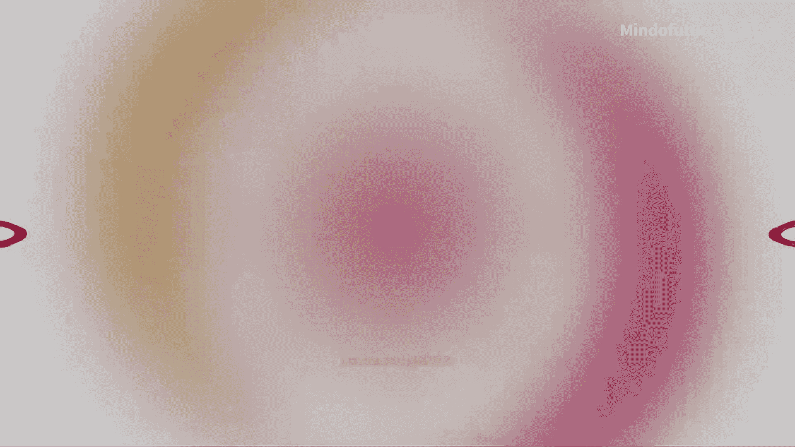
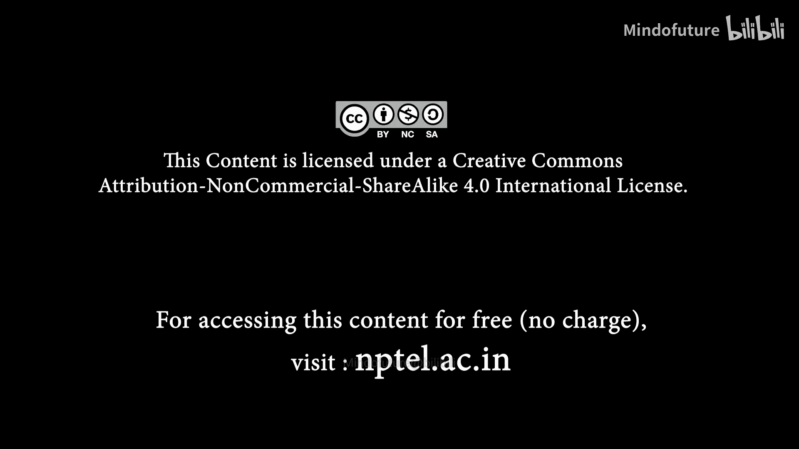
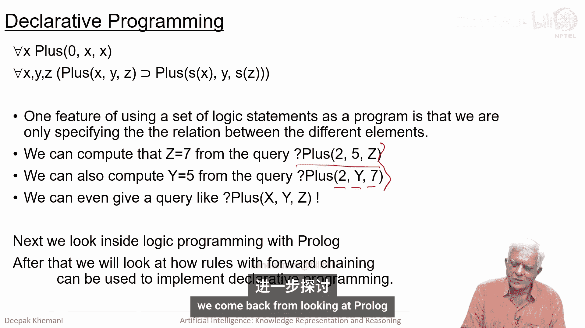

# 【印度理工学院】知识表示与推理 ｜ Knowledge Representation And Reasoning p47 P47_逻辑程序设计 -BV1c4zNBmEyF_p47-

So welcome back， we have been working on this idea。The theem proving in logic。I。

Something with subsumes。All programming， all computation。

 essentially whatever you can do with any other machine， any other language。

And with its compiler or whatever， you can do with here improving。We talked about arithmetic。

In the last session， we saw how addition can be done。And then of course。

 once you know how to do addition， you can do multiplication。

And once you know how to do multiplication， then you can figure out how to do subtraction and division and then you can talk about finding prime numbers。

 all that comes later essentially。But you can do competition in logic programming is what we saw so let us now look at slightly different this thing we let us talk about lists because lists are something that programming languages like to work with quite a bit essentially in fact。

え？In the last century in the 60s， 70s， 80s。The most。

Advanced programming language if if I can use the term advanced。Was something called list processing。

And which was expanded as Lisp LP。So LIA stands for L and P stands for processing。

So list for the language which people said is a language for AI。

 one of the reasons that it allowed to do was that you could define arbitrary structures and you could use dynamic memory and things like that。

You didn not have to define arrays of fixed size and that kind of stuff you could grow search trees without any restriction。

And and it was a functional language。 functionalal language is something which has some kind of an analog with logic programming languages that logic programming languages are built on top of。

The relation。In mathematics and functional programming language are built on top of functions。

 essentially so everything is a function in functional programming language。

So the thing was that that list fu。It only data structure when it was invented was a list structure and it represented list says。

Binary trees this is what we are going to see now， which means that it could represent lesss of arbitrary length and arbitrary nestedness。

Which was not possible in other programming languages at the time。So。

 let us see how list can be represented internally as binary trees and we look at one simple list function which is2。

Append tool list together。So we look at three lists here。A simple list containing two elements。

 A and B。A slightly longer list containing four elements， A， B， and C。

And third a list containing two elements， but one of them is itself a list which is AB。

So in the diagram that yes。Going here。A circular node is represented as a dotted pair or a con pair。

 so let us look at the first。List which is this list AB。So， when you draw this。

 we draw this in terms of circles and these rectangles。The circle represents a。

What is called as a dotted pair or a con pair。 This word cons comes from the language list。

 So it is a basic operator in in cons。 So when we say cons something with something it basically says a taker。

List。And add a new element at the head of the list。 And that operation was called cons。So。

 for example。If you look at this statement， it says。

Take an empty list and put be at the end of it recently So this empty list is this this empty box here。

And then B is put at the head of the list thing。So， the。And that is the conspirre。

 that circle is the conspir， the left style points to the head of the list。

And the right child points to the rest of the list or tail of the list essentially。So。

 you can see that that that cons b nil represents this list。And this whole。Experencies。Gans。

So this is the outer cons。Which is here。This outer con says。

It is a cons of a which is the head of the list。And another list which is cons be nil cons beil is a list in which B is the head and nil is a tail the en list is the tail。

In short form， we write this as a list of A and B essentially。Internally， we would write it as cons。

 a cons b nil essentially and we can think of it as a binary3 as drawn on the top。

Here is this longer list ABC D， you can see that the same pattern follows you start with the topmost cons and it says a is the head element then you go down then b is a head element of the remaining part of the list then see is the head elements for the remaining part of the list and so on so you can see that when you write recursive programs about less。

You can think of them as this kind of binary trees or you can think of them as these dotted pes or con pas。

The third list is。It has a nest list。So as I talk most。I have a quas。

But the head of the list is itself a list which is shown。By this， yeah。

And the tail of a list is a list which contains only c。

 so it is seen as a list which is cons of C of and needle essentially so that is a structure that we work with essentially。

So let's look at the program to appendish tool list。So I am already using the phrase program。

What I am writing going to write is a set of logic statements。The schema for the predicate。

 every predicate。You should define as to what are the constituents and how are they related to each other。

That is of course given by the semantics but it must be clear in your head as well So when you write append x by Z we are saying that when you append list x to list y then you get list Z you will see this similarity between plus and append and in fact the similarity is very stark strikingking。

This is a program， which。Is a program for。A pendingending tool list。

And you can see the pa between the program for adding two numbers。

The base clause says that if you append the empty list to anything you will get that same list back so append 0 xx。

The recursive clause says。That if you can if you append x to y and it gives you z。

Then you can look at the successor of x。And append it to。Wei。

And it will give you the successor of that。The successor is defining terms of cons。So in fact。

 this is not quite correct。 I should write it says。Gones。A X， So this is an error。有。

And what you will get is bonds。A this。So the parents of copy paste。

 so I copied that code from plus and pasted it here and I forgot to change this success thing with the cons function here。

So。Let us read this again what is a recursive clause is that if you can append x with y to give you Z。

Then。If you pen。X in which a has been put at the head。

And append it with y you will get Z with a has been put put in the head basically。

So that's a correct definition。 and I will correct it in the slides， but you must。Make note of it。

So here I return it correctly。Instead of A I used a constant C here or it can be anything。

 it doesn't have to be a constant it can be a list or it can be something。So in the clause form。

 I will the correct definition in the logic form I made a mistake。So here we are。

 And now lets see if we can， how do we。Use this to。

Appren to list So like we did in the case of natural numbers， we said that we are not saying that。

X is a natural number here also we are not saying that x is a list we could define a function like list and and then work with that。

 but we will leave that aside for the moment because that is。

Imperative from the pure logic point of view， not from the point of view that。

Program that we are interested in seeing how logic works as a program that that function would if you had defined this function list text it would have simply said that this statement where you append0 to an empty list you get sorry if you append an empty list to a list。

Then you get the same list back you are just emphasizing the fact that what you are doing there is a list essentially so ideally speaking you must you must put that list condition there essentially。

So， you might write。Not to。This is true only as long as。That is a list。So， here is our program to。

Pend to list。The query is given on the top。In the。😔，Heading。

 it says that if I append a list which contains A and B。To a list which contains C and D。

Then what will I get， what will that x be essentially。嗯。So。

 you can see that the list containing A and B is represented as this cons A cons B with the empty list。

And list containing C and D is represented by cons C cons D with the empty list and the query is x and for good measure。

 we have added the answer predicate here so that we will have the answer computed as we go along instead of having to trace back the。

Substitutions。Well build answer as we go ahead essentially。So。

 our answer is going to be contained in a variable called x， which will stand for some list。

The pattern of this proof is。Identical to the pattern that we did for adding two numbers。

And it's no surprise。That the first number， there was two。

And here the first list is list with two elements， so therefore the number of derivation is also going to be the same。

So， you should just go this a little bit carefully。😊，呃。So。

 this is why that we are talking of are they are coming from here。And。From here。

 that's what is being mass。 So that is being。This thing to buy one。

 so that means we have moved one step inside the list there。So。

 the answer is going to be a with whatever the answer for the rest of the thing is so a has already been added to the answer and this y 1 has to be added essentially。

Then in the second step， both A and B have been added to the answer and y 2 has to be added。

But by this time。Our query。Has an empty list here。And of course。

 it has this other argument that you want to open C and D and you can see that that will match with y2 and then you will get this。

Answeerring this。listsing。The value of the variable is。It' is a list which is made up of A， B。

 C and D essentially。So here we have done a pending。Just like we did additional earlier。

 we can do a pen here as well， so I hope that is somewhat convincing that。

We can do everything in logic that you could have。Done with imperative programming languages。

One feature of using a set of logic statements as a program is that we are only specifying the relation between the different。

Elements。We are not even saying that we are going to add two numbers to give us the sum。

Or we are going to append to list to give us the result on list we are saying。

In the case of numbers that if you have。3 numbers x y and z when is it true that x plus y is equal to z？

We are not giving a procedure for adding likewise we are not giving a procedure for appending tool list we are simply showing when does the relation hold essentially。

Yeah。A plus point of that。Is as follows。That what we showed earlier is that we can compute Z from the query。

2，5 then that if you if you add 2 to 5， what will you get then essentially that。Like doing addition。

But you could also compute y from the query is that if you add2 to something then you should get 7 what is that something？

You will get the answer by is equal to 5。So， you can see that the same program。

 same piece of code can be used to do。Add additionition。As well as subtraction。

What is even more interesting is you can even give a query like。😊。

Plus x by is  z where all three are variables。And the answer。Would be true。

And when you run prologue you will see that you can get the first answer， the second answer。

 the third answer and fourth answer and so on， because this particular query has many answers and the other two queries had only one answer。

So you would stop with that， but in forlog you can keep saying give me the next answer。

 give me the next answer， give me the next answer。And then you would see that。

It would practically print the whole addition relation for you0 plus 0 is equal to 00 plus 1 is equal to 11 plus 1 is equal to2 and all possibilities would be。

Given out essentially。We will look at。Logic programming。In a little bit more detail。Next。

And after we had done with that。We will come back and look at。Declarative programming from。

The perspective of forward chain。 So by now I hope it is clear。

That logic programming is kind of closely tied up to backward chain and as you will see it is also tied up to searching the goal tree in a that first such fashion。

So going from gold to sub gold and so on。The idea behind decative programming is that you define the relations between input and output and let some other program do all the hard work for you of establishing that the relation holds for a given instance。

We will also look at this idea of。Declarative programming from the forward changing perspective。And。

 in fact。It was developed with a slightly different motivation this forward chain rule based expert systems as they are called they were。

Designed。To capture the knowledge of experts in the form of rules， and we did mention。

A program called Excon or Rn earlier。But in the same spirit that if you can capture the knowledge of experts in the form of rules。

Then that knowledge can be。Utilized。By another program when a given problem is to be solved。

 then another program is called the inference engine。

And there is a very neat algorithm for doing this efficiently。😊。

Which is what we will look at after we come back from。Looking at prolo。

