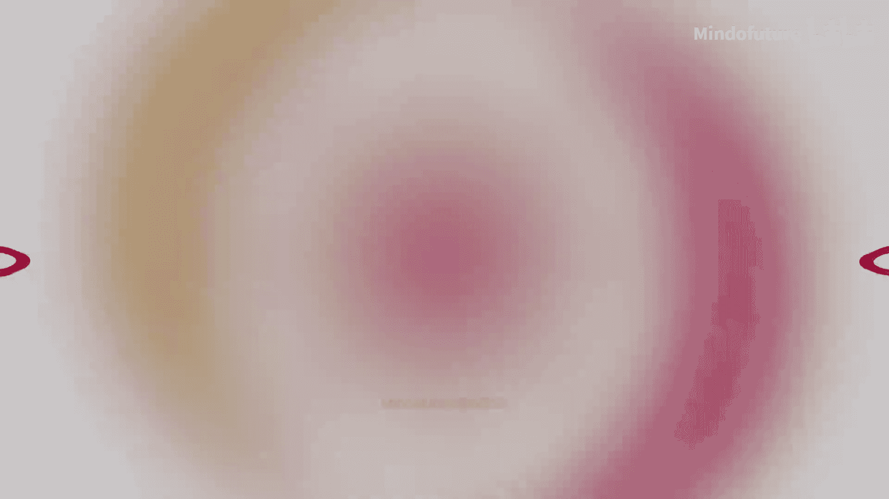
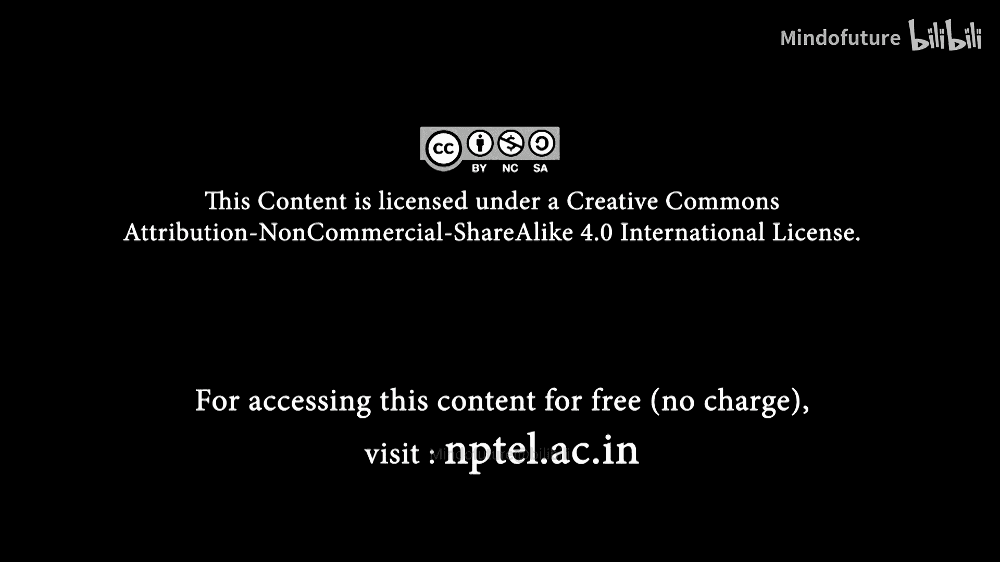
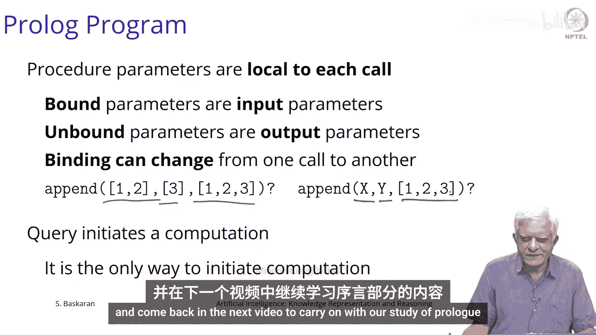

# 【印度理工学院】知识表示与推理 ｜ Knowledge Representation And Reasoning p48 P48_Prolog逻辑程序设计 -BV1c4zNBmEyF_p48-

So welcome back。We have looked at first logic and resolution method。

And backward training and SLD resolution。And we have seen。

That logic can be a foundation for computing。That whatever you can do in logic。

You can do in computing。Or rather the other way around whatever you can write in any other programming language you can do in。

Logic。And we had said that we will look a little bit into this language of prologue。

 which stands for programming in logic as the title says。To give you a flavor of。

How logic and programming is connected essentially。As you can see the title on the slides。

 the name on the slides is that of S Basker who is a software expert with many years experience in industry。

 I will try to do as much justice as I can to his slides for some reason he is not able to present them。

So， let's begin our journey of。Prologue， which is programming and logic。So。

 we will look at the programming model of prologue and some basic elements of prolo and demonstrate these elements using how they would look in an interpreter。

Now prologue can be seen as many things we have seen it as we have seen already seen the perspective as a hem prove。

😊，We have talked about deductive retrieval earlier so we can think of it as a reductive database。😊。

And a query language for querying the database。We have already started by saying that it' is a knowledge representation language。

And now we are also saying that it is a general purpose language that it is a tool complete language。

 whatever you can do in any other language you can do with prologgue essentially。

There is a subset of prologue called data log， which is prolo without the function， so remember that。

A logic language is made up of prediiccate symbols， function symbols and constant symbols。

Data log does not use function symbols and that makes it much more efficient and in applications where you don not need function symbols Data log would be a good option。

So， just a recap first order logic is a declarative language for writing logic statements and writing proofs essentially so it is like a language of mathematics horn logic or horn clause logic is a subset of first order logic。

And it has been adopted because of the fact。That your improving is efficient in that。

Prologue language is one implementation of on closed logic。And the prologue interpreter。

Would have things like runtime extensions， external features， debu facilities。

 software interface to write programs and so on。Like any other programming language。

You can look at some of these implementations of prologue to practice what we are。Talking about。

S2 I S W I prologue is a is a commonly used。Implementation and you can download it easily from this website and install it and test it out if you are interested in if you dont want to download it and if you want to use an online version then you can try this Sw SW prolog which is available which can be executed online。

And you may find other implementations of the language， essentially。So， if you were to。

Run SWI prologue。As shown here。You will get a welcome message。And。😔。

Then you can pursue it essentially。Now。What aular progue gives you is a interface to ask queries of whatever is a knowledge base or do you enter the knowledge base the knowledge base can be entered by this command all consult。

A file called blocks world What does B world look right you can see on the bottom right of the screen。

That。As you can see it is a prologue program and we have already introduced a little bit of the syntax。

We have some statements which can be called as facts A is on table， A is on B， b is on C。

 C is on table。And C is maroon， Then we have rules。

For defining the above relation we have the on relation we want to define the above relation which is a recursive relation we have already seen flavors of this this says that x is above y if one option is that if x is on y if it is if it is on y then it must be on above that is the first or the base clause the recursive clause says that x is above z。

If x is on y and y is above it， so if you remember the grandfather grandparent relation we had defined earlier or the connected graph relation it is very similar in flavor to that。

You can also define the inverse relation， you can say that x is below y if y is above x essentially。

😊，So， when you you say consult blocks world prologue will。

SWA progue will load your program and it will be ready to answer your queries。So。

 when you type in something it is treated as a query so here you have typed in a query which says。

Is there some x which is on by is？Where y is also something and prologue will in this version will give you all the answers it will say x is equal to a y is equal to b that is one answer delimit by a semicolon。

Then the second answer， x equal to B and y is equal to C essentially。

So you can see that both these answers are。😊，True for on the query on。

 because we have said that A is on B and B is on C， essentially。

Now some versions of product will give you all the answers it is try to give you all the answers。

 some version will will give you one answer and you will have to place the collegeage return to get the next answer anyway that is a matter of implementation。

You can give a command call halt， which means I am done with this session and it will terminate the session。

There is a very nice book on。😊，Prologue is called the art of prologue by Sterling and Shapiro。

I use it in courses where I teach logic programming。And if you can get your hands on it。

 it is really a good book。Then there is the original paper by Robert Klski from 1979。

 which is titled Algoth musical to Logic plus Control we have already spoken about that。😊。

And there are some couple of more references that you can see。😊，To tell you more about Folock。

You can also look at the documentation of SWI prologue。So， the programming model for。Blog。

That algorithm。Isical to logic plus control now our notion of our algorithm model program is that it is a step by step instruction for solving a problem。

😊，which is closer to our notion of imperative programming a programming language like C for example would say x is equal to 13 y is equal to 41 z is equal to x plus y minus3 so you can write statements one by one and that is how the flow of control is part of the code and we have declared have we have kind of discussed this earlier that in logic programming which is a declarative style of programming we want to separate。

The two parts of the algorithm， the logic and the control。So。

 they provide us primitives for writing the logic components like FOL for example。

And a runtime prepares an execution plan and execute so the execution is not in our hands there is a interpreter or an inference engine which does it for you。

😊，Now prologue as we have already said uses the holess subset of logic because it is more efficient and it does。

As we saw in the case of backward Jenning it does the first search over a tree essentially。

Which corresponds to SLD resolution for horn clauses remember we will define horn clauses again as we go。

Prologue interprets horn clauses as procedures。As procedures declarations and interprets SLD resolution as proural execution。

I hope we will get a flavor of this as we go along。Some terminology。A term。In logic and into look。

Is a reference to an object in the domain。So， we have defined the family of terms earlier。

A predicate is an atomic statement about those objects。 It is a relation on。

Of some mality on those objects。A hornn clause is a sentence a statement about objects。

 it includes atomic predicates。And logical connectives connecting them together。

Unification is a process that we use for matching two terms。Nigation， as we will see in。

The near future。Will be treated as negation as failure in prolongedlonggue， which means。

That if you cannot show that something is true。Then you assume that it is false and that is how prolo treats negation so it is a closed world assumption it says that if I cannot show that it is true then it must be false。

😊，We will look at a procedural tool called cut which is。

Used to make programs more efficient because essentially prologue is searching over a knowledge base and to avoid some repetitive searches in many situations。

Prolog interpreters come with this feature which is an extra logical feature in some sense called cut essentially we will look at that also later。

😊，So。An algorithmgorithm is logic plus control。The product program is a logic part of the program from the users perspective。

It's a knowledge base of facts and rules essentially。From a programmers perspective。

 it is a set of procedure declarations。From a matchs or a logical perspective。

 it is a conjunction of a set of positive definite clauses。The input and output。

In all these procedure calls is done。By unification and that is a process that we have already studied。

Procedural parameters are local to each con， so you make a call。

To a procedure and the parameters will be local to that。If a parameter has a value。

Or it is bound to a constant then it is treated as input。

unbound parameters are output parameters and the binding in a procedure call can change from one call to another essentially so we had seeing this upend when we talked about logic you can see that you can make a query which says if I take the list1 plus 2 and a list containing3。

And append them together will it be the list containing one2 3 so that is what this query is saying。

Everything is an input to this because all the three variables are bound。

And we are just asking whether this is true or not。Alternatively。

 we can ask a query that is there some x， some list x and some list y？

Wwhichch we when we append together gives us a list of 1，2。

3 and if you were to run this in SWA pro it will give you a sequence of answers。So。

 a query initiates a computation。And it is the only way to initiate competition。So， with this basics。

 we will take a short break。😊，And come back in the next video to carry on with our study of prologue。

