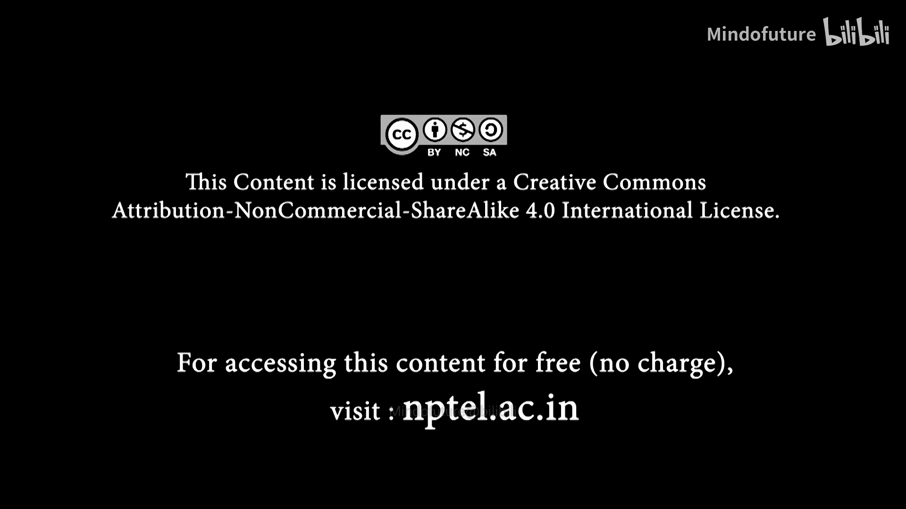
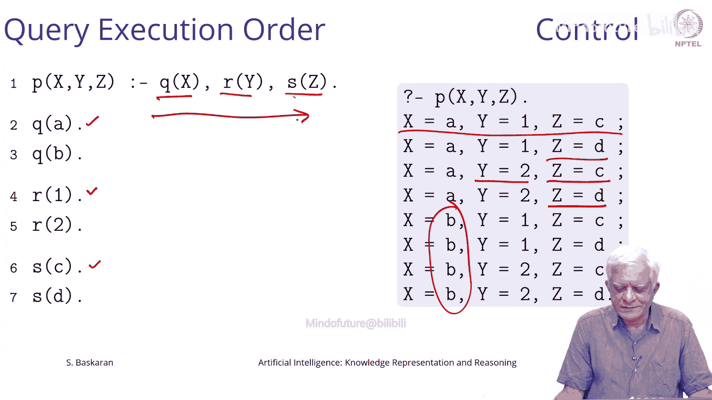

# 【印度理工学院】知识表示与推理 ｜ Knowledge Representation And Reasoning p49 P49_Prolog过程性解释 -BV1c4zNBmEyF_p49-

So welcome back。Let's continue with a study of prologue。 We said that a prologue program。Use this。

Procedure parameters to send input and send output and we saw this example of how you can call the procedure append either you can give all three arguments as input or you can give one or two arguments as input and the third one would all the second or the other two would be the output essentially。

And the only way to initiate competition is to ask a query in that sense it is like a database you can ask is this statement true？

The control in prologue。As we have said earlier。Is that first search so DFS stands for that first search。

 so if there is a tree it will first go on one branch then backtrack and try another branch。

 then backtrack and try another branch and then backtrack and try another branch。And so on。

 essentially so it。Dives into the search tree and looks for。Satisfing the goal。

We will look at things like how rule order matters and goal order matters。

And how your knowledge base is stored in a relational database。As far as we are concerned。

 we will not worry too much about the relation database aspect because we will treat the prologue program as a text file。

😊，And the order will be as the lexical order in the text file so if there are two rules written one after the other the first rule would be considered first and the second rule would be considered second and inside the rule on the antecedent part if the antecedents are written in some given order they will be considered in that particular order and that as we have already seen translates into this depth first search that we were talking about。

Then there is the option that do you want one answer or do you want all the answers。

 this is what interpreters will give you。So hall clauses。Oh。

Is a disjunction of literals a horn clause is a disn of literals we have studied this so this is a very quick recap。

😊，With atmost one positive little essentially。So， you can see this in the first line there is only one literal in the clause and that is a positive literal so that is fine。

In the second line。We have one positive literal and the rest are negative literals。So when you say B。

 it's some instance of B， b1 B2 and so on。That is called a definite clause。

 the first one is called a unit clause it has only one lital a definite clause has one positive lital。

And the others are negative and as we have studied earlier a definite clause can be seen as an implication statement that B1 and B2 and so on。

 they imply a essentially。😊，Which in prologue would be read as is。A， if P1， and B2 and so on。

A third kind of clause is a goal clause which has no positive clause。

 so it is a negative clause this thing and it is treated as a goal clause。Logically speaking。

 it can be seen as a statement which says that B1 and B2 and so on imply false if you convert this into cloud form you will see that what you get is on the right hand side which is a negative clause with not B1 or not B2 and so on essentially。

And lastly， we have the empty clause。Often denoted by a square。

Like this and it stands for falses it means it has nothing in it， it has no literals in it。

 it stands for falses which is another way of saying that logically speaking the true implies false so true implies false is false so an negative empty loss stands for falses。

Where in the above diagram， AB could be any of these things that we have drawn here。

So the definite clause is the main part of the。Program in fact。

 a program is a collection of definite clauses。We have either unit clauses or we have you know definite clauses which have。

A certain number of antecedents and one consequence so as for example here exactly we have two antecedents and one consequence remember then the question mark notation we have been using for universally quantified variables。

So， a productgue program is always often described as a head in a body。

 the consequ is called the head。😊，And the antecedents are called a body。

 so the body implies the head。Or we can also read it as saying。Head if body。

 which you can if you are thinking in terms of tilt values。

 you can say the head is true if the body is true essentially。But remember again。

That logic is not really concerned with truth values， essentially。It is fairly syntactic。

Machinery like all programs that we have。This implication that if x is on y。

And y is above that then x is above that is written as we have already seen in prologue with a different syntax we write the consent first in prologue we don' not use question mark we use capitalize letters for variables。

And。This is same as。The implication going from right to left。And instead of and we use the comma。

 So it is a set of。Close this。We always end with a full stop， essentially。

The procedural interpretation of this is that first we will call。On x， Y， which is the first。

Pdicate in the antecedents in the body。We will get some binding out of on x y remember our logic theorem proving that on xY will be true for some value of x and some value of y。

That value of y。Would be fed into the。Second call because it must have the same value in the statement。

We can think of it as two calls one。For testing whether on x y2。

 the other for testing whether on yz is 2 where y has to be taken from the。

First call it is the output of the first call which is the input to the second con。

The unit clause we have already said is equivalent to saying that。Tru implies head。

 which basically means head we can we dont need to write this through implies and we don not in logic。

We would just write it as。Abo x y。And remember that these are universally quantified variables in the consequent。

😊，A universalrsally a capital variable is a universally conher variable in the consequent it means that this is equivalent to saying for all x for all y x is over y okay now whether that is true or not is a separate matter。

 but we have stated it as a fact here。More often than not。

 we would write statements like that a jar is above the table。😊，Which could be written as。

Being implied by the fact by true but true is always true so we dont really need to write this and we will stick to this notation。

So it's like defining。That this is true。The gold clause。Is。Interpreted as。A negative clause。So。

 we are asking these two queries， is there something such that x is above y？And。

So remember that this comma is an and。Is why Maroon， essentially。So， this is like calling。

The two queries separately look into the database， look into the whatever the format for storing a database is can you show that there is some x which is above y if if yes。

 then you take that y and feed it to the second call and。Ask whether that wise。

True or not if both the queries return true， then your answer is true。

The empty clause is represented by false。It is an artifact of。

Resolation method and also in particular SLD resolution。

From a programmer's perspective from the procedural interpretation it is interpreted as a successful completion of the program if you generate the empty clause that means your program is termd。

The query and all the subsequent goals have been solved essentially。

We have seen in backward chain that you start with a set of goals and you keep reducing them and you keep reducing them and in the end if you have an empty set then you have。

S showed the goal and the。And you have seen in deductive retrieval that you can return the values of variables which make the goal true。

And those values are captured in the MJU， which is the most general unifier we have seen the procedure for computing that。

And we just print that as a answer essentially so that is the procedural implementation of the problem so you keep calling the different perdicates as procedure calls。

😊，Be careful about the variables， how they are being passed。And。If you have derived the empty clause。

 that means you have solved your query and the answer is lying in the MGU。So。

 a program can be seen as a set of procedures， so a set of sentences。

From the logic perspective is a set of procedures from the procedural perspective。So。

 this is the same program that we saw some time ago on the left hand side。

 you can see we have some facts。A is on B， b is on C， C is on table C is meoon。

 then we have some rules as we said。That if x is on y， then。X is above away。

 that's when we have defining above。Otherwise， if x is on y and y is above z。

 then x is above z essentially so we have seen these rules earlier。😊，And below we can define as a。

Converse of above。We have also seen addition we call it plus that time。

But this is how addition would be defined。You could say that。

Start off by saying zero is a natural number。And then you can say define the set of natural numbers by saying that if x is a natural number then the successor of x is a natural number。

 so it starts with0 then you say 1 then you say  two then you say 3 and so。

 so you know that whether the argument to a na which is a predicate。😊。

Is a natural number or not if the argument satisfies this program then it is a natural number。

 otherwise it is not a natural number。 so if you say that。For example， Peter。Then to。Say false。

Because goes。It is。Doesn't satisfy the definition of natural numbers。So。

 once you have defined natural numbers you can say that okay if x is a natural number then 0 plus x will always be x and then we have seen that if x plus y is equal to z then the successor of x added to y will use successor of z so we have seen this process earlier and this is how you would write it in prologue。

😊，Wwhichch is also we have as we have seen earlier it is as a set of relations so the same program can be seen as a set of relations or a set of procedures。

No。Given a knowledge base。In particular， we are interested in a knowledge base in horn clauses。

There can be two。Ways of。Controlling。Competition。We have already discussed this。😊，嗯。

And we will quickly go over that again the first is forward chainning which is what we saw when we started by looking at logic。

We will take our definition of natural numbers here。In forward training。You would say。

0ero is a actual number。If 0 is the natural number， therefore。

Successor of 0 is a natural number because we have this definition of natural numbers which says that if x is a natural number then successor of x is a natural number。

 so if 0 is a natural number then the successor of 0 as shown here is a natural number if x successor of 0 is a natural number。

Then the successor of succession of0 is a national number and so on in forward training if you were to do this whole process。

 if you were to run this role in a data driven fashion。

 then it will keep saying all these statements。Z is a natural number。

 one is a natural number two is a natural number and so on essentially。As we can see。

This may not be a process whichever ends。So， if you are talking about terms。

 then you can see that from 0， we can derive successor of 0， success of successor of0。

 successor of success of successor of0 and so on because of the same rule that we have been talking about essentially。

So from X。You go to successful of X。So you're moving in this direction。

That's data driven or forward chain。Or you can think of it as generating a set of terms start with0。

 success of 0， success of zero and so on essentially。In gold driven。😊。

As we have seen in backward chainning， the process is different。We ask a query。

And then we try to see whether the。Qury is satisfied or whether that existential statement that we are making is true or not essentially so。

 for example， this statement。Which is a goal。Is equivalent to saying there exists in x。

So is that x is natural number。Now， if you are to give this as a query to this program。

 the same program that we have been talking about。Then it would start off by saying yes。

 0 is a natural number， so there is an x such that is a natural number。Then。If you want more answers。

 it will go from there。And then show that。Successful。Of x1。 So if you say。😊，That x is equal2。

Successor of x1。Wwhichch means x1 is a predecessor of x1。

 so we have seen this process earlier the 3 is a natural number， if2 is a natural number。😊。

Wwhich is a natural number if 1 is a natural number which is a natural number if0 is a natural number and the0 is of course the natural number because we have ci it as a fact essentially so in backward training we keep asking this question till we hit 0 essentially。

😊，Or if x is a successor of x1， then x is a natural number。If x1 is a successor of x2。

 then x1 is a natural number and therefore x which is a successor of x is a natural number and so on。

So， we have already seen some of this earlier。😊，To log and we have said this before using a gold ribbon or backward chain approach。

So， it would basically ask the query that。X is a natural number if either。😊，X is 0。All。

X is the successor of。X1。And of course， recursively that x should be a natural number essentially。

Soう。Let' us look at this very simple program。It is a little bit like the evening out program that we had written here。

That。App predicate。P on three arguments， x Y Z is true。If it is。

If there are three independent peddics， which are。True for each of the individual arguments。

 so Q of x is true r of y is true and0 s of z is true。

And then we have a small database here where Q is true for two。

Consts A and B r is 2 for 2 constants 1 and 2 and s is 2 for2 constants s and D now we have set the way the tologgue does that first search in lexical order。

It will first try to solve。The main query which is p of x by Z， then it will try to solve Q。So。

 it will find that。Yes。A is a Q。Then it will go to the second query。

 which is why it will say yes1 is R。And then it will go to the third query about s and it will find that yes。

 c。Is an s， so it has satisfied all the three queries and that is captured in this first answer that prologue will give you。

That yes， the predicate p is true when x is equal to a y is equal to 1 n z equal to c。

If you are ask for more answers。It will backtrack on the last one。And。Say okay。

 another way this can be true is z equal to。利。If you ask for one more answers because it has run out of now essays。

 there are only two essays。S statements that C is and S and D is and S。

If you want more answers it will have to backtrack further and it is already done with y is equal to 1 so it will go to the second R argument and say yes。

Y is equal to 2 and it will go back to the first value for z which is c。Then。

 if you want one more answer it will again go back to the second value of z which is d and in that fashion it will backtrack so if you still want more answers then it will go to the all those answers where x is equal to be and repeat everything that it did earlier essentially。

So that gives you a flavor。Of how。Prologue。Execute programs， essentially。Talk to down。

Which meansq of a is considered beforeq of b。R of 1 is considered before R R of 2 and so on。

And left to right， which means q is considered first， then R and then s。

And that can be visualized as a。Search 3， which we will see。

 so we will take a break and come back and look at that。

