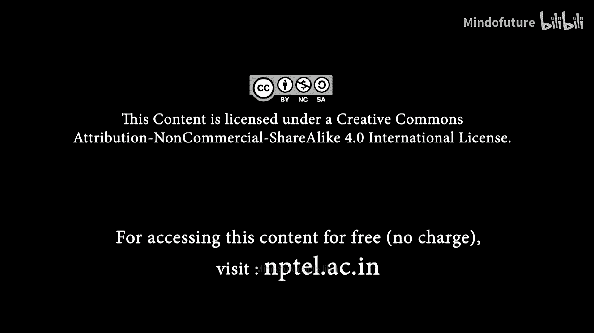
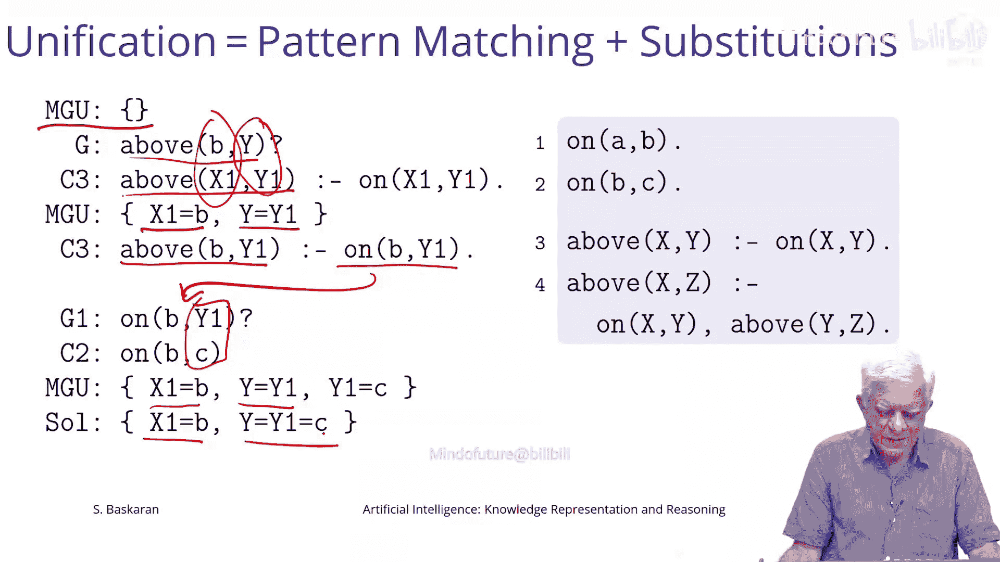

# 【印度理工学院】知识表示与推理 ｜ Knowledge Representation And Reasoning p50 P50_Prolog查询评估 -BV1c4zNBmEyF_p50-

Welcome back。To our study of the prologue language。

 which is an implementation of logic programming using horn clauses。

And we have seen that the execution order of。Statements in Plogue。I lexical。

 which means that whenever you ask for a query in this case P for example。

 you could have asked for Q also directly it doesn' not matter。

It will start scanning from the top and whenever it finds the first p it will see whether it can be satisfied so either that p would be a。

Fact， which means there are no antecedents。Or it may have it may be a rule rule in which you go from P to the body of that rule。

And try to satisfy the rule and in the body of the rule you go from left to right。

So we saw this example here。And we can visualize this as saying。That to solve for p X， Y。

 we define this。Procedure structure。So call Q of x。

 call R of y and call S of Z in that order essentially。

That will give you one answer so when you say call Q of x and call RF of and a subject you will get the first answer which is。

X equal to a。Y is equal to 1 and very equal to c。 then if you keep repeating this then you will see that。

The order in which the answers will be produced is as we saw recently。So。

 you can think of it as saying that for each solution of Qx for each。

Solution of RY for each solution of S Z， the solution is x， Y Z。So， we make this。Calls。

 nested calls and generate each line of solutions。So， as you can see。

 there are eight possible solutions here and they get generated。

We already set this execute rules in the program order and goals in left to right order expands the search tree in the depth first search order。

And then it produces all solutions in the process。So。

 the same execution pattern can be seen as a search tree here you started with this query of。😊。

Is px Y Z true？And then we made a call to。P X Y that we are renaming variables because that is generally a good practice when you are visualizing。

What is happening in logic？Of course， internally productlogue will manage its own variable versions so you don't have to worry about that。

But the way productgue will see this as as a depth for search is that it will first。Try to。So for。

The first variable which is x1。And the first option that it sees is。That a is the Q。

So it is looking for a Q， then it is looking for an R。With a variable by1， it see that。1 is an R。

Which is written as R1。And then finally， it sees。Season is。そう。

The leftmost branch in this tree gives you the first。Option。

Then when you backtrack and come back here。It gives you the second option。

Then you backtrack and come back here。It gives you the third option where now y has become two essentially。

What is2。And Z is C here and so on from there you will backt and come here。

 And then when you are done with this part of the tree。

 it will backt and go down other branch and repeat the same process here。

 So this is just to illustrate。That what Flog is doing is that first search over this search tree essentially。

We have mentioned this earlier。😊，That search such such trees can be seen as and or trees Why is that because。

You want to show that p is  true p of x y z is  true。

 you have to show thatq of x is 2 and r of y is  true and s of z is true so that comm is really in and and in and or trees which we have been exposed to earlier this is saying that to show that p x y p x1 y1 z1 is  true I must show three components。

And I will show all three components， so if you remember in Android trees。

Which are different from the three that we just saw。

 which is sometimes call as an or tree there are and nodes， which means you have to solve every。

Branch below that essentially before you have a solution and the solution。

 if you remember is a subre。So， we have this add node and then of course we have the same query is Q true for sum x1 is r true for sum by 1 is Z true S true for sum Z 1 and then of course there are these all choices below that that yes Q is true for a and  Q is also true for B  Q is。

True for R R is true for1 R is true for 2 and so on， the same process will be repeated here。

And the same set of8 solutions would be generated if you look at it as an Android tree。

That's only a matter of perspective。So， terms in the language we have defined the family of terms。

 remember that we said that variables are terms consents are also terms that if t1 and up to Tn are terms then if you have a function symbol。

Then。The function single with those M arguments is a term essentially。

We have seen that lists can also be terms and。Which are kind of。

Data such as that we can construct using that function called cons， if you remember， so a con pair。

And so on， so cons has got a head in a tail essentially its got two arguments。mm。

Consent is a term we have already said。 We can say the function。As a。

A consent is a function with zero arguments， that is just a matter of looking at things。

Then we define numbers and strings and they can be terms essentially essentially。

And some functions that we are interested in is this plus minus star and slash essentially。

So the examples of terms are given here on the right hand side， so one plus 2 is a term。

2 star3 plus 4 is determined。Terms are not evaluated。

 they are just stored as structures essentially or data structures essentially。And prologue。

And logic in general allows you to look at the structure of such。Domes。Numalic terms。

Can be evaluated using the A predicate that prologue is gives you that special thing。Which is。That。

You can evaluate a numeric term。So， here is an example you can write x is 2 star 3 plus 42 starts。

3 or 2 into 3 plus 4 is a term， but you can evaluate it using the is predicate。

And Polgue would say the answer is yes， essentially。It has an in notion of pi if you say x is pi。

 it will give you the value of pi out for some。Number of。Some precision。

You can say if x is sine of pi by 2。It will tell you that it is one， essentially。

So when you say equal to in this， it is。Like saying that they can be unified essentially。If in fact。

 this is。What happens inside unification， you say x is substituted with 10 here we are saying x equal to 2。

A is used to evaluate numeric terms if you want to compare。

Terms you have to use a different symbol which is two equal signs with us colon in between。Anyway。

 those are language specific things， hopefully you would look at them。

We have already seen lists we said that you know lists are made up of。

These functions call dotted pairs。which sometimes we draw as a circle。

 which is also called as a con pair where we can write cons remember that cons is a term that we borrowed from list as language。

But we can also use a head tail notation。It says that the left hand side is a head and the right hand side is a tail essentially。

They are all similar notations and。Can be variously used effectively。

We often denote list with square brackets in prologue。So。

 empty list is denoted by a pair of empty brackets， one，2，3 is a list。Which is。

A same representation for all the。Diagrams that we have drawn on the right。

 but we can write it succintly as 1，2，3， we can even write it as one is the head。

And the rest is the tail。And inside that2 is a head and the rest is a tail and inside that three is a head and the rest is a tail and the rest is only an empty list essentially。

Which we can also write as cons one， cons2 cons 3 nil essentially， so we have seen this before。

This is a headtail notation with a vertical bar。So。

 if you say x y z vertical bar tail that means x y z are the first elements of the list and whatever is specified in the tail is the rest of the list。

So， this is the original not where we use square brackets here。We have looked at unification。

In fair amount of detail， it is a process of making two expressions the same the two expressions can be logical formulas。

They can also be。Terms which have functions inside them。And in general。

 the community uses term functions so any functions。

Any two expressions with functions can be compared。And。

If there is a substitution which makes them equal， then unification algorithm will give you that sub substitution。

So here we are talking specifically about terms， but in general。

The pro at the high level also uses unification when you give a gold predicate P。😊。

It will have to go looking for that P essentially but of course P will be a constant perdicate names are not variables in first order logic。

So unification will be simple。A role is selected for execution if its head unifies with the gold predicates。

 but we have already said that the。😊，The name of the prediiccate is a constant but the argument so that may not be constant。

 so unification may still work essentially may still be required。

Unification is the only mechanism for passing information between goal and the head。

Head and the body and between body predicates essentially。So you start with a goal。

You match it with a rule。With the head。And then。Whatever variables are there in the head。

 you will communicate them to the body and so on。It enables bidirectional information flow passes input down the call chain。

And passes output up the col chain。So， our same program that we wrote earlier。

Defining the above relation。There are two facts， A is on B， b is on c and there are。

I a base rule which says that if x is on y then x is above y and the other rule is that to show that x is above y is that you must find some y sorry x is above z is to you must find some y such that x is on y and y is above z essentially。

So we have seen all this before。And。Given this program。

 now this in the shaded area here in this big box here， this is a logic program， essentially。

You went this program， you asked this query。This is above B y2 where y is the variable。

 it will say yes。And if it is giving you all the answers it will try to look for another answer and say that there is no other answer and that is why it is saying false so here it is saying yes。

And then its not saying yes， it's giving you the binding。Which is in the most generalifier。

Notice the semico it says that okay I have answered your query and I am giving you the next answer and when it comes to giving you the next answer。

 it says。Yes， I can't print another answer。But if you ask for the query， that is there。😊。

Something above sea。Then by our definition and you can work this out。Is that because b is on C。

 b is above C and because A is on B and b is above C。A is also above c。

 so it will give you two answers and then say there are no more answers so you must interpret this as saying。

That this is the first answer。This is the second answer， and this is no more。

You can see the same process。As to what is happening internally in logic。

 you start off with an empty most general unifier。And then you have this query。Abo beway。

It matches this rule。Above x1， y 1， if something， something， something。It matches it by saying。

V is x1， so x1 equal to b。And y and y 1 are same， so y is equal to y 1。

It reduces to a query which says。That above B y 1。Is true。If B is on wave1。So that's the。

Sub goal in some sense， which is what is asked here。That is on B by12。Then， it finds。In the program。

 a fact which says that B is on c。So it does this match here。

It is already done this part x1 is equal to be and y is equal to y 1 now it does the third part which says that y 1 equal to c。

And。It finds that it has a solution， so it gives you the solution that x1 equal to B and。

Y is you equal to see that your answer to the query that is b above something is true？

Where y is equal to C usage essentially。Okay， so let us take another big and we will come back and continue with how Prologue answers your queries。

😊。

