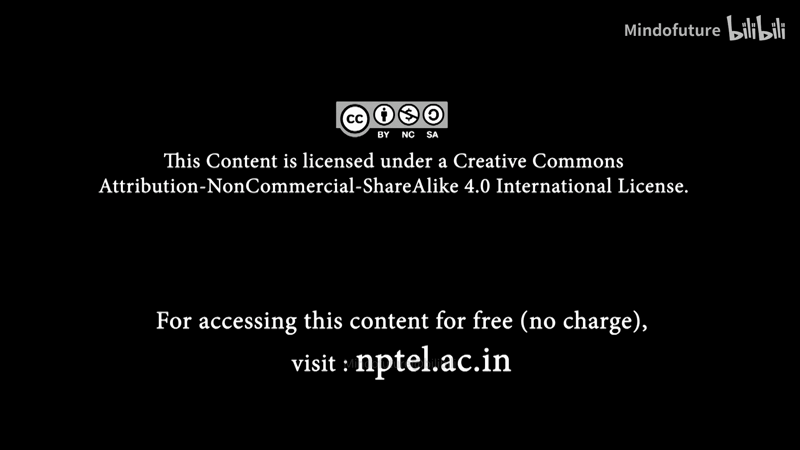
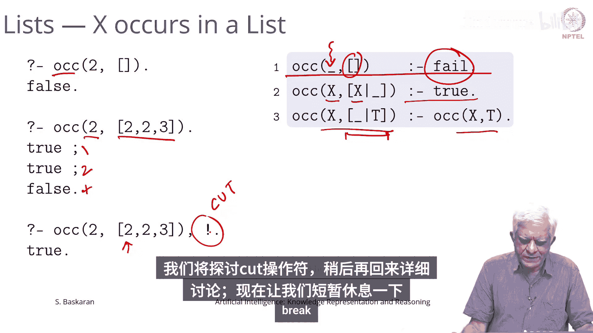

# 【印度理工学院】知识表示与推理 ｜ Knowledge Representation And Reasoning p51 P51_Prolog项合一 -BV1c4zNBmEyF_p51-

So welcome back。We have been looking at how pro。Handles your program。

 how it answers queries that you are asking it given a program given your program which is treated as a knowledge base。

And we have seen that unification is an integral part of。😊。

The way prolo works and how ti proving works in general essentially。Yeah。Now， in our case。

 unification matches two terms by finding substitutions that make the structure of those two terms the same。

😊，So if you have two terms even and T2。Then are they the same？

The statement t1 equal to t2 returns true。When the two terms unify and the unification process we have seen easily。

This stands were not equal to。T 1 is not according to T2。

And this returns to when the terms do not unify exactly， we can't find it this thing。

Now prologue uses a simpler notion of unification， it does not do the occurscc check。

Because of efficiency reasons。And we remember that， that we can。

The a text is that you cannot substitute for x。A value f of something。

 something something which contains an x。 So if x occurs in the pattern。

That you are trying to unify it with or that you are trying to substitute it with。

Then you cannot do that exactly。So， if you want to。

Use that feature then you have to use unfi with a check that a check is there or not。

 but in general by itself prologue does not do the a check that so it could lead to some logical errors essentially。

So we are talking about unifying terms if you have two constants。Sn equal to some。

 it will return true。If there are two functions with a different function name。FNG。

 it will return false。If there are two different constants， it will return false。

If there are two functions name which match， so we have F andF on both the states。

Then if their arguments can be unified。Remember， that is how we did unification。

 there were procedure called subunify。So， if the arguments can be unified， then it will say yes。So。

 in this case， the argument to the right side is x。

And the argument to the left hand side is G of y and there is nothing which stops you from seeing that x equal to G of y and unification succeeds。

And it also tells you what is a。Substitution that you are using for which variable that you have unifying x with G of y。

If you say sun is not equal to moon， it will say true。If you say is x equal to sun？It will say yes。

 it won't say yes， but it will say x equal to sun。It sounds like。Circular。

But the second one is the answer that the substitution that prologue has found。

 the first one is a query that is there some x says that equal to some。And the answer is yes。😊。

If x equal to sun， then it will become equal to the term sun。Likewise， if you say x equal to f of x。

It'll say yes。X equal to F of x but。This has not used the Ac check， so it is allowed you to say this。

Which of course， as you can see， can run into logical conundrums。

If you were to say unify with a curse check f of Fx， then it will save poll。

So if you want to take care of that particular case， you must use unify with a check。So。

 we said that if two terms can be unified。Nin。Prolog will say yes so if you ask is 6 equal to 1 plus 2 plus 3 it will say no because it cannot find any way of making them the same anyway there are no variables in that。

And we have not evaluated the term 1 plus2 plus c。On the other hand。

 if you said that is this list of 3 to1 the same as a list written in a di format in the headtail format。

It will say yes。They can be unified because internally。This is same as this。

 as we have said essentially now， whether we talk about con pairs or whether we talk about dotted pairs。

All the headtail notation， it is all amounts of the same binary tree。Ming。

You can ask that x plus y plus z is equal to 1 plus 2 plus e and it will happily say yes。Yes。

 that these two terms can become equal。If you said substitute x with 1 and y with2 and z with 3 essentially because then of course they will become equal you can even ask。

That is x plus y equal to 1 plus 2 plus 3。Again， it will say yes and say yes if x is1 plus 2 and y is 3 then these two terms will become equal remember x and y stands for they are all terms and these are terms can be defined in a nested fashion the function symbols can occur inside plus is a function symbol it can occur nested at any level essentially。

Similarly， if you ask that。Is this list can it be the same as this list， the answer will be yes。

 if x equal to 3 and y is equal to lists containing 21。Lakewises。

A list containing x and y and something else。Which is it。

Can it be equal to 321 answer is yes if x is 3 y 2。And that something else is a list containing one。

So unification will do all this for you。So， is this pair x and a list starting with x。

 can they be made the same？Yes， if x equal to 3 and。So。

 axis 3 which takes care of the first part so the second part remains。And T is equal to 21。

You can use。A function name inside。And you can match it with a variable z。So。

 you will see in the answer Z is to function of something and what is that something？

Whatever t matches with and this t will match with this part2 and 1。So2 and one will come here。So。

 if you want to write a program to find out whether an element is present in the list or not。

 let is call the name of this program as occurs， which we will abbriate to OCC here。

And we want to say that our first argument is some element。

 the second argument is a list and we are asking whether this element is there somewhere in the list essentially。

😊，This can be done by this program here。嗯。The first line written here。Is actually redundant。

What it is saying and if you want to put it down。To show that， logically。This can never happen。

 because， you know the。Condition is fail， which means the。Consequent can never be true。

 so essentially what you are saying。Is。That nothing can occur in the empty list essentially so there is an empty list and whatever you put here this formula can never be made through essentially that is what it is saying essentially。

😊，It's never used in in。In running the listing。Otherwise， it is。😊，That。

X occurs in the list if x is the first element in the list。Again， this true is redundant。

 you can leave it out as we have done in base clauses earlier。But if it is not in the first element。

😊，Then。Acurs x in this this whole thing is a list。Is true。If x occurs in the tail of the list。

So to determine whether an element is J in the list， look at the head element。😊。

If it is there as the head element then say yes， it is the endless。

 otherwise look in the tail element。So， if you ran this program with these queries。

 as you can see the first query will return false because in the empty list there can be nothing。

Anyway was？Think about this that even if you didnt write the first clause it would still return false because of the fact that Blo has this idea of negation which is that I was not able to show that it two belongs to this list and therefore it must be false which is called negation by failure。

But if you ask this。Does2 belong to the list containing2，2，3？Then it will say yes one time。

Then for the second time it says yes， again it is found another two that means。And then it says。

That's all。 So no more tools inside the list。Now， if you want one。

Be careful and simply say that just tell me whether it is there in the list or not。

 dont tell me all occurrences of that element you can do so by this feature which we will study。😊。

It's called cut。It's called a cut operator， it has。

A procedural semantics it doesn not have a logical semantics。But we will see that in a short win。

 So what is the impact of cut is that。Once。It is。Found that there is one occurrence of2。

It does not look into the tail of the list this cut stops from looking it at the tail of the whatever remains essentially okay you have found the two just return the answer to and that is the end of the whole thing。

We will look at cut， we will come back and look at cut， let's take another short break。

