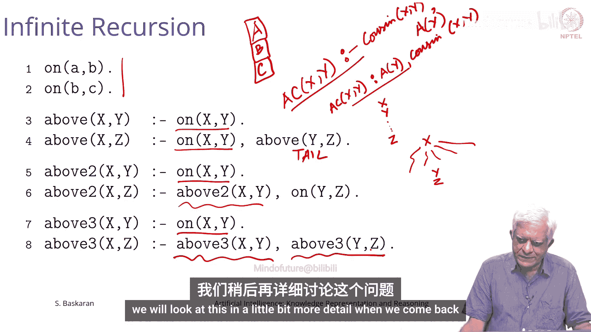

# 【印度理工学院】知识表示与推理 ｜ Knowledge Representation And Reasoning p52 P52_Prolog目标顺序 -BV1c4zNBmEyF_p52-

We are back。And we will been looking at this Ro small program。Which is used to determine。

is whether an input argument X occurs。In the list， which is the second argument。So。

 this occurs has got。A schema of two。Arguments。Element。List。

And it looks for element in the list and if it finds it， it returns true。

We saw this program last time， and I had also mentioned。That the first clause is kind of redundant。

 so we can actually work with the second program， which simply says。That。

X occurs in the list which starts with x that is the first clause the second clause says that x occurs in the list if it occurs in the tail of the list essentially。

And here are some more examples if you ask whether three occurs in this list 2 to3。First。

 it will say yes， then looking for another answer， it will say false that is because it is time to give you all answer。

 it will look at the entire list before it。Gives up。If you ask whether4 occurs in the same list。

 it will simply save false and that will be the end of it。

If you simply give a variable and say is there something which is there in the list then it will enerate all the elements so first it will say two then another two then  three and then say there is nothing more。

😊，And that。Prologue's way of saying that is that false fine， I can't find any more answers。

We can also do the same kind of program when。The second argument is a term， so its a。Funal name。

With some number of arguments。And the definition is。😊，Alogs， as you can see。

 it is either the first argument of that function or it is a later argument of the function essentially。

So， some more examples2 does not occur in nil。But if you say does2 occur in this f of2。Of F of 2。

 so it iss a nest definition。Of the function of the term， so it occurs in this place。

 so it says true， it occurs in this place， so it says true。Then it can't find anymore。

 so then it says false。But as I had said earlier， if you。Use the cut operator。

 it will just tell you whether it occurs in the list or the term in this case as as the case maybe and stops with one answer essentially so we will look at cut。

We have already seen the definition of a pin。So let's kind of revise that again。

So heres the definition given here。With to。Says。That first clause says that an empty list appointedended to an empty list will give you an empty list remember that the third clause。

The third argument to the predicate is the append list。

The second clause is that if you take an empty list and。😊。

Apppend it to a list containing head and tail。Then you will get the same list containing the headnt。

The third argument is a recursive clause， which is。

That if if you take a list of x's and if you take a list of y's。

And it gives you a list of zs then it is also true that if you if you start if you if you put x at the head of x's。

你。Uend with the same wise， you will get zs with a list of x so we have seen this definition before。

So， you could also write this in a style similar to that we would add。So， you could say， for example。

You could define a list essentially， you could say。An empty list is a list。Then， you could see。Okay。

 I am mixing up upper per case in the lowercase， I hope that doesnt matter。

It is very similar to the definition of natural numbers，0 is a natural number and successor of0 is a。

Successor of any any natural numbers the natural numbers。

 so here we are seeing an empty list to the list and if you put anything at the head of it any anything at the head of any list then。

😊，You will get an empty list。 Then you don't have to go into。

Some of this complex stuff that we have written here。The same the。

These two clauses can be combined into saying。Ned。Upend。Empty list。X， x。Provided。listist。X。

But they are equivalent definition， so either should work。They are almost equivalentent。

The definition Ive written is slightly better。Logically speaking。So again， if you now ask this query。

That if I take one and two and a point into3。What is the Z I will get？It says that will be one，2，3。

You can see， if I take。1 and2。And。Appppenend it to something。Will I get the list containing  one，2，3。

Then it will say yes that something must be the list containing3 remember that all the arguments must be list here precisely。

And of course， it says false because it can't find any other answer so whatever。😊。

There are variables it will look for other answers。X can be the first argument。

This can be the second argument and  one23 is same it will again come back and say yes。

 x equal to 1 and 2。So， by now I think we are familiar with this process。

 the way prologue works I think。If you give two。Variables in the query。

Is there an x and is there a y？Sa that when we append them together， you will get the list 1，2，3。

And pro will an all the possibilities for you essentially so first it says。

X is empty list and y is a target list。Then it will say x is a list containing only one and y the list containing2 and 3。

 then it will say x is a list containing one and 2 and y the list containing。3， then finally。

 it will say x is。Target list and y is the empty list all fault listings it will anate for you session。

If you take the same query and。Add another。Question to that。There is a length of y2。

Then it will give you only one answer。Which is。When y is equal to 2。Fi。Is it a crusse？

I will ask you to define the length function in prologue。So。

 the arguments to the length function should be first argument should be a list and the second argument should be a number。

And the meaning of that predicate would be。That。As shown here， too is the length of a list。Goldway。

Now we have seen that many of the programs that we have written are recursive programs。

 they look at some part as a base clause and then they look at the rest of the data sector as a recursive clause essentially。

And we have seen in the examples that we have seen， for example。

 membership of element in the list or app to list that when the two arguments are finite。

When the arguments are finite。And we will not go into the detailed definition there is a very well defined notion of what do you mean by finite here but in our case when for example the the list is of length 3 or the two arguments are length 1 and 2 or whatever as long as we are dealing with finite structures we will have finite recursion and it will try out all possibilities and terminate。

😊，But sometimes， for example， if you look at the set of natural numbers。

 there is an infinite set there。You can get into infinite reion。Inferitetic cushion can be。

Of two types。One is that you have somehow got into a long infinite loop， so we discussed。

Some time ago that you can have a rule which says if x is valid to y。Then y is merit to x？

And we saw that there was a possibility of getting into an infinite loop doing nothing there。

 so that could that is a possibility that could happen。If your program is written。

 which has that this thing。Here also we saw this definition of above and below。

 which are kind of the opposites of each other。And they could get into an infinite loop calling each other all the time。

The other way that infinite recursion can happen is when you are looking at infinite structures like the set of natural lus。

😊，We have probably seen this before。😊，But let's do a quick recap。 We are talking about。

Our knowledge base of three blocks。So we have our three blocks。Yi。😔，Ninbi。😔，Linxi。

That is given to us as a knowledge base。A is or B。And B don't see。

 and then we have a definition for above。The definition above there are three definitions we are looking at。

😊，嗯。1 is called above one is called above 2 and the third is called above 3。

 all three have the same base clause that if x is above y， x is on y， then x is above y。

 the base clause is the same。The recursive clause is different。

And this will take us into this area of lu ordering essentially。Ordering。

Which order is a good order to write？The ante。So， as an example。Why ordering matters。Then。

This is an example， for example， this is。That。If you have an American cousin。

So let's use AC for American cousin。X， y， or Y is an American cousin of X。If。Gzen。

And we have seen the definition of cousin。X y。And。😔，Let me use a for Americans。喂i。So。

 why is an American cousin of x if y is a cousin of x and Y is American？Now。

 just imagine an alternate definition where I say。I just use a different order。X， y。American way。

And cousin。X为。The same logically it is saying the same thing logically it is saying。That。

X is an American， Y is an American cousin of X。If y is a cousin of x？And why is American。

Procedurally and that is what impacts prologue。The order in which you write the two antecedents matters a lot。

Now， just imagine。That I ran the first version of the program， which is this one。

What I say is there is。Does Soish have an American cousin？

Then what will it do it will search through your database。You know， again， talkeded down and so on。

And look for somebody which can be shown to be a cousin of Suish。So it is look at the cousin of Sure。

It will find a cousin of in that database if there exists， otherwise it will say false。

And then check whether that person is American or not。😊，Compare this with the second。

We are writing the same rule it says。W is an American cousin of X if y is an American so if you were to execute this。

😊，What would you be doing you would saying you look at all people and say， oh。

 is this person an American if yes， then is he a cousin of or is she a cousin of？Sish。So。

 it will go through all the Americans before it finds a cousin whereas the first clause will look at all the cousins and then find an American so you can see that efficiency wise the first definition is much more efficient than the second definition so order matters or not in to loggue essentially。

😊，So we have just two three definitions of above here。

The base clause is the same is that if x is above y。If x is on y， then x is above y。

 then one definition says that。X is above a， if x is。On why and why is about that。

 So what are we trying to say here we are trying to say here is that。X is here。Then y is below that。

And somewhere there。There is a z so we are searching from the top。

And saying is there something which is which x is on and is that thing？Abo said。

Whereas if you look at the other two definitions。😊，Their first clause is the recursive clause。

 which is the above clause。 This is called left recursion because the recursion recursive clause comes。

First and then the other clauses come。Whereas this is called tail equation。

And telec is known to be efficient， essentially。In this query， in the second query about two。

 what are we saying？That。X。Will be。Above that。If there is some， why somewhere。

Such that x is above way。And that is why sitting on it。

You can imagine the kind of search that you have to do here。

To try out different whys and then see whether that y is sitting on it it is analogous to the example of the American cousin that I gave her。

u。The basic problem is the same essentially。The third definition。😊。

Does not even use the on in the recursive clauses it uses above and above。

Now you see that this will indeed find a solution just think about this and you will see that indeed find the solution the question is about。

Efficiency essentially so we will come back to this this is to do with goal ordering and we will look at this in a little bit more detail when we come back。

😊。

