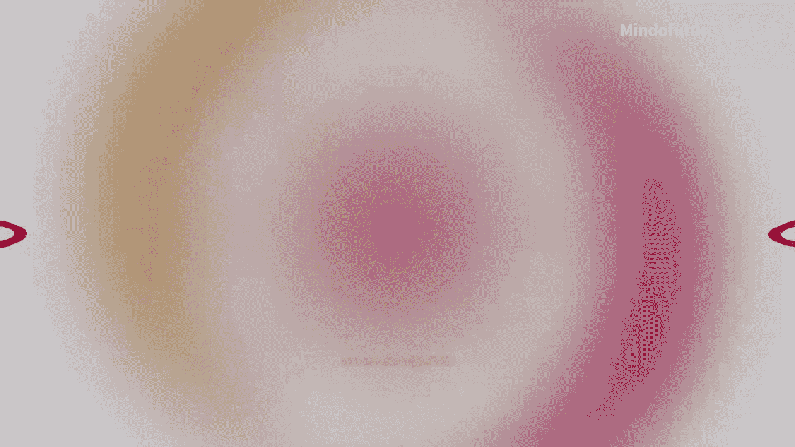
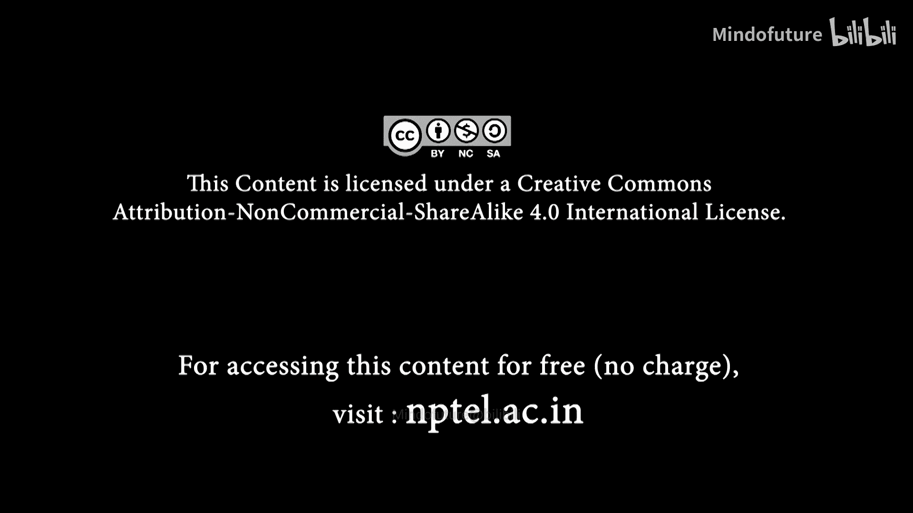
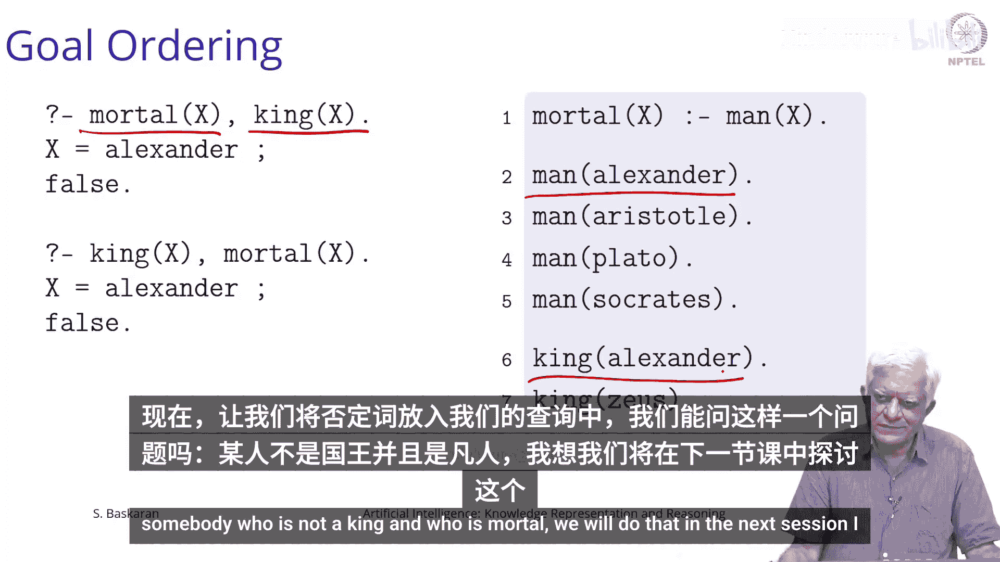

# 【印度理工学院】知识表示与推理 ｜ Knowledge Representation And Reasoning p53 P53_Prolog表格 -BV1c4zNBmEyF_p53-

When you come back？So， we are looking at。The problem cases in prologue were。

Your program could get into an infinite。Loop， essentially， especially when it comes to recursion。

 essentially。So， we started by looking at this definition of above we looked at three definitions of above。

In the first definition。You are looking at。You are saying x is above that if x is on y and y is above z。

 so somewhere may of course you will search further so obviously if you use the same recursive definition。

Then this will lead to a second query which says x is above y y is above y1 and that y1 is above  z essentially so you will gradually grow from the top。

Only looking at those objects on which this。One of the object is there。Whereas in the second。Quie。

We have this possibilities of。All those vis， we want to look for all the wire which can be below。X。

So let's see what happens there。Remember， our knowledge base is simple。We have A， B， C。A is on B。

 B is on C。If we say above AB。Whether it's true or not。The first version of our preddicate。

 which is called above， will say through。And then it will say I cannot show anything else。

Because the recursive close。Will stop there essentially。It will it will not be able to。

If you were to use a second definition， it will also give you the answer as true。

As I had said that you should work it out that it is indeed the case。But。

Trying to look for another answer。Because it is left recursive。

It will try to go into it will get caught in an infinite loop。

 The same thing will happen with the third definition。 and the problem with that is， as we saw。

Earlier。That。The first clause is a recursive clause， which is a left recursive program and they will。

Go looking for answers and eventually your machine will give you a stack overflow problem。Now。

 if you look at this answers， ABC。If you look at this blocks， ABC。

And you ask a general query is something about something else？

Then you can see that there are three answers to this。net。A is above B。Bs above sea。N is about C。So。

 ideally。😊，If you were to ask the general query which is with variables。

It should generate all the three answers。But。We have already seen。

That there will be a stack overflow here， so。Ploggue。Allows you。To shift into。

Data driven more and says that。Create a table of whatever you know so you are seen that a is above V and so on。

And then work with that table essentially this process is called tabling we will not go into too much detail。

 but。I just wanted to highlight the fact that modern prologue will allow you to。嗯。

Prevent infinite regressioncursion on left recursive rules essentially and you can do that by this process of tabling。

What happens if you do that， then all three versions of the。Definitions。

We will give you the same three sets of answers。They will end a little bit differently。

 The first version would say that there are no more answers than other two will terminate。

After giving you the answer， because they are the only answers which occur in the table essentially。

So this is just true。😊，Let you know that。There is a way of。Avoiding infinite recursion。

In situations where you must use this table feature。So here's another example。

You are creating a table for the sibling predicate。

The sibling predicate is defined here on the right hand side。There are two facts given to you。

Eva is the sister of。Eer。And Dan is the brother of Frida， this is given to you。

And the query that we are going to ask is that are there two siblings in our database。

And the our rules for defining siblings are as follows。The first rule says that if you are a sister。

 then you are a sibling， the second rule says if you are a brother， then you are a sibling。

The third rule says that。If x is a sibling of y， then y is ase sibling of x。

This is like that married thing that I had mentioned earlier essentially。And we have another rule。

which says which is a transitive rule， it says that if x is a sibling of y and y is a sibling of z and z is not the same as as x。

 then x is a sibling of z essentially so if there are three individuals you can and you know just this information。

Then you can what is given here， then you can conclude that who is a sibling of why？So， ideally。

 the answers that you would expect is that yes。Ada is the sibling of Eva， Ada is a sibling of Dan。

That' is given to us in the database itself。But also that Eva is a sibling of Ada and Iva is a sibling of Dan。

And that Dan is a sibling of Ada。And then is a swelling of E， so you can see that this is the same。

This， but because。Of this。Call。We have generated two answers。Two separate answers。

But because of the fact that we have used the table。Feature here。

We have stopped with those two answers， and we have not gone into an infinite loop， you know。

 repeating that。So， we are not going into an infinite loop in this clause。

That if x is a sibling of y y is a sibling of x and therefore x is a sibling of y and therefore y is a sibling of x。

 we are not going into that cycle and that this table feature allows us to do。So。

 this is known as SLG resolution tabled execution。😊。

It memoises that means it remembers what are the answers that it has found so far。

It is a form of data driven computation。And benefits of memorization are that it avoids predicate reealuation。

 improve performance if you have evaluate this predicate once it does not it again essentially。😊。

It avoids infinite recursion of left recursive rules avoids infinite recursion due to loops in data。

It removes duplicate answers， okay。So for further information。

You should look at this documentation given on the SW pro site。

So we we have been talking about goal ordering that goal ordering is important。

Here is our favorite statement we started the course with all manner model。X is mortal if x is a man。

And we have some data， Alexander， Aristotle， Plato， Socrates， these are men。

And Alexander is a king and Zeus is a king exactly。So if you ask a query。

Is there somebody whose modeltal？Our program will give us all the four answers as you can see here if you ask is there someone who is a king again it will give you two answers。

If you ask a query。That is there someone who is mortal and who is also working king？So。

 we have Alexander's model， Alexander King。Then irrespective of the order in which you give this query。

Moortal first and king afterwards。Prologgue will do your job for you and tell you that。Yes。

 Alexander is such a person。And I'll also tell you that there' is no other such person。So far。

 we have not spoken about。Nigation。What if you wanted to say？Is there somebody。Who's a mortal？

And who is not a king。You can see in the example here that there are three such persons， Aristottle。

 Plato and Socrates， they are modelt and who are not kings。How can we do that in prologue？

The key part is who is not a king？What's even more difficult。As we will see shortly。

Is if we reverse the order。If you ask， is there somebody who is not a king but who is a modeltal？

Then we can run into problems。That's a problem that we are going to see。Which comes。

With the way pro log things about negation so I have already said。That。

Prologue uses negation by failure if it cannot show that something is true。Nin。It will say that。

 it is false。So， now let us put the negation in our queries can we ask this question that somebody who is not a king？

And whose mortal。

We will do that。In the next session， I think。