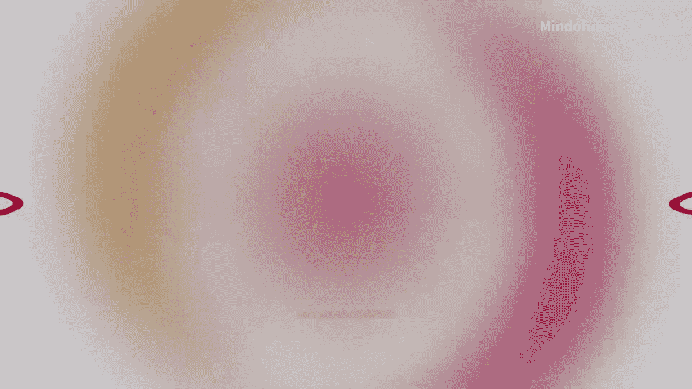
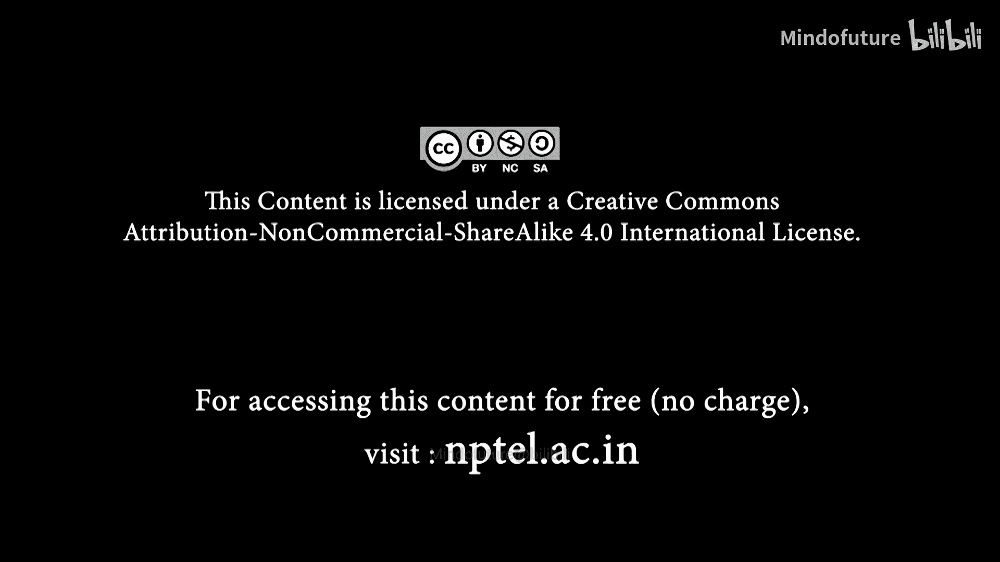
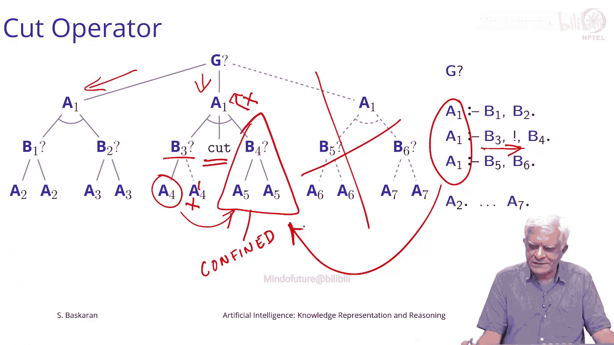

# 【印度理工学院】知识表示与推理 ｜ Knowledge Representation And Reasoning p54 P54_Prolog失败即否定 -BV1c4zNBmEyF_p54-

So， welcome back。We have been talking about models and kings。And mortal kings。

And we have seen this small。Database。In which there are four persons。

 Alexander Aristotle Plato Socrates。And。There are two kings in our knowledge base。One is Alexander。

 the other is use。And if we ask equally is there someone who is mortal and who is the king？

Then the program comes vacancies。X is calendar， Alexander。And it says there are no other such person。

If you ask the。Qury with a different order， is it somebody who is a king who is mortal？

And again it comes where I can say yes， Alexander x is equal to Alexander and again it says there is no other such person。

But now let us ask this question is that is there somebody？Who' is not a king and whose mortal？Now。

 you can see。That there are three people in our knowledge base who are men。

But not kings and therefore they are mortals。But not kings。How can we get that answer？From the look。

So， inlogue。We have this notion of negation here。This backlash stands for n n plus means stands for positive。

 so in some sense backlash positive stands for negative。So you can think of it as not。

 though it is not the logical note。It is a negation by failure or not that means we cannot show that it is true。

So if we ask the query。Is there someone who is mortal？So， what will the program do。

 it will look for somebody's model， then it will go to the second part of the query which is who is not a king。

能。By the time it comes to this query。We know that x is。Either Aristotle or Plato or Socrates。

Or Alexander， for that matter。But Alexander will fail because Alexander is a king。

 so the fact that Alexander is not a king will not succeed。😊，But for these three individuals。

Moel will succeed。And not a king also will succeed。

Because it will look what it will look for is it is is aistotle king in the first instance。

And it will find that no。It is is a king cannot be shown。So。

 it satisfies our query that Arotle is a modeltal and he is not a king， so it will say yes。

 the answer is aotle， then it will do the same for Plato and the same for Socrates。But if we say。

If we change the goal order， we say is there somebody who is not a king？And who's mortal？

Then very curiously it comes up when he false。侬。That doesn not logically follow because。Liino。

That there are all these people who are not kings and who are mortals。But it is saying that no。

 this is not true。That there is somebody who is not a king and whose mortal and is is coming back with false。

And we will see the reason for that is。That is negation。Cannot handle。Variables。

It can handle if you say is Aristotle a king， is Aristotle not a king？

It will say true if you say is plato not a king， it will say true if you if you say is Alexander Alexander not a king。

 it will say false that is why Alexander doesnt figure in the answer in the top query。

But if you give a constant is an argument not a king。

Then it works and it will tell you whether the statement is true or not。

 but if you give a variable to an argument。With a negation。

Below that then it is will always return false that is a quirk of pro log and the way it implements negation。

So let's explore a little bit of negation now。😊，So。

 this is a negation a negation of b b is some goal。So。

 we use the term goal for predicate interchangeably in prologue they tend to call everything a goal so we have goals and sub goals。

 but everything is a goal。So， in the absence of a negation goal in the body。

And in the query goal ordering and query does not change the solutions we have seen that it can tell us that there are three people who are mortal and who are not kings。

The location of the negation in the body and the query may change the meaning of the program。

As we have seen。By meaning of the program we basically mean what is the set of answers that this program will give us essentially and that is called as。

Meaning。Indian notional semantics。And the meaning can change。

 as we have shown seen in the previous example that if you put the neation negativegd goal。😊。

Not the king。Earlier。Then it was not given us the correct one。

 so it has basically changed the set of answers it is going to give it says there is no one like this。

It means it has changed the meaning of the program。

We have already seen that goal oriented can improve the performance of the program by doing unwarranted search we saw the example of the American cousin and cousin you first check whether somebody is a cousin and then you check whether that person is American is much more efficient than first checking whether somebody is an American and then that person is a cousin。

So goal ordering can matter。In first photo logic。When a knowledge base does not entail alpha。

It does not mean that the knowledge base entails no alpha。That is logical。If you cannot。Yeah。🤢。

Show that something is true。It does not mean that it is false。 so that is the open world assumption。

 Prologgue is is a cold。closed world assumption which says that if you cannot show that it is true。

 then think of it as false or treat it as false。So prolo can only prove the existence of something。

 Prolo cannot prove the nonexence of something； it can only show that certain things are true easily。

So， it has only two outcomes one is solved or fail to solve essentially negation as failure。

Or negation by failure， as we say sometimes。Nagigation by failure assumes that if you cannot show alpha。

D。Alpha is false。That not alpha is true。But it's not a logical note it a。

Negigation by failure notice。Which of course is logically it doesn't make sense。So。

 product treats failure as proof of non existence。That。If you can't show that it' is true。

 then it must not be true， that's a basic idea。And thus。

 a negatived goal B returns true when all attempts to solve be fail basically so you to show that not be is true you try to show that b is true and if you cannot show that b is true。

That means all attempts have failed， then you say that neg of b is true。

It is a weak form of negation and was introduced to deal with missing information。

And you should read it as fail to solve b so when you say not p， it really means。

Could not show that B was true。We have already said that it is not equal to the logical lot。

Because if you put a knot p somewhere。Then。You will violate the definition of this listing。

It turns the gold body not being the gold body turns the gold clause into a definite clause。

 so it becomes like this。And if it is there in the。Body。Then it， it's no longer a horn close。

Which is why our example of。Asking that is there somebody who is not a king whose model did not work said and the program came and said that nobody works and the reason is that the negation of a predicate with only free variables will always return false essentially。

With only variables。So， I had mentioned the cut operator earlier so lets。Look at that。

It is a system predicate。It's not a logical predicate。

It is produced it is procedural construct which breaks logic versus control separation a little bit。

It prunes a search tree and improves efficiency， we will see how it does that。

And negation of failure can be implemented using a cut so if you want to define this not be predicate。

You can see。Call P。And if you succeed， then you go to this cut。喂。If P is true。Then you go to the cut。

And。D。Cut doesn not do anything； it allows you to move forward to the next one which says fail pale is false。

So if p is true， it will return false。If P were to be false。

 that means you could not show that callP did not succeed。

Then you would backtrack from there itself and come to the next clause which is not p and not p is been given as a fact to you。

 so you will simply say not p。So this needs a little bit of careful understanding。

 There are two cases。 One is when P falls。1 is when P can be shown to be true and one is when p cannot shown to be true。

If P cannot shown to be true。Then we backtrack from here itself。

Because we are not being able to show the P through and then we go to the。Next clause here。

 which says that P not P true。So， if you cannot show p2 be2， you will end up saying not p2。

But if you can show that p is 2， which is the second case， we will move forward to the second clause。

 which is a cut clause。Cut the operator。Cterwriterer will not do anything， it will say okay。

 go ahead。And return fail。So it will return field。But more interestingly。😊。

It says that we have come up with a final answer。That you don't go and try the second clause anymore。

So， we have shown that not p is。Fals。Now don't go and try and show it true by some other means。

 the other means is simply saying that it is true。So。

 if you think of it a little bit carefully about this， what you are saying is that。😊，If it is true。

 then cut will stop it from。If P is true。Then cutt will force you to return false。

 which is what you want to return。Because not p is false， a P true。

But it will not try to go to the second clause， which is saying that no， no， no， not be true。

So if phase is true， you will end up only saying that。Not peaces， which is what you want。

If P cannot be shown to be true， then you will never reach the car operator you will backtrack before that itself。

And go to the second clause which simply says that TP is false。

 so this is how negation by failure can be implemented using this cut operator so what we need to understand。

Is this cut operator？So look at this search tree here。You have some gold to show。

And you have some three options。 So you have three rules， even a23。Versrgins of rules， okay？So。

One version says even is true if。B1 is true and B2 is true。

The second version that is shown on the left branch。

 then the middle branch shows a 1 is true if B3 is true and b4 is true。

And the third rule is which is the lightmost sub， which is that a 1 is true if b phi is true and b6 is true。

Okay， that is the rightmost sub， it corresponds to this rule essentially。So。

 there are three things so if you were to now run this program it will just try out all these combinations a1 a2 a3 a4 up to a 7 and list out different ways of showing the Gs through that is how。

Normal backward training。Will work。Our our normal depth search on the gold tree will work。

But a cut operator。😊，Changes the structure。Of the tree essentially， how does this work？

We have introduced the cooptor in the second clause。And therefore， it is shown up here。

In the middle sub。So for。When we are trying to show that goal is true， it will first try the first。

Branch。And it will try all combinations。And see whether it is。True or not。

Then it will come to the second branch。And。To show that a 1 is true in the second branch。

 which is the second rule， you have to first show that B3 is true。So， if you show that B 3 is true。

 let us say we show that a1 a 4 is true for B3， that means it has succeeded essentially。

The rule says。If you have shown that B3 is true， you go past the cut that means。Now。

 you go to this side of the。Search three。So you have gone past the cut。

But Kt says okay now that you have gone past this point you can never backtrack from here essentially so Kt says that the only solutions that you can now give are in this part of the sub where you can show that before4 is true。

Either by showing that a5 is2。All。Whatever is it the two clauses for a 5 R and。If you can show that。

 it's fine。But you can now go back and try something else so you cannot backtrack from this place that is not allowed essentially once you have reached that region you cannot backtrack from there so if you have gone past the cut。

You are confined。To this up three。You cannot even go back。

To the second way of showing that B3 is2 you cannot。Backtrack from where you were。Normally。

You would have shown that B3 is through using some a 4 then you would have gone to B4 with some a 5 then you might have come back to show some other a 4。

So， let us call it a full prime here。But you are not allowed to go back if you have gone past the cut。

You cannot。Go backward， essentially。That is the interpretation of God essentially。

Notally are you confined to this。This part of the sub will not be accessible to you because you are not allowed to backtrack and try something else for even so remember there there were three rules for even。

The left rule which is the first rule， the middle rule which is in the middle row。

 which has a cut and the right rule which is on the right hand side。If you have gone past the cut。

Then all your options of showing。Even are confined。Do this。So。

 it is a very interesting operator which can be used to control。Efficiency in search。So。

I will stop here for a moment。For you to think about what cut does。嗯ello。By looking at this diagram。

And we will come back and see how cuts can be useful。

 so that will be the last part of prologue that we will look at essentially。

