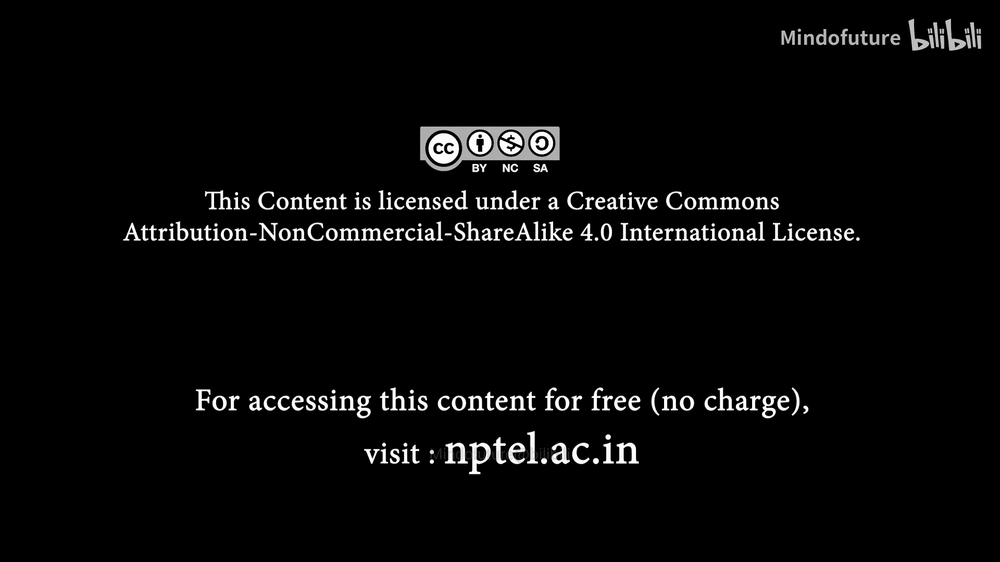
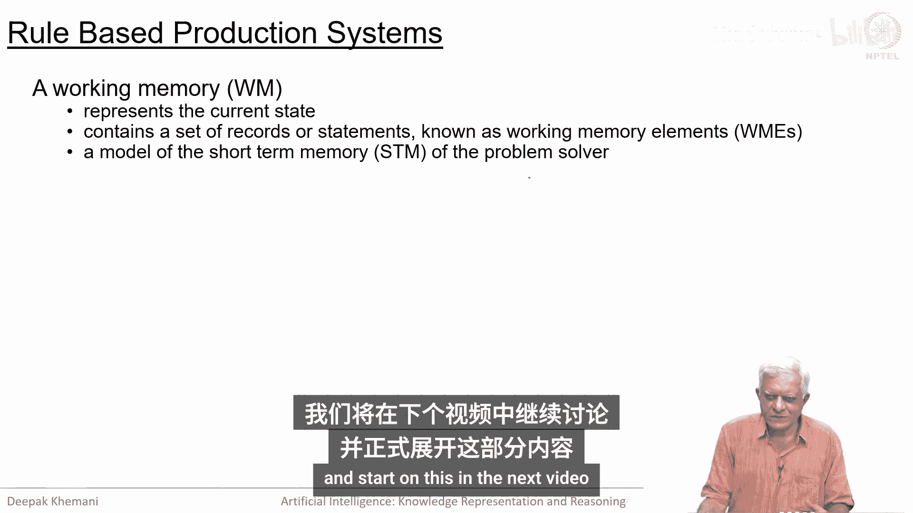

# 【印度理工学院】知识表示与推理 ｜ Knowledge Representation And Reasoning p56 P56_基于规则的专家系统 -BV1c4zNBmEyF_p56-

will come back。We started by looking at logic。And then。We saw。

That logic could be used for competition。That you could do programming in logic。

And we looked at that concept。And we looked at prologue a little bit。Plogue was doing logic。

With backward chain， which many people have said is。The way that humans also reason。In the sense。

 they think of a goal and then they see how to achieve that goal essentially。So。

 then they would start reasoning backwards from there and many people including Koalski have said that backward reasoning is the way humans think。

😊，But there are also many situations where you do reasoning in a forward fashion that you look at something and then you make some inferences and then go ahead。

😊，So。Now we will look at。This field of rule based expert systems。

 which came out of forward training essentially。That you could look at patterns in your domain。

And make decisions essentially。And it has also many applications as it is， in fact。

 it is very popular in many corporate environments where they have you know business logic which has to be entered into。

😊，Program， which will make decisions for them。And they also like this idea of declarative programming。

😊，So both were and。Rulway systems that we are looking at today。

They promote this idea of declarative programming。The prologue is not pure in the sense that the user does have to。

Order the clauses carefully。The idea on ruleway system is is is。

Is more general in that sense that you just gave us the rules。And we will。

rite an influence engine which will run those routes essentially of course we will give you some metal level control so we will look at something called search strategies。

😊，And once you have chosen that then we will do the rest of the job essentially。

 but the rules don not have to be written in a particular order or in a particular fashion essentially。

😊，So let's start with that。We have looked at backward chain we have looked at forward chaining。

 we have also looked at resolution method， which was a complete method。

 but for our current interest forward and backward chain is what we are going to be working with。😊。

So， rules。They connect antecedents to the consequence。

 so that is the idea of a rule if the left hand side is true， then the right hand side is true。

 essentially。We imagine the world described by statements in some language in our case it is going to be first or logic。

And then。We will write rules， which will look at subsets of this。Knledge base。

Or look for patterns in the knowledge case， that's the idea。Of lighting rules， essentially。

The antecedent of a rule captures a pattern in the domain that if you are looking for a certain kind of pattern。

 then the rule will capture that。If the pattern is matched then the consequent will hold through and if you are doing logical reasoning then you will assert that the consequent is true。

But， we will see that。The idea of rule based systems is is more general than just making。

Inferences you can also trigger actions essentially and this language that we are going to look at allows us to do that essentially。

So backward traininging looks at the goal。And it translates into the sub goal。

 it repeats that process till the sub goalss match something in the knowledge base。

There is a pattern that the rule capture。Exist in the domain。

I is the question that we are asking so if you have a goal and the goal has an antecedent which is a pattern and is that matched in the knowledge base？

So it's a top down process from goals。 we are going to sub goals towards the。Individual facts。

 if you want to see that。It's goal directed， essentially。

It is a low branching factor because only the rules switch。😊。

Have the goal as a consequencesent will apply。It' is also lazy processing。

And you make the inferences。Only at query time when somebody asks that is this particular goal true only then you go ahead and make this inferences which of course means that it could take time also。

On the other hand， forward chainning focuses on the pattern in the data。

And consider the consequences of of that pattern。 essentially it's bottom up。 it's data driven。

 It looks at data and say， oh， I see this pattern and this is action that I can take or this is a。

Inference that I can draw。By definition it is eager processing as opposed to lazy processing is that if you can make an inference you go ahead and make it。

 you don't consider whether you wanted to make that inference or not or it is leading to you to the goal that you have in mind or not you just go ahead and make that inference and that is why these kind of methods they need some additional guidance as to you know which of the possible inferences that we can make which one should you really make essentially because we are assuming that we can make only one inference at a time。

It has obviously high branching， because。Many inferences may be possible。

 not all of them will be relevant to the goal that you are interested in。So。

 this field of forward training。Data driven processing is also called pattern directed inference system that you look at patterns and based on that you make inferences and you proceed in this fashion。

The question that we are going to ask today and address it is how to make forward trainingning。

Work efficiently。So， that is the idea of a pattern that I could inference in some so if we have some given state which we can also call as a knowledge base。

Then a rule looks at a small subset of the knowledge base。

And does something essentially makes an inference is the simplest thing that you can do。

But you can do other things also essentially， you can trigger some actions， for example。

 if you are controlling a robot and things like that。So。

 our rule looks like at a part of a state which matches a pattern and does an appropriate action essentially which is。

Given the described in the rule essentially。So what triggered this idea of。😊。

Pool waste expert systems is that okay find you are building this system。

 but where do the rules come from essentially？So obviously。😊，Every time you develop some software。

You have to somehow inject。Doomain knowledge。In that essentially even simple things like sorting and array you have to study sorting methods and decide okay this method will work in this situation。

 this method will work in this situation and so on， so some somehow。Kowledge has to be。

Either embedded into the system as it is done in procedural。Languages。

All it has to be expressed as in some form as it is done in declarative languages like prologue and the language that we are going to look at today Ops 5。

But the thing is that these rules have to come from somewhere。

 essentially who knows about this domain that we are trying to solve the problem in。So。

 let's call the domain domain expert who has this domain knowledge and the idea behind rollway systems is to extract that knowledge from the domain expert and put it into the system。

So can we elicit those rules from exports？So the expert may be an expert in whatever domain that they are。

Working on。And that is where the idea of rule based expert systems。

Came up this was very popular around 1980 little before 1980 and a little after 1980 also。

And many systems were developed， they were developed for example， prospecting oil。If you are。

Company which digs oil from the earth， then you have to you know dig you have to you know search for where could oil be do some study。

 make a well dig it and see if you strike oil or not。 So this whole process is so。

Expensive that people feel that if a rule based system。

 people felt that if if a rule based system could give us a good idea of where to dig。

Then it would not pay for its own development simply by the amount of money that it would save the company。

So there was a system called prospector。Maybe you should go and look at that essentially。

Another feature。😊，Where people tried to develop expert systems was in diagnosis。

Human diagnosis as well as machine diagnosis。Because diagnosis is really pattern driven you see a certain pattern and you make certain inferences。

Diaaggnois is complicated by the fact that it is not。Deduction it is as we have discussed earlier。

 it is abduction， but nevertheless it is a very useful thing to have and therefore people have spent a lot of time。

Doing diagnosis。 So one of the earliest diagnosis systems was a program called myin。

 if you just look for this。On the internet， you will get some information about it。嗯。

Because of the fact that it was doing abduction， it introduced a measure of belief or a measure of access of its conclusions。

In the form of numbers which were called as certainty factors that how certain are you that if you see these these these symptoms then this is the disease then the rule came with these certainty factors and therefore you know you could at least try。

Evaluate of all the possible hypothesis that you are making which one is the most likely one。

And configuration we had already mentioned that， you know。

 they were used for configuring systems in this language。

Maybe we will look at that example very quickly again， essentially。What happened in。

After this rule based expert system idea came forward is that people discover that that conceptually it is a great idea that you go to an human expert。

 elicit their knowledge。😊，Put it in a system and lo you have a expert system。

But it turned out as it turned out the experts were either unwilling or they were unable to articulate the knowledge in the form of rules so in those days the community had developed a lot of protocols which said that this is how you should extract knowledge so knowledge acquisition became a big thing and people put in a lot of effort so they would record interviews instead of asking the experts to。

Articulate rules directly and then from that they would try to extract rules and that kind of stuff essentially。

 but it was not easy。And。It became a bottleneck， so that was known as knowledge acquisition bottleneck。

What happened in the mid 80s is that people said that okay instead of abstracting these rules from experts。

 why don't we just store their entire experiences and that gave rise to a whole new field called case space reasoning where every instance of problem solving was stored as a case。

😊，And a case had two parts， one was a problem description part and one was a solution part so if you could just told the entire thing as a case。

And then you had a whole repository of cases as experience grew。

Then when you see a new problem to solve。You match the problem with the problem part of your cases so retrieve the case which matches best the problem description。

Take its solution description， maybe adapt it a little bit to the current problem and you have a problem solve over there。

It is also knowledge based， it is just as the knowledge is not articulated explicitly in the form of rules。

😊，The knowledge is stored as direct experiences from which you would eventually would have derived the rules and casespace reasoning says let us use those experiences directly and it was also a very successful way of solving problems and a lot of industrial systems were developed which were based on case based reasoning。

And of course， in the mid 80s， Ruors Heart and Company again gave us the back algorithm for neural networks。

😊，So， it kind of。The interest in neural networks came back and since then we have not looked back。

84 85 we got the backdrop and sometime early in this century we got this algorithm for deep learning and since then neural networks have been enough。

Focus of many people who work in AI。But the businesses had spotted an opportunity。

And they stuck to the idea of rule based systems。Even though they would not call them expert systems。

They were definitely a useful way of implementing software and typically in businesses where you have something called business logic。

😊，The idea。That the managers in the business could articulate that logic。

and put it into their system and some system would actually run it was very appealing to them essentially because they didnt have to go to a software firm every time they tweak something because if you are doing programming in a procedural language。

Then a lot of the stuff that you lot of the knowledge that you are putting in is embedded in the code essentially the idea of declarative programming is that。

Control is different from logic。So if you can express the logic separately and leave the control to the machine。

Then we have a different paradigm of programming and that was eminently suitable for。😊。

People who worked in business because for them expressing the logic itself and maybe tweaking it as they experimented with their system。

Gme quite naturally。But they were not called expert systems any longer。

 they were just called rule based。ExRll based systems。Now， one thing about logic is that。😊。

You may have a large knowledge base， you may have a large description of the world。

 but making inferences is something which is local， it is a local action。😊。

That you don't look at the whole knowledge base to arrive at a conclusion you only look at a power essentially so the conclusions depend only on the antecedents being matched essentially so if you have a rule and if you can find the antecedents of that in the knowledge base then you can go ahead and make the conclusion so in that sense it is local in nature that you look at local patterns and you make local inferences。

From the complexity purposes that makes life better。

So one does not have to consider the entire knowledge base so for example。

 if you have looked at algorithms of state based search。

 they read the whole knowledge base as a state and say from this state I can go to this state and from this state I can go to this state and so on and so forth。

Or if you look at something called default reasonney。😊，Which says that。For example。

 you might want to say something like if x is a professor， then x has a PhD。Okay， unless something。

 something， something。There may be eminent people who are professors and who don't have a PhD。

 but you want to make an inference that professors in general have PhD。No。As we will see。

 we will look at different reasoning as we go along。😊，To make default inferences。

You have to look at the entire knowledge base so complexity wise that goes up essentially。

In a similar fashion， probabilistic reasoning。Will also depend on knowledge base because the probabilities will come from the data and the knowledge base。

So， rule based systems exploit the locality of action essentially。Which is true of logic in general。

Forward chain actively considers patterns in the domain。And it says that if I can see this pattern。

 I can do this section。The action could be making an assertion as in logic that if if this pattern is true then this consequent is true but it can do other things also as I said that you can have any kind of actions so if you see this pattern do this and this do this could include making an assertion so in that sense it subsumes making inferences。

So。If you are in a given state。Then you can maybe spot many different patterns in that state。

And therefore many rules are applicable。And you may want to choose one of them。

 so a state is a set of sentences in some language。

 so its a knowledge base in our case the language is going to be first order logic。

And the pattern is a subset of those sentences in that。Knowledge base and a move。

Or an inference or whatever you want to call it。Say that if you see a pattern。

 then you do some action essentially。So it could be that you could。In this example。

 see four different patterns。And therefore do four different actions the key point of course will be which of those four choices will you make and that is where。

The effectiveness of the system will lie。We have already been speaking about declarative programming。

 so lets do a quick kind of a recap of this。A rule associates an action with a pattern in the state physically。

In the language that we are looking at， a rule is also called a production。

A production or a rule it unifies different kinds of knowledge。Into one form。

 it can be heuristic knowledge that if this is a pattern， then this is a right kind of action。

 it can be business rules， like if this is the。Let's say。

Description of a loan seeker then this person is eligible for a loan it could even be actions in a programming language essentially as you will see so it is it turns out that these rules are enough to。

Define a complete programming language which is during complete essentially so just like prolog is during complete this language that we are going to be looking at is also tu complete and but during complete we mean。

That anything that the tuuring machine can do， this program language will allow you to do。

The idea of declarative programming， which you have been repeatedly saying is that the user or the programmer only states the rules。

As I said， it is very popular in business environment for example， lending by banks。

The programmer only specifies the Pat action Association。

She does not specify when that action should be done。

 which is the key part when you are doing imperative programming or procedural languages essentially。

But nevertheless， we will have to talk about search strategies。

Because as we saw in the previous slide， if there are four possible rules that you can apply。

 which one should you choose essentially？So what rule base？

System developers do is that they give you a choice of strategies that you can use and then you can say that okay this is a strategy I will use and we will look at a few examples of that essentially。

Now let's move on to defining lu waste。Production systems。

But since this definition will require a little bit of time。

 lets take a break and come back and start on this。In the next video。

