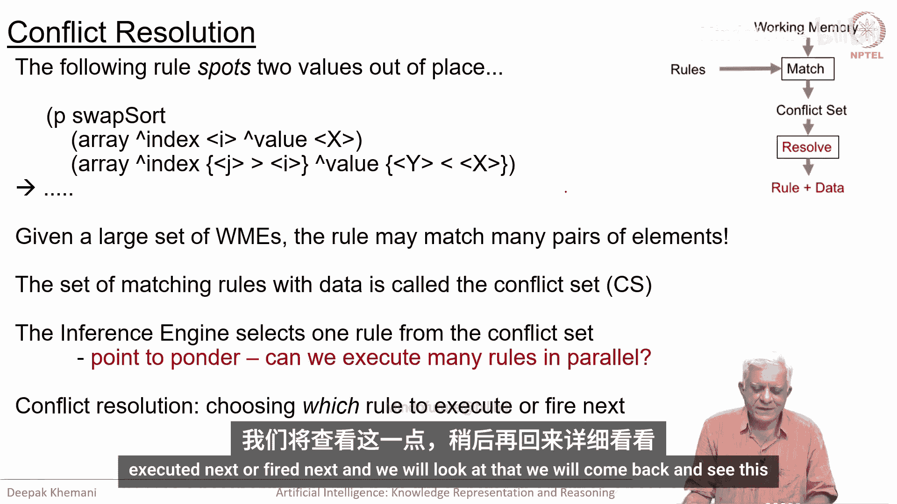

# 【印度理工学院】知识表示与推理 ｜ Knowledge Representation And Reasoning p58 P58_匹配、解析、执行 -BV1c4zNBmEyF_p58-

So， we you come back。We will be looking at this language ops 5。

 which is a rule based production system language。We saw。

That the knowledge base in ob is called the working memory and it contains a set of working memory elements。

And the working memory elements are basically。Class names with attribute value pairs stored inside them。

And rules。Have a name and they have a left hand side and the right hand side the left hand side。

Consists of patterns which should match the working memory elements。

 which means that they should the constants in the two should match the class name should be the same。

 the attribute name should be the same。But。In a rule。

 you can have variables or we can have conditions on on values and then match match is defined。

So let's look at the rules again。The value field in patterns can have variables and boolean tests we have said that。

Paent are。In the left hand side of the rule。So， what are the Booleion tests that we can do？

We can test for equality that it is the same type。Or they are equal essentially we can say that they are not the same type or not equal。

Or we can even just say that they are the same type， essentially。

Then for integers or floating points only we can do comparison because they are ordered sets。So。

 we can say that。Something is less than something or something is greater than something。

The value field can have conjunctions so。This expression here。

With the curly brackets then greater than 3。0。And less than 3。5 essentially says。That。

It should be greater than 3。5。And should be less than three greater than 3。0 and less than 3。5。

Both the conditions must be true and that is captured by the curly brackets。The other brackets。

 for example， they stand for or。And you might say that， okay。

You can come and see me on Monday or Wednesday or Friday then that would be expressed as this which means that if I am seeking an appointment and the day is Monday it will match this pattern if the day is Tuesday it will not match this pattern if the day is Wednesday it will again match this pattern and so on so whether it is Monday or Tuesday or Friday any of them is allowed and so both or and and are captured。

Ordered sets can be compared。And equality can be compared。What about the right insight？Of the rules。

Is a set of actions so in the language of of5pe， we don not say consequent we say actions。

So the actions could be。Consequence。Or at least a certain consequence。

 but we we think of them as actions in logic first or logic we say。

That an implication statement is that if the left hand side is true。

 then the right hand side is true in。Oscribe like languages we say。

If the left hand side is true or it matches， then do what is given to you described in the right hand side。

So， the simplest thing you can do is make a new working memory element that is like adding a consequent and that is what。

Like doing things in logic， essentially， that if。If the knowledge base has all manner modeltal and Socrates is a man。

 then add to the knowledge base that Socrates is modeltal so this part is like doing logic。

But you can also remove an existing working memory element now in classical logic it doesn not make sense to remove things classical logic is also called mathematical logic because it captures the relations between elements in the domain and those relations they x there always。

😊，Exist in mathematics at least that if something is true。

 then it is always true essentially within what is the point of saying it。

 remove it from your list thing。But when you are talking about the real world。

 when you are trying to talk about actions and change。And dame。Then things may be true， essentially。

 So if you have a。Let's say。A block of ice。On your table。Inject name。

Then pretty soon you will find that the block of ice is no longer there on the table。

 so things can be true at some time。 things can be false set another time。

 even if you are doing things like planning essentially so you are doing the you want to。

To plan how to shift your office from one room to another room So initially let's say your set of books was in office  one。

But after you execute the plan your that thing will not be true that AI book that I have in my office is no longer there exactly so things can change with time。

And。Of five allows you to do that essentially it allows you to retract。Hm。Statements。

And in that sense， it is often said to be doing non monorononic reasoning。

 non monorononic in the sense。They are the set of true statements。

Does not grow monotonically it may be some things may be true at some point。

 some things may become false later， so the set of statements may grow it may shrink it may grow it may shrink so it is not monorononic essentially。

We will see that non montroomic reasoning also plays a role in default reasoning。

 which we will look at later that you may draw a conclusion at certain point。

 but when you get to know more about。Let's say that individual。Then you may want to retract that。

 that conclusion。 And so you might make a conclusion like。

W which is which is like a default conclusion that， for example。

 if x is the standard example we use in default reasoning is ifquity is a bird。

 then in further twiie can fly。But later on， if somebody tells you that twi is a penguin。

 then you may want to retract that this thing and so nonmonrononic logics do that sort of a thing。

Of say will allow you to。Do that because you can delete elements from the working memory。

The language has defined something called modify， which is basically equivalent to removing and and。

And adding it again with only a small change that is specified in the modify part so maybe you want to change your D1 attribute then you can use the modify statement that that that increase that change the marks supposing you are adding up the marks of a student and when you have seen the physics in the chemistry Mac marks the total is 1762。

Then you see the math mark and then you add it to say no it is 279 or something like， not 279。2，58。

Aumming marks are 400。But there can also be other other actions like read write， load haul， So which。

By load， you mean load of file from from disk or something like that。

 So all kinds of functions are load。All actions on the right side are assumed to happen concurrently it is not that the first action happens first and then the second action happens we assume that all of them are。

😊，Happening at the same thing。The values those those actions use will be taken from the values that was。

Extracted when we did the match essentially。So it doesn't matter if you do two actions in two different orders。

 it does it will not matter。 So here is this ranking example that we were talking about。

In the next rank you want to assign is R， whatever it is and。There is a student S。

So remember that these are variables， it will match all the students。

This is also match all the students， so all the students who have some marks and who have rank nil will match with that。

But when we put in the second condition that there is no student with marks greater than this student。

Then this rule will eventually match only one or two students。

 so whoever are the few students who have got the highest mark they will get them。

Highest meaning highest remaining marks， they will get the rank that we are talking about。

 essentially。Then we could say something like modify 1 so when you say1 we mean the first pattern。

 which means this。别 then。Which is rank， so we are saying okay。

Modify it to whatever it was before and add one to it so if the first rank that we were talking about was6 at that point。

The next time we assign the rank it is going to be 7， so we have already increment that。

And you modify。2， which means the student that we are talking about and you give the rank that we were about to assign so as you can see。

The order of these two actions is not going to affect the result whatever is the rank that you are going to assign is going to be assigned to the rank。

And whatever the rank for the next student is going to be out plus  one。

 but this student is not going to get out plus  one out plus one even though this action comes after that so in that sense it is not a imperative language。

So， that is what it says if you have found the record with the highest marks。

 then assign rank r to the student and increment。We assume。

That these two actions happen concurrently。Sometimes we write this a little bit differently instead of saying。

Modify 1 and modify2， we can give names to these working memory elements。

And then use those names to say that okay change that working memory element essentially that of course will give you the flexibility that if you are changing your rules a little bit you are adding some other pattern or something like that then you don't have to keep track of those static orderings that you had said this is the first pattern this is the second pattern and so on you can say okay this pattern we talked about the rank this pattern we talked about the total and even if we shuffle them around data your program would still work correctly。

So， let's look at this。Program called sorting so I am sure you have studied sorting and you have studied various algorithms for sorting here we are going to study or look at a program。

Which is possibly the tiniest program you can write for sorting。So let's say we have an array。

Which is a set of working memory elements。Whose class name is array and which has got two attributes。

 one is the index and the other is the value。The objective is to sort the values。

 lets say in increasing order， so the first index should have the smallest value。

 the second index should have the next smallest value and so on and so forth。

So you wonder in increasing order。This rule。It spots some two values which are out of place。

And swaps them immediately。Which two values we are not seeing it saying that this will match。

2 records。So record one and record2。And just calling them one and two or maybe I should call it IN G。

In fact， that' is what it is indexes I。And indexes J here。It will look at two records。

One which has index I can be anything it is a variable。

J is also anything but it must be greater than i， so it comes later essentially。

So if there are two such records。Such that the first record has a value x。

And the second record has a value y， but this value is less than x。So it comes later。

 but its value is。Smaller。So， we would like to swap the value and thats for this。Lule does。

It says modify 1 so that its value is y， which is the smaller of the two values remember y is smaller than x。

And modify2 so that its values x so we swap those two values and。That is the entire program or。

Sorting an array。The program is tiny， its execution may not be tiny。

Wwhichch is why when we write programs and other languages。

 we you know look at things like merge salt and quick salt and things like that which will do things as quickly as possible here we don't know which rule will fire when essentially。

I mean which instance of which fire so it may end up doing a lot of unnecessary swapping。

But eventually it will solve the problem it will solve that Ter so if you have plenty of time you want to start your machine then go off and go for a walk and come back then maybe this is a good idea。

So let's look at the match again。A rule has a match with a working memory element。

A match in the working memory with the working memory element。

If each positive pattern has a matching working memory element。

 so we have a rule it is got pattern one pattern two pattern 3。And each pattern。

 each positive pattern。Must match some working memory element。Unsed patterns are by default positive。

And the second condition is that。For every negative pattern。

There must be no matching working memory element in the working memory。

So every positive pattern must match something。And the negative pattern would not should not match something。

A pattern。In a rule matches a working memory element in the working memory if。

The class name of the pattern is the class name of the working memory element。

 so these are constants in your expressions so they must match so if you remember a unification algorithm。

It is。Kind of based on that， essentially。Except that you are not making them identical you are saying that okay this pattern must match certain criteria within the working memory element so it could be greater than 19 or something like that。

 all that is allowed or it could be a disjunction that is also allowed。So。

 the class names must match of course， and the attribute condition in the pattern。So。

 notice that we are not saying the attribute value in the pattern we are saying attribute condition in the pattern matches the attribute value in the working memory element working memory elements will have only values。

But the pattern must。Match that value。So， if I have set greater than 19。

 then any value greater than 19 will match with that。

Attributes that are not mentioned in the pattern。But I present in the working memory。

 I will just simply ignore present so we are not looking for ifupping I am saying I am only looking for a student who got marks greater than 79。

😊，Then I don't care。When looking at the working memory element， what is the name of the student。

 what is the age of the student and things like that？

Whatever I state in the rule is what I am looking for in the working memory element Other attributes are ignored。

So this we have mentioned earlier， so let's just look at it again。

If the attribute in the rule is a constant。Then it will only match an identical constant that is like in unification。

If the attribute is a variable。Then it will match any constant。

 so this it makes it like again like unification that it will match any constant。

But the other conditions are a little bit different。When we say equal to or not equal to。

Or not same type as or same type as then it will only match certain things essentially so I can do things like n equal to3 n is a variable remember so that is fine essentially I can write this pattern in my rule and if。

The value in the working memory element is 3， then this will match essentially。😊。

I can even say x equal to y this x maybe。In my first pattern in the rule。

 y maybe in my second pattern in the rule and in the third pattern I may say that value of x should be same as this value of y in the second pattern that is also allowed。

Same type as we will not get into the same type as here。We can also do Comps。 We can say this。

Value must be less than3， we saw that when we were talking about ranking。

Or it must be x can be greater than equal to y all these things are allowed essentially。

We can do conjunction that we have already mentioned。That if there is a。

Curly brackets with a set of taste。If they don' not have to be constant they can be test so for example I might say the number must be greater than 25 and less than 43 essentially then it would。

Maly likewise， I can do a distributionn of test that the number must be。Let's say。Lesten。덧비。

All greater than 40， which means I am excluding all numbers between 30 and 40。So。

 anything would match if I say less than 30 or greater than 40， that means 16 would match。

 47 would match， but 35 would not match。😊，So in that sense， it's quite powerful。

So let's say we are doing this swap sort。And we are also doing this ranking and let's say we put all the rules together into one program。

 which is not always a good idea， but let's say we have these rules and we have this working memory elements。

 so we have a certain number of elements in that L and we have a certain。

Number of working memory elements describing marks of students。Then。This match processes。

Going to look for matching patterns so for every working memory element。

It will for every pattern in all the rules it will try to see whether it matches or not， so。

 for example， this match would succeed that the array index i value x would match。The first。

Working memory element， it would also mass the second memory element， but that would be。

Different rule is in different instances of the rule。For one instance of the rule。

 the first pattern would match 1， the second pattern would match 3。Likewise。

 if I am looking at the other rule， the first pattern would match working memory number 5。

And the second pattern would match the working memory number7。And we assume that。

The third pattern doesnt match anywhere if that happens then we would have these two instances of the rules with these two these elements into the working memory into the conflict set and the conflict set would look something like this it is a set。

Which is made up of。Tuples where each tu。Start with the rule name。

And the times stampamp of the working memory that it is matching so the two examples that we saw are shown here on the left so swap sort matches one and3 as we saw one here and three here。

rananking algorithm ranking that rule it matches 5 and 7 so 5 is here and 7 is here and of course there are other things in the complex set but this is the general idea of how the complex set is compute。

Next， we want to talk of conflict resolution。Supposing there is a whole set of rules which are。

Matching。So， the following rule spot， let us say two values which are out of place。

That's a swap sort rule， essentially。Right if。If there is a value at a later index which is smaller than the value at earlier index。

 then you want to swap them。So， given a large set of working memories elements。

 which means you are given a large working memory。The rule will match many pairs of elements。

Let's say in the in the extreme example， when I have given you a array which is sorted in the descending order。

 then every pair of elements would match this rule essentially you can see that all combinations would be。

Kind of a clamoring， too。Get selected。 No that's what it means to be in a complex set select me。

 select me。Ex that kind of stuff。The setting the set of matching rules with data is called a concrete set that we have seen。

The inference engine selects one rule from the complex set。And execute it。Now。

 this is a point that you can think about if you are going to implement a rule based system in the future sometime。

That under what conditions see nowadays we have market thread machines and you can do you know a lot of concurrency can be built into programs。

And parallelism can be built into programs so you can try to。Imagine the conditions under which。

All matching rules can be fired at the same time。That doesn't happen in ox， but you can see that in。

In certain domains， it should work。But in certain domains， it would create chaos。

 especially if you are let say updating elements and and lets say sorting a list。

Then there would create chaos but for certain elements which are used for let's say just pattern classification or pattern recognition you miss for different patterns and say oh this is there in the image there is a horse in the image there is a chair in the image and things like that so maybe they can be done in parallel so just give some thought to when can。

We allow。The entire conflict set to be executed in parallel。

 what kind of applications would that be useful in， we will not get into that here。

Conflict resolution is the task of choosing one rule and saying okay this is a rule that is going to get to execute next of all the rules that are saying execute clamoring fall。

Attention。Sa this role is going to be executed next。All fired next。And we will look at that。

 we will come back and see this again。

