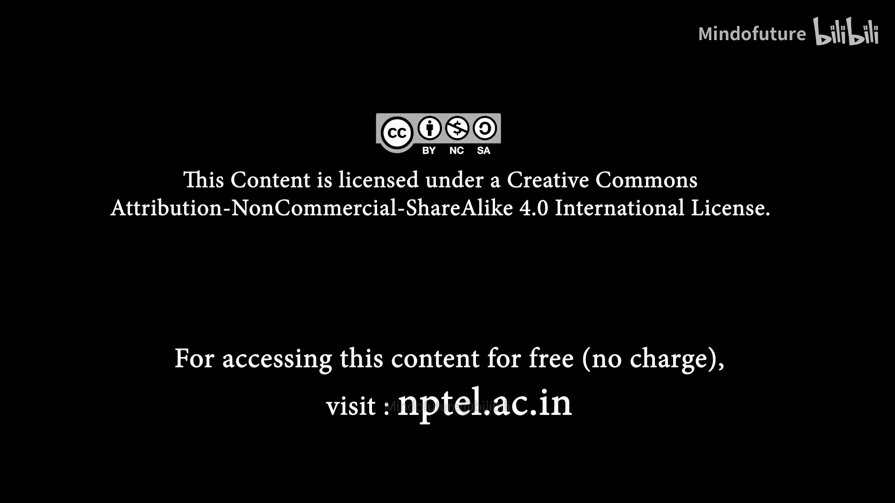
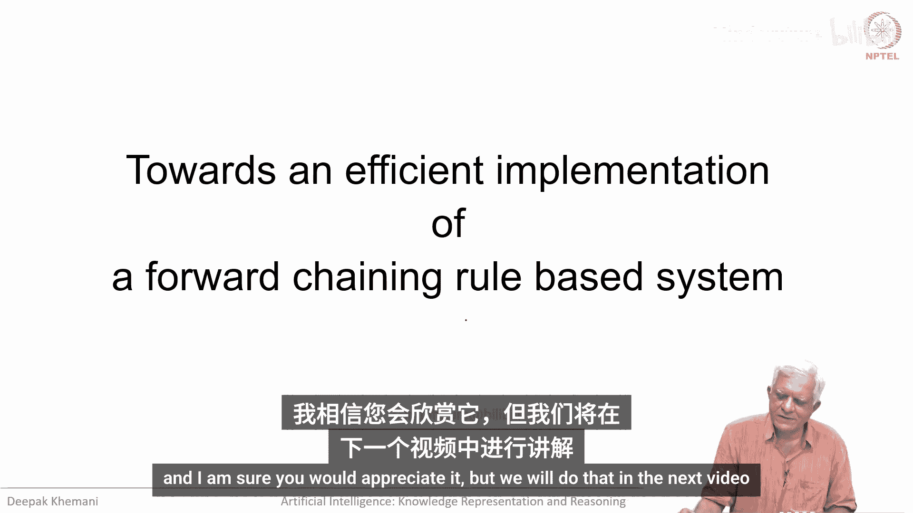

# 【印度理工学院】知识表示与推理 ｜ Knowledge Representation And Reasoning p59 P59_冲突解决策略 -BV1c4zNBmEyF_p59-

Okay， so welcome back。We have been looking at the structure of an influence engine。

For a forward training。Production system。We have looked at this notion of working memory。

 working memory elements， rules。Then， we have said。

That given the set of rules and given the set working memory。You will produce。

The match phase of the algorithm will produce a conflict set。

The complex set is a set of all matching rule instances with the matching data。

And now the task is to say which of those instances should be executed next and that task is called the conflictlict resolution task。

So let's see what are the kind of strategies that we can implement for conflict resolution？

Given that at any given point， a problem solve may be faced with many choices。

The key to effective problem solving is to be。Making informed decisions。About which choice to？

Make or making informed choices， essentially。If you have studied heuristic search algorithms like Best first search or A star。

 you would know that。We have a notion of a heuristic function。Which looks at all the choices。

And gives them a value and says。Then you can say， okay。

 I will choose the choice with the smallest value and that value is a heuristic function。

And that is what we do when we are looking at search essentially。

In rule based systems rules encapsulate the knowledge gleaned from the human experts essentially and then we want to simply say all the rules that are applicable。

 which one to fire next。When one more than one rule matches the data。

 the inference engine has to make a choice as to which instance to execute next。

It is a little bit analogous to which candidate to inspect next in search essentially。

And we will look at some conflict resolution strategies。Later， popular。So， the first。Strategy。

Which is necessary， in fact， is called refraoriness。It says。

That a rule instance may fire only once with a set of matching working memory elements。That okay。

 you have found this whole instance it matches this piece of data and you can fire it。

But you cant keep fighting the same rule again and again with the same piece of data。

 assuming that the actions of the rule do not have anything which is deleting from the working memory element if you are not deleting anything from the working memory element。

Even though the rule has fired， it would still。Match again。Reected in a says。

That this is not allowed。Otherwise， there is always the danger that that one single rule will keep filing all the time。

The idea of refriness comes from the way neurons fire in our brains because when the the way that neurons fire。

If you have looked at neural networks， is that the neuron gets inputs from many other neurons。

And there is some sort of a function built inside this which you look at which is some of the inputs and you know there will be some thresholdholding and maybe some sigmoid function or something like that。

So， one the as they call in terms of neural network， as the excitation level goes up。😊。

The neuron will fire and it will create its own。Impulse， which will travel down the action of that。

Newborn。Now， what happens is that in in physical brains this excitation is in terms of chemical electrical signals so once it is used up then。

The neuron has to wait again for it to get built up again， so it happens naturally there。So。

 when the neuron has received excitation that crosses the threshold。

 it fires one and then waits for new signals to come in。

So then the name reffactoryiness comes from there。In terms of rule based systems， it means that。

A rule instance with matching data should fire only once。

We will see that that happens naturally in the implementation that we will talk about。

So this is a definition of refrainess from this medium web dictionary。

 the insensitibility to further image stimulation that develops in irritable and specially nervous tissue as a result of intense and prolonged stimulation。

As we will see。😊，We will look at this algorithm called the rate algorithm and refractoryiness will happen naturally in this algorithm。

Okay so here is a second conflict resolution strategy this is called lexical order essentially it says that of all the rules that have matching instances choose the first one that the user has stated so the user has written the rules in some order。

Choose the first one that matches。If a rule has multiple instances that match with different data。

 then choose the instance that matches the earlier data because。The data also ist ordered。s。

The strategy this strategy places the ownersus of the choice on the user。

 the user is more like a programmer。And we have seen that。

This is the kind of strategy that prologue uses the prologue says that I will look at all your rules in the order that you have written and the facts are also written inside that same file and they are also written in a particular order。

 so prologue always looks at things in lexical order。So I have mentioned this a couple of times that。

Real prologue as opposed to pure prologue real prologue deviates on the idea of pure declarative programming where I would only have to state the rules and the facts and it would somehow solve the problem for me in prologue the order in which you state the rules is also important which is a bit more like programming so here' is another strategy called specificity this says that all the rules that have matching instances choose the instance of the rule that is most specific so if one rule matches two pieces of data another rule matches five pieces of data。

Then choose the one which matches more data； it is more specific。As you will see。

 specificity can be measured in terms of the number of tests that the pattern in the rule。

that the rules need so if you look at the swap program that we saw it does some test that there is one element whose value is distinct thing there is another element whose index is greater whose value is smaller so it is doing this test you can count how many tests it is doing and based on that you can decide which rule is more specific which instance of the rule is more specific。

The intuition is that。The more specific the conditions of a rule are。

 the more appropriate the rule is likely to be in a given situation。

 that is an intuition that we often use。Remember that the working memory models the shorter memory of the problem solver。

And rules constitute the problem long term memory and reside in the quasi static long term memory。

 so I am saying quasi static because you are allowed to change rules of course。

 but in general when you have built the rule based system，It will be kind of constant。

Specificity choosing this specificity as a conflict resolution strategy can facilitate default reasoning What is default reasoning if you don。

 if you know some things then you make an inference if you know more things then maybe you make another inference and。

You do the default only when you don't know the other stuff essentially if you know more specific things then you take the default action essentially so the default default action is that for example I will make a cup of tea at 5 o'clock but then if something happens and you know。

Maybe I have to attend to something and some other facts come into play。

 then I may have a different action decision。So， here's an example from。The game of contract bit。

 which。I hope all of you will learn at sometime。And this is from the。

Bidding phase of the game in bidding phase people are it is like an option that is happening and you are making bids essentially。

So I don't want to get into the game that will take up too much time here。But I just want to。

Give you some instance of rules where specificity would。Be used。

To take actions when you know more specific information。

But if you don't have that information then you just use a default rule so here is a default rule。

Which says that。Unless you have good cards， for example， you just pass。

And the default rule simply says that there is a player。

X and it is his turn to or her turn to bit and the next player to bit will be after that would be y essentially so it is your turn to bit after you y would bid。

And then the default thing is pass。 no， if you don't have some good。Cards， then you would pass。

 but if you had good cards then you would that data would be stored in the working memory somewhere。

So， you can see that the first two rules patterns are the same here as in the default route。

 but there is something else given here okay so you don't have to get into the details。That its。

 that， let's say theres something called。High cut points that bridge say British players use so if you have 15 or 16 or 17 high cut points。

And if the shape of your hand is balanced by this， we mean how many hearts you have。

 how many spades you have， how many clubs you have， how many diamonds you have。

If that distribution is balanced。So there are certain things which are balanced。

 there are certain things which are not。Then。You make this bid， which is an opening bid。It's。

Bid name is notrum and denomination is 1 so which players would recognize this essay。

And if you have 15 to6 17 high guard points and you have a balanced hand。

 then you open one notrum if you don't have all this stuff。

Then you just pass of course there are other bits for making other other patterns for making other opening bits。

 So in general， of course， you would choose the most specific。Rule instance。

And you dont have to worry about whether my program will pass by mistake as long as you specify。

Whether the conflict resolution strategy， specificity， always choose the board specific rule。

And if you can't find the most specific rule， then go to the default rule。

We will look at default tra again。As an exercise。Just write this。Two rules。

 one says that birds fly and the other says。That。If you're a bird and you're a penguin， then。

You do not play， essentially。Then you can see that specificity would help essentially。Okay。

 so one more strategy that。We often use it called recency。And。Reency says。

Then have all the rules that have matching instances choose the instance。

That matches the most recent working memory element so remember the working memory elements are times stamps。

And you have， let us say， 15 rules in your concrete set and all of them matching different working memory elements it says choose the one which has the highest decency。

It can be implemented by looking at the timestamps of the working memory elements。

But we will see that there is a simpler way of doing this when we when we implement this algorithm called the R net。

Or data algorithm。The intuition behind using recency。

Is that when a problem solver adds a new element to the working memory then maybe you want to do something with that working memory element so there is another rule which matches this then maybe that rule。

ItMake sense to be it makes sense to use that rule now in some sense。You。Want to maintain。

A chain of thought you're making a sequence of inferences。

That is this is true then this is true and now if that is true then something else is true so if there is a rule which is looking at that then give peripheral to that so decency will allow you to maintain a chain of thought。

😊，Of course， you can maintain the conflictor as a priority queue sorted on the recency。For each rule。

 which means the recency of the。Highest working memory element in that role。

The oxite language gave us。Conflict resolution strategy called main sense analysis MEA。

Based on the problem solving strategy as posed by Simon and Nell。

Who did a lot of work on human problem solving？So， the idea is to partition the set of rules on the context。

These set of rules apply in this context， this set of rules apply in this context and so on。

And focus on one partition at a time。One can think of each partition as following some specific sub goal or reducing some specific difference。

Is a term that Newell and Simon spoke about。The context is sir set by the first pattern in the rule essentially。

So， in their strategy。They first looked at the first pattern in the rule。

And then looked at the rest of the roof。All these rules in the same partition have the same first pattern。

 so as context is do activity x context is do activity y as the case maybe。

And all rules which are concerned with activity x will be in the same partition or will they have the same first pattern。

And likewise for others， essentially。What the MEA strategy does it applies decency to the first pattern so that if you are doing some activity。

您。You will continue to do that activity unless you switch context。

 so which means you have to explicitly say okay I finish with this activity x now I want to move to activity1。

So that some rule must do that and then you will switch to another context and then you will continue in that context。

And you can apply specificity for the remaining patterns that within the context choose the most specific rule。

So you can think of， combinations。Like this。Next。We will see this data algorithm， this。

Which uses a structure called a latenet。嗯。Which is useful。

Efficiently implementing rule based systems。And it is quite a well known it is quite a neat algorithm。

And I am sure you would。Appreciated。But we will do that in the next。Video。

