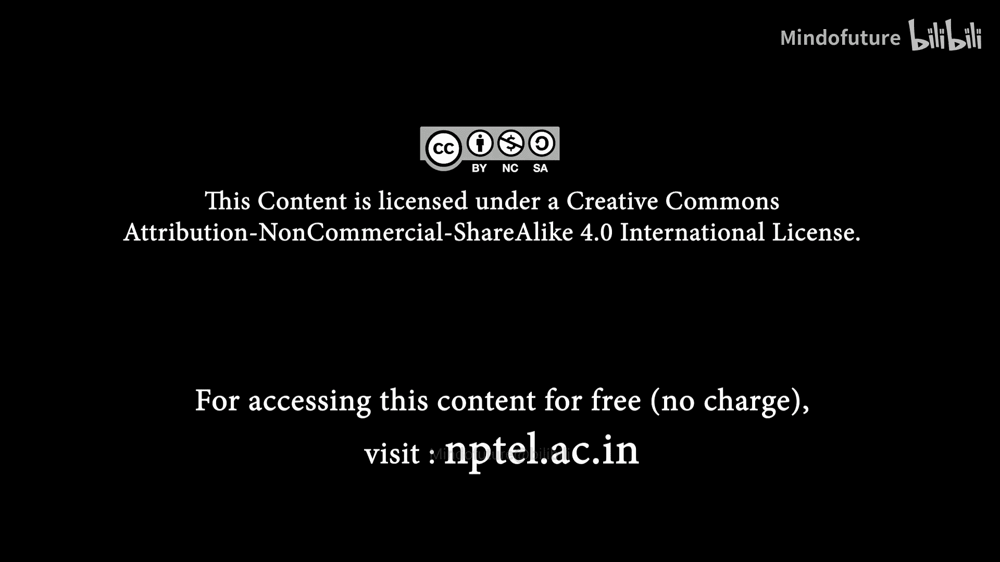
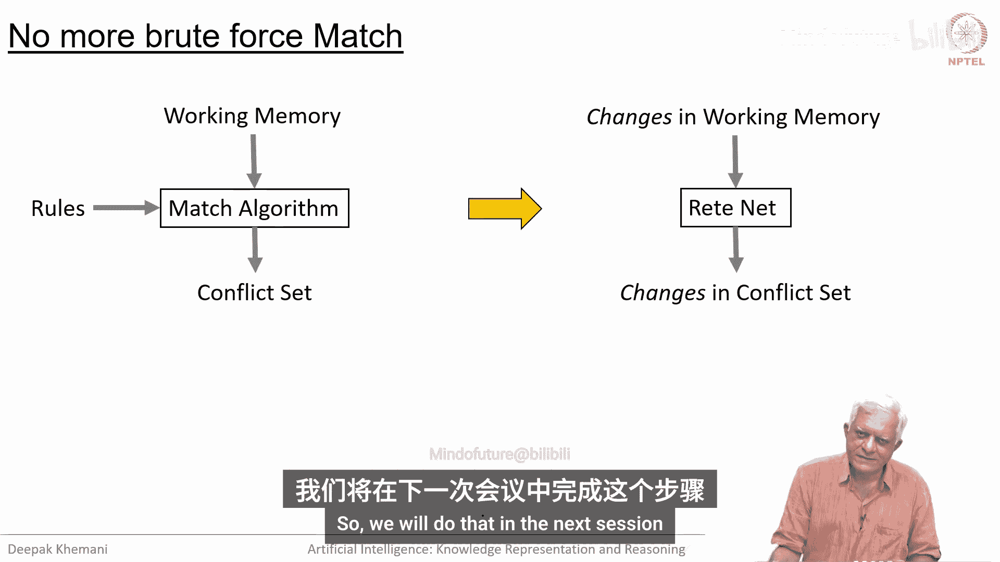

# 【印度理工学院】知识表示与推理 ｜ Knowledge Representation And Reasoning p60 P60_Rete算法 -BV1c4zNBmEyF_p60-

So， welcome back。We have just looked at the broad idea。Of a forward chain lu based production system。

We have seen how the memory is organized in terms of working memory elements。

Our rules are expressed as set of patterns and related to a set of actions。

We have looked at how match is done。And how。Once the match is over how you pick a rule from all the rules that are matching。

And go through that cycle of match Re， execute。Now， the problem with match is that。

It requires a lot of。Computition， you look at all the working memory elements。

 you look at all the patterns and all the rules and see whether they match or not。So。

 we want to now look at this algorithm called Re algorithm which is which uses a structure called the re net。

Which does this whole thing much more efficiently。So first a little bit about the name。

The word later。Is based on the English word。I presume it's pronounced light。In middle English。

 olden time English， which itself was derived from the Latin Latin word which means a network。

An anatomical mesh network as in wes our trees and nerves， so you know。

 just like we have networks in our。Body， which carry signals。

 which carry blood and you know all kinds of things。A definition from the dictionary。A network。

 especially of vessels or nerves。An anatronomical part assembling or including a network。So。

 in that sense。Since data itself means a network calling it a data network is a little bit of an overkill。

 but that is what we do。All the thing。So the inventor was Charles Fuji。

 as I said he was doing his PhD in CMU。He developed the rating algorithm。In the 70s。

 but it took some time for algorithm to become widely popular and now it is indeed widely popular when business rule technologies finally emergemer so we are looking at this phenomenon called business rule management systems。

Is that you know， if you put in a lot of rules which are business rules into some system。

What kind of a program will？Use those rules。So BRMS stands for business rule management system。

 most BRMS vendors develop their own algorithms that are known。

In elite circles as x rateta or unilta or so on， but they are all based on this idea of rate net。

E2 itself was a version that Charles Fuji developed which broke the legendary so called re wall。

 which referred。To the dramatic performance degradation when the number of objects in the working memory elements。

Increaseed essentially。 So remember that match。Requires。Matching all patterns with all。

Working memory elements。So the the larger the number of elements。

 the greater is the work that match has to do。Laterter3 is an evolution of A2 developed in this company。

Called sparkling logic。 And they had this system called rules power， which was， you know。

 sold as a blaze advisorr。 And you can read about this in this blog。 There's a link here。

 If you place on this。 or if you just search for this， you will get this。

Block and some of this history I am quoting from there。Then came something called rita N。

TheOs J the opsj language is a version of the ops language。

 late N engine from production systems technology that is what Charles Fuji started uses the latest incarnation。

From 4 g essentially the rate and nng works with any rate rate some people say rate okay so I have a tendency to say rate but some people would say rate based systems but you know it is really。

Not dear to me， which is a correct pronunciation， so I'll say later， but some people say eat。

Including those from IBM or E and so on so many people were using this system to the commercial system licensed at $5000 per CPU。

 or it could be used by the production system technology clients。With the OPSJ rules syn tax。

The new generation of this algorithm was much， much faster than rate3 essentially。How does it work。

But Hoji would not reveal that and he has not published。 He publish his data algorithm。

 and its a paper that you can easily get。But this rate n here is not published。

 so it is a trade secret and。You have to test that guess as to what it could be。

Here is some quote from casualul and。This thing about。Hows the data algorithm？Held。And。

She says the best usage of the rate network I have seen in a business environment was for alarm correlation and monitoring so if you have these large systems the networks。

 you know telecom network or power network and things like that and you know you have devices all over the place and something may generate an alarm how do you respond to that alarm so how do you monitor these networks and how do you handle alarms essentially。

So， a state foot kind of execution where alarms are received over time。As they occur， essentially。

And she says the actual telecom network is made up of thousands of pieces of equipment to be kept in mind of whoever is monitoring the systeming and there is no wonder that later outperforms any brute force system that you can think of essentially。

So， she says that when one alarm is raised on one router。

 the written network does not have to reprocess all the past events to realize that we reach the threshold of five major alerts on。

The same piece of equipment， so you allowed up to five alerts on some piece of equipment and it was very easy for late network to monitor that decision that is because。

It doesnt do this match repeatedly， as we will see。

So hours of processing time turned into seconds in the network management systems。

 which she says was fabulous。So what is。That is that the retail network gives us and the retail algorithm gives us one is that it does intra cyclee saving。

What is that so let us look at this example， lets say you have a grading program in which for every course for every。

Grade you have a rule， so this rule for example says that if in AI grade who gets the C Gr。And。

This rule says。That if a student has marks who is more than 59 and less than equal to 70。

Then you should give that。Se great to the student， essentially。So， replace this nil。Let's see you。

Of course， you would not do this， you would not write。

A separate rule for every course for every grade you would more likely write a general rule。

 but this is just to illustrate what is the kind of savings that we are talking about here。So。

 here is another rule which says that in the ML course， what is the criteria for the C grid？

And it so happens that this grade is 49 and between 49 and 60。

And then let's say you have students among them are these two students I have mentioned here Neha and Sunil。

And Sneha is doing five courses and Sunil is doing three courses and then you know you have their marks and grades all available in there and you can see that for example。

The first rule will match the first working memory element ifneer is doing that course。And also the。

Second rule will match the first working memory element if she is doing that course。Now。

 should we do this match。Twice or is it that we can look at this working memory element only once and then say okay it matches this it matches this and it matches this so there is some scope for saving there。

Likewise， for the second student Sunil whose working memory is the second working memory element。

It matches， let's say he is also doing those two courses， so this rule will match。Him also。

 and likewise for all the students who are doing all the courses。

 So there is some matches So the intra cycle savings that we want to do is that， for example。

 we are talking about this， this student。We are talking about a student。Okay。

 so we are saying the student has a name。Rle number。Age and year， Let us see。And so， we have。

 for example。The student callsneha， whose old number is something whose age is 20。

 whose year is three。But this student will match the AI grade。Rule。😔，In fact， it。

The first pattern definitely will match all the。AI grade rules， A， B， C， D， E。

 whatever the grades are， if I have all different rules， then because Neha is doing that course。

 she will match all those rules。Likewise Sunil will match all those rules。

 not only the AI grade rules， but all the ML grade rules and so on。

So all we are saying is that here is the student。Who is doing this course and。W match this。

Repeatedly。For every rule， essentially， can't we somehow。

Optimize this and match make do the match only once。And this is what。

The retail algorithm allows thenet allows us to do as we will see。In practice， as I said。

 you may not have many rules。So you might add a third pattern here。

 which says the cutoff in subject S is low and high。Then you get grade G。And then， of course。

 you will have a list of such。Working memory element， instead of having a list of rules。

 you will have a list of working memory elements essentially。

And as long as the marks are greater than low and less than or equal to high。

 then the grade is the grade that you mentioned so all these three values。The lower cut off。

 the upper cut off。And the grade can we all。Expressed in。One working memory element and then。

 of course， your knowledge base would look different essentially so you would have the students。

And then， you will have a。Le。Marks that the students got in different courses and then you would have the set of cutoffs essentially and this one rule will do the entire job for you essentially。

But we wanted to illustrate as to what kind of intra cycle savings you want to do。

 which means that if the same。Pattern exists in different rules。

Then when the working memory  element1 comes， you must not do match them every time。

 but you should do the match only once。The next thing is the inter cyclee savings what is inter cycle savings remember that a cycle is match resolve execute then you go back and do the match all over again。

That doesn't sound like a great idea。So， let us say that if we have 300 students and between them they are doing 1200 courses that means 1200 grades have to be assigned that means 1200 times those matches will have to be done and。

1200 times the gal has to be assigned and remember that if they are doing 1200 courses each course has 5。

😊，Grades let us say then we have 120 into5 grades that have to be matched so all that match work has to be done。

So， initially there are 1200 instances of grade assignment rules in the conflict set。

Because once you know the student marks， only one of those grades would be applicable。

One of these instances is selected and。 so let's say you give Neha。C grade in AI course。

The remaining 1199 instances are still matching。 Nothing has happened to them just because we found one student who。

Gets a particular grade。The rest of the students will get the grades at their marks defined essentially。

 and you have already done the match that you know for this student for this course this is a match for this student for this course is a match。

If you have done that match once why repeat it again。So， that is a。

Second kind of savings that retail algorithm gives us。

 which is the intra cycle savings that between cycles。

You do not want to repeat matches that you have done in the earlier cycle。And that's a big thing。So。

What the latete。Algorithm does。Is。It replaces this。Processing。Skin。

Where the match algorithm takes rules and working memory。And gives you the correct set。

With a new processing scheme。In which。The match algorithm is replaced by the late it。

We will see that the internet。😊，Encapsulates the rules inside it itself。

And anyway rules are long term memory， they don't keep changing。

 it's only the short term memory or the working memory which keeps changing。So。

 will the rate network will accept changes in the working memory。😊。

And produce changes in the conflict set， which means。From one cycle to the next。

 it will carry forward the conflict set。And。Once some change happens， you only look at the change。

And say what changes in the complete set？As you can imagine。

 that' is going to be very much more efficient than doing the match all over again。

And we'll come back and look at this algorithm in。Detailed in the next session。But the idea is this。

That you don't want to keep repeatedly doing matches again and again and again once you have done a match。

Remember that that match has happened， essentially。So we'll do that in the next session。

