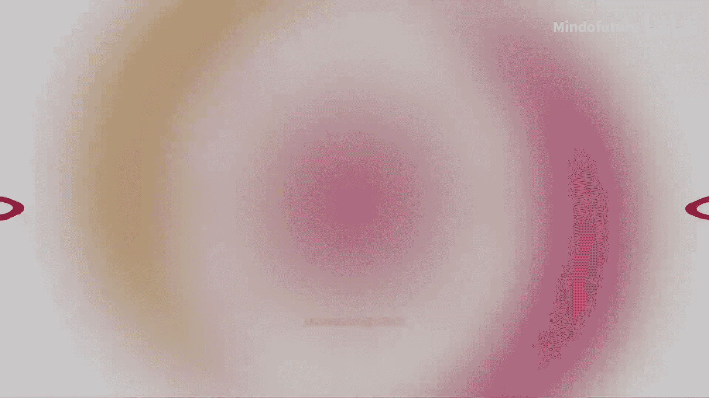
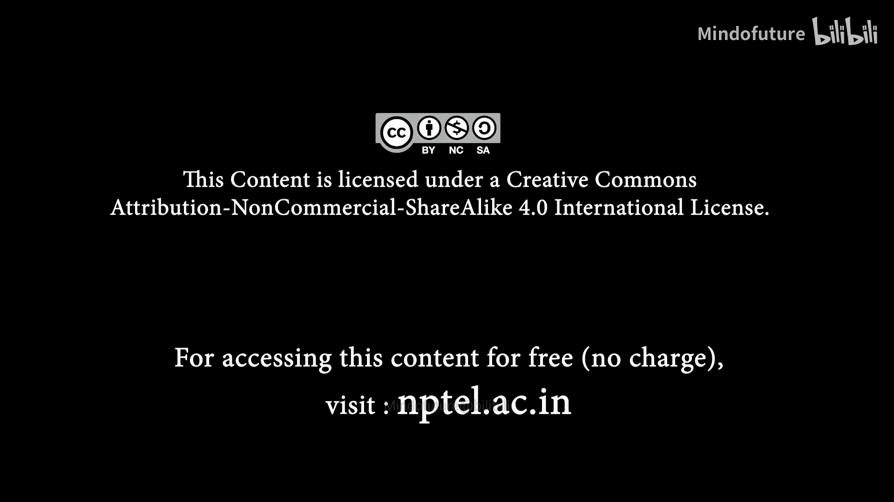
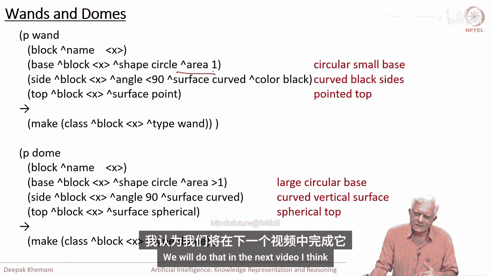

# 【印度理工学院】知识表示与推理 ｜ Knowledge Representation And Reasoning p61 P61_Rete网络 -BV1c4zNBmEyF_p61-

So， welcome back we have started looking at the renet and the Ra algorithm and we said that the renet is basically a much more efficient way of doing what match did match was brute force in every cycle it looked at all the patterns in all the rules and all the working memory elements and kept checking whether each of them matches the other or not。

The latenet as we will see， will look at every working memory element exactly once。😊。

And in that process it will it will identify which rules it matches。Furthermore。In the next cycle。

 it will remember all the matches that it had done in the last cycle。Which， of course。

 is the key to savings。So the first thing is to organize data， essentially， instead of having。

Sequential。List of working memory elements。We want to organize them in such a way。

Let the rules find it easier to match。So whenever we have large amounts of data。

 we often tend to use some kind of a divide and con conquer strategy so that you divide the data and then when you want to look for a particular data in all of that。

You。Seververse this kind of trees which are called discrimination trees。So。

 you do test0 at one level， then depending on what the data matches， you send it down one part。

And then do another test and then do another test and so on。 So it traverses down the this thing。

And since the depth of the three is typically smaller than the length of the。Data elements。

This is going to be much more efficient and we have studied this in various places binary search trees is a starting place you must have done followed by bee trees or decision trees if you have looked at that。

Cary trees。Qut trees and tries essentially triess are used with alphabets， essentially。

The top half of the written net is going to be a discrimination3。It's going to be made up of。

What are going to be called as alpha nodes。So， you are going to look at the vacuum element。

Which you are going to put into the network and it will traverse down certain paths based on the different tests that it satisfies。

And it will be stored in nodes which are called as alpha nodes。

 these are part of the discrimination structure。So。

 alpha node serve as a working image of the rule base system。

A working memory token is inserted at the root of this network that we are going to look at。So。

 if it is if the action was make a working memory element。

 then we would add a positive token if the action was delete。Then it would be a negative token。

 so instead of make sometimes we use add also。Then it traverses down the network。So。

 you put in a working memory element， it does some test and based on the value of the test it goes on one of the parts。

When we draw these networks， we will use a more compact representation， which。

We will see in a moment， I think。So the first test usually looks at the class name as to what is the kind of data you are looking at is it a student data。

 is it a ranking data or whatever the thing is and it appears to token and subsequent test will look at the value of some attribute。

The key to building an efficient written network would be to organize the test。

 the order of the attributes in such a way that the more common attributes are tested first and the less common attributes are tested down that particular branch that they occur in。

So instead of drawing this。Complex。Thisす。Diagram， we would use more compact representation。

 So either we can represent where the。Test is stated at the。Top note on the on the higher node。

And the。Granrantches are labeled by the test value。

Or we would represent it in a case where the test is represented。In the destination node essentially。

So， if you have a working memory element， if it satisfies test 1 value1。

 then it should come down this path， whereas there we are saying the test one is。

On the higher node and the value one will go down this path both are saying the same thing it is just that our diagrams would express that in different。

V， essentially。So， if the working memory passes a test。

 then it moves on to the appropriate alpha node down the branch。

 otherwise it will get stuck on the node differently。Which means it's。It may not have been。

The working memory may not have enough information that we are looking for。The other kind of。

Nos are called beta nodes， so beta nodes。Essentially， capture the fact that。

Let's set these two working memory elements here。If one goes down the left path and if another goes down the right path。

 these are two different working memory elements。But they will match the same rule so one will match pattern 1。

 one will match pattern 2。Then they will come together。

Here that if they are doing that so typically there is a join based on the value of the variable。

And then you would have a compound token that would traverse here and maybe it matches the third element so this。

Noode。😔，Represents a rule。Witht。3 patterns。And this rule would be satisfied。

If the three working memory elements were inserted into this network and they eventually got together at this place where we know that these three patterns are being matched。

So we cannot have at least one parent。More often， more。

2 or more parents must satisfy some joint condition。 That's when we say that the pattern is from。

One given rule。And a rule instance can be attached to any beta node essentially so beta nodes will basically be defining the rules。

That we are getting。Here is the instance of join with three tokens。So。

 here is another example of a later network we have four rules here。Rule one， rule 2。

 rule 3 and rule 4。So， rule C for example， needs。Two patterns。

And they must come from this direction as shown here essentially。Lule 2。

Also needs these two patterns which will come here so if these two patterns are present。Then。

If these two patterns match， which means there are two working memory elements which match those two patterns。

Then rule 2 will match。But rule one needs whatever rule2 needs。Plus。

 it needs two tokens to come from here as well。So rule2 has two patterns rule 1 has。

4 patterns So you can see that rule 2 is a default version of rule 1 it is only looking at part of the data that rule 1 is looking so if only those two patterns were there in the knowledge base or the working memory then rule2 would fire if all the four patterns were present。

Rule 1 would also go into the conflict set， rule2 would also go into the conflict set。

And then if you are using specificity， then rule 1 would be selected。

So those are the two patterns that we。Just so。So， here is a small。Obswave Lake program。

Which is used to define。Shis。So， for example。You might define。A green pyramid。As follows。

You are saying that if x is a block。It is name X。And the base of the block is a square and its area of this base is greater than1。

The side of the block。Is ined。It' is not vertical。Its surface is plain。

And the color of the surface is green。And the top of the block is a point。So what are we looking at。

We are said。That the base is a square。And。The sides。

 so there is something hidden there that we are not drawn。

Then the sides are inclined and they meet at a point in the top and the color of the surface is green essentially。

that is what we call the green pyramid， even though I have drawn it in red。

Let's assume that it's green。Lakeways。Okay， so there we have said that then add a working image saying that x is a green pyramid。

 essentially so that is what we have done here make。Class block。Type this thing。

Likewise you can define the cylinder as you can imagine。That ifs a block。

Whose base is a circle with area greater than one let us say whose sides are vertical curved surfaces and whose top is flat。

Then， it's a cylinder。Likewise， you can define two more kind of shapes， one is a bond。

What is bond there is a base which is circular。And it's small， So whose area is just one essentially。

And who surfaces like？Cd。And it has a pointed top recently。So， it's like a。Stick。

With a circular cross section。But gradually tapering to a point。That would be a want。

And the third thing is the dome essentially， so base is circular and it is like a spherical structure essentially。

😊，So we have defined these three。3。These these four kind of shapes。 And now。

 let us look at how they would be represented in the rating network。

 The rating network is a compilation of the rules。 So the rating network for this particular problem would basically。

Cture these four rules and that is why we said that it has the rules inside essentially it is only when the data comes that we want to see whether it is a pyramid or whether it is a dome as a case maybe。

Well do that in the next。

Video， I think。