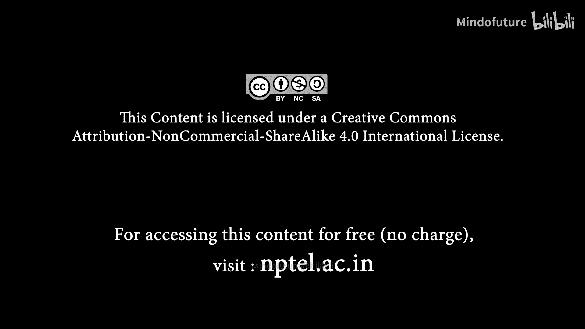
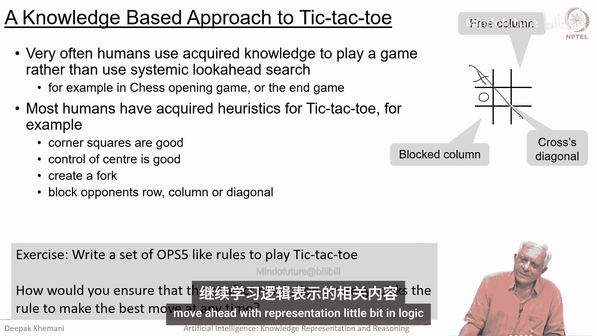

# 【印度理工学院】知识表示与推理 ｜ Knowledge Representation And Reasoning p62 P62_Rete网络示例 -BV1c4zNBmEyF_p62-

So， welcome back。We will be looking at the late。😊，And we have seen。

How the rate network is a network which has got two parts the top part is the alpha network。

which is used to match working memory elements and the lower part is a beta network which is used to pull together those patterns which constitute a rule essentially。

And then we saw。And a small example of rule based system in which there were four rules defining pyramids and bonds and domes and cylinders。

With some color， maybe。And。Let's see how the rating network looks for。This。Set of rules。

So here is a network where we have shown the test to be below。

 which basically means that for example， we are testing the。Value of the attribute here。

 the class is the base， the class is the side， the class is the block and so on and as we go down we look at values of attributes and the test essentially so here for example we are saying areas greater than 1。

And so if the token has a value which is area greater than one。

 then it will come down this this path， otherwise it will go on the other path where you have area one So we have only two kinds of test in two rules one says that。

Area should be greater than one and the other should should say said the area should be equal to1 then we look at the shapes。

 some have shape square， some have shape as circle and so on， so depending on what。

The working memory element is it would traverse down as particularor path。

And then we had the four rules that we talked about one was this green pyramid rule。

One was the w rule。One was the dome rule and one was the cylinder rule。😔，So。

 I would urge you to look at this more carefully offline and see that the four rules that we wrote are all captured in this network if you wanted to。

Use other notation where the test is on the top then here you are saying class what is the class name and you are saying the class name is base then you what is the next value which is area and then it is greater than one or equal to one you can see that the same network the way of writing it is different it is a matter of personal choice as to which one do you prefer let us say this is our working memory。

So those of you who are Harry Potter fans。You would recognize some of these characters。

So here we have some block names where we also have data about owners。

But our rules for classification don't use that data essentially。

That's what we said that patterns in rules may have。Wey not necessarily have。Those attributes。

 which are there in the data。 So in the database， we are saying that the。

There is a block called one whose owner is Harry， but the rule will not look at the name of the owner essentially it can be ignored essentially but lets say this is a knowledge base or this is a working memory element。

Then we have these four blocks， one2，3，4， and we have something some knowledge about the base of these four blocks。

 as you can see some as a circle， some is a square and so on。

Then we have some information about the sides of the of the four blocks， so some may be curved。

 some may be plain and so on。 some may have an angle。

And then we have information about top of two blocks， not our。 So we don't have a complete。

Knowledge base here， we have some information。So， let us look at the match part when a working memory element token。

Is inserted into the writtennet。It traverses the network。

 travels down the discrimination net guided by the test results at each level and waits for other matching working memory elements too。

Arrive at the appropriate beta node remember that beta node collect together different patterns and then they say okay this rule is matching。

So， when you say a working memory token is inserted。

 we had said that there are two kinds of tokens we can insert plus working memory element or minus working memory element plus is when the action is made or add a new working memory element。

 minus would be when you are deleting a new element。So。

 let us say this is a working memory element that we are putting in the token it is a base。Is。Of。

Block and the number is2。 the name is2。 the shape is square and the area is 20。

 so it goes on this particular path and。Where it has matches everything so block name is a variable as you can see here in the rule essentially。

😊，But so anything will match that。Area in the working memory element is 20 so that will also match because it is greater than1 the shape is a constant so that will match。

So， this is how token would travel down here。And you can see。

That once this working memory element is created， it it is looked at only this one time essentially and it will never be looked at again。

 have been we have put it into the network， it has tra traveled down and it is sitting at an appropriate node essentially。

The green pyramid rule is waiting for other working memory elements to come and when they come then it will go into the conflict set。

So what are the other things we see that it needs。3 things。

And they would have to come from these path， which have been shown in red here， essentially。

If you look at this working memory that we had described and you will see that this is where all these nodes would sit。

 so we will assume。That the working memory elements， they sit in alpha nodes。

 they don't sit in beta nodes because the working memory element element will match different beta nodes。

 so we don't want them to traverse there they sit in the alpha nodes and the beta nodes simply keep a pointer to say that okay this element has come This element has come and so on Now let's talk about the。

Conflict resolution strategy。 So we have got an idea of what is happening here。

 We have created the written network。😊，And then we start putting the working memory elements one by one。

 so in the initial phase all the knowledge base put in in one go。

Then if all of them settle down some rules go into。

The conflict set one of them is going to be selected from there。

 it is going to make some changes and it will be put back into the data network again。

 that is the process。 So the next question we want to answer is resolve how do we。

Implement a different conflict resolution strategies that we had spoken about essentially。

So when a positive token is dropped in， it travels down。

And it may trigger some rules because that may be the last token that some rules are waiting for。

Whose other conditions have already been met essentially。If that happens。

Put this rule in senses in a bucket。And they will all have the same recency because， you know。

 that is when this working memory element came in。Let's say it triggered rules 3，4 and 5。And。

It triggered them at the same time， so all those rules 34 and 5 will have the same recency right？So。

 in this way， you can keep track of recency so if you are using the recency。😊，He。😔。

Strategy then the moment you put in a working memory element it traverses and select some rules that means you have to select one of those rules or。

Execution of course you could have a more refined strategy you may look at what if two rules have the same recency then what is the strategy you want to look at that is something you can develop。

So， for every rule instance in the conflict set the sum of the lens of the paths define the specificity remember that each path in the discriminationri net。

In the alpha node is。Doing a sequence of tests and specificity measures how many tests you are doing。

 so if you just add up the path then you would have specificity and you could use that through if you are using the specificities strategy。

So， once a rule is selected so just imagine this rating network you are put in all the working memory elements they have traverse down and then certain rules are let us say hanging now it is like。

Fruit with。Hangs from trees， essentially。 if you think mangoes， for example。

So each insensible role is hanging from the。R network once you remove it and execute it it is no longer there in the conflict set so refraliness is straightforward to implement。

It's automatic。When a negative token is dropped in。

It may go and exercise some rule with was matching。So。

 just just remember this for example this ranking algorithm supposing we are adding this marks 1 by 1 essentially and lets say student A had marks 79 and a rule was matching which is that there is nobody higher than 79 and。

Thereforefo it might be ready to fire but some other rule was selected and that that rule fired and that created a new working memory element offer a student another student B。

 let us say whose marks were greater than 79， let's say 83。

And then it would go down and this token would go down and match the negative pattern of the ranking rule for student a and say that。

Okay， there is a student who has got marks more than 79， so that rule will have to be removed。

This is a slightly more complex process， but I hope you get the idea I will give you some example networks that we have created。

😊，As exercises over the years。And what I would ask you to do is to look at these networks。

And write the corresponding rules for。The task that they are doing essentially。

So give them appropriate names。Well， we have given names here， fair child， fair student， fair games。

Well。Alju know award winners， essentially， you know， they are allowed to free travel and stuff。

So students， for example， they get concession if they are going home children have a lower fare and things like that。

 So these rules are supposed to capture that as an exercise。

 please write these rules in the ops5 like language that we have all you have to do is to look at this network and convert it into。

The four rules that we have for four kinds of phases。Here's another one。

Which talks of loan eligibility here we have not given the names。So， there are four rules。

Give appropriate names。And write them down as。Rules so again， this is a small system at four rules。

Express the of five language so that they。This network represents them， essentially。

Here is another one on geometrical shapes earlier we talked about blocks but now we are talking about two dimensional figures so there is a whole list of figures you can see on the right hand side the triangle the quadlateral。

 the isosli triangle。The right triangle， right angle is the triangle which is a right angleangle。

 the rous parallelogram， right isosless triangle and isos triangle， which is also a right angleangle。

And you can see that there are many bitter nodes here on this graph and you can see that there is a certain amount of more specific descriptions and more general descriptions so for example a triangle is more general than a nice socialist triangle so you can see a spot out of them there so do try to look at this and write the rules for doing that。

There are quite a few objects here。Where do you。Gemetrical shapes here。

 Here's another way of drawing the same diagram instead of writing the。Rule names on the right。

 we have drawn them。In the network itself。So you can see there are many， many rules。Do look at them。

So a note on inheritance。We have。Seeing that， you know。

 some things are more general than other things。So， for example。

Look at the lombus and look at the square。A figure with four sides and four sides being equal is a numbersus。

Then you can say that a rombus in which the angle is 90 degrees is a square so you can see。That。

If you have described the numbers。Then you can describe a square as an。Specation of the numbers。

 which has angle。90 degrees so you can inherit the rest of the properties and。Just add something new。

And that kind of stuff happens a lot when people build things like taxonomies。

 essentially we will be looking at a little bit of that。The square is more specific than the numbers。

 which in turn is more specific than a quadri lateral。So， default rules。

Haveav an underlying inheritance hierarchy。So， a penguin is a bird， for example。

 so whatever properties you will ascribe to a bird。They can be inherited by the penguin likewise。

 whatever you say about a quad letter that will be also inherited by。A square physically。

So inheritance is a very powerful mechanism that we use and I already mentioned that when we organize。

😊，Things into object like structures which we will call as frames。

 then inheritance will play an important role there。

 it will lead to compactness of your knowledge basis so that some things that for example on all mammals have two eyes can be represented at a very higher level you don't have to represent for humans and cats and dogs separately recently。

So there is certain advantages there。And we will look at something called description logics which allow you to describe things so description logics are also called logics of noun phrases。

 we will look at that as well。They are used in building ontologies and ontologies have certainly gained a lot of importance in the last。

Few years because of the fact that there is internet and commerce going on， essentially。So。

 in a description logic basically you would represent this inheritance network you might represent it like this saying that a square is a lombus。

 a lombus is a quaiallateal。So do look out for。That。I want to end。A little bit。Little。

A different problem which is that of game playing。which we study in a different course on search methods and in search methods when you play games like thistic ta to or ch or go。

 we search over the search tree essentially。And this kind of is a slide I've taken from that course。

Wwhichch shows that how you search that first search。

 you do that first search moving from left to right and you do certain kind of cutoffs called alpha beta cutoffs and so there is an algorithm called alpha beta algorithm。

There is a search algorithm。But humans don't always play games using search essentially。

 so here is a。Incitement for you to write a program to play the game of Tt to also call us crossing Nors。

Its a knowledge based approach that use rules， write rules to play the game instead of。

 you know searching ahead and trying to。Finding the best move。So。

 humans choose acquired knowledge to play a game rather than systematic look ahead search。

For example， the chess opening game or the end game the programs don't really do search。So humans。

We rarely do search。And it was， in fact， said about the game of Go。

That go is hard for machines to play。Because machines use search。Whereas go players the go masters。

 they use perception。Which is kind of knowledge， essentially。So。

Most humans have acquired heuristics for the ttao game or the cross and notes game and you have things you have certain ideas like corners squares are good corner of。

Control of center is good or you can create a fork so that opponentent can only close one row that there is a strategy to block opponentance row or column or diagonal。

So， these are the kind of features that you would use when talking about heuristics for that。

 so there is a free column， there is a blocked column。

 there there is a diagonal for the cross for example。So you can write a program to play Tio。

Using a set of rules and I would encourage you to write this set of rules for example you might simply say that start with a corner or if the opponent started with a corner then play in such a position so let try to enumerate the different rules so that。

You have a program。2 which is a rule based program to play the game。

 So there is an alternative that you can。可o。So write a set of up I like rules to play。Dt2。

And how would you ensure。Then the conflicts resolution strategy picks the right rule essentially。

 so you may have a rule which says now it is time to play in the side now it is a time to place in this corner。

 whatever the description that you are using。What conflict resolution strategy would you use？

So its a small exercise to say that you know。😊，When you are solving problems。

There are different approaches that you can use， you can use search for example in gameplay。

 but you can even think of rules for example at least in simple games like Ti ta2。So。

 I leave you with that with that we will end the rule based production systems study。

And we will come back and。Move ahead。With representation a little bit in logic。

 so see you in the next session。

