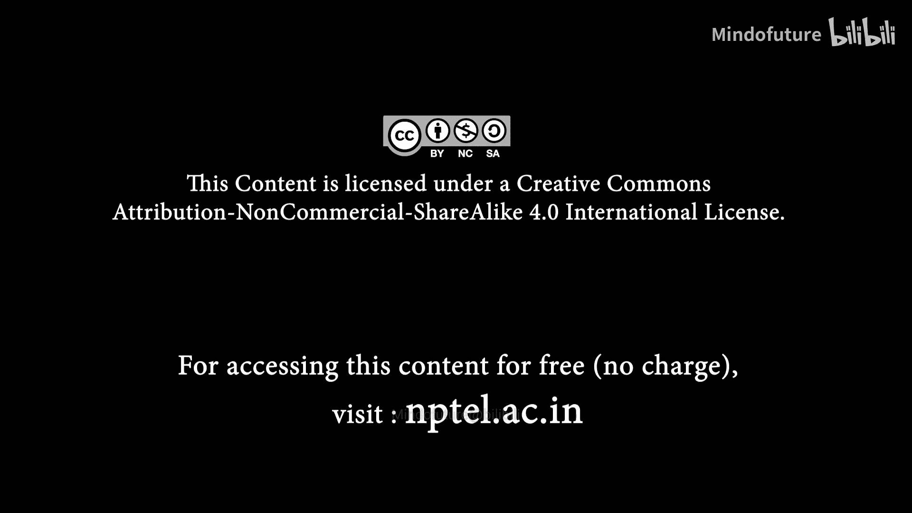
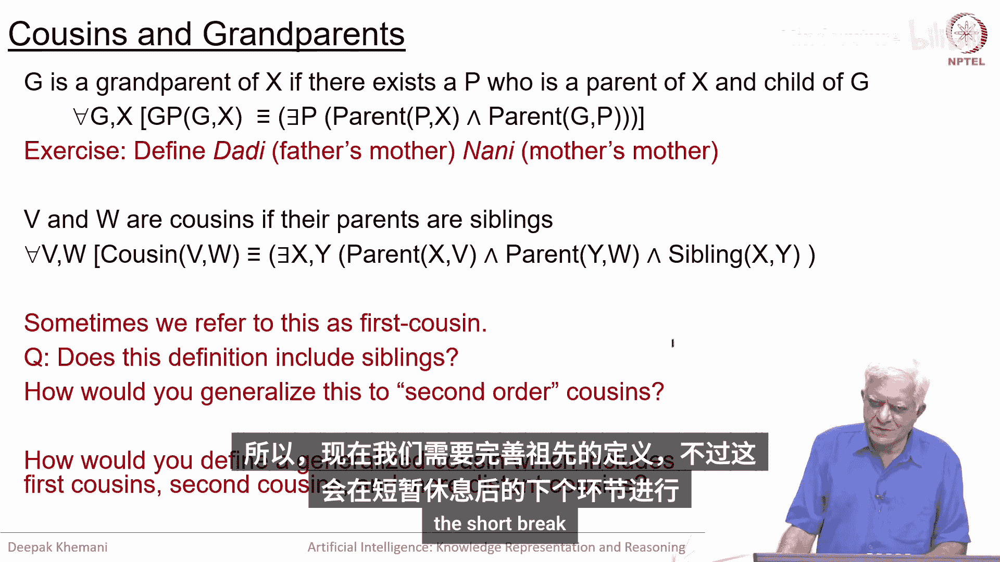

# 【印度理工学院】知识表示与推理 ｜ Knowledge Representation And Reasoning p65 P65_描述家庭关系 -BV1c4zNBmEyF_p65-

So welcome back。We have been looking at binaryial relations。And。

There is no other place where binary relations are so。So much in existence。

As in a family database essentially。So， let's talk about。

Trying to see how if you wanted to create a database of your family。

which told you how someone is related to somebody else。Then how could we build that essentially？

So you have relatives like uncle， aunt， grandma， brother， sister， cousin， and so on。

How can he go around？Representing such。Knowledge or such information。Indian language is。

 in particular as。Lch in specific names for relations。 So while in English。

 you might say aunt or uncle in in Indian languages。

 we have a name for every specific kind of an uncle。 So you this chacha。 there is Nana。

 there' is nani mama。My mirror， high and so on。 So many of you would be familiar with such。Relations。

 all Indian languages are rich in these terms。We can define some basic relations。

Which we will store in the knowledge base。And then we can infer the other relations from that by defining。

The connections between basic relations and the derived relations。So， for example。

 you might want to add the fact that Aman is the Charr of visually。做就出。Means。Father's brother。

 V his's father's brother is a man。So should we add them to the knowledge base or should we infer them as and when needed essentially so that would take us back to the。

Original。debate that we had about whether forward chain is better or whether backwardboard chain is better if you do forward chain then you will keep adding new facts to your knowledge base you may or may not need them or use them。

And they will take up space。But query answering would be very quick because the thing would be there in your knowledge base backward chain on the other hand is lazy。

And you will only make the inferences when you need to make them。

 which means that query answering would take a little bit of time。

But the knowledge base would be compact。So they are trade offs， obviously。Now。

 one thing we have to be careful of when we represent。😊。

Things like family databases and in general when you talk about knowledge about people。

We have said very happily that Amman is charge of visually。

But in the real world there may be many people of the same name essentially so there may be many am and there may be many specialities which one is the one that we are referring to how do we know which individual the constant symbol we are using in our knowledge base。

Maps onto two in the domain because in the domain。Many people would have the same name。

We often try to。Address this problem by using surname or village names as the convention may be in different parts of the world。

But the problem persists because you always have people。The same name and the same cell name。

 there are many instances of that。So， one idea is to use suffixes of some kind to distinguish between。

Individuals。So， you might say。Among 21 is in one individual。Among 39 is another individual。 and then。

 of course， in the knowledge base， you can be。Add the relevant facts you can say for example among 21 is the Charcha of 33 or something like that and then you know that you are talking about the right people this is an idea that was proposed by Chan and Mcdomt in their book on artificial intelligence which was published in the mid 80s。

Nowadays， you might use something like a uniform resource identifier I encourage you to go to this site but when we look at RDF and Owl we will talk about。

These things， again， later。So， we said that we will define a family。Database or knowledge base。

In terms of the primitive relations so what what would be the input to this whole thing is some primitive relations and the rest of the relations would be defined in terms of those primitive relations so what is a bare minimum that one can work with so let us say that we begin with the following set of primitive relations。

One is a parent relation。And here we read this as parent x is a parent of y now I have said this earlier also that when you write parent x y it is not clear to us as to whether x is a parent of y or whether y is a parent of x because it is just a formal agreement between us essentially。

Language， of course， tries to。Solve this problem by expressing things using linguistic connective。

Surish is the parent of Manish。So， we already know that Su is a parent of Phetian one。

 So in all languages there are case markers which tell you how。What case。

That each individual in the sentence。第一个。When we do things in logic we have to make these things explicitly in some way or the other。

 so one way we would be to use something like a schema which is used by the database community that they say that when you say the parent relationship。

😊，The first argument is a parent and the second argument is a child essentially。

We could use this itself because you know， we have just said that variables are going to be。

Capitalist。So it helps in specifying。What is it that you are talking about？The都。

Primitives that we need。Is gender information？So， we have to。Pedicates here， male X。

It says x is a male。Female x， which is that x is a female。

there are only two genders we could even do away with one and you know have a rule somewhere that if you are not a male then you must be a female。

 but that is kind of becoming a little bit too。Compact， if you want to say that。

Notice that in these relations we we are not saying man women。

 we when you talk about marriage we said manwo because that is when we said that。

It's humans who get married， but these relations would apply to any。Living pictures。So。

 we could define the rest of the terms in terms of this predicates， so for example。

 we can define sun as saying。The first argument is the second son of the second argument。

 this is different from what we had said earlier， which is why I keep repeating that you could use both but you must be consistent and you must be clear as to what your representation means essentially the one way to do is to define it as a schema essentially。

So we can define sun now as saying that。Son is the son of the parent。

There is a little bit of overloading of symbols there。

If parent is the parent of the sun and the sun is male essentially。So。

 only this parent and male relative relation we have used here to define some。

She can define other things equally， so I am using X y from henceworth easier to read。So。

 we say x is the mother of y， if x is a parent of y and x is female。

Then we can define our earlier definition that we have using equality x is equal to the mother of y is equivalent to saying mother of x y。

😊，So the next thing one would talk about is siblings。If two people have the same parent。

 then they are siblings especially so lets follow。That definition and let's adopt that definition that can be expressed as saying。

That for all， why is it？Z is a symbol of y。Is equivalent to saying。That there exists in x。

 so that x is a parent of y and x is a parent of Z， so the same x is the parent of both y and Z。

 then Z and y are siblings。Now， if you look at this definition carefully。

 this will allow you to say that Surereish is the sibling of Sureish。😊。

You most likely don't want to say that。 So if you don't want to add。

That in your or if you don not want to be able to infer that in your knowledge base。Then。

 you must add and。And。Cls to that， which is。That z is a sibling of y。If z is not equal to a。

And then exist。And x such that x is the parent of y and x is the parent of sius so that would make it。

More consistent with what is our notion of what is mean to say that one is a sibling。Now。

 the sibling relation should be symmetric， so you should add these facts to your knowledge base。

and it is transitive， so that should also be added so that if x is a sibling of y and y is a sibling of z。

Then x is a sibling of z as well。This transfer relation maybe one wants to be a little bit more careful with。

Because it could be possible。That。X and Y have one parent and y and Z have a different parent。

So then they are not technically speaking siblings。But。One has to be maybe a little bit more。

Careful in defining。The transta。We can define sisters and brothers。

A sister is a sibling who is a female and a brother is a sibling who is a male essentially。

Then we come to arts， I think。A is an and of x。If there exists a P。Who is a parent of X？

And the sibling of he。So， we can define it。Has。Well lose。Re forral a。

For all x a an n of x is equivalent to saying。there exists a p so that p is a parent of x。

And p is a sibling of a or a is the sibling of B， that is a symmetric relation。And a is of female。

Now， since this is an equal solution， we can break it down into two directions we will do that。😊。

But before that， I would urge you to define Chacha we already said his father's fathers brother and Chaq。

With his father's brother's pose。So， let us look at two sides of the implication if you go from left to right。

 then you are saying。😊，That。If a is an ant of x。Then there exists a P。

So that p is a parent of x and p is a sibling of a and a is a female。So you would now remember。

That here。This P is a column function。So， we are only defining the relation between AN x and certainly this p has come into between and this p is of course related to ANx and that is why it should be a scm function。

😊，Of。Both A andx。If you were to。Schoolom is it。The right to left reads normally， so we have this。

There exist P inside the antecedent。And we have already discussed this that we can when we move this out。

 it becomes a universal。25。So， an existential quantifier in the antecedent。

Can be seen as a universal quantifier and you can write it as a universal quantifier。

 So the reading of this statement， which is a universal statement is。That for all P。

 for all A and for all x and for all p， if p is a parent of x and a is a signaling of p and a is female。

 then a is the o of x so everything is a universal。Viable here。The following would not be accurate。

That if we simply said。For all A， for all x for all P and Ax。Is equivalent to those three。

Facts that we were talking about。And to verify that。

 you should look at the implication from the left to the right， what does it mean？If you were to。

Say that， essentially。So， for one thing it would say that for all p p is a parent of x now you dont want to。

Iert something like that。Okay， so let's move a little bit further away into the family。

Let's talk about cousins and grandparents。G is a grandparent of x。If there exists a P。

 who is a parent of x and a child of G？So which we can write in a very simple fashion。

That for all G for all x， grandparent Gx is equivalent to saying that there exists a P。

P is a parent of x and G is the parent of p essentially。

Remember that this x and G are still universally quantified for all G for all x。So， as an exercise。

 please define daddi， which is father's mother。And nany， which is mother's mother。

These would be special cases of grandparents and we can define relations between the and grandparent also so we can say。

Thedi is a grandparent。Where the grandparent is a female and the parent is a male essentially so you could do that or you could define it from first principles。

In terms of father and mother。We say that。2 individuals v and W for all VW。

 we say V is a cousin of the blue。If there exists x and y such that x is a parent of v and y is a parent of W。

And sibling X y。Sometimes we refer to this as the first cousin in。Many societies。

One question I would like to leave you with is。Does the definition of cousins here include the definition of sibling？

So， are siblings also cousins or are they not according to the definition that we have written here？

So please go back in。Check that。And see whether they are intuitive or not included。Howard reduce？

Generalize to second order cousin so second order cousins would be whose parents are cousins and so on。

And。You could even do a generalized cousin relation which basically includes first cousin。

 second cousins， third cousins and all kinds of cousins。Into one category called cousin essentially。

So， if you say that x is a cousin of y， then essentially it will boil into saying that。못탑 them。Have。

A common ancestor。So now we need to refine ancestor， but well do that。

In the next session after the short break。

