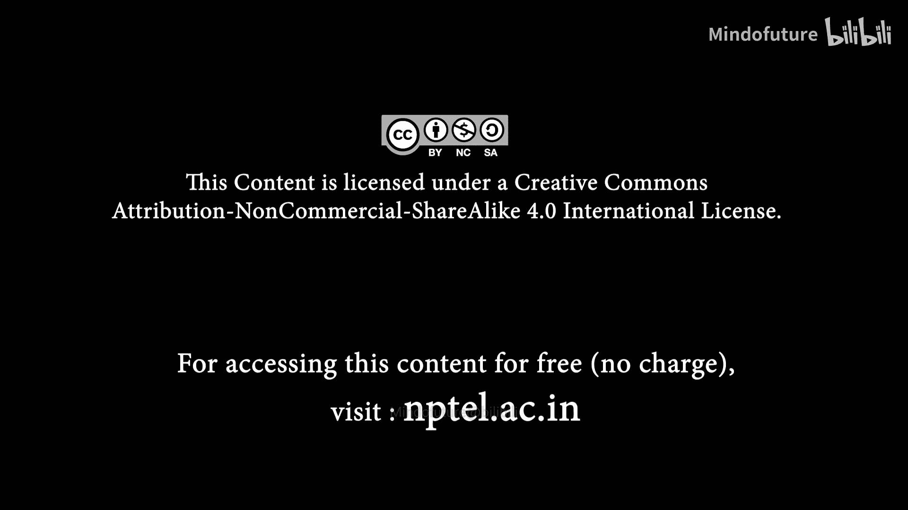
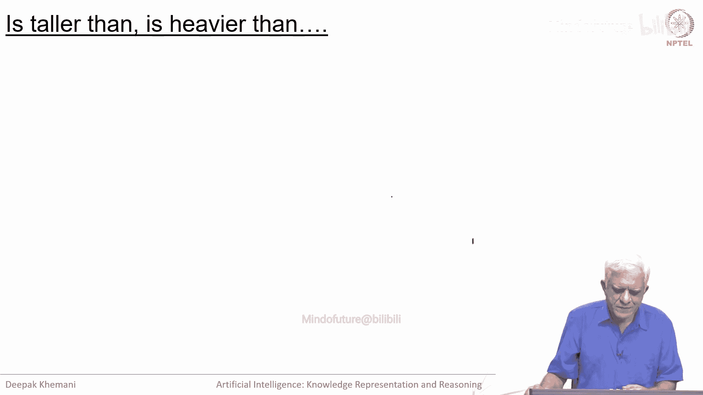

# 【印度理工学院】知识表示与推理 ｜ Knowledge Representation And Reasoning p67 P67_抽象实体 -BV1c4zNBmEyF_p67-

So welcome back。As promised， now we are going to talk about graphs a little bit。

The first thing that I would like to say about graphs。Is。Their graphs are abstract entities。

They are composite structures made up of nodes and vertices and so on。

And we are moving towards this idea of representing abstract structures or abstract entities。

It is made up of nodes and edges as we said that typically one were to draw a graph one would draw it something like this where every of these circles is a node and every line is an s between two nodes。

People talk of hypergraphs where there are hyper edgeges which can connect more than two nodes。

But let us keep it simple here。Notes。Exist in the domain。

And they belong to a category called node so we can make a statement like x is a node essentially。

We will model edges as binary relations between nodes actually so we can say。That there is an edge。

Between， let's say。If this is node x， and this is node y。

Then this there is an edge between that it is a binary relation between this node x and y。Of course。

 very often。When we talk about。嗯。Graph algorithms， we give names to edges as well。

 so we can say that E's and edge essentially。So， for every edge in the graph do something we can do talk about things like that。

 so again we are creating an abstract entity call an edge。

Which we think of as existing in the domain essentially。But here。

We are modeling edge as a binary relation。So just like parent child or。Let's say uncle and Nephew。

 if you wanted to define it as a new relation， there is an individual。

 another individual and an edge between them。So what exists in the domain are nodes and graphs are。

Made up of nodes。A graph is an abstract entity that is millpo set of vertices。Or nodes。And a set of。

Eis。E， so V and E， or sometimes we use N and E。But basically a set of verrtices or a set of nodes and a set of edges conceptually that is what is a graph。

And we can say that G is a graph now G would be an abstract entity。

 essentially it is like a collection of all those nodes and all the connections between those nodes。

A node of course is defined in the domain so we can say n is a node。

 we can also say that n is a node in the graph G by saying n is a node G is a graph and n belongs to G actually。

So belongs to is a binary relation between。A node and a set。An element in the set。

We can say that edge N1 n2 is true whenever the pair N1N2 forms an edge。

 that is how we define the interpretation of binary relations。

That there must be a relation in the domain。Made of such tuples here。Or page in this case。

And that what we mean by an edge is that n1 is directly connected to n n2。

We would make an observation here that。An edge occurs only between two nodes essentially。

Just like we said。The two people can be married only if they are human。Here'll be a thing。

An edge can occur only between two things which are called nodes。

 which which belong to the category nodes。And we can talk about an edge being part of a glove。

Then we would mean that the pair N1 and 2 belongs to the graph G。

But we here are not modeling them as elements in that the singular of modeling them as relations between。

This thing it would be a slightly more complex exercise to add those set of edges to the domain and then connect them to the nodes in。

You could do that。But we don't often need that， essentially。Now， if the edge relation is symmetric。

Then we say that the graph is undirected。Which means you can go from n1 to N2。

And you can also go from N2 to n1。Otherwise it is directed so when you say edge n1 n2 we have a sense of direction that we are going from n1 to n2。

If you allow you want to allow it to be in both directions。

You can say that the edge relation is symmetric in your graph。Otherwise。

 if only some edges are symmetric then you have to explicitly state both n1 and 2 and N2 n1 you cant have a generic relation that all edges are symmetric。

So when we talk about parts， when we talk about graphs， we often talk about parts recently。So， let's。

Define a path here。There is a path from a node n to a node M if there is a sequence of edges forming a chain starting at an n and going up to M。

So。You may have。Inin。An edge2。That's say P and H to Q and H to R and then an H to M。

If you have a sequence of such edges or a sequence of such nodes which are linked by edges。

Then we say that there is a path from n to M。We can define。

This predicate called path this prediates is。There is a path from node n to node M。

And we say that for every NNm saying that there is a pass from node n to node m。

Is equivalent to saying。That either there is an edge from node n to M。Or there exists some node P。

Such that there is an edge from n to P。And there's a path from P to M。So again。

 we have an incursive definition。😊，That you have a pass from n to P n to M if there is some node。

SoFor which there is an edge from n to P， for example， as shown here。And there is a path from P2。

The fact that N and M have to be nodes is implicit because we have already stated that edges can only be between nodes。

Another small point to note here。Is that nothing stops n from being the same as M。

So when you talk about graph algorithms， we may。Or may not。

Want to add self edgedges or reflexive edgedges between nodes。And if we have reflexes edges。

 then we can say that there is a path from。😊，Notode n to itself if that reflexive edge is not there。

Then。There is no path， but in the definition that we have。We have not said anything about whether。

Reflxive edges are reflexive or not。If， if we want to add reflexive edges either we will add to have a general statement that for all n there is an edge from n to n。

Or if there are some some nodes which have reflexive edges we have to add them explicitly。

When nothing stops us from。Adding reflexives。Now， you would have observed that this definition of path is。

Almost the same as the definition of an ancestor that we had defined here。

 So if you look at these two definitions component by component。You will see that。There。

Identical except for name changes and we have already said that names are only in our heads not in the。

嗯。Program itself are not even not in the knowledge base itself。

We can interpret the meaning of paths to be anything I could say is path means an system。

An ancestor means path it really depends upon what you want to define。

So in both cases we are talking about some two things being connected we have already drawn the an sistertor thing almost as a graph earlier。

And then we are saying。That。From that eggs。It is X here and M here。

There is an immediate connection so there is an edge called parent is an edge we can think of our graph as made up of only of parent edges。

 then it is a graph essentially which is talking about the family relationship。

And then both have the same existential。Cls and both have those two components。

 one of them which is a recursive part and one of them is the initial part of that essentially。So。

 obviously if you were to draw a family tree we could talk about path so mean we are thinking of them as graphs。

The only difference is that parent is not a symmetric relation whereas we can define the edge to be a symmetric relation。

😊，If the edge was not a symmetric relation， which means that the graph was a directedive graph。

 then the two would simply become。I saw more vi。So when we say。X a is a parent of B。

 then we could say then there is an edge from a to B essentially。

Then there would be no difference between the two。Do meanss。

Since we have introduced this graph as an abstract entity。

We can talk about properties of a graph we can say that the graph is connected。

And what we mean by that is as you can see at the bottom of the slide。

Therefore for all nodes in the graph for all nodes n and M， you choose any pair of nodes。

If n is a node in the graph and if m is a node in the graph。Then there must be a path from n to M。

So a graph is set to be connected。If you can go from any node in the graph to any other node in the graph。

So we can talk about properties of abstract entities like graphs。

We are talking about abstract entities and as I said， we are moving towards。です。

Process of creating abstract entities。嗯。We look at this problem。

This relation of being is taller than。All is heavier， then。But let's do that in the next session。

