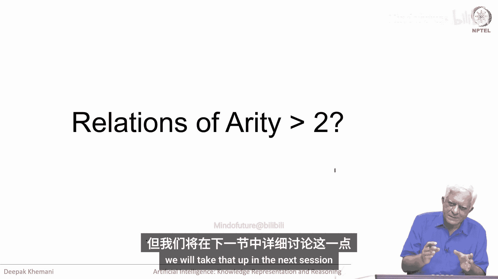

# 【印度理工学院】知识表示与推理 ｜ Knowledge Representation And Reasoning p68 P68_具体化度量单位 -BV1c4zNBmEyF_p68-

So welcome back。We have been looking at how to represent things in first a logic。

And we have been gravitating towards this idea of。Creating abstract entities in the domain so that we can describe the domain better so in the last session we created this entity called graph which was a collection of nodes。

And relations between nodes and we could talk about properties of the graph that it is。

A connected graph。 we could talk about other properties that graph theory people talk about this。Now。

 when we talk about。We are trying to describe the world there are certain things we use in language which are not so easy to。

Convert into。First a logic。 So I might have mentioned at some point earlier that if you want to define。

The notion of tallness， if you want to say。That Susan is tall。

How do you define the semantics of that essentially of course you can simply say that we have a category called tall。

And if you belong to that category， then you are at tall if you don't belong to the category。

 you are not taught， but that would not really serve the purpose essentially。Let's talk about。

A simpler thing。Which is to say。If x is taller than y， or x is heavier than y。

Then we would like to be able to compare them in some way。

And then come to a conclusion whether x is tall than y or not essentially。So。

 we already know of course how to do that。What you want to see is how to do that in Per logic。

How would one say。Aishha is taller than Suushma。One simple answer would be to introduce a pdicate called taller。

And say Aisha 32 is tall than6ma 29。好来了吗。The specific isishia we are talking about is taller than the specific sushman that we are talking about。

But that will not help in reasoning except if you write rules explicitly using to then so you could define。

 for example。The inverse relation that if Aisha is taller than Sishma than Sishma is shorter than Aisha。

 this kind of stuff you can do。Instead， we need a conceptual representation of the notion of tallness。

And being taller than being taller then is easier to define。Then， defining。What does tallll mean？

Because as we might have said at some point。That is a foruzzy concept， essentially。As you， let's say。

 if you're a human being， as you。Inch towards6 feet。You become more and more。

Eligible to be called tall， essentially。But there is no strict cut off thing that above6 feet you at all and below 6 feet here not all because。

You could be just close to 6 feet。And that is why Zay introduced this notion of fuzzy sets and fuzzy logic in which one could talk in terms of such linguistic things。

But let us get back to defining tallness which is taller than which is easier because if we can measure their height。

 then at least we can say who is taller essentially。So given the height of two。

Personons we can we should be able to decide whether the statement is true or not。

 we are trying to define how to establish the truth value of the statement。

Other than simply saying that we have this relation called taller and we will kind of populate it somehow manually or something like that。

So。That's a recap。We have been talking about aggregation。

We have been talking of abstract entities and things like that。 So we have said earlier that。

When we talk about aggregation hierarchies， a bunch of things can be seen as another thing essentially。

And we talked about abstraction also， but aggregation is what we are interested in here and we saw an example of teams of sports persons。

Which is the example of a blue team from Italy from here。But。

That was one way of creating new elements in the domain by。

Aggregation saying that this whole thing is one element。 You know， this is a car。

 It is made up of four wheels and a steering wheel。And whatever else is there in a car。

So we are talking about the process of reification。 The reification is the process of。

Adding abstract individuals to the domain。Now we have been saying this ever since the beginning of the course that in our in in a way all our representations are leified。

Because human beings are， after all。A collection of 10ly 27 atoms or something like that。So。

 that kind of reification we have already accepted and said that yes。

 we will represent in our domain a human as an individual， as an entity now on this thing。So。

 even aggreg of persons so teams we will accept as an entity know。

Doin now we are talking about different kinds of abstract elements that are not aggregations but new conceptual classes or types。

By themselves。And the kind of thing we have in mind。Is height， length， weight， color， and so on。

You might remember how we define the notion of。Natural numbers essentially we created and said that this is a set of natural numbers。

 which is part of our domain essentially。Let's talk about height1。Tallness and things like that。

 So we want to introduce something called a length type。

So a type is another word for category itself。Subsect of the domain。

 but we are creating this new subset and adding it to the domain。So let's call it the type length。

This will include all。Elements that are of type length， whatever that is。

We can access these elements by defining functions like length， height， distance， and so on。

So remember that a function。Maps its arguments onto some element in the domain， essentially。

Now we are saying we have this new type of elements in the domain。Call length types。And。

We are defining functions which will take any other element in our domain and map it onto。

These length type things so we have not given names to them。

 but we are assuming that they are there in depth。So。Lth pencil 71。

It stands for the length of pencil 71， or if I talk about this pen here， this pen。

Is an object in the domain。But。Its length is an element in that length type in the domain which we are defining we are not giving that object name。

We are simply saying we will refer to it using this function called length。

 so length of this spin will stand for that element in the domain which stands for its length essentially。

So that is the abstract type we are creating。We can do the same for height， for example。

 height and length are similar kind of。Entities。Distance， for example， between Chennai and Bangalore。

Is also a length type， so all these things will map onto。Those elements which are of length type。So。

 these C functions map their input to abstract objects of type length。So。

 the next question we want to ask is how do we quantify this length essentially that is what we would like to do essentially。

We want to be able to say that isa is start then。S记ator。Or the geese was。To quantify these objects。

We introduce。Units of measurements。Also， as functions。Remember that functions。

Are denotational in logic in the sense when you say the president of the USA。

It it denotes a particular individual in the domain。

 like by all other functions mother of Susma is a denotes a person who is the mother of Suishma and so on。

 so here we have。Introduced。This new abstract type called length and we are defining functions which will denote objects in that type。

So let's talk about feet， I dont know， we still talk about feet when we talk about measurement。

 especially when we talk about height of people。So。

 we can define a feed as a function to relate objects of type lens。

 which is what we are just created by this process of reification。😊，2 numbers essentially because。

 you know， eventually we want to quantify things。 So numbers we already know what are numbers。

Now we have this objects of type length and we want to basically create a association between objects of type length and these things called numbers which will help us quantify。

Ls or distances or heights， as the case may be。We will talk about the type number here we have not formally defined numbers。

 but you can imagine that it is not so hard we have defined natural numbers。

But let's include the factions here。Which can be expressed in decimal form。So。

 you can define this function feet， so remember now feet is a function。

We are defining it as a function and we can define it in two possible ways。

One is that is a function from the type length objects to the numbers。

 the numbers we already know what are numbers。So， it takes an objective of type length and returns a number to a physically so you might say。

That。The height of Aisha in feet is 5。9。 that is what we want to say。

And we can use it using this function feed that we have just defined that takes an element of type length and maps it onto a number so what is the argument this。

Sentence is saying。The argument to feet is。The height of A。Can别 do。

We have already said that is height is a function。Which maps I show onto some objective type length。

Now we are taking that object。Of Tri lengthth。And saying we are using another function feed to map it onto a number and the number happens to be 5。

9。So we will interpret this as。The height of Aishha is 5。9 feet。

That' is one way of defining the feet function。We can define it in the opposite direction also as well。

 we can say that feet is a function from numbers。2 objects of type length。

 so which means we can abstractly talk about5 feet what is5 feet，5 feet correspond to a certain type。

Some objective type length。So， this definition takes a number as an argument。

And represents the number in feet， which means it translates it into a particular。Object in that。

Lth type， so you can imagine that。All objects of same lens will map onto the same object essentially。

And that object would be， for example， 5。9 feet essentially。So。

 height of isia maps it into an object of lens type。Feet of 5。

9 in this new definition also maps it to an object and we are saying that they are the same object。

That whatever we mean by5。9 feet is what we mean by the height of is。

So these are two different ways of。Defining a function called feet。

 which can now be used to talk about。Properties like height and length and distance and so on。So。

 we were interested in being the taller than properties， so lets look at that。So。

 we defined feet as two kind of functions in one type when we map from length to a number。We can say。

That exists all than by。For our legsway。If there exist two numbers， N and M。

Sous that n is the height of x in feet。And M is the height of y in feet。And n is greater than M。

Then we know that x is dollar than y。We can do this in the other definition as well。

If you are moving from numbers to length。Then again we are saying that exists tall than y if there exist to numbers nm。

Sa that。When you express n in feet， it is equal to the height of x。

And when you express m in feet it is equal to the height of y this height this type of length numbers。

 live type length objects。And we also know that n is greater than n basically exactly so in both definitions you can define the notion of tallness。

😊，Once we treat。This function。Whi goes from number to length。For example， feet，5 feet。

6 or five feet or 6 feet。We can define an ordering between then we can say six feet is greater than 5 feet essentially because6 is greater than 5 feet essentially then maybe we dont have to go to numbers simply to say which one is。

Higher in the orderly。How does one deal with mixed units。

 so we don not often deal with only one kind of units。

You must have spent a lot of time in school working with mixed units， so for example。

 instead of saying 5。9 feet。We are saying 5 feet 9 inches。

 which is of course different from5 feet9 feet。But how do we handle things like？Mixed units。So。

 here's a。Small problem。So， one thing one could do。As a project。I write a program。To lead。

Word problems from high school maths or high school physics。And then solve them。

Using logic or whatever other forms of competition that you can use。Including addition。

 solving equations or whatever the case may be。So， you read。

Problems in English So of course you need to have this NLP component。

It is expressed then in some logical form which includes mathematical notation。

Use a method to solve it。And。😔，Produce the answer。And if you kind of worked on a small。

 well defined domain， you could have a。Program which could solve problems of those kind for example。

 chapter 6 in class 4 maths book or something like that。And you could build。呃。Teaching system。

Which will help students to。Solved。World problems in maths or English and so on。

 not English in maths and physics。So this could be one such problem。

 which some student would have had to solve。That Sammi jod for 3 kilometers and walked for 500 me。

 then he stopped by for a cup of tea。And then he walked for another 600 meters and jo for 2 kilometers。

What was the total distance he covered essentially。These kind of furls。Can be solved in logic。Ass。

And we know that logic subsumes mathematics。So， one way would be to define an algorithm to solve mixed units。

Just as we have learned how to solve addition in school that you first add the units then you add the tens then you add the hundreds and so on and then keep carrying over we could do something very similar here we say first we add the meters then we add the kilometers and so on essentially。

So then you would have a process which is something like this。You want to add these to。

Objects of type length。So， first you add 5600 and you get 100 plus a carry of  one because what you get is 1100 more than one goes as a carry essentially。

😊，So， there would have been。1100。Out of this0 comes here。And one is the carry。

So this carry comes here。And you add it to the other tool，3 plus2 plus 1。

 you get6 and the answer is 6 kilometers and 100 me。Another way。

Would be to convert everything into one unit。And then， of course。

 you can add and subtractence this thing。 So you know， people say you can't compare oranges with。

Apples， so you can compare kilometers with meters， but if you convert everything into meters or you convert everything into kilometers。

 then you can jo add and subtract and do whatever you want。

And we can write such conversion definitions。So here we are saying。That for all numbers in。

If n is being measured in kilometers。Or it represents a length in kilometers。Then， it's equal to。

If you multiply n by 1000。The same length in meters essentially so you can convert from kilometers to meters and meters to kilometers。

In the other definition also you can do that。You can see。That， if you have。The height of x in feet。

 remember this will give you a number。And if you have the defined height of x inches。So。

 if you have the height of x in inches， then if you multiply it by 12 you will get the height of x in p so you can do conversion essentially and then you can solve this。

Kin of word problems。Let's just。Talk about colors a little bit。

We will not go into too much detail here。So， two possibilities occur just as we said that when we talk about taller then we can just simply define the predicate that x is taller than y。

 but then we have to worry about how to populate it in the knowledge base。

Here also we can define red as a category and we can say for example that ball 33 is red essentially。

How does it go into that category is something that you have to address？

We can think of red as an abstract object just like we talk about length as an abstract object we can talk of color also in the observed so we can have it something of a type color。

And then， lead。Maps onto that。Element in that type essentially and we have given it a name that it is called red。

So， write it in abstract type and this color is a function which maps this ball onto this abstract object called red essentially。

Remember that these two are similar definitions I think。

We are definingfin a predicate there that there is a color predicate。

Which kind of connects ball 33 with this object called red essentially。

One way I often want to say that you know， how do you define similar colour so I might tell you。

 for example， I might give you my office keys and say go and pick up this book on logic from my shelf。

It's a green colored book。But。It really depends on how you interpret green essentially because you know。

 there are so many variations parrot green and Prussian blue also looks like green and so on。So。

 if we have an understanding that when I say green， then I mean also something very similar to green。

Then we would have a working。Relation there and you could find that book essentially。

But how does one define similar similarity in color decision？So， as you probably know。

 the colors can be represented using the red， blue， green coordinate。

Every color can be expressed as I weighted sum of these three colors。Red， green and blue。

We could use those values， how much light is there， how much green is there， how much blue is there。

 and we take two colors。Then we can。Think of it as a distance between these two。

Points in three dimensional space， one is red， one is green， one is blue。

 and then you measure the distance between them that would be a distance between those two colors So red minus red。

W squared and so on， essentially。And then we can normalize it to 0 and1。All distances。

 maximum distance is1， the minimum distance is0 essentially。And similarity can simply be defined。

By saying1 minus distance， once you have normalized it to 0 and 1。

 it will be between 0 and 1 similarity also will be between 0 and 1。

Then you can you know give a number to what is the similarity between red and Mooon， maybe it is 0。

8 maybe its 0。7 I dont know， but some such number you would get。And then you could define something。

Called a predicate。Which is actually a fuzzy predicate。

 but you can define it using a threshold essentially。We say the two colors are similar。

If the similarity value。Between the two。Is beyond a certain threshold， so if it is more than 0。

7 they are similar or we you might say if more than 0。8 they are similar。

 but we can do that essentially here。So color is also something that we want to。

Think of as abstract object， just like we did about numbers and length and so on。

We would be looking at the。More abstract objects， this process of reification is not。Who was it？

But we will do that later。And we will then talk about。

Relations of LT greater than 2 so so far we have talked about urary predicates which are categories and properties。

We have talked about binary predicates or binary relations which connect two elements together。

What about。Pdicates we talk of more than2。Arguments。

We will see that this reification would be a useful tool。To work with dad as well。

But we'll take that up in the next session。

