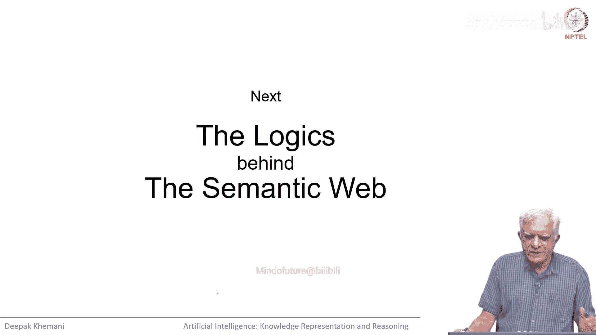

# 【印度理工学院】知识表示与推理 ｜ Knowledge Representation And Reasoning p69 P69_语义网络知识图谱 -BV1c4zNBmEyF_p69-

So welcome back。We have been looking at reification。😊，Let's continue with that。And we will look at。

How it turns out to be a useful mechanism when。We are dealing with relations which are of LT greater than 2 we are mostly seen binary relations so far。

 but we may be interested in relations of greater LT。😊，But， I'll just take a。Short break。

 and I want to go back to。O love。Video and add a little bit of material to that。

And I'll be back after that。Yeah。是。So here I am back again。

Let us look at our study of relations of aity greater than 2 and see how raification。😊。

Can play an important role there。Now of course you can think of many relations a relation is after all a relation between some elements of the domain。

 you can have a relation between two elements， you can have a relation between three elements and so on。

😊，And if you are going will be talking about knowledge representation。😊，We have to know。

Think about how we will represent these different relations so there is a multitude of relations that we can talk of and how can we handle them effectively。

😊，So， in the real world， entities are related to multiple other entities。😊，The question is。

How does one capture such relations？This happens in particular when we are talking about。

Events and actions。So， lets consider the use of verbs for describing actions so here and is an example of an incident about a couple of kids。

😊，Oh。Playing and you know， having a fight and this incident says that the we hit atoll with a stake yesterday afternoon in the park or in a park。

How do we represent this？One might be tempted to simply invent predicate names as and when we come across such sentences。

 so you might say， for example， that the predicate is hit and its arguments are the we are。Remember。

 we are using specific names to distinguish between the various DVLs that might be there。

In the domain。So。The we have 54 hit U 81 with stick 14。Yesterday afternoon。In part 28， I mean。

 that is a very lazy way of doing things。😊，The semantex is completely arbitrary and the user would have to keep track of what parameter represents what essentially。

😊，Already we have seen earlier that when we define the sun predicate we have to be clear as to who is the son and who is the parent essentially so here the problem would be manifold。

😊，嗯。And what happens if we wanted to talk of different sentences。

 supposing we didnt want to mention the power or we didn't want to mention the time and things like that。

 how do we handle such things so lets look at some of these issues。呃。No。

So the question is about choosing appropriate predicates essentially。😊，So if I say the we hit at all。

I can simply write it as hit DVR autonalization。😊，If I say the we ahead at all with a stick。

 then maybe I can say。😊，The we are hit， the V are 54 a 81 stick 14。

 so I have given three parameters instead of two。Let us assume that we can overload predicate names and that is allowed but there is a little bit of a problem here this sentence says a stick it doesn not say the stick essentially how do we handle things like earth stick so should it be something like what written here is that there exists in x which is a stick and the weR hit a tool with that x essentially that could be one way of writing the。

😊，Earths take part literally。If I said DVR hit ato yesterday。

 I would just write it as DVR hit DVR a tool yesterday。

 so you can see it is already very arbitraryarily an ad hoc and many of the questions that we would want to raise is that how is hit DVR atoll stick yesterday different from hit DVR atoll yesterday stick？

😊，The problem is particular to first neuro logic because you know we are formal and we are very precise essentially unlike natural languages in natural language we have you know ancillary words which help us understand the meaning of the sentence if you in particular if you look at Indian languages we have explicit case markers so you must have studied about Kaak。

😊，In your school sometimestime so there are these various cases so Kthanni， Calamco。

 K say kduara and so on， those are case markers they tell you which element plays what role in the sentence。

So， who is the actor， who is object and so on and so forth。

 whereas when we write sentences like this in first order logic。

 it is not clear as to what what is it that what stands for。😊，嗯。

How does one know that yesterday is a different kind of thing from stick 14 so obviously we should have some information about categories somewhere。

😊，How do we know that yesterday stands for time in the first place and moreover yesterday is a relative term and I say yesterday at this point of time。

😊，It means the day just before today， but if I were to refer to the same incident after one week then I would have to say something like last week or so on so it doesn' not make sense to use relative。

😊，References， so it would probably be a good idea to。

In the representation to store the date and the next question that would arise is how do we。😊。

Represent。A date。So let's move towards answers for this。😊，The modern trend。

Is to break down complex sentences into binary relations。

Everything all relations you want to store should be a binary relation so how do we do that for example。

 in this example that we are talking about DVR and Earthul。😊。

We could create an abstract type called event。And associate everything with that instance of that abstract type。

 which is an event。So we could say something like this that。Here is it。

Abst entity that we have created which is an instance of something which is called a hitting event。

 which may itself be a type of events because events can be of many kinds。

So what we are saying in the first line。😊，Is that。😊，E45 is the hitting event。

That we are talking about， so we have identified one instance of an event。

Then the second line says that the actor of E45 is divvier so you see that we are trying to bring in something which is like case markers we are trying to make the semantic relations explicit essentially so。

😊，That this is the actor and so on。Then we have we can say at statement the object of E45 was a。

 the date of E45 was March 21， the location of E45 was PA 28。And。😊。

The instrument of E45 was a stick so in this manner。

What we have done is we have broken down this relationships between many elements， the actor。

 the object， the instrument， the date， the location， and there could be other things also。

And associated each of them with an abstract entity called E45， which is an instance of an event。😊。

So， we are moving towards a more systematized。W of representing things。Yeah。And as we will see。😊。

This move will help us move towards。Representing information and knowledge which can be accessed by different programs。

Over the Internet。哎。So notice that we have talked about named properties so actor object date。

 location。Instrument。We can flexibly choose what we want to talk about so maybe we don't want to talk about the date。

 maybe we don't want to talk about the location we can choose what to add to the representation。Now。

 it is also now popular to break represent these in a slightly different format， which is as follows。

😊，The predicate subject object。Which is the binary relation we have talked about， for example， actor。

😊，Even 45 was Da。Can be expressed as a triple， so it is a collection of three items。

Some people refer to it as subject。Predicate object the first element is the subject。

 the second one is a predicate and the third one is the object as you can see it is a。

It's the same three names that we had used earlier。But in a different order。

 subject always comes first。The other way that people talk about is subject property value essentially。

😊，But both refer to the same kind of thing。And in the triple representation the same data would be represented as follows now we have triples。

 I have not used angular brackets， I use normal brackets but the point is that each of them is contains three elements。

Yeah。So， the same information that E45 is the instance of hitting event。

 E45 is the actor the sorry the subject is E45， the property is actor。😊，And the value is div。So。

 we are already going to be talking about the subject predicate object or subject property value。😊。

The list follows lose。E45 object atoul E45 date March 21， E45 location Park 28 E45 instrument。

 stick 14， the instrument of E45 is the stick。So， we can represent information in this very standardized uniform format。

Each tripleple says something about the subject， which is the first element of the triple。그。

The second element characterizes the property and the third element is the value of the property。So。

 nowadays when you represent now that we have a well structured representation that everything is a binaryral relation。

 everything has three constituents， one is a predicate name， one is a subject and one is the object。

😊，We can also now use standardized representations which allow us to store these triples and these things are called triple stores。

Each tripleple is a binary relation between two entities and we can depict them as an edge in a graph so we can even draw graphs to show what we are representing so on the left hand side we have subject property value on the right hand side we have subject perdicate。

Object。Each sentence is stored as an edge between two identifiers。

 essentially so that is going to be the key that in the internet we will talk about something called a resource and everything an individual and so on。

 everything would be a resource。😊，And we would link up resources with property edges so the subject is a node in the graph the property is a label edge emanating from the subject。

😊，The property H points to a value and we will see values can be of different kinds， for example。

 value can be a date value can be a number value can be another node which may have its own properties and so on。

 so all that kind of。Complex representation will be possible。The。

They can be stored conveniently in what are known as graph databases which are different from relational databases and they have a different query language and。

😊，They turn out to be very useful for。Such representations。So here is an example of another。😊。

Pace of information that you want to represent that you may want to represent and you will notice how we are moved away from arbitrary complex predicates with arbitrary number of parameters or with arbitrary L towards a standardized triple based representation where everything is make a binary relation。

So， this is what we want to represent its information about some musical performance。😊，So。

 these are the facts that we want to talk about。Okay。Hadiika Kni sang the Sufi song called Wang。

On June 10， 2012 in Coke Studio， it was produced by Zhi Fayt and hosted。

By YouTube that is something we want to say and we don' not want to say this in one long preddicate with many parameters。

The second thing we can add now is that this was also sung by Lahatth Hei Khan and Amjad Sali and also for the Coke studio。

Yeah。The song was written by the famous Indian poet Amir Kusro。哦。

Another Suhi song written by Husro is titled Chap Tok Sahini。

We written only the first three words from there， so how do we represent this in the new format that we are devising essentially？

Again， we start with an abstract entity called performance， so let us call this performance 101。

And we will link everything to that essentially， so just like we said that events。😊，45。

Was an event and then we related various elements to that we are doing the same thing here。

 except that now we have multiple sentences that we are putting in the same。

Graph graphical representation。So， here we go， we start with this Haddiahs performance。😊，And。

There the relation says that single is Hadbiah， the title of the performance is L。

The journal of Lung is Sufi and Lungy is a song it the date of the performance was June 12。

 the producer was Ro here。It was hosted by YouTube and it's in Co studio so you can see that。

That complex piece of information that we had。Is now all present in this graph。

But as binary relations between elements essentially。😊，So an edge， of course， relates。

Two of those things。Then the second sentence said that the same song was also sung by two other singers。

 also for Coke Studio。So that is what we can add to that now that there was a performance 1 or2。

 the singers were RFK and Amjad Sali and this was also in Coke studio。

The third sentence said that the。Poet of W was Amir Kusro。And Air Kuslo was an Indian poet。

 essentially his nationality was Indian。And finally about the other poem written by air Kuslow which is called chap Taxer。

 we can add that also to that and also add that it is a Sufi song which he wrote differently so this is the。

😊，Style of representation that we are going to be moving towards and we will see that this way of representing things facilitates a lot of work on the internet。

 so much of the things that we traverse so there are databases in on the internet which uses。

These kind of triple representations are binary representations and we will have a little bit of look at that after this particular video。

😊，Even问。50 years ago， when people had started using knowledge representation。

 started looking at knowledge representation and started looking at personal logic or knowledge representation and started looking at the way of making inferences。

There was already a school of thought which was saying that if you represent your whole knowledge or your whole knowledge base will be a set of sentences。

that is what we have been saying so far， then any theorem approval that wants to operate those on that knowledge base or want to make inferences on those knowledge base or want to make connections between different entities on that knowledge base will have to search through the entire knowledge base and depending on what is a format in the search would take a certain amount of effort essentially。

The other school was taught was as some people for example Chan and Magdamot in their book they call it concrete representations by concrete representations we mean that we have these explicit pointers or links in the knowledge base which tell you as to for every entity what else is a related item so we can just follow the edges to find out。

😊，What these things represent？No。That was known as semantic knits。Or semantic networks。

 And there was a lot of work which we are not going to be talking about here。

 which for which spoke about how to。Exploit the fact that we have these explicit links in the network or pointers in the network and there are these algorithms for example marker path passing so I will just write the name here you can look it up somewhere。

😊，Yes。Thank。There this algorithm called marker passing algorithms。

 which would try to figure out supposing you have this large network and you have one element here another element here and you want to say how are they related you can think of this。

😊，As an example for your the family database that we had spoken about some time ago in remember in the family database。

 everything was represented in terms of。😊，3 relations。

 the parent childil relation the gender relation that male relation and the female relation so out of which of course gender relation was specific to a node but the parentchil relation connected to nodes it was a binary relation and everything else was。

Like a path in that semantic network， so grand grandfather is your parents' parents whos a male aunt is someone who at the most fundamental level who is。

A child。Of your mothers。Our fathers。Parent， so an aunt is a female child。Of your parents' parent。

So we are going through some three links， remember， so if you are here。Then your parent is here。

 but this is you。😔，This is your parent。😔，This is your grandparent。😔，And the grandparent has a。Child。

 who's your aunt and she is a female。This is how we represent it。Yeah。

We defined this predicate called R essentially now you can see that essentially this is like a path or a certain pattern in the graph database and the query languages used in graph databases they are well equipped to recognize such pattern patterns essentially so that is in the modern sense and we will come to that maybe later。

😊，But I was talking about marker passing so marker passing was algorithm is that if you take two nodes so lets say suhima here and an there somewhere in the graph and you want to say how are they related then marker passing algorithms would basically search you know from both directions and see what is the path between those two these things and then of course you can optimize that by choosing the shortest path or the longest path it will also depend。

😊，Upon whether you have additional edges， so do you supposing you have found this definition of art。

 do you may create an additional edge？Between an person and the persons arent because that would makes searching faster so that again is a tradeoff。

Between forward chaining and backward chaining， do you add all the edges that you infer？Or do you。

Search the graph。Whenever the query comes essentially so those are interesting issues。😊。

And this was more than 50 years ago in this area called semantic networks nowadays people have moved towards。

😊，Something called good。Okay。嗯。Knowledge graphs。So。

 a semantic network is a graphical model in which nodes representing concepts are connected with label edges representing relations。

😊，The idea of a semantic network has been around for a long time。

Some people say even going back to the Greek philosophy time because remember that even Aristotle was talking about categories and things like that。

 the Socratic argument that houses the category of men related to the category of mortals。

 so people are talking about such representations which connected categories together even in those times。

😊，Early work in semantic networks was motivated by natural language processing。

 we do not have too much time to get into that here。It is often credit to Los Queenland。

Because he wrote one of the papers in 1968， which kind of crystallized this notion of semantic networks and made it more explicit。

But the idea had been floating around at that time subsequently the idea of semantic nets evolved into the idea of knowledge graphs。

😊，Which were semantic networks spread over the internet。

 So when when when the internet came then you could you know link。😊。

Different databases together and say this pointer is related to that element in that database and that kind of stuff and so we had this idea of knowledge graphs。

The idea of the semantic web evolved in this。Century a little bit towards the end of the last century。

Okay。And。In 2012， Google adopted formally the name knowledgeled graph。

For its representation of its data essentially so remember that Google represents。

Crolls the net and represents a lot of data which it uses for answering queries for you。So here。

 knowledge graph is a proper。Noown or noun phrase。But we also use the term knowledge graph as a more generic thing。

 which says that it is a kind of a semantic net spread over the internet。Fed over the mystery。So。

 here's another。Another。Description of knowledge graphs this time from an IBM site lest you think that it was only Google which was interested in this concept。

 there were many people and there were a lot of interesting work going on。

This says a knowledge graph also known as a semantic network represents a network of real world entities。

嗯。Yeah。嗯。Which are objects， events， situations or concepts。

And illustrates the relations between them essentially。😊，So the emphasis is。は。On the network。

Or the semantic network。We call it semantic network because the edges are named essentially so this edge means this relation that edge means that relation and so on。

 unlike a graph which has unlabeled edges。😊，The information is usually stored in a graph database and visualizes a graph and that is how we got the term knowledge graph essentially a knowledge graph is made up of three main components。

😊，Nots， edges and levels any object place or person can be a node。

And H defines a relationship between two nodes。Okay。

The other phrase that has come about when we talk about a semantic way and so on is the notion of ontologies ontologies are basically taxonomies but they can have other kinds of relations as well。

It's an extension of this idea of knowledge graph in which you have nodes and you have relation between nodes。

In the context of ontologies， the worldwide。Web consortium。

 the blue 3 has agreed upon a standardization of the language called Owl。

Where the acroronnyomy is OW L， but the name is web ontology language， it is a little mixed up。Yeah。

 we will look at our a little bit in the poll next。😊，SoNext。

 we will move on to something which I have been talking about on and off called description logics。

How they are represented and how they lead to。The construction of ontologies。And。How the language。

 our whole place。A role we may not talk too much about all。

 but we will certainly illustrate how all comes into play。All the stuff that makes into。

What is called as a semantic web， some people use the term web 3。0。So we will do that next。

