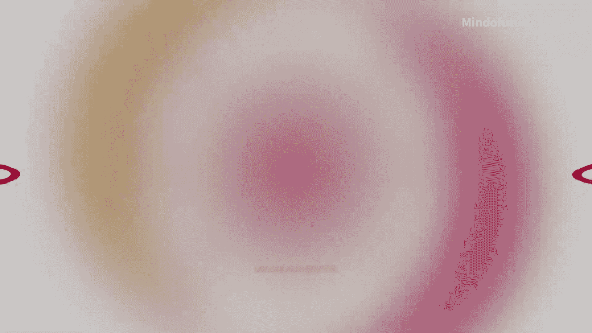
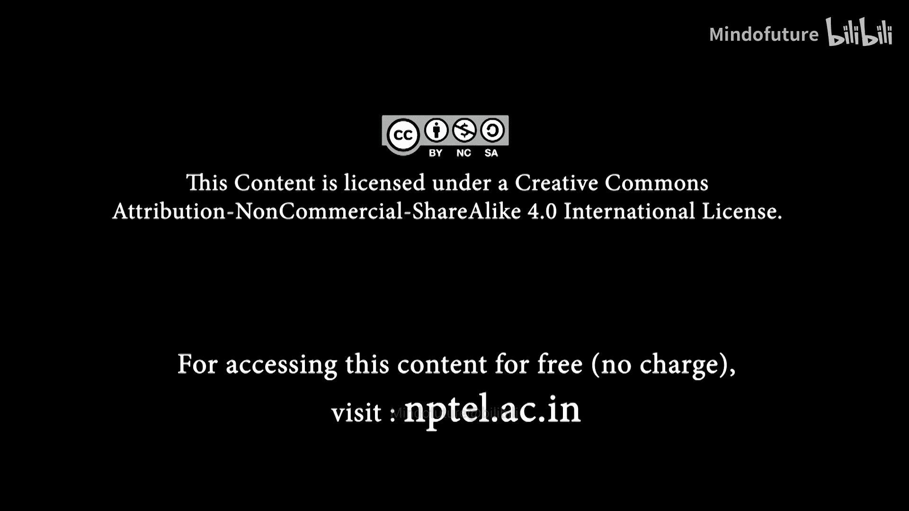
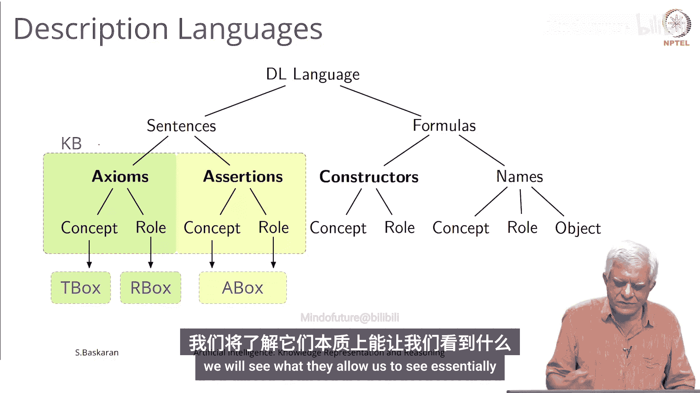

# 【印度理工学院】知识表示与推理 ｜ Knowledge Representation And Reasoning p70 P70_描述逻辑中的语句 -BV1c4zNBmEyF_p70-

So welcome back。We have been looking at。This family of description logics。And we have seen。

How to define new concepts from old if you want to see there。

or new roles from whole so you start off with a set of primitive concepts and a set of primitive roles and then you can define new complex or compound concepts or roles essentially。

Let us now look at what are the kind of statements that we can make。So we'll start with the tea box。

There are essentially four statements that we can make。

We can say that a concept C is subsumed by another concept D。Which defines a concept hierarchy。Oh。😔。

A taxonomy。So， we have been talking about the natural world taxonomy quite often。

 so a goat is a mammal a mammal is an animal an animal is a living creature and so on。So。

 each of them is a concept essentially and they are subcons of other concepts。

We can talk about concept equience， these are like synonyms。We can talk about。Premitive concepts。

Which have this subtion relationship with。Complex or defined concepts。

 so remember a are named concepts of primitive concepts。And C And D are something which can be。

Constructed from simpler these。So， the most。Important one is C is a subclass of D or as we have said here D subsumes C essentially。

In terms of interpretation， it basically means that the set which represents the concept C is a subset of the concept which represents D essentially。

There are various ways that we have been able to talk about such kind of relationships。

In description logic， we are essentially saying。Lets C is a subconcept of D essentially。

It's a subset decision。There the set C。Is in inside the set D in first logic。

 we would have set for our legs。Cx。Replace Dx。It same thing in first order logic。

 but here in description logics as we have seen。We are not talking about variables and quantifiers and things like that。

 We are simply naming concepts and。Relations between concepts。So， this subtion relation is。

Is the the key relation， in fact。C is equivalent to D it is basically saying that C is subsumed by D and D is subsumed by C essentially that they are the same concepts with different names essentially。

We can define them。Primitive concept and give it a name and say it it is a subset of this concept C essentially as we will see we can use it to define this thing but we cannot use it in reasoning very easily。

The only difference between this and when we said that C is subsumed by D is that C and D could be arbitrary things whereas here we are saying that okay I am defining this class and this is a subclass of that subclass but we have not said precisely what kind of subclass it is but it is a subclass that is all we know。

If you say equivalent， then of course we are giving a name to a concept that we have defined we we could have defined C using whatever context expression and then we are saying we will call this a new concepts so for example arent essentially。

Lets talk about role axioms or what goes into the R box。There are three things here。That。

R1 is subsumed by r2， R 1 is equivalent to r2 or a roll chain is subsumed by some complex by some role r essentially。

So， as we said。This simply says that。Aen。Is subsumed by R2 or R 2 subsumes R 1。 So R 2 could fact。

 for example， be the。That is say sibling relation。And our could be the brother relation， essentially。

So。Ifhu。😔，Let's say。We have this set of people。And this arrow points to the fact that。

There is a brother relation between them。So a has two brothers。 Let's call this A and B has。

One brother。So that's a relation essentially。Whereas if a。Had。Her sister as well。And let's say。

 we also had a。Sister， as well。Then this new relation。Which is。The union of the。

Full arrows and the dash arrows。Subsumes the brother， So basically sibling。

Relation which says that either this kind of hell or this kind of error。Then that obviously。

Is a superet of the brother relation， essentially。So I hope the idea is clear。Formerly。

We would say that if Ab belongs to r 1， then ab also belongs to r2 so if a is a brother of C B。

Or B is a brother of a， then B is a sibling of he。The equience thing is is。Basically a two way thing。

 so basically it is another synonym。For the same relation name。If AB belongs to R1。

 then it' is equivalent to saying that Av belongs to R2。We can say that a roll chain is a sub of。啊。

就是啊很手机。So， I。Could be。Another relation that we have defined essentially actually。The finally as。

Which is to talk about the a box which talks about individuals essentially。So。We can assert。

That a belongs to the class C。That a is a C， for example， or object a is a member of the concept C。

If that is not true， once we assert that if it is not true。

That it induces new role fillers essentially so if we say for example。As an aunt。

And in our knowledge base that is not it is not clear that is an not。So。

 essentially this will induce the fact says that。A belongs to the set。Who have siblings？

A for example A belongs to the set who are female and who are siblings who have children or who have at least one child。

 then if we simply assert that a is an aunt then this would automatically be added to that essentially。

😊，Likewise， we can assert。That there is a relation between A and B that is a of B for example。

If it is not already。Clear from the database。From the knowledge base。

 then we would add those appropriate relations and restrictions。As you said， if not。

 the assertion induces the role filler and induces the new assertions about the existing role fillers so that this AB satisfies this relation r。

Object equality， we can say that two individuals are the same or they are different。

Remember that we don't have the unique name assumption in description logic。So， it's possible that。

That two symbols can stand for the same individual。

It but we can we can state that they stand for the same individual。

 we can also state that they dont stand for the same individual so is。Not the same as B， essentially。

Okay， so we are done with the。The knowledge base。Next we will look at some languages。Which are。

Some of the languages that we mention which and will will see what they allow us to。

See， exactly。So we' will do that in the next session。

