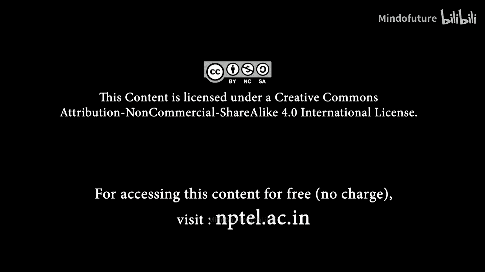
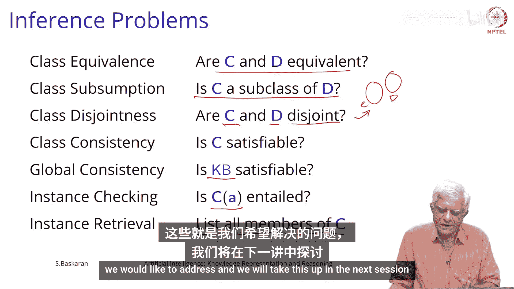

# 【印度理工学院】知识表示与推理 ｜ Knowledge Representation And Reasoning p73 P73_ALC表 -BV1c4zNBmEyF_p73-

So welcome back。We have been looking at description logics。

And we have seen how to form new concepts from a set of primitive concepts。

 new relations from a set of primitive relations。And how to。Express sentences in description logics。

It basically are about subtion。And membership。So。Let's look at。

The process for reasoning in description logics and the algorithm that we use is the tableau method。

Which you might recall we had studied when we were looking at proportion logic。The idea is similar。

It is like model checking that you give some input to the algorithm and it tries to find a model for you。

If it cannot find a model for you， that means that the original input is unsatisfiable。

So something similar we will do for。The kind of conclusions that we can draw in description logics in particular we will focus on。

This。Simple description logic ALC， but you can imagine that the method can be generalized。😊，So。

 this is the language ALC that we spoke about just to do a very quick recap concepts can be。

Atomic concept， top， bottom or some a。Or they can be constructed using any of these。

Other construct concept forming operators， which includes neg intersection union。

And role restriction。And the kind of statements that we are interested in is that us。

Concept C is subsumed by a concept D or is is equivalent to a concept D and。That an individual a。

Belongs to a concept C。Or a pair of individuals belong to a relation or role R。So。

 whatever we discuss in description logics。Is often implemented using the web ontology language all。

And this is how a sentence in o would look like， so this is just to introduce to you the fact that you can use a tool called Pro。

To express or construct ontologies in Owl and ourwl。There are different variations of owl。

 but there is a variation called owl deal。😊，And that ordeal。

Corresponds to whatever you can say in description logic。So， here is just a。Snapshot of。

How you would express things。So， you can see that。嗯。There is a concept called Apple device。

 There is a。Con concept called happy and it has a subclass called T A and there is a concept called person there is a concept called teen。

And T also has a surplus TD TD transfer。Ts。呼换。Apple devices。And what we are saying here。Is that。

If someone is a teen and owns an Apple device。Then they are a subclassus of the class of happy individuals。

Here are some examples in Owl。Oh。So you can see here that。

We are talking about the equivalence relation here。

And this is expressed by the fact that we are talking about equivalent classes there are two classes。

 one is just a name class called taughtt， the other is an intersection of two classes so this is intersection here as you know。

One of them is teen and the other is this。Concept， which says that you have。Some values from。

For the role owns from Apple device So so teens， you have to be a teen and you have to be。

Someone who owns at least one Apple device。And we are saying that the name toad applies to this concept essentially。

And then we can say that to。Is a surplus of happy device So whenever you are looking at Dl statements。

You can also think of them as an implication statement。So， it。

Basically as we saw this earlier whatever we can say in description logic we can say in for so logic so essentially what this is saying is that if someone belongs to the class stored then someone belongs to the class happy so then you would think of this as an implication sign。

Here is a grandchild relation， So we are saying。That there is a。Property chain。Which is hasschle。

 followed by hasschle。And that this property chain is a。Sub objectject property。Of something called。

Has grandchild， essentially。So if you have a child who has a child。Then you have a grandchild。

You are saying that the domain。Of the child property is a person essentially。So。

 the properties has style。And the domain of that is person， essentially。

The range of hashtle is also a personalization。And you can express them in description logic as shown here。

That if you have a child， if you have at least one child， then you are a person and。That everyone。Is。

Belongs to the class that if they have children。Then the child is a person。

We have also spoke about the inverse earlier。And that basically here it is inverse object property。

 So this is our language and。Oh。Whatever we could say in description logics。

 we can say in owl essentially。Now， the process of reasoning for。

Description logic involves converting everything into a form known as a neg normal form。

This is very similar to the clause form or the connctive normal form that we use for resolution repet method。

It will also have the added similarity that if you want to show that something is true。

 then you might want to add the negation of that to the set to the knowledge base essentially。

But first， let's focus on how to convert things into negative normal form。 So if you have。

An equivalent statement， you reduce it to subsumption statements。And if you have a subtion statement。

 then you reduce it to。Concept essentially， so you have to think a little bit carefully here as to what is happening。

Because what you have on the left hand side C subsumes d is a sentence；

 it is either true or false essentially， whereas what you have on the right hand side what you are converting it is to a concept essentially。

So。If you remember。What C subsed by D is。That for all eggs。C x。In place， Dx。

If you look at the semantics of this。Then what you are saying is。That。You have a concept， C。

And it is contained in the concept T。 So this is C and this is D。 And of course。

 there is a universe of discourse or the。Think concept or the top concept， essentially。Now。

 what have we done here we have said。Compliment of C Union D。

And if you think kind of correlate this with logic， you will。Kind of。Associated with。Not。Cx。Or Dx。

Which as you know is a way of writing the implication you can write it as a distinction as well。

But how does this work for。Reasoning。Now， remember that the tabau method is basically a model checking method it is looking for a interpretation which is a model essentially。

😊，And what is this particular set saying？That。You are it is a union of everything that is not in sea。

And everything that is in D essentially so if you think about this carefully you will see。😊。

That this is the entire。路面。Because everything that is not in sea is outside of sea。

So it must be from the domain。And the rest is from Nomandi。So， in some sense。

 this corresponds to the full domain essentially， so you can think of it as corresponding to something which is true。

What if c was not subsumed by d if c was not subsumed by D。

 then it could possibly be something like this。So， this is C and this is D。Now， what does our。

Concept deote it says that it is the union of not C with d。 So lets first look at what is not C。

So not C is everything that is。Outside C。So what I have shaded now。Is not C， essentially。

But this is a union of not c and D， so we have to include everything that was in D as part of this。

So now you see that it's not a complete。Unniverse of discourse there are some things which are not in this this thing and that happens。

When C is not subsued by D。When we saw that when C is not when C is subsumed by D as we saw。

 everything would be included in the set。No。The taboo method。😊，你。The one that we studied earlier。

Would take the negation of what you want to prove and add it to the set of sentences and then try to find a model for that。

So， by negation in。The concept world we mean complement so what is a complement of Nazi union D。

The complement of not C。Union D。The complement is the empty set。As you can see here。

 provide that C is subsumed by D。But you C is not subsumed by t。

Then we have seen that the complement of is na Union D is not empty as we have drawn on the right hand side。

So here， let me write this that C is。Not subsumed， body。So there is something which is。Reminining。

 essentially。Now， if I take the complement of that， then I will get this。😊，This moon like shape。

 which let me shade with the。Vertical line。So that would be the complement of not C union D now that is a non empty set so that means it is satisifiable。

And。Which means that we do not have a model for the negation of not C union D。

Whereas if C is indeed contained in D then the complement would be the empty set if it is not contained then the complement is not the empty set and this should hopefully give you some intuition as to how does the tableau method work essentially so we take a sentence which has tools values。

We transform it to the domain。And now we are looking for a model essentially or satisfiability essentially。

So let's look at this a little bit。In more detail。First。

 how to convert things into negative normal form。嗯。We have already said that。

We will transform this into two these things。The equis into2。Subsumption relations。

If we have the negative form of c subsumed by d。Is the negative normal form of not C union D so we have made this transition from a sentence to the domain essentially。

In some sense that is a semantic approach so model checking is like a semantic method we are looking for a model which will satisfy the sentence or which will make the sentence true。

Then there are some other things that if you have。Negation of top then it bottom and likewise negation of bottom is top the n NF of a is a itself NF of n a is not a。

The N of not， not C is C。And if you look at the。By느ity。Operators。

Then you basically push the negotiate NNF form inside there essentially。

And like in the D organs loss。We flip the nature of the operator。Essentially。

 so once you push the knot inside here。Then。This intersection changes to union。

 So we are used to this by no， Something similar happens。嗯。For role restriction also。

That once we have negative negation here and when once we push it inside the nature of the。

Quantifier changes so for all becomes they exist and there exists becomes for all。So。

 that tells us how to convert everything into NNF form and how we are ready to talk about the algorithm。

This is an example of converting things into negative normal form。嗯。

So you see that first we have eliminated this and replaced it by this and by this。

And then we have pushed the knot inside here。And。Then we have replace this by a。

And then we have pushed this knot inside here。And that's become for all now。 And now we have a。

Compound concept， essentially。So， we are talking about enttailment and we are talking about interpretations because we are looking for models so just to do a quick recap。

That。Interpretation is a mapping。That denotes。For something in the domain concepts are sets of objects。

And you can see that things like teen apple， so when you say teen superscript try basically what I mean。

😊，The interpretation of teen。 So the teen is a is a。Expression in the description logic。

 it is a concept in the description logic。But T superscript i is a set in the domain essentially and that set is a subset of the domain essentially。

Likewise roles are subsets of domain cross domain。And objects are。Images or interpretations。

Of those individuals。We say。That an interpretation I is a model of alpha if the interpretation satisfies alpha that means that that alpha can be made to be true that such a concept does exist。

It is a model of a kb if it satisfies all the sentences in that KB essentially。

And a model is an arrangement or a configuration of the world that makes that alpha true essentially with respect to the knowledge base。

So， if you have a set of sentences which form the knowledge base there will be a combination of T box and a box sentences remember that T box is a terminology box which doesnt talk about individuals but of relations between concepts and roles and so on。

 whereas a box talks about individuals the assertion box。So alpha is satisifiable。If it has a model。

The Kb is satisifiable if it has a model。And a Kb entails alpha if。Every model of the Kb。

I is also a model of alpha， and this will be true。If we add the negation of alpha to this and then the whole thing becomes unsatisfiable。

So to show that K B entails alpha， you add the negation of alpha to the K B and show that it becomes unsatisfiable。

 So you would recall the resolution reputation method with it exactly there and also in the tab blue method that we studied for propositional logic。

Now in general there would be many models because we have been saying repeatedly that we are talking about the open world domain。

 it is not that everything that we know has been expressed in our set of sentences。

 there may be other things that we don't know and many of those other possibilities would be included in models so in that sense。

We can have an infinite number of models。InAnd that is the open world assumption that we are talking about here。

And we are going to be working with that， essentially。So， what are the kind of。

Inferences or the questions that we can answer what are the inference problem that we can address in description logic using the taboo method that we are talking about。

So， the first thing is class equivalence or c D equivalent then class substion this is the most important is c a subclass of d。

Clas disjointness are C and D disjoint。By this， you mean that there is no overlap between the two sets。

Second。Is C satfiable， which means？Can we find an individual。Which belongs to the class C。

Is the knowledge base satisfiable？Is every concept in the knowledge base satisifiable？

Is c of a and tail， which means that given an individual a。It belongs to the class C。

 Can we show that。And then we can say list to all members of C these are the questions that we would like to address。

And we will take this up in there。

Next session。