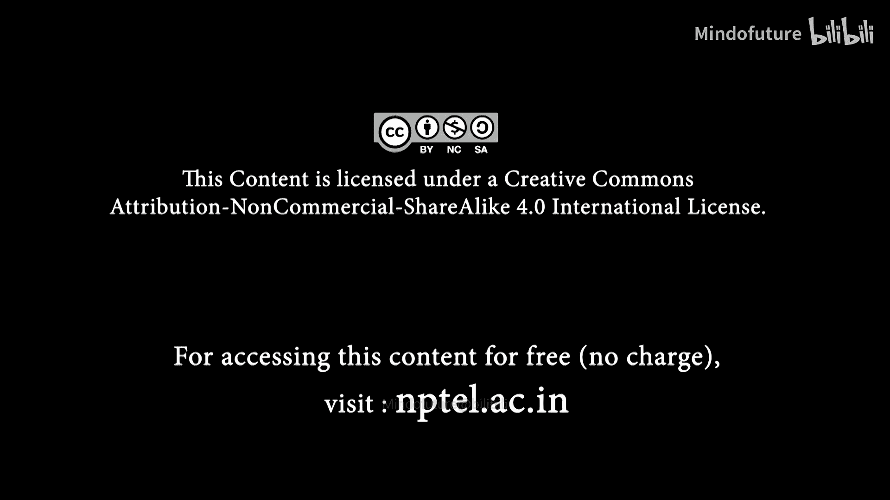
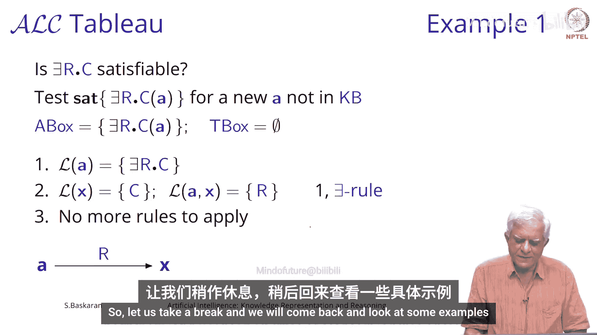

# 【印度理工学院】知识表示与推理 ｜ Knowledge Representation And Reasoning p74 P74_ALC中的模型检查 -BV1c4zNBmEyF_p74-

So welcome back。We have listed in the last session。

The set of influence problems that we will address， the problem of class equivalentence subsumption。

 disjointness， consistency， global consistency is the whole knowledge based consistent and instant checking essentially。

So， let's look at that problem。To find out whether a class C is equivalent to a class D show that。

This。I is a logical of or consequence of the Kv， so this is true。If both these things are true。

 we have already said that。We break down， break it down into substion checking。

So this problem is called substion checking。This is a key。Ting。

You want to show that c is subsumed by d and we have already said。That。This statement。

We will reduce it to this statement。Nazzi Union D。And then。We will take its negation。

And add it to the knowledge base。And we will show that the knowledge base has become unsatisfiable。

And when we simplify this statement， when you push the negation side inside。

 we get C intersection node D。So， what does scene intersection normally look like？When。

C is subsumed by d if this is d。If this is the universe of discourse and if this is C。

Then node of D is this。Everything that is。Outside D。So this is a set that I have drawn here。

So can we find something which is in this set essentially？

That that we cannot find an element here on the other hand， as we said earlier。If this is a。

This thing， then the negation of this thing was this sec。Okay。

 so you must remember that this is empty。Because。C does not have an overlap with node D no D is the shaded person outside and see is the shaded person inside essentially。

But when we。So this was c and the other thing was not D and you can see there is no overlap， I think。

Now you can see that this region。So this was C and this was D。Then。

C intersection now d not is everything which is outside d。And if you intersect it with C。

 you get whatever is common with c and you can see that this is not empty。So。

 if C is not subsumed by d， then C intersection node d would be satisfiable because it is not empty set and an element may exist in that whereas if C is。

😊，Subsumed by D then what we will get is an empty set and there is nothing that can be in an empty set so that is not going to be satisfiable so that will be unsatisfiable。

So， that kind of explains。😊，The rationale behind taking the sentence like C subsum is subsumed by D。

And replacing it by this sentence that show that。This sentence is unsatisfiable。

So the negation of that sentence is unableable。To find out whether two classes c and D are disjoined show that their intersection is empty。

 so remember that this stands for the bottom concept which is also the empty set。

Is a logical consequence of this。So。This is。The knowledge base entails that C intersection is empty。

If。You assume that there is some element a which belongs to this class C intersection D。

And then then that becomes unsatisfiable that there is no such element essentially。

To find out whether a knowledge base is globally consistent。

 we will essentially say that there exists some element somewhere in the domain。

And if that is satisifiable。Then the knowledge base is globally consistent。约 a。

He is a new individual not already mentioned in the knowledge base。

To find whether a given class C is consistent show that。C is not an empty set。

 so this stands for C is subsumed by the empty set which means C is an empty set。

Is not a logical consequence of the knowledge base essentially。If it is not empty set。

 then it will have some element and that means it is satisifiable。So C is consistent。

If this is satisfiable， on the other hand， see is inconsistent。If this whole thing is unsatisfiable。

 essentially。So， to show that。She is unsatisfiable。If you add the C of a。

Where AI is a new individual again to the knowledge base and then shows that that is unsatisfiable。

To find out if an individual a。Belongs to a class C show that C is a logical consequence of Kb。

 so its。So this is what you want to show。And。What you do is you add the negation of that to the knowledge base and then show that it is unsatisable。

To find all individuals that belong to the class C。You collect all individuals from the domain。

 remember that this stands for the domain or top class or thing essentially such that。That。

C of is entailed by the knowledge base， so you just collect all those individuals together。No。

Like the taboo method that we studied for proportional logic。The tab blue method for， for sort for。

Description logic is similar that you have a set of expansion rules。

 you start off with a root node and then you keep applying this expansion。Rules。

 the root node will contain all the a box statements。

 and then you apply the expansion rules and then try to show that there is a model if if there is if you can' if if the。

Process of extending the tableau。Domins。In the sense that you cannot apply any more rules and there is no contradiction then it is satisfiable。

 but if all branches are closed then it will be unsatisfiable exactly like what we did in the。

Tableau method for Pro logic， except that the rules here are as follows there is the intersection rule。

 the union rule， the there exist rule， the for all rule and the t box rule the t box rule basically says。

That whatever you have said in the tea box which is true about the domain will apply to the individuals that you。

Are talking about and remember that we start constructing the tableau by individuals which we have taken from the a box。

So， we construct a directed label graph as before， which is called a completion graph。

Where v is a set of constant variables， e is a set of role assertions and l is a set of。

Notode and edge labels。So these are the node and edge label。A node label says that this。

Element X belongs to。Some some concept which is which will be listed in this list essentially。

 so it is a list of concepts。Likewise， there is a list of roles for which pairs of elements are interestinging。

So if the， if the。Label for roll label for。Lucy comma x is like or by it basically means that。

We have Lucy， we have x， and the relation is either likes or by or both in this case。So Luc likes x。

 lu by x。The label set for individual。Are the concepts that。The individual。

Belongs to so in this case， Lucy is a team。And also。That Lucy is。Someone who likes fruit。

 essentially。And x could stand for fruit， for example。Now this one rule。

 the union rule creates branches。In the proof procedure， just like the R rule in。

Professional logic created creates branches。 This also creates branches in the this。So。

 the the process would basically be you follow one branch expanded branch and when a contradiction or a clash occurs we will define what we mean by this that is you have a and not a two concepts in the list thing they belong to the label set for x or or bottom belongs to the label set of x then backt and try another branch so essentially we are looking for a satisfying。

Assignment or a model essentially。A branch is closed when a clash occurs which basically means it has something like AN not a insight and a branch is complete when no more rules can be employed。

So， the algorithm is going to be convert formulas to NNF。Prepare。

The T box and the a box and initialize the completion graph with elements from the a box。

 so we as we said that we start constructing the tableau right。Elements from the a box。

Apply all T box axioms to all individuals because。That is what the T box says that you know。

 these are generic things which apply to everything in the domain。And if there is a contradiction。

 then backt and try another branch if you are looking at this rule essentially。

So either you will have some closed branches or you would have some complete branches。

So when a tableau returns a class free completion graph。

 then the input sentences are satisfiable or consistent。

 which means there must be at least one branch which is class free。

 then we have a model and then we see that the sentence is satisifiable。

If it fails to return a class free completion branch。

 which means there are no branches which are clash free。

Then the original set is unsatisfiable or inconsistent。So， let' us look at some of these roles here。

This is the intersection rule。If this concept belongs to the label set of x。

 so we are looking at a node in the。In the graph， so somewhere there is x and x may be a child or something else and so on。

And C and D do not belong belong to this label set， then we add this Cd to the label set。

 so for example if we started with C intersection D then we add C and D so we have these two new things added to the label set of C so this follows from the meaning of intersection that x belongs to the class C intersection D means x belongs to C。

And x belongs to T。So， again， we are trying to eliminate operators just like we did earlier。

If one of them happens to be already in the label set。

 it doesn not matter we add the other one to the label set。For the union。嗯。

If you are saying that x belongs to C or x belongs to d or both of those。And if C and D are。

Not in the label set， so their intersection is empty。Then you create two branches。

 branchlan1 then branch 2 to one， you add C and to the other you add D essentially。

So if you had this x。With the label C union D。And it take two branches。To one。

 you add C to the other， you add D。We are still talking about x here， essentially。

If one of the two concepts is already there in the label set。

Then the Union rule does not apply because we already know that it belongs to sea。

So that is enough to tell us that it belongs to C union D。The existence rule。

If in the label set we have there exist Rrc， so remember what does this say this is。

There there exists at least one role filler who comes from the class C。

 essentially so it is a role filler who comes from the class C。So。

 x is related to something and that something comes from the class C。So， and there is no y such that。

XY。Belong to the。嗯。So that R belongs to this pair xy。That the edge X y is labeled by R。And， and。

Y should we level by c then we add a new variable y。So we started with x。

Then we add a new variable way。And we have this relation R here。

And we say that y belongs to the set C。So， if we have this statement there。

 then we add a new edge and。We say that y belongs to C。So the universal rule now。

If this statement would say that all role fillers must come from the class C。

Then remember that the universal statement is conditional that if there is a role filler。

Then that role fill must come from class C， it doesn not say that there has to be a role fill。

So that's what we are saying here。 if there is a y width。With， with。

Which is a road filler for this R。And C does not belong。To the label set for y。Then， add。

C to the level set for essentially。So if you have this。And if we have a roll filler R。

And C does not and y does not belong to C， then add C to the label set of y。So。

 for every edge that is emanating from x， we must do that。So， there is a。Exhale。

And if you have a Y hill。And a wave on here。And y2 here， all of them are related by this rule R。

Then for each of them we will check whether C is added as a concept。

 if not we will add it as a concept。The tea box rule if is said that。

If there is any tea box statement。And it doesn not belong to the label set of x。

 then add it to the label set of x and this is because D box statements are general statements that should apply to every individual。

We do not apply T box rules to close branches， we will talk about that in a moment。

And we do not apply tea box rule to blocked variables。 So close branches are when。

They are inconsistent and can we don't need to extend them any further。Block variables are variables。

 which will。Could potentially go into an infinite branch， and we want to nip that in the。But。

 as we say。So， apply all T box statements to all individuals that is the basic idea of the T box rule。

So， let us say that we have in our knowledge base a sentence which is there exists at least one role fill with from the class C。

And we know that there is an element a which comes from the class C。So， is this。Satisfiable。

 is there a model for this？So， how does it work， we start by constructing the a box。

As the starting point of the tableau。And so a is in the a box so our first instance comes from there there is an element a and which belongs to the class C so C is in the label set of a and then we have one t box rule so we need to apply that to that。

So we bring it here， apply T box rule。And what does this rule say that。Create an x1。So this a。😊。

Create an X1。So is that。X 1 is related to a。Where the role are。And give it a label C。

So we started with a。A belong to C， but that doesn't matter。 We also want to say that。There exists。

A roll fill of the class C， so we create this X1。And we say this also belongs to the class。

It belongs to C。 So let me use belongs to help。This。

So now we have this statement that there is this x1 which belongs to the class C。 Now， again。

 we have to apply the。T box rule because that is what the method says。

 So we have to either keep applying till no more rules supply。Or if a branch is closed。

But in this case。Neither will happen and therefore we will have to invent a method for stopping this expansion process。

So we started with a。Then we added x。Now we are saying that add an x2。Add another variable x2。

 which must come from the class C， everything is from the class C in this example here。

So x2 must be from the class C and x2 must be。A roll filler for x1， essentially。

So you can see we started with a， we added x1， we added x2， then we will add x3 and so on。

And we do not want to keep doing this essentially。 So this is where we define the。Locking ruleism。So。

 if a rule induces a new variable， then applying the same rule to the new variable may induce yet another new variable that is a problem that we just saw。

And it may not terminate therefore， essentially， So we can force the tableau to terminate if we block。

The variables from creating new variables that are similar。So by similar。

 we mean they have the same label set。So， in this example， x2 can be blocked。

So a node x blocks node y。If y is a variable and not an individual， it cannot be a consent。And。

X is an ancestor of y。And the label set of y is contained in the label set of x。So。

 any x with the label set X y is a predecessor of y because y is a role filler for x。

 every predecessor of y which is not an individual is an ancestor of y。

 every predecessor of an ancestor of y which is not an individual is also an ancestor of y。

And a node y is blocked。If it is directly blocked all one of its ancestors is blocked。

 so that is a definition of blocking so basically we stop this unending chain of new variables being created。

And then of course， once we have blocked it， we don't expand that branch any further。Okay。

 so let's take a break and。We will come back and look at some examples。

