# 【印度理工学院】知识表示与推理 ｜ Knowledge Representation And Reasoning p75 P75_语言无关的表示 -BV1c4zNBmEyF_p75-

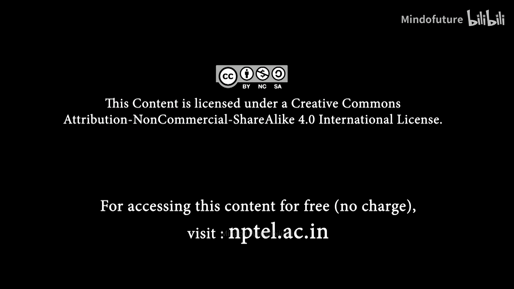

So welcome back。We have said often during this course。

That the choice of predicates is a very important thing。

And that is a matter of which logicians don't bother about too much because they are more concerned with the theorem proving strategies and so on。

 whereas from the knowledge representation point of view， the choice of perdicicaacy is of important。

Is very important， so let me。Do a recap of some。Things we had said earlier。

That choosing predicates arbitrarily necessitates adding rules which work with the predicates because if you are going to add predicates to your knowledge base。

😊，Then the only use that predicates can have is if there are rules which are operating upon them。

Which allow you to make inferences with them so the mold the number of predicates you choose the mold the number of rules you would have to add。

Which basically means that choosing arbitrary predicates from English language if you are talking in English does not make sense because for every such predicate you would have had to write rules or something like this。

😊，We had seen at some point that we could use something like wordnet to translate them into synonyms。

 but that is another way of doing things what we want to look at。No。

Is that can we define a conceptual domain which is independent of natural language terms？So， that。

The predicates that we define in some sense， are not。

Let's say in English essentially we have already said that the。😊。

Name we use for a prediccate is irrelevant。Because we can have any interpretation for any predicate。

But what we are now seeing is that。Explore the world of concepts and choose a canonical set of predicates。

In terms of which you will be able to express everything else so can we think of such a set so as I had said even then。

That Roger Shakin his group in the mid 70s at Yale University。

 they did a lot of work in this area and they developed what is called as conceptual dependency theory。

😊，W had a very small set of predicates and now we will take a quick look at that。😊。

For various reasons， that approach did not survive primarily because。😊，It was。

Very manual work intensive that somebody had to sit and do all that stuff。But。In the end。

If you want to be reap the benefits of knowledge representation you have to somehow get into it of course we can try。

Learning approaches or teaching approaches whereby we can teach a machine the meanings of words in terms of the predicates that we are defining。

 but we will leave that for later essentially let us try to see how this whole idea works。So。

 perception or understanding the work of Roger Shank and his group at Yale was focused on understanding natural language stories and their idea was to read。

Stuff in English。And understand it。We will see what we mean by understanding。

And be able to answer questions based on that one advantage of representing whatever you are reading in a language independent format is that if you want to generate language from that you can put a generator for different languages and so you can read a text piece of text in English convert it into CD theory。

And generate it into Hindi let us see if you have a generator for Hindi that is an idea which natural language translation also had pursued for a while。

😊，which is that of an interlingua， a language which is common to a representation which is common to many languages。

 but more recently again that has gone out of fashion because working with parallel textcopoola has proven to be effective in many domains。

Yeah。So， when we say understanding， we basically mean perception in the sense that making sense of some inputs。

 not just labeling it。😊，But creating an internal representation of whatever you are seeing or hearing or reading。

 so you could do it in natural language， understanding， speech， understanding， language。

 understanding。The thesis that this group put forward is that understanding has a strong top down component。

 it involves concept driven mapping into preconceived notions rather than data driven bottom of approaches actually that you already have in your head what you can understand its just a question of mapping。

The incoming information into those internal representations。We have seen this example earlier。

 so I will not dwell upon this we will just keep it in the。嗯。

Slides so that you can go over them again， but basically this is a story of。嗯。

This guy called John who is upset with Mary and they are having some conversation and as this conversation goes on the listener has some expectations and we have listed out that expectations can come through various sources because of the syntax of language because of the meaning of what people are saying because of the context in which that the conversation is happening because of conversational rules。

 for example people talk for a certain reason because of the world we offer a listener。

 what do you know about the other person and because of cultural norms because different cultures have different ways in which they interact with each other。

And then we had said that one would be very surprised if he said that change the topic and said oh I want to go and eat some fish and we have also observed that jokes often exploit such violation of expectation so the whole idea of top down understanding is that as you are getting information you are processing it and generating expectations as to what will come next and when you see something which you are expecting then in some sense you keep adding to that information essentially。

And we will see this a little bit。😊，Yeah。So， here's。

Small video that I wanted to show this was given to me by Richard Gregigley， who came from。In it。

And it is it illustrates。The fact that。吧。What you see is controlled。

To a large extent from what you expect to see， essentially so there is。

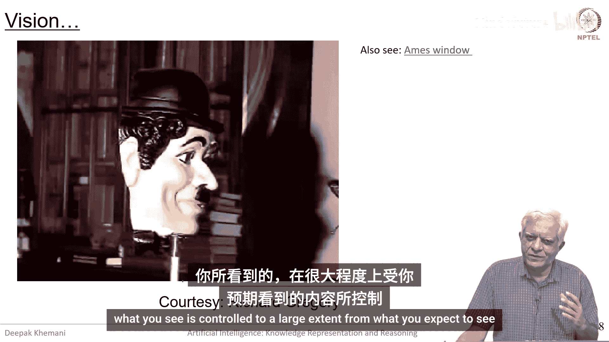

Face。Mask of Charlie Chaplain， who I think everybody。

nose and this mask is a hollow mask and it is going to rotate about the vertical axis and we can hear what Gregory says about what is happening there essentially let me read this the hollow head actually at the moment is a perfectly normal head chain but wait as it comes round you will see will you that it is hollow the back of it coming round now is actually a hollow mask。

Itears to rotate in the opposite direction。 And amazingly， a nose sticks out。

 although it's actually sticking in。Coming round now is the normal correct， as it were face。

 And wait again as it comes round。And you'll see this extraordinary thing like Jekyline Hyde。

Both the noses stick out because it's so unlikely that a nose sticks in that a face is hollow。

 So you see it as convex， although it's， in fact， concave as now。

And then it will become the normal face again there。

And note that as soon as the features appear in the hollow inside。

 it will look convex as though it's a normal face almost that it isn't。

As soon as the features appear。对。Your brain refuses to see it as hollow simply because it is so unlikely and this demonstrates the immense power of top down knowledge。

 which could actually counter signals bottom up from the senses。And force。

 an extraordinary illusion in which the sensory information of the present。

Is counselled by immense knowledge derived from the past because you've seen so many faces or with their noses sticking out。

😔。

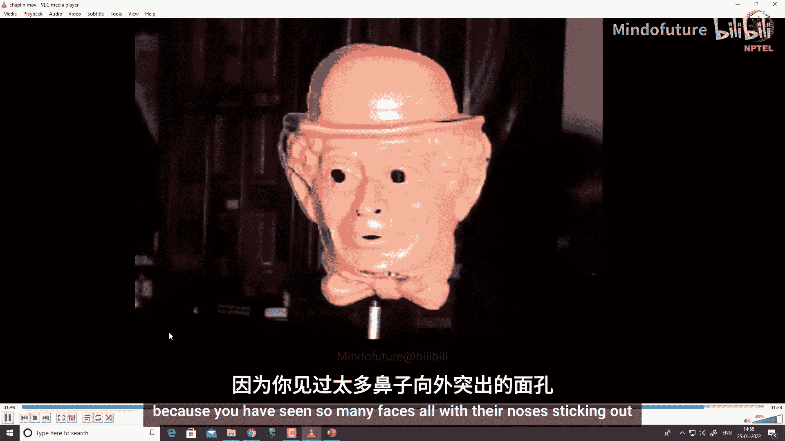

Both of this website， which is called Ams window， which talks about such similar illusions。

 the whole idea of illusions。Is that we have certain expectations about what we are seeing and sometimes we refuse to。

Except that what we are seeing is not what is exactly happening essentially。

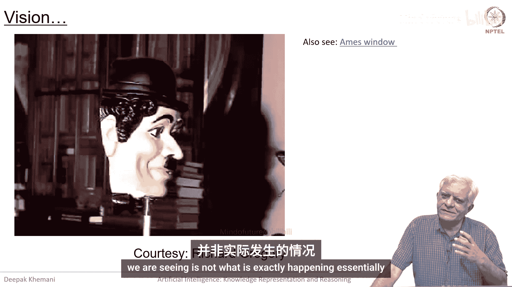

🎼Let me back up for a second。 This is the first part of a three part illusion。 What do you see， Well。

 there's a window and it's turning， except it stops and reverses direction。

 So the window is oscillating back and forth。 That's what most people see when they look at this illusion。

 except that's not what the window is actually doing。 It's on this turntable。

 and it is rotating continuously。 This is known as the Ames window illusion。

 And I saw it on an old Australian TV program called the Curios show， And I was curious。

 So in this video， I'm going to dig deeper into this illusion than anyone has before。 You know。

 the window itself is not a rectangle， but a trapezoid。

 You can see this side here is much shorter than this side over here。

 and that is essential to the illusion。 Also essential。 It is。😊。

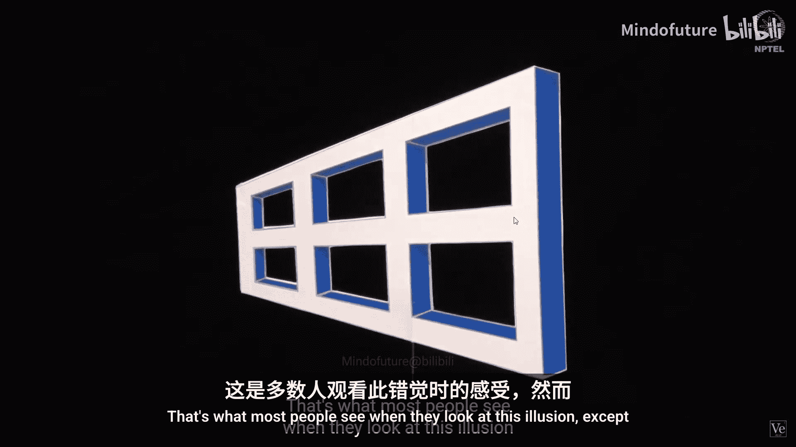

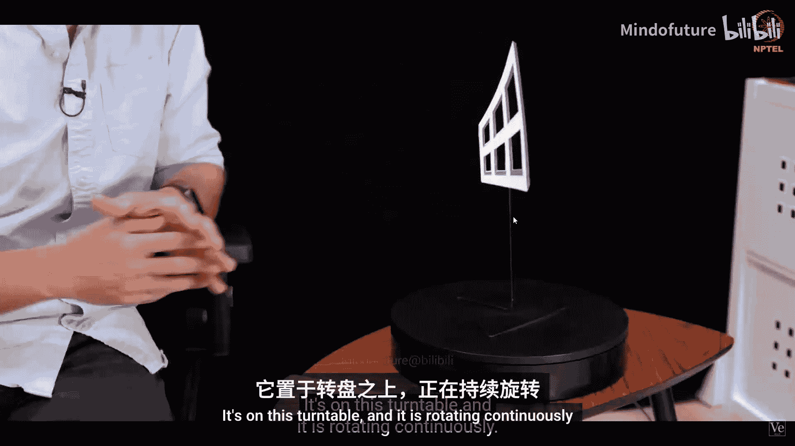

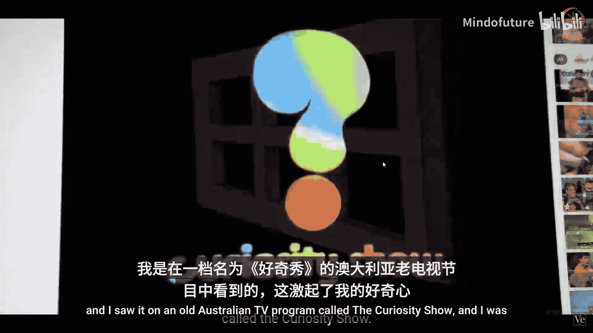

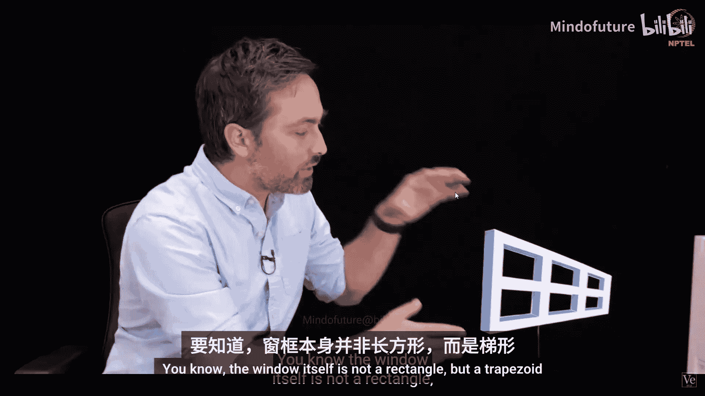

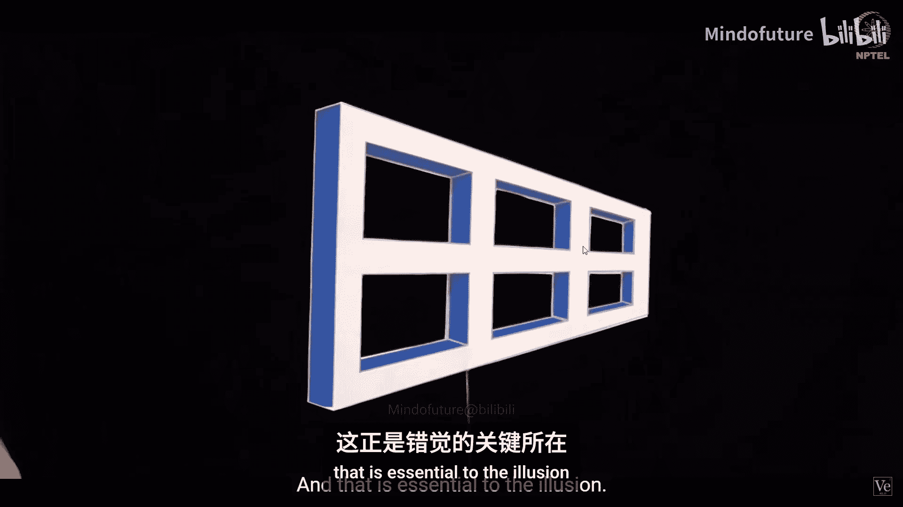

🎼Shaded to make it look 3D， but it's actually just a two dimensional card with the same image on both sides。

 So now that you know exactly what this object looks like and what it's doing。

 Can you correctly perceive the rotation rather than the oscillation。

I still can't。 It still looks to my brain like this window is going back and forth。Okay。

 here's an idea。 I'm going to attach this rubbiik's cube to the short side of the trapezoid so we can keep track of it as it goes around。

You ready？🎼Okay。Okay， the Rubik's cube is going around， everything seems normal。But now what is that。

 it looks like the Rubik's cube is continuing to go around。

 but the window is oscillating back and forth。There goes the Rubik's cube around the back。

 I don't even know what's happening。Whoa， look at that。

 it looks like the rubbik's cube is out drifting by itself out in front of the whole illusion。

What is happening？

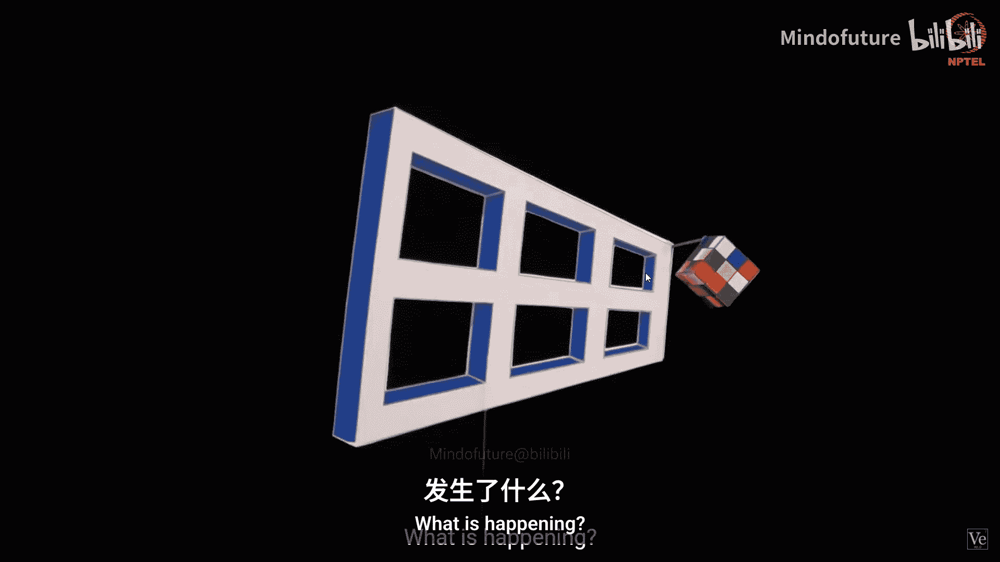

Okay， new plan， I'm going to take off the aruics Cu。

Okay， so we are back and this should give you some idea of how our mind influences。

What we see essentially。When we meet next， we will look at the work that Shank and his group did at Yale University。

 so see you in the next slide。

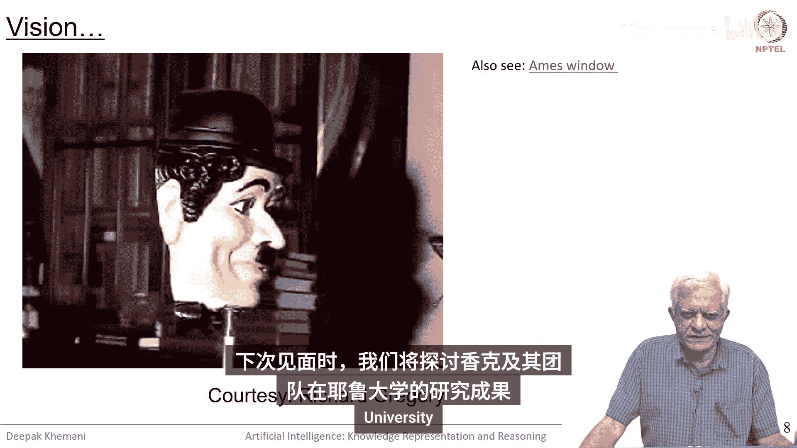