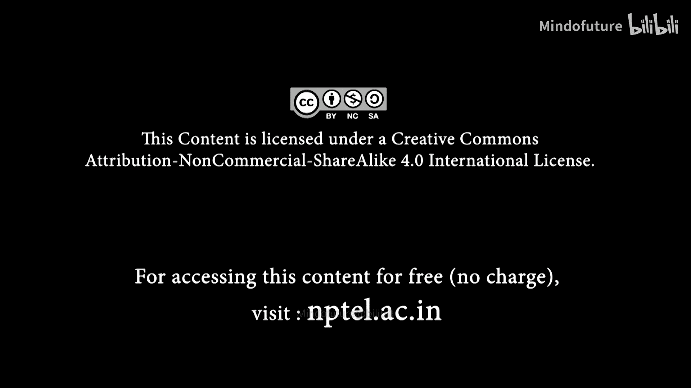
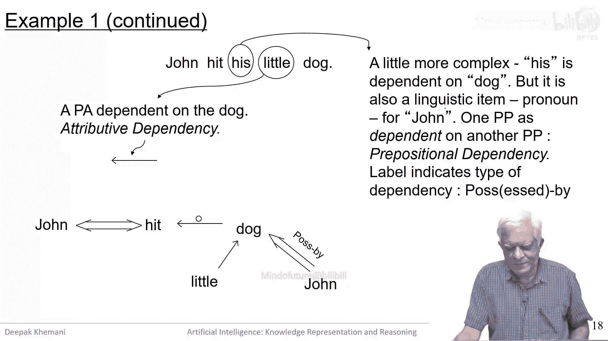

# 【印度理工学院】知识表示与推理 ｜ Knowledge Representation And Reasoning p76 P76_概念依从理论 -BV1c4zNBmEyF_p76-

Welcome back so let' us move on to conceptual dependency theory which as I said earlier was developed by Roger Shank and his group as a representation scheme。

😊，To represent everyday actions in。With a small set of predicates。So。

 the CD theory defines a semantic base for natural language。

 as I said their goal was to understand natural language stories。

The CD theory is designed for everyday actions。😊，What。I would say， is that。

We should study the way this works。And if you want to design。A language。

Something like CD30 for a special domain we can do that and then we can map the translations from English which is talking about those concepts into that list thing so this this should basically illustrate the idea it doesn' not mean that we should use the same predicates because they are actually in some sense very fine grain as we will see。

So， that is what I have said here that more specific domains would require specific sets of primitives。

 so if you want to do knowledge representation in a particular domain you can choose your own set of primitives。

The basic unit in sary is something called a conceptualization。

 which is a little bit like a well formed formula in logic the main concept。😊。

One of the main components of consideration is an event。Wch is defined by an actor， an agent。

 an object， and a sense of direction。We will look at this。So。

 a conceptualization is made up of two things concepts and relations between concepts we have already explored this idea when we looked at semantic net and so on。

😊，Except that the semantic net explored the idea all the knowledge graph that we studied explore the idea。

😊，Without trying to define a set of concepts， whereas what Shank and his group have done is to there to try to define a small set of concepts and express everything else in terms of that。

So concepts are made up of something called nominals or noun phrases。

 which they call as picture producers。And actions， which they call as act。 Now。

 these are inherently governing categories of language in the sense that they can stand by themselves if I talk about a individual Peter then。

I can understand the concept that you know I'm talking about a person。

 if I talk about an action called rowing for example。

 then I know that you know I'm talking about somebody rowing a boat and stuff like that so these are they can stand by themselves。

There are also modifiers which modify the concepts so they call them picture errors and action aiders so pictures are errors are like adjectives and action errors are like adverbs so instead of saying that he rode the boat you can say he rode the boat fast or something like that or he ran quickly and things like that。

Yeah。Nominals and actions can exist as independent notions nominals stand for objects and people。

 actions are acts of nominal。Modifiers give additional information on the nominal selection。

A dependent concept predicts the existence of a。Governor。So adjectives can't stand by themselves。

 adjectives have to apply it to something， adverbs have to apply it to something。

A conceptualization as defined by Loger Shank， is a collection of conception relations in which there is at least a two way dependency and we will see what they mean by this dependencies。

😊，It tells you something about the world。Conceptual depend theory defines a small set of actions。

 so there were two or three versions in one set they were 11 actions in another said they were 14 actions but as you can see they are a small set。

It can be described in the logic like syntax， in fact， Chanac and Mcnamot in their book on AI。

They did describe it using logical syntax。But they can also be depicted graphically by what they call as C diagrams or concept diagrams。

 which as you will see they are a little bit close to how we could depict knowledge graphs essentially there is no essential difference between the two in any case。

As I said， what distinguishes conceptual dependency theory is a choice of predicates。😊，Okay。So。

 a small set of conceptual primitives conceptual dependency theory is a representation scheme in which a small set of state predicates and a small set of conceptual actions are used as primitives and everything else is described in terms of this the aim of the research。

Was。😮，Understanding natural language stories。We have said that。By understanding。

We mean expressing them in terms of CD actions and states。

So it's like translating into this language。All mapping into this language。

The understanding was demonstrated by programs answering questions on stories， essentially。

So if they could answer questions， then one presumes that you know。

 they have created an understanding of the story。So you can if you subscribe to this viewpoint that there is a conceptual base。

With serve。As。The meaning of natural language sentences。

Then you can see that there is something which you can call a semantic passing。

which means which is of course different from syntactic passing in such syntactic passing of a English sentence you will break it down into noun phrase verb phrase and that kind of stuff in semantic passing you will try to identify what are the conceptual primitives that sentence is talking about。

In any case， it will translate into。Conceptual dependency formulas。Which are， basically if。

In first order logic。We have already seen that the meaning of first or logic can be given in terms of interpretation that you choose a domain and you choose a mapping。

Which is in some sense the model of the world that you what you are talking about。So。

 in that way natural language can be related to the world that you are talking about why are this conceptual dependency theory？

😊，Yeah。Now this group was very active in the mid 70s and early 80s or up to mid 80s， one might say。😊。

And some of the programs that this group grows were as follows。

There was a program called E English language interpreter by Rebek was a semantic parcel used to convert English into CD theory。

😊，One of the earliest programs the road was called Marji by written by the group working with Shaang。

Would make inferences based on meaning of input sentences using。

Chuck Les inluencing program now I should emphasize here that they are making inferences they are not necessarily doing reductions so it is not as if they are doing logical reasoning。

😊，But they are making inferences that they see something and they infer something from that essentially。

😊，And we will see examples so you will realize that we are not talking about deduction here。

Babel was a program written by Goldman which converted the output into English。Yeah。Sam。

 a script App mechanism， we shall have a little bit of a look at that after we are done with CDd theory。

😊，By callinging For was a program to use scripts， so there was this structure called scripts which we will see to understand stories based on stereotypical situations。

Yeah。From was another program they wrote for story understanding by Dijog。

 all these were PhD students they were working with。Roger Shaang。

 this front was directly linked to the news via and it generates summaries of stories that it was reading。

Pm was plan player mechanism was a program that could reason about goals and plans and actions。

 how actions are tied to how actions are parts of plans and how plans are made for goals and so on actually so this is in terms of knowledge this is not in terms of automated planning that domain independent planning。

Community studies where you try to figure out how to generate a plan This is saying that you know already that if you have this goal。

 then you have these possible plans and these plans will have these possible constituents Figure time we might。

Pep into that a little bit。Politics was the programmed by Carboneal。

 which could reason about subjective goals from the liberal and the conservative viewpoint。

 so it could reason about stories which were you know geopolitical in nature。对。Yeah。

Wendy Leonhar wrote a program which focus on how to answer questions， essentially。

 how to understand what is the intent behind the question。And then give an appropriate answer。

Talepin was a program by James Mehein was a program to generate stories in English so if you have all this knowledge about what is happening in the world written expressed in some conceptual base。

 then you can give some goals to some fictional characters and you know choose a path that they might possibly follow and his stories were like that。

Bris。By Dre put together many of these ideas from the Yale group together into one mammoth program。

 which could really understand fairly complex stories。

So you should look up bulls and di and you might get some stories that the program could answer questions about so as I said the way to accept that they are understanding the thing is if they could answer questions。

And Silas was a program by Janet Kudna。Which models episodic memories so by then。😊。

The group had started Roger Shakin in particular had started talking about something called dynamic memory and it said that basically our memory gets enriched with experiences and it grows and grows and you know its kind of。

😊，The term that he used was osify is that how experiences， many experiences osify into a script。

 which is like a high level representation of those thetypical solutions。😊。

And this colonar's work led to the rise of a field called case based reasoning which curiously was partly responsible for loss of interest in knowledge representation as proposed in CD theory。

😊，So the conceptual dependency theory representation of meaning of sentences。Okay。

The basic idea that they wanted to pursue was that for two sentences with identical meaning regardless of language now language as we have been observing is rich and diversified。

And it can also be abiiguous。What。The goal of this canonical representation is that if different English language sentences are Hindi language sentences or Tamil language sentences。

😊，A talking about the same thing， then the representation of meaning should be identical。😊。

There should be only one representation。Any information that is implicit in the sentence must we may explicit in the representation via influences。

 so we will see as we go along what kind of information we are talking about。

 but one thing that we have kind of mentioned in the passing is terms like yesterday yesterday doesn not make sense in representation you have to put in a date。

But also as you will see when you look at scripts later。

 we will see that if you are talking about somebody going into a restaurant then you already know many things about what would happen and so on essentially so some of that information would be made explicit essentially。

😊，The meaning propositions underlying language are called conceptualizations。

 we have mentioned that and there are two kinds of conceptuals， one is active and the other is state。

Active is when there is an actor and an action and an object in a sense of direction。

 also a sense of an instrument action which is denoted by this double arrow here。And stateative is。

 for example， an object is in a particular state essentially。And that is。For example。

 you might say the man is tall or the man is hungry or John is angry。

 all these things are state essentially they talk about state essentially and they would be represented by this triple bidirectional arrow。

😊，let us start with an example and then we will go into the details。😊。

SoSupposing you want to represent this sentence， John hit his little dog。Okay。

So John is a picture producer of a noun phrase。Can be understood by itself。

Hate is also an action conceptually an action and it also we can understand what the word hate by itself。

And a two way dependency between the two concepts is the core of this consster which means that John was the agent of the act of hitting。

The dog。Hes also a picture producer， we can understand a dog by itself also。

But related to the act hit as an object of an action。

I dependent on hate cannot be understood in the conceptualulation without thinking about the word hate that is known as objective dependency and。

This sentence would be something like this that John。Is the agent， it is the action。

And John hitting is a basic concentration and the object of hitting is the dog essentially。So。

 as I said， we are using a graphical like notation here。

 but one can always write them in logic like notation by using predicate names for the different dependencies that we are representing here using arrows。

So we still haven't processed。Two words in this sentence via process John hit Do。

Little is the picture either。It embodies what we can call as attributive dependency。

And it shows up as an attribute of the dog that the dog was little。

Or small or whatever so right now we are not using the C actions， we are using English word actions。

 but gradually we will move towards them。This is a little bit more complex。

 first of all it is a pronoun。😊，It is a linguistic item which stands for something else in this case for John so one picture producer is dependent on another picture producer prepositional dependency label indicates type of dependency possessed by。

So the dog is possessed by John。So this has created for us a small representation。Of this sentence。

 John hit his little dog。嗯。We will take up from here in the next。Video。

