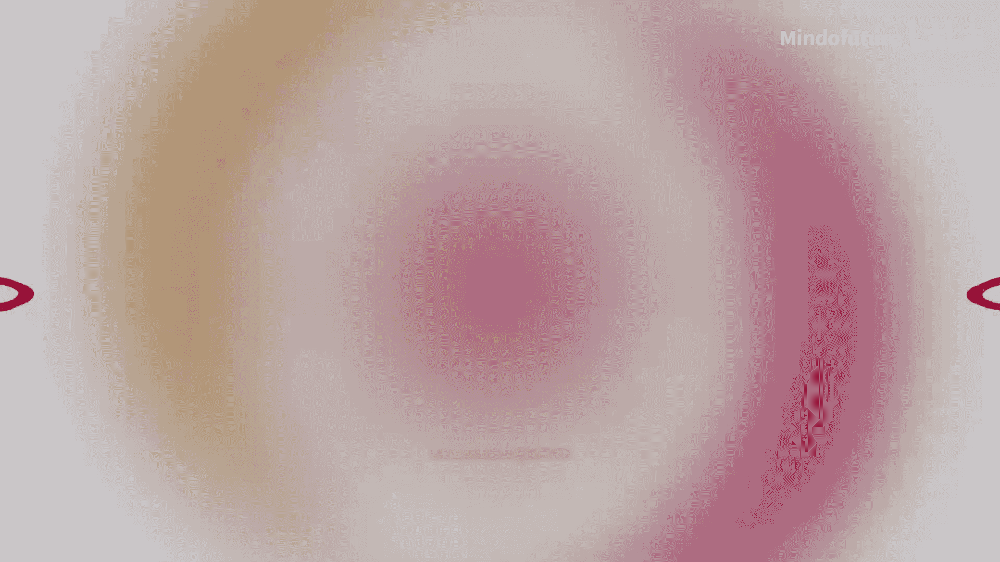
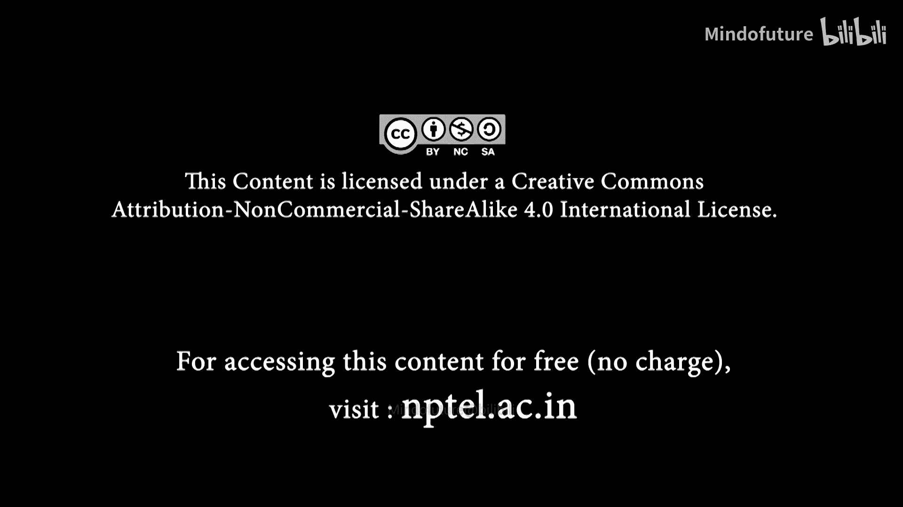
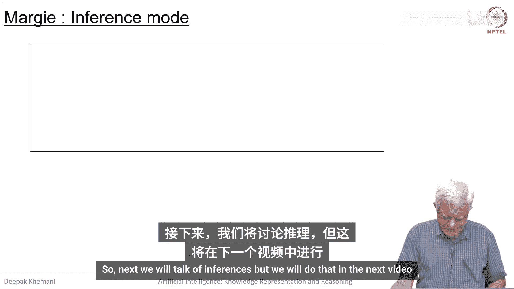

# 【印度理工学院】知识表示与推理 ｜ Knowledge Representation And Reasoning p77 P77_CD状态 -BV1c4zNBmEyF_p77-

So welcome back。We have been exploring。Conceptual dependency。

Whi is a set of predicates in terms of which we want to express。

Nationural language sentences in and we saw this example of John hate his little dog is represented between with these relations between these concepts John is a picture producer he is in action。

Dog。He is also a picture producer， but it has an objective dependency with the action and little and possessed by all this thing。

 prepositional and atbutive dependencies。So， let us look at the different ways in which conceptuals can be constructed。

We have already seen this。That， that。Agent can do an action， a PP can be related to an act。Yes。

We also mentioned that。PPs can have picture eat。The the rose is red， for example。

 if you want to save you could do that with something like that。

Acts can have objects on which they are acting upon。

Acts can have a sense of direction so if you are talking about。Movement。

 then there can be a source location and a destination location。

Acts can have a set of sense of a sense of recipients。That if I give you the book。

 then the book goes from you to me essentially。Yeah。X can have。Concepts as objects。

 especially if you are talking about mental acts， John told Peter。That the house is on fire。

Something like that would be。The object of。The telling act is itself a conceptualization。So MTnce。

 we will see entrance trance is one of the basic actions。

 requires cons as objects and another action called MB has its own object type。

So acts can have conceptualizations， which are instrumental。In terms of it so John。Pent。

To the canteen。By riding on his bike。So， the second con is an instrument by which the first act is。

Accomplished。啊。PPs can be described by concentrations in which they occur and we will see examples missing。

Okay。Yeah。Yeah。Concentulations can have time， obviously since we are going to talk about these things we can see this event happened at this time。

And they can have locations。Now， there can be relations between。😊，Conceptuals themselves。

So conceptuals can result in state changes for picture producers。So what do you see here？That this。

Bottom part。Is a state change？It goes from this state to this state。Remember。

 those three lines are state in nature and this this particular diagram represents state change。Yeah。

What we are saying here is that something happened which is shown on the top which resulted。

In the state change。Event that we are talking about。

Events or actions can influence other events or actions so they can be reasons for conceptualization。

Something happens and as a result of it， something happens。A state or a state change event。Yeah。

Can enable conceptualizations to occur。Yeah。阿没서。그。That the house was burning。So， he called the。

Pire department。Something like that。This we have already mentioned that one p can be equivalent or an instance of the other。

 essentially in logic we have already said， for example。Biden is the president of the US。嗯。Yeah。

Acts can have action eat， so for example， speeds and dimensions and so on。

The next thing we want to talk about is。State variables。Yeah。Our goal remember。

 is to have a compact set of predicates in terms of which you will represent other things essentially。

So， the group at Yale they defined this set of state variables so for example。

 a variable called health is a state variable。😊，And it can have a value which goes between minus 10 to plus 10。

So， it's a。State variable can have values， so obviously when you write rules。To deal with them。

You would have to look at values of those variables and then appropriately you will relate them to other things essentially。

So this health variable。Goes from minus 10 to plus 10。At minus 10， it represents dead。At plus 10。

 it represents perfect health and in between there is a whole range of。

Other English language terms which maps the different levels of health so gravely ill seek under the weather。

 alright tip top and so on。Yeah。그。Here is another example。

 physical state is similar to health except that it applies to a larger class of entities which includes things like machines。

And goes from minus 10 to plus 10 again。So dead， harmed， injured， broken armed。😔，그。Hurt， okay。Yeah。응。

So it seems to be dealing with mostly negative things here。Yeah。Okay。Anger。

Can also go from minus 10 to 0。At minus1 you are furious if that is the highest level of anger that we can talk about then you have enraged angry irked upset and at zero you are calm essentially which means you are not angry so angle level zero means you are not angry。

Yeah。Mental state。wa available which in this program called Marji which I mentioned was all joy。

 it goes from minus  n to plus 10 going from catatonic at one end to extracttctic at the other end with various levels of mental sts replaced upside。

 sad， okay， pleased， happy and so on。Fear。Here is a negative emotion in some sense goes from minus 10 to0 if you start with terrified scared。

 anxious at zero you are calm。Consciousness is in some sense， a positive。

Stay positive variable so at zero you are unconscious when you are asleep you are maybe partly conscious so it is5 for example when you are awake it is 10 and if you have some higher level consciousness then maybe you are more than 10。

Surprise。Ws from 0 to 10。And it can accommodate words like surprise， amazed， astounded。行个。

Goes from minus 10 to plus 10。So。Starving revenues， could eat a horse。Hungry， no appetite， satisfied。

 full stuffed satiateated depending on what your state is。Yeah。Discuss is a negative。Emotion。

 you might see。嗯。Go through minus-10。그。20。Nuseated revolted， disgusted， bother and so on。是吧。

You could also talk about compound states。By combining variables。

So shocked could be surprised and disgusted essentially so surprise level5 discussed level minus 5。

Calm could be everything is zero， surprise is zero， discussed is zero， fear is zero， angle is zero。

 consciousness is more than zero。So， this is the way that they represent it。

They try to represent states in terms of a small set of state variables。And。Yeah。

You might get a flavor of the way， for example， in。Indian philosophy or psychology。

 we talk about the nine states of emotion or the nor the nine Rass essentially this is done mostly in the context of art and music and so on as to what is it what is it that you are depicting but you know all these things like disgust and anger for example rather us and so on are。

Categoize into these nine categories， so this is a little bit in that sense similar。

That we are trying to identify some core states。And then we will give values to them to say how much of that is existing。

So next we'll talk of inferences。But we will do that in the next。

🎼Video。