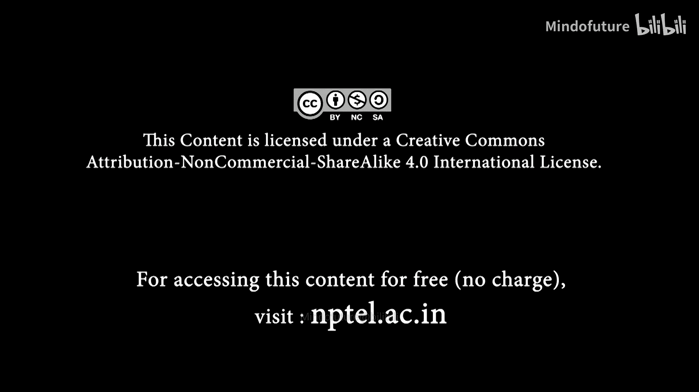
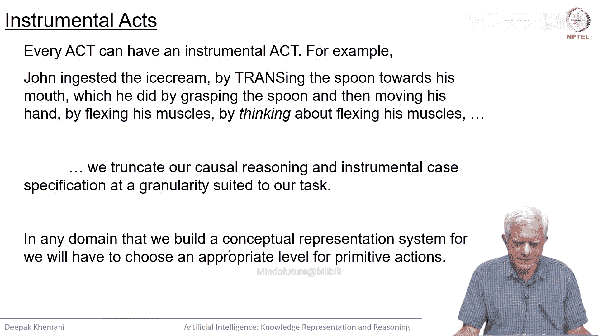

# 【印度理工学院】知识表示与推理 ｜ Knowledge Representation And Reasoning p79 P79_CD动作 -BV1c4zNBmEyF_p79-

谁为金币。We are looking at this way that conceptual dependency represents。Yeah。Facts。Okay。

And we have seen that there is some similarity in the way in which we construct semantic nets or knowledge gloves and so on。

But our focus on conceptual dependency was the choice of predicates。

 so let's start moving towards that。If he said that John took a book。Then the man took a book。

Then the man is the agent。The act is take。The object of the act is。Book。And this P。

Stands for and this happened in the past。That the event happened in the past。

But he must have taken the book from someone。So， we expect that there is some missing information and conceptual dependency。

Has predefined。Dependencies which create slots。Which in some sense create the expectations of something will fill the slot。

그。Yeah。So he must have taken the book from someone。

And there is this recipient dependency that we had spoken about earlier。And there is an empty slot。

Which we can expect we will be able to fill with something else that we have。

We have taken the linguistic work take here， but we will move away from that。😊。

This recipient stock is like an explicit case marker。

 like I have might have mentioned earlier that in。😊，Our grammars。In the Panini grammar。

 we have kac these， so Kanne and Calamco and so on， which tell you。

As to what is the role that an element plays in the larger sentence？Which may be an event。Okay。I。So。

 conceptual cases are predictive mechanisms， they create slots that need to be filled up the conceptualization is incomplete。

😊，Till they have been filled， so dialogues are often sustained by the process of filling up empty slots。

So you could see that some of the questions that Maji was asking was based。

On trying to fill some empty slot。So， these are the cases that we can talk about the objective case that we have seen objective dependency a directive case。

We can imagine。You are going from one location to another location。

 the recipient case we have seen that a book is given by one individual to another individual。

We will also see the instrument case in which there is an action there is a conceptuallation which is instrumental to the main conceptual we will see quite a few examples。

So we said the man took a book and now we are saying I gave the man a book。

 now you can see that conceptually。The representation is。Very similar， the structure is same。

It's just that the fillers are different essentially。For one thing。

 the actor has changed from the man to eye。嗯。And this slot has been filled in。By saying that I。

 the book was from me to that person。So， conceptually giving and taking involve the transfer of something。

Only the actor is different。So， they。We can talk about。An act called。

Trannce and we will refine this into different kinds of trans to start with。

 but transnce is kind of short for transfer。The man took a book and I gave the man book very similar in nature。

Except that。The actor is different。And this recipient from the slotest is different essentially。Yeah。

Yeah。Now we have replaced in both the sentences。Gaive and take by one。Action which trans。

 which stands for transfer。So， let us look at this sentence， John grew the plants with fertilizer。

 there are two events which are happening one is that the plants are growing some kind of state change event is happening and John is doing something and he doing something with the fertilizer。

The linguistically fertilizer is the instrument in the sentence John grew the plants with fertilizer。

But conceptually。It is the object of some act。Okay。So， there are two events。

On the top is a state change when the plants are going。From size x to size x plus y。

 so you can see I said that this whole thing comes from folk psychology and this is how we in some sense in a qualitative fashion represent states essentially。

So this x plus y represents the fact that the plants are growing。Yeah。Yeah。Also。

Conceptually we know that John has done something， he is doing something I mean there is some action but we don't know what that action is I mean we can guess what that action is but if we don't know what that action is we can just write do which is a short form for they exist。

An action。Yeah。是的。They like this way。Well， a is an action or something like that。

Now there is some action that。John did。Right。Now， there is a causal connection between what John is doing and the fertilizer is growing so John did something with the fertilizer which 1 specified what he has done which caused。

There are plans to increase in size， so the physical state of the plants went from some x to x plus y。

And this whole thing was intentional， John did this intentionally essentially that he wanted to grow the plants and therefore he did something with the fertilizers。

And all this happened in the past with this P stands for first。

He grew the plants with the fertilizers。It could be something like this。

That he transferred the fertilizer。From a bag。To the ground in which the plants are growing essentially。

So， again， you can see that our level of understanding would depend upon。😊，Our world knowledge。

 so that is the key thing that I want to keep emphasizing you cannot just look at a sentence and somehow make sense of it essentially you have to know the meanings of those words and how they relate to the world that you are talking about。

So， let's look at the set of actions that Shank introduced as I said they were at two different times。

Either a set of 11 actions or a set of 14 actions， some of them had got compressed into one。

 maybe we will see what they were。In Cd 3 these are the actions， so transnce itself is not an action。

 but it could be a trans or as we would see P trans or even m trans。So ance is the abstract。그。

Transfer of position。All control or ownership。So， when we want to model words like give take by。

 we will use a trans。If I give you a book。Then I've given you possession of the book。

 so aance is the action that I'm doing。P trans stands for physical transfer transfer of physical location of an object。

 so anything which is moving along can be。Model using patrons。

Proel is the application of physical force to an object。

Regardless of whether the object is patronance or not。

 so I may push against a wall or a rock or something。Yeah。

I am still doing the act of propel essentially whether as a result of it。

 whether it moves or not is a secondary matter。😊，So anything push， pull throw kick。

Well have propeller as part of them。Move the move of a body part by an animal by a sentient being。

The move of a body part of an animal by that animal essentially， so it is like moving yourself。

It's often an instrumental act。So， for example， move foot。

Would be the instrument in kick so if I kick the football then I did it by moving my foot。Grass。

As the name suggests， the grasping of an object by an active verbs。

like grab let go and so on throw in wall graph so they don't have a separate word for armgras then in some sense they say that in the future you stop grasping or something like that ingest is all forms of input that you can take。

Exel is all forms of output。Mtransnce is mental transfer。

 the transfer of mental information between animals or within an animal so they modeled as I said this is all folk psychology。

Memory into partitions so there was the conscious processor called CP there was a long term memory called LTm then there were other memories there was an immediate memory I am。

I。Oh。Oh。Qu。Yeah。Then there was a short term memory。Oh。And so on。So they model as if， you know our。

Eds partition into different kinds of memory。Long term memory， as the name suggests。

 would store information for the long term conscious processor。

Would be just processing information and not storing it。So if you want to use a word like tell。

Then you are saying entrance between people， essentially if you wonder you。Express C。

 then it is entrance from I to a conscious processor。

If you want to express remember it is entrance from the long term memory to the conscious processor and so on。

 so its as if you are moving around formulas in your head decision or representations in your head。

E build。Was to build a new。Conceptulation。So to construct by an animal of new information from old information。

So， anything you want to say， decide， conclude， imagine， consider deduce， for example。

 could be used using M build。Okay。Speak the action of producing sounds。

 not just words but sounds humans often use it as an instrument of entrance so anything you want to say say play music per。

Screen would involve speak。And attend so attend was actually a combination of some of the other things that they had for using listening or seeing and so on。

So， attend basically says the action of attending or focusing a sense organ towards a stimulus of some kind。

It is also an instrument act for Mt。So， when you want to say C， it is m trans from C to the I。嗯。

To to Cp from the eye by the instrument act of attending the eye to the object。

 so if I am looking at the camera。Then the instrumentnstrual act is attend then that I am attending my eye to the camera essentially so you can likewise attend here and so on if you are listening。

Yeah。Okay。So， we talked about the instrumental case。

 so let us look at that John ate ice cream with a spoon。So linguistically。

 the spoon is the instrument by which John ate essentially。Yeah。

It is a instrument with which John eat conceptual level。

The act of eating is enabled by an instrumental act。That uses a spoon as an object。

 so we are doing something with the spoon。Because spoon is the object of our action and that。

Is an instrumental act？For eating。So， you are doing something with a spoon as a as a result of which you end up eating the ice cream。

그。Okay。哎。So John ate ice cream with a spoon。Yeah。嗯。Yeah。Okay。Okay， so this is a repeat slide。

Except for the fact that some more detail has been put in instead of do。We have this。

Entire structure here。Whi。So， we first said that John ate ice cream by using the instrumental of doing something with the spoon。

Now we are saying。That he patron transs the spoon。We trans object spoon。

And this spoon contained ice cream。And he the recipient of。

The Petrans act was from the ice cream to the mouth。And the mouth as possessed by dawn。

If you know what it means to eat with a spoon。Then this would possibly be our internal representation for the same。

Yeah。Yeah。Yeah。So every act can have an instrumental act。For example， John ingested ice cream。

By P transing the spoon towards a mouth， which he did by grasping the spoon and then moving his hand by flexing his muscles。

 by thinking about flexing his muscles and so on。So， when we started on the course， we had said that。

 you know， we cannot model the world at the level at which it exists。

Wwhich is at the level of fundamental particles interacting with them in some way。

 we always abstract away at some level which is cognitively suitable for our decision。😊，And。

This comes from folk psychology， so obviously you can trucate。The level of instrument acts。

To the level that which you are comfortable with so we truncate a causal reason and instrumental case specification。

At a granularity suit to our task。In any domain that we build a conceptual representation system for we will have to choose an appropriate level of primitive actions so I keep repeating this fact that you know the conceptual dependency illustrates。

What kind of semantic representations you can create。To make sense of language。Yeah。

The C theory is aimed for everyday actions， but you can always。Define。

A set of actions specific to a particular domain。Yeah。嗯。Yeah。Okay。

 so we will take this up further in the next video。Okay。

