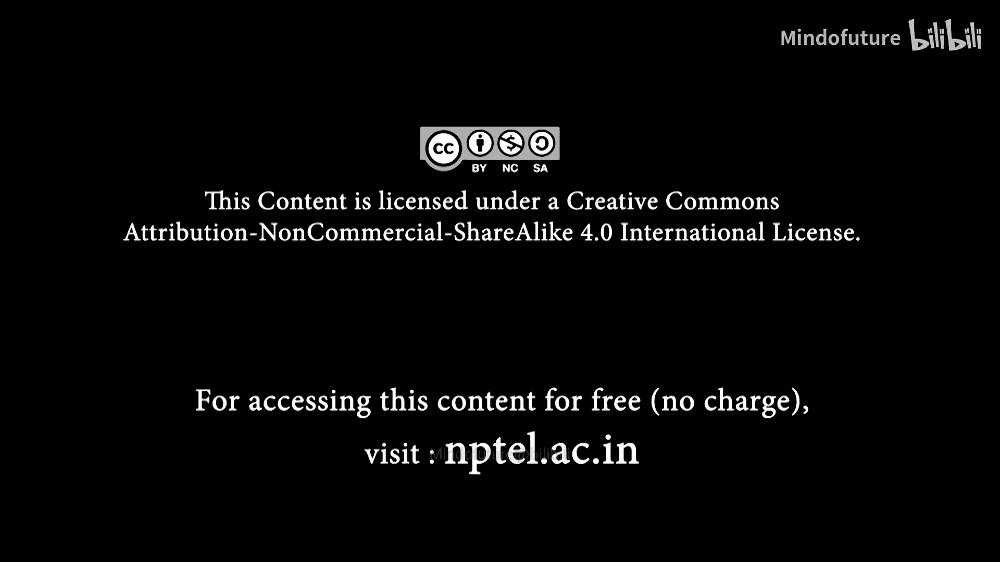
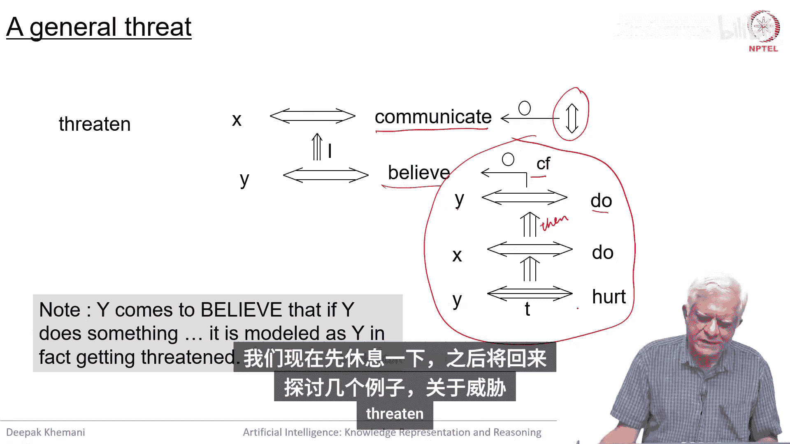

# 【印度理工学院】知识表示与推理 ｜ Knowledge Representation And Reasoning p80 P80_英语到CD -BV1c4zNBmEyF_p80-

伟金币。We have been looking at。Conceptual dependency。And we have seen that this is a kind of a semantic base in terms of which we can map natural language sentences。

And create representations which are canonical in the nature that they are language independent we choose a set of actions so m trans B trans。

Move Loel and whatever。And try to represent everything in terms of that so let us look at a few sentences and how we would represent them。

So here is his sentence John was sad because Mary hit him。So we want to be able to say。That。Yeah。

Yeah。Maybe。Hitting John resulted in John going into the state of becoming sad essentially。So。

 an act causing a state change， the act is that Mary hit John。

The state change which results out of that act is that John became sad。

Of course it is not a CD act we have introduced the CDX banner。

 it will be a modeled as coming into a state of being in forceful contact which propel being the basic act and move the instrument of the act we don't know about Mary hit John with but something was propelle。

嗯。Against John。I。Events can cause other events to happen， we have said。好。嗯。

When Fred gave Mary a peach， she ate it。So， the first event is。Fed。Transd a peach。

 so ideally it should be either a trans or p trends。More likely as。That gave position to。Maybe。

As a result of which， Mary ate the peach and all this is happening in the past tense0。Yeah。So。

 a lot of words in English language， which are verbs。Are not actions。Conceptually。

So here's a gruesome example。John killed his teacher。So in English skilled is a verb。

But it's not an action conceptually because we cannot visualize what John is doing John could have done 10 different things。

嗯。Which resulted in the death of his teacher， including not submissions submitting his assignments on time。

But there could be many other ways of doing this， so such verbs in language。😊，Which are verbs。

 which means they tend to invoke a sense of being actions are not really actions。But they are。

Causal relations between doing things and some state change happening so these are called state change verbs essentially so the main thing that is happening。

Is that the teacher。Yeah。We are mod it saying possessed by John。

In the past tense went from the state of being alive to the state of being dead。

And this happened because John did something。So， this is an accurate representation of the sentence John killed his teacher。

Because we don't know what he did。He did something。But as a result of which。

 there was a state change event which happened。Yeah。So。

 the linguistic verbs often focus on the state change。

While ignoring the action part of it essentially so conceptually verb is not of action conceptually killed is not an action。

😊，So， it could be that John killed his teacher by shooting him in the head。

So the second part is the same。The teacher was killed。

But the action has changed its more specific now he proped bullets from the gun。

To the head possessed by the teacher。So， you can see that this is how you would。Imine。

Things to be happening in countries where you know people go around shooting their teachers。

So when they say Sam flow his。Playin to San Francisco。So， then。Yeah。First of all。

 we have to translate his into。The fact that it is a plane which is possessed by Sam as shown in this red circle here。

But otherwise， it' is a state change work essentially。Sam did something。Which is shown on the top。

As a result of it。😊，The plane flew。From somewhere we don't know where to San Francisco in the direction of San Francisco。

嗯。Clyide itself would be modeled as ps in the air or something like that。Yeah。John comforted Mary。

Again， John read something we do not know what。Where Mary went into a state of being comfortable。

 so it is a mental state。Yeah。Here is a slightly more complex sentence。Since smoking can kill you。

 I stopped so there is two things here happening here one is a causal connection between smoking and you possibly dying from that。

And then this act of stopping smoking。Because of this causal relation between smoking and possible death。

So， this is the first part。With。You can see that if one ingests smoke。

From the cigarette to oneself so again you can see these are you know very somewhat ad hoc ways of representing things。

So， if one。So， this is a conditional relation between the two actions if if all this is in the past。

 smoking can kill you。If you in smoke。Then you can go。

 so this can stands for possible can go from the state of being alive through the dead。

This whole thing。Was。The cause。Of this new。Conceptization which is there on the right hand side。

 which says。That the conceptualism itself is that I ingest smoke from the cigarette to me。

But the labels for the act say that。I terminated this action sometime in the past。Yeah。

So I stopped smoking。Why did I stop smoking because of this connection between smoking in？That。그。So。

 while going home I saw a frog so one concentration can mark the time for another one essentially so the one thing is that I am going home and at that time I saw the frog。

So we have seen there are various labels that we had used which。

Talk about when the event happening because we are talking about time so whenever we talk about action need to talk about time and change and so on so these are the various labels we can use so with this past then future then transition then transition start then transition finished continuing。

Interrogative when did it happen， negative it did not happen sees for potential so since smoking can kill you with it。

Nil is just present term and delta means timelaes so you can model。Different tenses。

So here's an example。嗯。Yesterday the boy in the chair hit the boy on the piano in the mouth。

 in the park， so there are a lot of dolls here as you can see。

Which basically are talking about specific。Things。So the chair is specific。

 the park is specific and the piano is specific。嗯。And so on。Yeah。

So the boy in the chair is marked by saying the location of that boy is that chair。

The object of heat was the mouth。And the mouth was possessed by the second boy。

Whose location was near the piano。And this whole thing happened yesterday。

 though ideally we would replace it with a fixed time。

And this location of this entire event was the park essentially。Yeah。

You can see that in the spirit of logic。Our representations are unambiguous。And。嗯。Complete decision。

Complete in the sense that everything that we we are saying in the sentence is there。Okay。So。

 very often its not clear whether we are talking about actions or states。😊。

So when you say I like books， its it's like saying that books please me essentially。

 what do you really mean essentially one thing that you could mean？

Is that I do something with books which results in me being happy or please or whatever。

Then you can talk about different kinds of thinking actions。So prevent would be model as。

X doing something as a result of which why not being able to do something， whatever that is。

If you were to create a dictionary of English language to conceptual dependency。

 then these are the kind of structures that you would store。

On the retrieval side that prevent whenever you see the word pre prevent you would you would retrieve this entire structure in addition as we will see later we may have semantic constraints on what can x be what can y be for example they must be sentient creatures or things like that。

 whatever it is。So， you imagine that you create such a dictionary of words and then as you read sentences。

 you retrieve those structures and try to。Match them and fill up the empty slots and so on。

We will see a couple of examples。So instigate would be similar。

Except that the label is that you are doing it intentionally。So x does something which。

Intentionally he does that as a result of which y does something。

Hurt we have already seen that when Mary hit John， he was hurt。Comfort also we have seen。

If x does something， then y goes into a state of being comfortable， which is a mental state。

So you can see I comforted John that I did something in the past as of which in the Tazian state he became comfortable。

A more probabilistic analysis。Would be。That。I said some things， what was this that。

 there were some soothing words， maybe。Towards John and。I ahead。

Gin of gently tapped him or something or pated him。As a result of which。

 he went from a state of being upset to a state of being comfortable。So。

 here is something even more specific if you say I comforted John by feeding him。

Then what you are doing。I you can see at the topmost level。That I。A transched。

 but I should say a here。Food towards John。As a result of which John ingested the food。

As a result of which， he went from a state of being upset to a state of being comfortable。So。

 giving food。Leads to eating food。Leads to becoming comfortable。Yeah。Yeah。Yeah。好。So， here's。

Representation of the word threaten so if you wanted to create this dictionary。

 this is what you would need to put it put into your dictionary essentially what does threaten say。😊。

Tencies。And we have used some non Cd words here。But that is a general idea that if x is threatening y。

 then x communicates， so this is m essentially。Something which is a conceptualization in itself。그。

As a result of which。W comes to believe？This whole thing。

What does this whole thing saying that if conditionally in the future？W were to do something then。

So this is like then。X would do something as a result of which y would be in a state of being harvest。

그。Yeah。So， this is our general understanding of the word written that you tell someone that if you do this then you will get hurt we are not specifying how or what will happen or something like that if you are more subtle than you might simply say if you do something。

You will regret it later， assuming that。If you are getting hurt， you will regret it essentially。So。

 we will stop here for a break and come back and look at a couple of examples of。

Ctan and other words in this language。

。