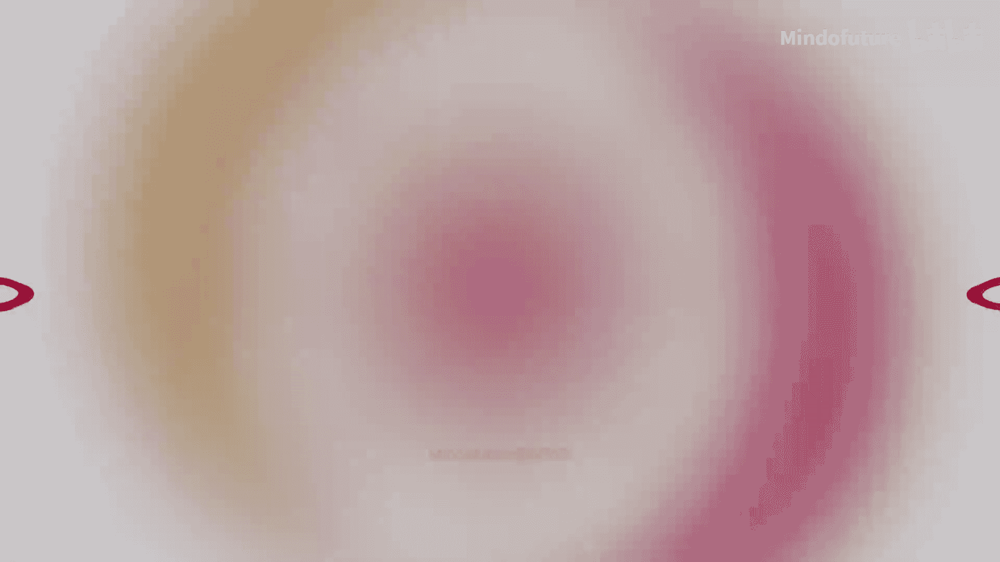
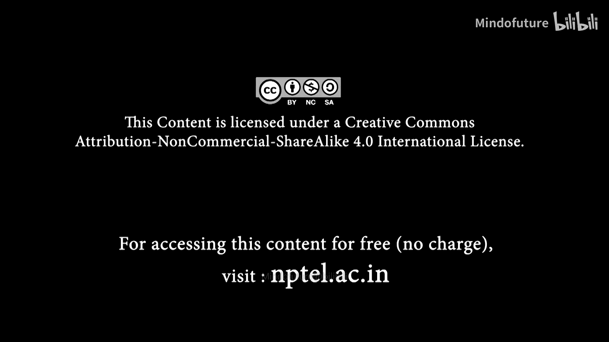
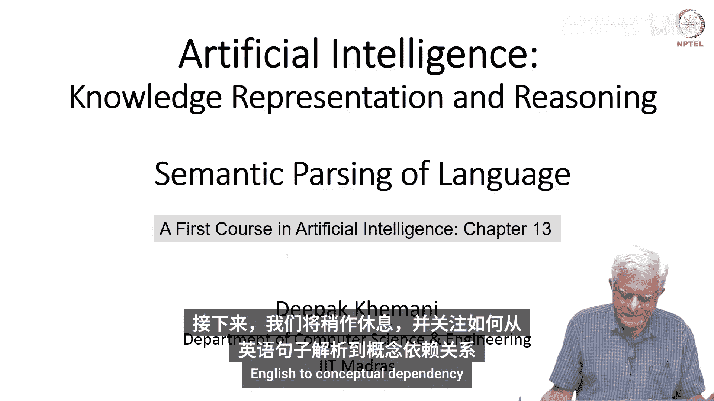

# 【印度理工学院】知识表示与推理 ｜ Knowledge Representation And Reasoning p81 P81_表示复杂动词 -BV1c4zNBmEyF_p81-

Welcome back。We have been looking at conceptual dependency theory and by now we have understood。

That the way to handle language。is to create a dictionary in which for every English word you will have a conceptualization we should be stored there that conceptualization would have empty slots and as you read more of the sentence in which that word occurs。

You will fill up those slots based on， as we will see maybe some semantic match or some rules about whose actor and who is the object and so on。

So， we saw this word set which is that。X communicates something to y。我不。As a result of which。

 in fact we have not even said that it communicates to y x simply communicates something。

 maybe it just makes an announcement。And y comes to believe that if y does something in the future。

 then X will do something as a result of that as a result of which y would get hurt。So。

 here is a specific threat， I set him with a broken nose。😊，Okay。So you can see theyre the basic。😊。

Scafolding is still the same。We still have this same thing that I communicate something and so on。

 as a result of which he came to believe that if conditionally in the future he does something。

 then I will do something listening。Let us look at it in a little bit detail now I communicated。😊。

From。不。The recipient is he and I and the communicator。The object of my communication。

 which is the conceptualization is。That。This whole thing。That I will do something。

Or why we do something？As a result of which the nose would be in a state of being broken and the nose would be possessed by him。

As a result of H。😊，He comes to believe this whole thing， as we have seen earlier。

That if he does something which is x conditionally in the future。I will do something， which is why。

As a result of which his nose。Would be broken message。this is simply the representation of the word。

😊，Setin filled with some additional information from the sentence which says that I am the actor and he is the object of my communication and there is some broken nose involved somewhere which is。

Yeah。Ca a relation。So here's another explicit。😊，Th。Again， the structure is the same except。😊，That。

The action is changed。Now I am saying that I will do something with the hammer。Yeah。嗯。う。嗯。

And he comes to believe。That if he does something then I will do something with the hammer as a result of which。

He will get hurt。So this。Is that from I to he， the hammer。

 whatever I am doing would be in this from I to him。Okay。So， advice is a similar word。😊，Okay。

In the sense that you are communicating something， so x communicate。The following。Yeah。

That x believes the belief is like an action。😊，The following which is inside this here。

That if Y does something， then why would be pleased essentially conditionally in the future。So。

 here is an example， I advise him to try the twice cooked pork。So， again。

 I communicate it in his direction。And it said that I believe something and what I believe is this whole thing。

That if he ate。Twice cooked pork， then he would be。Please。So liking， we said earlier， I like books。

So very often。We can represent this in two different ways。One is that。Yeah。

If in the future I were to ingest ice cream， then in the future I would be pleased。

That is just representing the fact that whenever I eat ice cream， I feel。Happy。

But we can also say that I can conceptualize this fact that whenever in the future。😊，I eat ice cream。

Then I am happy。哇。The same fact， but I can think about that fact。😊。

X think that x will be pleased if x eats size cube。So。

 here is the word want has a specific time sense。😊，So I want。

 if I say it basically means that if x does something， then y would be happy。If you want to say。

 I wanted it。Then I would say in the past。I was thinking that。If x did。Something in the future。

I would be happy so pleased and happy I'm using a syn namess。嗯。John wants it。

 but he doesn't realize it。We don't know who the speaker is， somebody is making this utter。

So there is a speaker。And。The same want structure is there。John wants it。😔。

But the only difference is that John is not able to conceptualize it， that he won it essentially。嗯。

He hit Bill's car， but he doesn't know it。So， there are two things， one is that he actually hit。嗯。没。

The car， which was Bills Bill's car， but he is not able to visualize this hole the same thing which is there on the top。

Hes there here he is not able to visualize that。Conceptize that。So。

 remembering is thinking about essentially so I remember the time。We ate oysters。嗯。So。

 remembering is by en trarancing it from long term memory to conscious processor so I conceptualize。

对。That we ate oysters。And the Instrual act for doing this。Yeah。Was that I。Emtd。The fact that we ate。

So the object of entrance that we ingested oysters。And I am entcing this whole thing。

From my long term memory to my conscious possessor。嗯。

That's how I remembered this fact the three8 oysters。嗯。嗯。So， we haven been saying communicate。

 communicate all this well but basically it is m transally。😊，In Cd  theory。

 so say or telling somebody something is also entrance except that there is an instrumental act of speaking。

Words were mixed away。Perception is also。M trans when you perceive something。

So from a sense organ to the conscious processoror。Whatever it could be an event。

 it could be a state。嗯。Learn something is that you。

Move it from your conscious possessor to your immediate memory。Remembering we have already seen。

Hes moving from the long term memory to the conscious processor。Forgetting is unable to be。

Able to move it from long term memory to the conscious processor。

Seeing as conceptualizing when I say I saw John eating soup。Then I can think about John。

Ingesting su which is this thing and I can do that by the instrumental act of m tracing。

This whole object that John is eating soup。Yes。From the eyes to my conscious processor。

And this act of seeing I am doing by another instrumental act。Which is。

Look at so look at was in one version of CDd theory attend I would be in the current version that we are talking about so it could have been attend。

Yeah。Yeah。So， attend I to the。Scene of John and soup。So various versions of this。A conceptualize。

 consider。Is to think of it in the future ponder is to simply think about it dream is to think about it while you are sleeping。

Wonder is to wonder whether it is。It will happen or not。So， love and hate are states。

 I mean people say they are two sides of the same coin。So。

 you can think of love as saying that whenever x thinks of y， x is in a state of being in law。

And likewise for heat， essentially。So you're thinking about x is thinking about y。

And X is in a state of either being in the state of being in love or state of being in hate。Yeah。

There' is another sense of the word。Yeah。Think。I believe that John is a fool or I think that John is a fool。

Yeah。So what you are saying here？I is that there is this conceptualization that John is a fool。是。

But that is inner a location。Which is my memory。Could this pay me exactly？

So the conceptualulation John， the food is located in my memory。I。嗯。No。嗯。

If an software agent has to deal with。Other don。People are agents。For example。

 in a computer game is the example that I'm using here。The software agent。

Or any agent in particular can only see the actions of other agents。So， there is some。

Things like intentions and goals and plans and so on。

You cannot see them essentially they are often left unstated。So for an intelligent game agent。

 for example， actions are the keyboard strokes。It needs to understand your intentions from them somehow essentially。

 so you need that knowledge about how actions are related to plans and how plans are related to goals and how goals can be the intentions of agents and so on。

Okay。So， goals and plans are not going to be linguistic entities；

 they are going to be what we call as knowledge structures。

 we will have a very passing look at goals and plans later。They are not often stated explicitly。

Instead， what we see is a sequence of actions essentially。Yeah。

We will see this connection between actions and plans and goals later。그。So， coming back to。Okay。

Other words conceptual words， so when when you say Fred believes John。

Then there are two senses of this word believe one is that John ens something this structure in the red to Fred as a result of which that structure has gone in sat in Fred's memory essentially。

So just like we say that， I believe that John is a fool or something， Fa believes something which。

 but that something is what John has told him。Yeah。

So Fred tells something to John and John puts it in his memory。

Another sense of the word beliefs is that。Yeah。John tells something to Fred。And。

Fred already has it in his memory， essentially。John is saying something to someone and Fed also believes that essentially so Fette believes whatever John is saying。

The earlier sense was。There was a causal relation between Fred telling this to John。

John telling this to F and then F believing that actually here John is telling it to someone。

 but F also believes the same thing。I。But Fred must put in in his memory right if he does that so we can model this at different levels of detail so John is enrancing something whatever that something is this event1。

嗯。From John to the。Conscious processor of read。So Fred thinks about it the same thing， you？

Then he builds this formula。And adds it to the immediate memory essentially。

As a result of which it is lying in his image of memory。嗯。Deciding to believe it。

 red must create the structure in his memory essentially。Yeah。If you want to model inference making。

 then if you know a certain set of facts and from that you infer another fact。

 then you can model it using MB in the example that we just saw there was only one this thing whatever。

 whatever John told Fred he emmbed and added it to his memory。

 but you can model inference is also in a similar fashion。So， the physical actions that。

CD theory uses all the following。We have move own body part that means only sentient beings can move their parts propel is to apply force ingest is eating expel is output p trans change of location grasp is grasp。

 we have seen that。I。If a P trans happens， then you should infer。

That the object ceases to be at the original location。And exists at the destination location。

So this is the kind of inference you should do when you see P trans essentially。

Likewise for a trends， if I give you the book， then you have the book。But not in m trans。

 if I tell you something that formalize in your head also in my head also。Yeah。

This relation between actions and change we will see a little bit later when we looked at event calculus。

Which is kind of a logical way of。Infering things which happens so for example。

If Suishna went to the canteen， then Suishna reached the canteen。

 these kind of inferences is the kind of inferences we are talking about here。그。

So if you want to say I walk to the cafeteria。The key act is P trends。

And you must infer that I am at the cafeteria， so IP trans myself in the direction of the cafeteria。

Because I use the word walkedked， there is an instrumental act of moving。

And I am moving my feet in the direction of the cafeteria。Yeah。So John threw a rock at Sam。

So throw is p in the air。By doing Poel。So P trans， object clock。

From John to Sam and the instrumental act is prop in the air。

The object clock in the direction of Sam。And P says that this is in the past tense。Okay。

If you want to say John through the pencil 2 Sam， so2 is modeled as a trans here。

 so it is different from at Sam。you throw a lock at Sam， you don't want to give it to him。

 but when you say throw a pencil to Sam， you want to give it to him。

Everything else is the same that we saw earlier。But the high level。

Conceptulation is a trans that John a trans the fil to Sam and he did it by throwing it to Sam。

 which we have already seen is patronrannccing in the air using Poil。John hit Mary。

 we have been using the word hit， but you can use propel now。We don't have hate with what。

 so we are just using something called x。对。In the direction of Mary。哦。As a result of it， x and me。

Come into physical contact。嗯。If you wanted to say John punched mainly。

Then the objective of propel is fist。Which is possessed by John， again it's in a direction of Mi。

And you can also guess that there is an instrumental act of move。

In which John moves his fist towards Mary。So， all that is more detail about the fact that he use this piece。

The concluding thing is still the same。They're the fist。

Possessed by John came into physical contact with maybe。So heres some more violence here。

John hate Mary by throwing a stick to her， so by now we are familiar with all these throwing actions and so on。

So。Essentially John propelled the stick and then he did this whole thing by propelling in the airands。

And throwing it。Moving his hand which contained the stick and he did that by grasping the stick and so on。

In the area is missing from here， but we can add it somewhere。

Because throwing involves me in the air。Yeah。If he said a car hit Mary。

Then we know that there is a prop action if the object is the car and the direction is me。

So Carl and Mary came into physical contact， we don't know who the agent is essentially。When I say。

I move the table to the corner。Then its possible that IP transched。The table by using propel。Yeah。

But it could also be that I ask somebody to do it for me essentially。So。

 if you want to capture the meaning of the sentence， I move the table to the corner。

 the best way to do it is。I did something。As a result of which。

The table went into a state of being in the corner。Okay， so we'll take a break here。And。

Pas some attention to how。그。Passing is done from。English， too。Conect independence。

