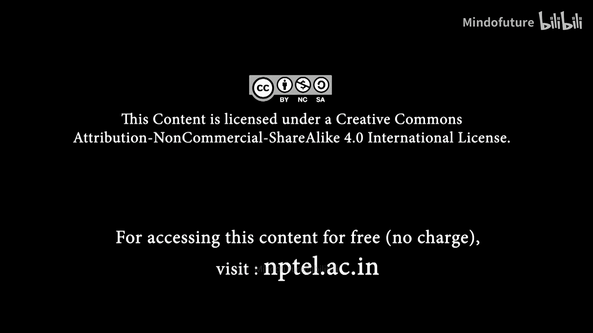
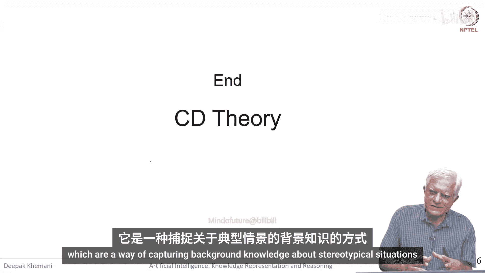

# 【印度理工学院】知识表示与推理 ｜ Knowledge Representation And Reasoning p82 P82_语言的语义分析 -BV1c4zNBmEyF_p82-

谁会金币。We have had a fair study of conceptual dependency theory。

 and we are seeing how we can represent。English language sentences into some canonical representation。

Where different sentences saying the same thing would be mapped onto the same internal representation。

 lets see how this process is done and this is called less semantic passing。Yeah。嗯。今。Okay。

 so the Yale group used word conceptual analysis。So let' us look at this sentence where I want to go to the park with the girl。

As we have discussed。嗯。Want is the first thing that you encounter the first action or first verb that you encounter and you will retrieve it from your dictionary and what you would get。

Is。What does want mean essentially， what does the word want to mean？So。1。

Meaning of the verb could be。There is some event were to happen conditionally in the future。

Then x would be pleased and this x is humans， so we are stating here for some reason that humans only want things。

But something must happen， which will make you happy。Yeah。So， a transitive verb would be that。

If someone were to a trans some object why some physical object。From that someone to me。

 then I would be happy I want the book， for example。Yeah。There is a third sense of the word。Which is。

That we are talking about two humans X。So， x wants y to p trans y from variables here。

 so I want you in my office at 5 pm if I see。Then this is a sense of the word want。So。

 you can see that words will English languages are rich and often ambiguous so you have to。😊。

Do a certain amount of search， a certain amount of heuristics to try and figure out。Which。

Sense that you have retrieved is the one that matches the current sentence。Okay。Yeah。

So we have figured out that once there are three senses here and we want the first sense which doesnt specify anything。

Wwhich is a state ver is chosen， the parel is now on the lookout for a complete conulation to fill it in because that send simply said I want something to happen。

On the top and then I would be happy。And we will read the rest of those sentence and try to figure out whats happening。

 what is it that you want？So， the next two words you reach is I want to go。It has。Also。

 different senses。One is。嗯。That x must be trans。X to someplace。

Which is probably the sense that we are looking for。But it could also mean that one P Franciss。

Something which is a physical object to someplace， essentially。

So this is a sense that you would say when you say you're doing takeaway or something like that or do you want to this thing？

Do you want to eat hurt or do you want it to go or something like that？Yeah。

So it fulfills the expectation of a conceptual we needed something。😊，And conulation here。

And we can fill it with this P trans action， so I p trans I to some place that someplace is what as we will see go to the park。

So， the place would get filled up by the park and the V conlation would be that。

Conditionally in the future， if I were to patronrance myself to the park， then I would be happy。So。

 one part of this sentence we have understood that I want to go to the park。

Now comes the part way with the goal now this width is。A multiple sense word in English language。

 we will see some of these examples here and see what are the different senses of the word。

With P so picture producer lounge trace， nominal， whatever you want to call it。

Has many conceptual possibilities。Yeah。So， the first is that the PP is an object of the instrumental case。

So if you look at the sentence number four here。Which is what I have written here。

I hit the boy with the bat。So with the bat says that it is an object in the instrumental case。

That's one sense of the word with PP。Then the P is an additional actor of the conceptualization。

 which is there in the sentence I went with the girl to the park。

 which is a sense that we are also looking for。A third sense of width is PP is an attribute of PP immediately preceding it so in these three sentences 12 and5 you can see that。

I went with the book so the book is an attribute of mine that I am carrying the book and I went to the park in sentence 2 which says I went to the park with the playground。

 so the park which is a PP immediately proceededing with the playground so the park had the playground in sentence number five which says I hit the boy with the girl。

So clearly what we mean is。Or at least。That's what we normally mean is that the boy was with the girl。

 essentially。😊，So， which the girl is an attribute of the boy？

And lastly P is an attribute the actor of the conceptualization so the first one says I went with a book so I the actor and the book is with me in some sense the last instance is I hit the boy with vengeance which is different from hitting the boy with a girl。

But now you can see vengeance is an attribute of the actor。When I say vengeance， its my attribute。

And as we observed on the way that the sense to is what we are looking for in this particular sentence。

So， if you want to now represent this sentence I want to go to the park with the girl。

 this is how you would say that I and the girl if we conditionally in the future。

 if we were to go to the so the girl and，嗯。It should be the park also the park should be also specific。

Thank。Oh， it is there， sorry。😔，可し不し。To the specific part， then I would be happy。对。Now。

 look at semantics a little bit。I said that when we put together these conceptuals by reading parts of this intent and putting them together。

 we can do a semantic match essentially。You know， you when you say I hit the boy with the girl then the girl can hardly be an instrument of the hitting act essentially likewise。

 you know， you can do a check of of semantic matching too。

Understand sentences now if you were to read a sentence like the boy ate a book and there is only one word of one sense of the word8 which is ingest。

And in the dictionary it will say that you can ingest food essentially so you can ingest y but y must be of the type food essentially。

What do you do when you read a sentence like？The boy ate a book with his。

Some of you might have seen a Charlie chaplain film called the Gold Rush。

In which Charlie chaplain is eating a shoe， it's a very famous scene Just look for it on the。

N some wave so if you can eat a shoe you can surely eat a book so we will represented it like that。

 but we will mark it by saying that there is something unusual about this there is a semantic mismatch。

Betweenen the object of that is being eaten because it is not of type food。

 but there is no other way we can imagine this sentence the boy ate a book essentially there is no other meaning of the word8。

好。So coming back to the width， John ate the steak with the odor。Yeah。So。

 typically what you would do is you would go down from top to down and the first one that matches that is the one that you would select。

So， this arrow is pointing wrongly， I' will correct it later， it should point to3 here。

PP is an attribute of the PP immediately preceding it。So the order is an attribute of the stick。

 which is。Soon like this。嗯。So he ate the steak and the steak had the odor。Okay。

On the other hand a syntactically similar sentence John ate the steak with the for first we said with the order then we had to understand differently now we are saying he ate the steak with the for so our representation the first one that matches is that it is an object in the instrumental case so he ate the steak with the instrumental act of P transcing the fork towards his mouth and the mouth was his mouth。

And so on。I。Yeah。He shot the girl with the rifle。So in the World Act dictionary。

 the dictionary that we are talking about， who would be represented as prop goets from a gun。So。

Since that is the first one that matches our this thing， we can model this sentence by saying。

That John propelled。Bulletets。And shooting was this。그。

Instrumental act in which you use a rifle to propel bullets towards other person and so that is the first meaning that would come to the。

Mind of the reason here essentially。But that that doesn't always have to be light。

He could have been a photographer in which case the PP would be an attribute of the PP immediately preceding it so that it would be the girl with the rifle so he shot a picture of the girl with the rifle now clearly simply by looking at this sentence itself you cannot say which is the right meaning of the。

Sentence and that is where language of course is is harder to deal with and that is where more world knowledge will come into play。

We have mentioned this in the past that semantic ambiguity has always been a problem for natural language processing。

😊，And the famous sentence， time flies like anarrow we have discussed in the past is time and adjective。

Which describes different kinds of flies， so time flies are a kind of flies。

All this time or verb in which your timing flies。Like you would time in arrow。看受啊。

The earliest program that process this produced some three or four different syntactic classes for the sentence。

Now look at the sentence， I saw the Grand C Canyon flying to New York now we would not have any difficulty in making sense of the sentence we would not even imagine。

That it was a Grand Canyon which was flying to New York， essentially。

 we would make sense of it by saying。That I saw it while I was flying to New York essentially so most people are unwilling to accept the flyingly Grand Canyon and so we managed to create a right representation and EA which is this program English language interpreter that I had mentioned which is doing all this passing for us。

 also managed to do this。So， if you look at the word seeing， it has some senses。😊，그。X。E transnce。

 something。From the conscious processor to the immediate memory。 so humans can。See in that sense。

Animals can also。See things。But in some sense。It goes up to their conscious peror。

And they do by looking at essentially， of course， humans can also look do it by looking at。

 but humans can also see things that when you say， for example， that I see。

That you understand something essentially。Oh。But animals according to this definition can see things in the physical sense。

Yeah。嗯。嗯。And you can see that there is some state that rise is in some state and you can put it into your。

Conscious process。That。The cat。Okay。So does that， for example。Of the cats， so。The cheese。

So when you look at this sentence， I saw the Grand Canyon。This part of the sentence。

 which is the first part。Eli Paer always works from left to right。

I saw the Grand Canyon and it creates this structure。That I am trans， the object Grand Canyon。

By looking at this object， Grand Canyon。From my I A to my conscious processor。No flying。

So the next word it read is flying， I saw the Grand Canyon flying。To New York。

 So flying has multiple senses。The first sense is birds and planes and insects can play。So， x。

In be sense x。By propeling in the air。Ex itself。 so you know you prepare yourself it a player and you can say。

The word， Sir。Les and insects。We can think of them as flying by themselves。Well， humans can。

Fly a plane。 So he flew his。Tin to New York， if you want see。Then humans。

Do something as a result of which the plane。is prevailelle in the air。

Toward whatever place you are flying it。So human do something as a result of it。

 the plane propels itself。Toward something。And the third sense is that humans can fly in planes。

That个。X can p times x， so x is a human。And the instrumental act。Is that the plane is。Flaying。

So I flew to Delhi， if I say。It means。That I patron myself to Delhi。

By using the instrumental act of the plane。Plying to Delhi。Implicitly。

 I am saying that I I boarded the fleet。So theres only one actor in this sentence。

 I saw the Grand Canyon flying to New York as long as you。嗯。Am not willing to x。

To accept the fact that the Grand Canyon flew to New York。

 it has to be you who is flying and it has to be you who has seen the Grand Canyon because I saw the Grand Canyon has been understood。

And here we have to rely on linguistic cues an English language specific rule says that the second conceptual conulation marks the time of the first one。

 so we had seen an example earlier。I saw the fogrog were going home。Again。

 there was two conceptualization。And one of them marked the time for the other。Okay。

 but then you have to rely on。Language rules to do that。 So when you do that。

 then it straightforward。你 I首都嘅。And so on， by looking at the Grand Canyon。

Which is the instrumental act here？And this happened while I was。re jump先。Myself in the plane。

In the direction of the。Dation of New York。And the instrumental act for that was that the plane was sprang to New York。

So I said that too。E8 passes sentences from left to right。

So all of us actually do that we pass sentences from leftate and that is why we have this thing called garden path sentence that we start off by looking at a sentence。

And constructing a representation。 And suddenly， we have to。T your with been dishes。

So heres a sentence which we want to look at， which uses the word fill。The word fill。嗯。

Has a few different sentences。 One is that a human being pay chances。Some liquid。into a container。B。

So I filled the glass with orange juice， for example。

Another sense of the word feels is that somebody is doing it。😊，And the glass is getting filled。

 so it's not that I am doing it。But somebody else is doing it。So let's look at this sentence。

 just read this carefully。Many start reading the sentence。And when you say the old man glassess。

The first image that comes to our mind is that of spectacles。But as we process the sentence further。

We see the word filled。V chity。And then we have to dev ways of。Representation and go back in。

Use the correct word of the sentence and the word is the correct sense of the I mean。

 the sense of the word you want to use。Then the。对。The container or the glasses。

Was possessed by the old man。And they were filled with chi， somebody filled it。

 we don't know who is it。So the last thing you want to look at。His。

Syntactic similarity by this we mean。That sentences which seem to have an identical syntactic structure。

May have very different meanings essentially。So。Let' us look at two sentences。

 the first of them is John's love of Mary was harmful。Now。

 we have already seen this notion of love and hate， we said that there are。It。

Stative in nature that you are in a state of being in love。In fact， if you remember。

This is how we model love。That when John thinks of Mary。John is in a state of being in love。

 so that stands for。John's love of Mi。Now， the second part of sentences was harmful。So。Yeah。

The fact that it was harmful is represented by this state that somebody is hurt。

Let's assume thats the meaning of the word harmful essentially。

And there is a causal connection between them that。😊，Yeah。

It was the love of John's love of Mary that was harmful to someone。

 so the fact that John was in love with Mary was harmful for someone is represented by the causal relation between these two。

Conceptualizations。Now， let's look at another sentence， which is。Has the same syntactic structure。

And the sentences。John's scan of beans was edible。So again， let's first focus on。

The first part of that。Which is John's can of beans。Now that is modeled totally differently。

So John scan of beans is this。Yeah。These are the beans。Yeah。Which are contained in the can。

And the can is possessed by John。So， that is John scans of beans the second part says was edible。So。

 edible。😊，Of course， is connected to ingest。But it says its more than just the meaning of the word in just it also says。

That。You can ingest so when you say it is edible， it is tied up to the marker can。

Which means what we have represented， what we have represented here is that one can ingest。

And what is it that you are talking about the beans that are contained in John scan essentially so John scan of bean was edible you can see that these two sentences。

John's love of Mary was harmful and John's can of beans was edible。

Have identical syntactic structure， but semantically they are totally different essentially。So。

 that is。Something which can be handled by the semantics of the words。

 so we know that love has a certain。Conceptual structure associated with it and we start processing the sentence using that essentially。

whereasas when we talk about a can of beans， then its a most straightforward thing which says that the can which contain the beans and so。

 so you can see that semantic passing helps in this essentially。So with this。😊。

We will end our study of CD theory。And as I said。We will look at the notion of scripts。

Wwhich are a way of capturing background knowledge about stereotypical situations。

 so we will do that next。

