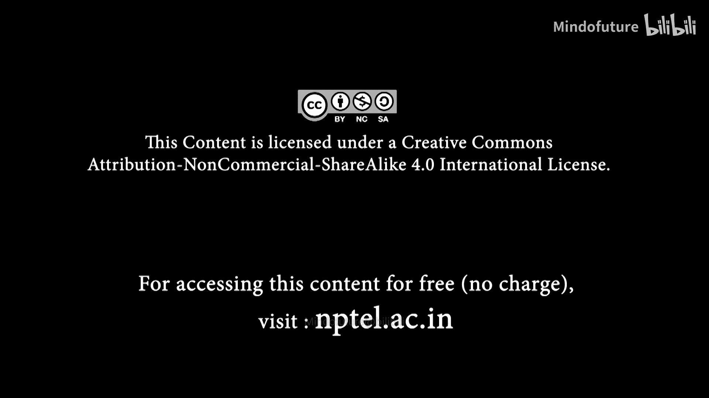
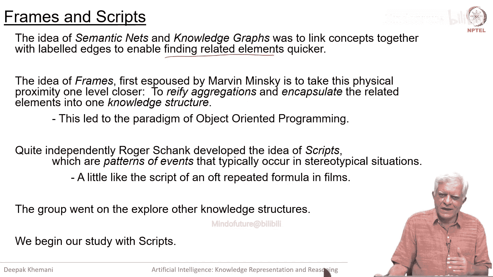

# 【印度理工学院】知识表示与推理 ｜ Knowledge Representation And Reasoning p83 P83_知识结构 -BV1c4zNBmEyF_p83-

So we to a new topic。We have just finished looking at conceptual dependency theory。

 which was basically a small set of predicates which were used as primitives to represent knowledge。

And this knowledge was about everyday actions， essentially。😊，We saw how other。

Werbs in the English language could be translated into conceptual dependency theory。

We also saw how some inferences could be made in a general manner knowing the semantics of the sentences。

 so， for example we knew that if you buy something it means that you are giving some money and getting something in back。

We know that if you are。Planning to take an aspir in then most broadly it is because you are not unwell or because you are unwell or so that kind of influences。

A program called Marji could make。Now we want to look at specific situations。

Which are larger in some sense。Which require a different different kind of knowledge representation and that representation is knowledge structures。

So we start with that。Yeah。This is a recap of what we have said much earlier that。

If you are hearing a story。😔，All this sentence。for example Anissa walked into a bookstore or into the bookstore。

 then you generate certain expectations as to what' is happening there。

 thats because you know what is a bookstore， what happens inside a bookstore and things like that。

And。You can make inferences like Anissa will probably browse through the books or maybe she's looking for a specific book and she look for that。

Perhaps she will go to the counter and pay for it and she may emerge with a book in hand so these kind of expectations you。

Will generate。Now， like the programs， Marji。嗯。What we are going to look at today。Is also。

Focus towards understanding stories so the same。Machinery will be built upon essentially。So。

 we use the phrase the phrase knowledge structures to say that how do you put together different pieces of information into one structure essentially？

How do you know about restaurants or how do you represent knowledge about restaurants or about dental clinics and so on。

 all these are stereotypical situations in which the same kind of thing happens。

Over in the world again。So in some sense， we collect and organize individual bits of facts about the typical knowledge about these entities。

And we create these aggregated representations。Roger Shank called such structures as scripts。

Malvin Minsky called them frames。And frames shows the idea behind what is popularly now called as object related programming systems。

Yeah。啊。When we were looking at conceptual dependency。

 we said that our goal is to understand natural language sentences and stories。😊，And by making sense。

 we meant that we map it onto some internal representation。

Which in our case happens to be in first orderlog。But what is more important is that understanding has a top down component。

 it involves concepts driven mapping into preconceived notions。

 essentially we already know what it means to buy to sell to drive a car and things like that。

 whatever。Rather than data driven bottom of approach。

 so we don't want to start by looking at sentences and then make sense of them when we are we want to be in a position to accept sentences and。

Try to see where they fit in into the knowledge that you already know and that knowledge is what we are trying to now talk about as to how that is represented。

So that is at a level that we have chosen so they are already aggregations in some sense。

 but we will represent them as individual symbols。😊，So， as we said at that time， we in。😊。

Invent our own concepts in our heads so you know people， trees， dogs， nations。

 organizations and so on。What we are going to see now is that with those representations。

 we can do further agligation。😊，And further abstraction so scripts and frames they allow us to represent abstraction hierarchies that we spoke about and I will just show you the picture to remind you of that again as well as the aggregated aggregation hierarchies and we do so explicitly now so now we will have a representation of the whole as well as the representation of the parts that make up the whole。

😊，And the relations between。Not only the different parts。

 but also between parts and the whole essentially。This will be explicit now。So。

 here is an example that we had talked about earlier。

 we had when we were talking about aggregation so as you can see。😊，For example。

 we have this set of elements， so let's say this set of cs。So。

 now this particular element denotes the set of cats or the category of cats or things like that essentially。

😊，Then we can have another level of abstractstruction we can say that you know cats are。😊，Maments。

Yeah。So not only are cats， mammals， but dogs are mammals， horses are mammal。

 humans are mammals and so on， so all the different categories that we represent at one level。

Can be again abstracted into the higher level category which is。Mammals。So， there。

Kam gave the idea of abstraction hierarchies and the idea of taxonomies。

 so we have already seen for example， how description logics allow us to represent taxonomies。

We also have this other dimension in which we put together things and call give them a name essentially。

😊，That was the aggregation。早archき。For example， these four elements。Could be。嗯。그。

Describing some device which has four components and together the four components come together and we give it a name。

 maybe this pen or something like that。We had also seen an example of teams in sports in particular we were talking about bridge and we saw that a bridged。

Bridge team。Is made up of three bridge players。Which in turn is made up of six bridge players and they there is a level of abstraction that bridge players are human bridge players。

And human bridge players are bridge players at some point nowadays we have computer bridge players。

 so they are also bridge players and humans are also bridge players so there are these levels of abstraction that we had。

Spoken about。哎。Yeah。Some of these things we have learned how to represent in in description logics。

And some we will see now。Okay。So， what we are interested in is in frames and in scripts， essentially。

😊，The idea of semantic nets。We saw that we had this RDF and we had this。

Graph databases with triples being stored in them and that kind of stuff essentially they we call them as knowledge graphs。

 but the original idea was called semantic nets the idea behind this。

Moode of representation was link concepts together。With labeled edges。

So that we could easily look for relations between different elements。So。

 if you want to look for related elements， then you have to only follow the label links till you find。

😊，Target concept that you are looking at essentially。The idea of flames。

 which I said were first espoused by Marvin Minsky of MIT。

I to take this physical proximity one level closer essentially so not only are we going to link together different elements which are related to each other so at one level that would also happen but we refi all those elements。

😊，And aggregate them into one new representation and encapsulate the related elements。

Into one knowledge structure essentially which he call as frames essentially。

We will look at frames a little bit as we go along。And I have said this before as well。

That this led to the paradigm of object oriented programming。

Because there we have this notion of encapsulation。

 we have the notion of inheritance and you that kind of stuff the of the parthole hierarchy can be captured in objects。

Quite independently， Roger Shaang developed this idea of script essentially。

which are patterns of events that typically occur in stereotypical situations so we saw we spoke about a bookshop one of the favorite things that Shaangs students used to talk about are restaurants what happens typically in a restaurant and we all know what happens in the restaurant and the script was the idea was to capture that into one structure which was like a large data structure at an abstract level。

So the name script I presume comes from the fact that they were a little bit like scripts that are used for plays and and films and in theater and so on in。

😊，你怎备。😔，Yeah。India， we have seen that there are certain very well defined patterns。

 well beaten patterns。Wwhich are called kind of formulas of films which are used to make films so you know every all the time that you know this is what to expect one difference between。

Minsky's frames and Shanks scripts is that Minsky's frames were essentially semantic in nature that they talked about the domain and the relations between different elements in the domain。

 whereas Shanks scripts they are episodic in nature they talk about episodes as to what happens in typical situations。

Okay。Sang's group which was at Yale University this happened between the mid 70s to mid 80s they explored many other knowledge structures as well。

 we will see a couple of them as we go along but we will begin，😊，Our study with scripts， which is。

The fundamental contribution which came from that group essentially we mentioned many programs when we were talking about conceptual dependency theory。

 there was a whole string of programs， for example ELI English language interpreters and so on。

 some of them will come and play a role again here。😊，But our focus now is going to be on scripts。So。

 with this very short setting of the scene， as you might say。😊，We will。

Come back to the next video and start talking about scripts。

