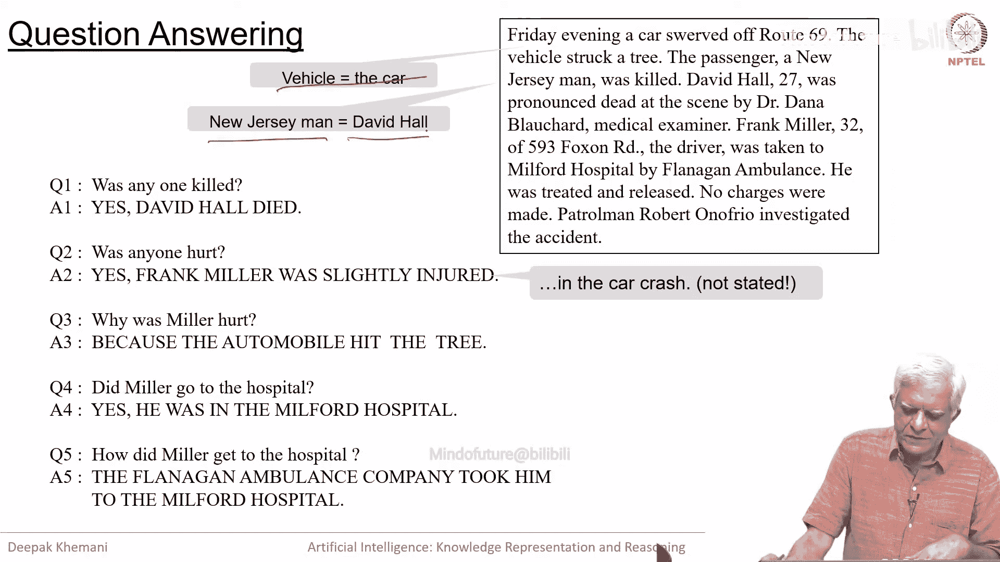

# 【印度理工学院】知识表示与推理 ｜ Knowledge Representation And Reasoning p84 P84_脚本 -BV1c4zNBmEyF_p84-

同皮金币。We have started looking at structured knowledge。

Or as knowledge structures that I like to say and we want to focus our attention on scripts for the moment。

Now， whatever I am going to talk about， I have basically taken from this book called Inight Computer Understanding where Roger Shank and Christopher Rebe。

😊，And in particular， this chapter， which is on a program called SA。

Wch stands for script Applier Mechan， which was the PhD work of Richard Culling For essentially。

So Rogerjas had a。What should I say an army of students。

 each of who looked at different aspects of building a complex natural language understanding system？

Focusing on the knowledge which goes behind natural language understanding。嗯。

So scripts are basically a collection of episodes。Sam。

 which is the script apply mechanism the program that we are talking about。

 read stories in a top down predictive manner。So the moment it knows that this particular script is active。

 it knows what to expect。It's like when you go to see a football match you already know what to expect essentially right I mean you don't know who will score but you can you will you know that you know people will try to score essentially you know that this is how teams are played they pass to each other and that kind of stuff。

😊，Like most of the work。In jail at that time， Sam read newspaper stories about situations describing motor vehicle accidents。

 plane crashes。Creen legs。Oil spills and state visits。So in a sense。😊。

When we do representation like this。😊，We are doing it in a very domain specific fashion that we are going to represent knowledge about particular kinds of situations so。

 for example， vehicle accidents or restaurants visits and so on。So。

 our programs will be good at that。😊，But they will not be able to understand。Yeah。

Stories which do not fall in the scope of what they already know essentially。Which。

 as you can imagine is to be expected。Okay。So， we use the word situations here。

 so situations are in some sense bigger than。Scrips。그。

Scrips are parts of situations so scripts are aggregated into situations and you can see that this whole process of aggregation has begun from the very fundamental particles that we talked about or fundamental events if you want to talk about events and then as we go up into the aggregation hierarchy we talk of things at a different level of granularity so scripts and situations and scenes as we will see are different levels of granularity at which we can talk about these kind of hierarchy Shank used to call it as packaging hierarchy because you are putting together sets of。

Sentences and packing them together into a script。We will call them aggregation hierarchies。

 but we mean the same thing。So later on something called mops。

 which is memory organization packets came up essentially we will see I might try to give you an example of that。

So， a script is a pattern of connected conceptualizations we already know what do we mean by conceptualization that you know this is a two way dependency between concepts as we studied in the CD 3。

😊，Now a script is a pattern of connected conceptualization， so there are many it is not just one。😊。

And they are all connected to each other there is a sequence typically。

we have roles and we have props so by roles we mean exactly like roles in theatre that somebody is playing Macbeth and somebody is playing someone else and so on and so so there are roles there are characters in the play and like that in scripts also there are characters who do specific things inside scripts so for example a cashier at a cinema theater is a role。

And props mean objects which are there in the system。Because we are working with scripts which。😊。

Organize this knowledge about typical situations。We are able to generate expectations。

 these are pre stored expectations about what will be that next we will see as we go along。😊，So。

 here is an example of a subway script。😊，By subway， we mean something like a metro train。嗯，So。

We have described the two levels one is at the level of episode。

 the other is at the level of conceptualization so at the top you can see that a patron enters the station。

😊，which is represented as a patron group P Franciss to inside part of the station。

 so we have given a lot list thing。Then they go through a gate。

 either they go through a gate directly or they buy a ticket and go through a gate。

 they go and wait at a platform， a train comes but maybe that is not the train that the patron wanted so they wait for the next train to come so there could be a cycle there。

Then they get into a train， then stations start coming and they might again wait till the destination arrives and at some point when their destination arrives。

😊，The patron leaves the station and exits from the station essentially。

 so which can be represented as the patron group p transs from the station outside。So， this。

Pattern of connected events is what Shank calls a script essentially so what is the script。

Let's do a very quick recap。At the top level we are seeing that somebody enters the station。

 then there are two branches that either you go directly to the platform。😊。

Or you first buy a ticket and go to the platform and we know that both models apply in most of the kind of travel we do nowadays then you go to the platform and wait a train comes。

If it's not your train， you wait for the next train to come。And so on。

 at some point you get into your train， then you wait for your station to arrive your destination to arrive。

And when it arrives， then you get off and leave the station and this is a typical。😊。

Subway script by subway， we mean metro essentially。Metro like local trains as we call them。

In many places。So， story reading， as we have said in in Sam is predictive。

 you read the first sentence and somehow you figure out。😊。

What is a script that we are talking about so the script is a collection of episodes essentially as you can see we have identified one of them the rest of them become expectations as to what is it that we could be hearing about in this story。

😊，And then the next sentence comes in the study and our task is now to match it with one of the。

Episodes in the script essentially as we can see here we have matched it with the fourth element in the script。

😊，And then the last sentence of the story comes and we have to match it with another episode in the script and that is what we have seen so we have three。

😊，Episodes in the story and they respectively are mapped onto the three episodes in the script。

So typically when we tell stories about typical situations。😊。

You do not describe everything at every level of detail。

 so if I was if I were to tell you that I went to the canteen and I had a doa and a coffee。

That much is enough for you to figure out what happened you will figure out because you know what happens in a canteen。

😊，For example in IAT Madra canteen you go to the canteen you stand in the queue and then you pay the cashier the cashier gives you a token。

 you take the token and go to the counter and the counter they take the token and give you whatever you have bought essentially you already know this so I don't have to say all that essentially all I all I need to say is。

I went to the。Canteen and I had a dosa in a coffee and you understand what is happening you know that I would have paid and I would have eaten the dosa hopefully and well see examples of such stories。

あ。So， the whole game in knowledge representation is about making inferences。

 we have spent a lot of time in the course on deductive inferences but not all inferences are deductive in nature many of them are abductive in nature in the sense that we make inferences which are likely to be true。

😊，Not always objective， maybe probabilistic also。😊。

So one of the inferences that you can make when you are processing scripts is causal chain completion。

 which means inferring the intervening events that must have taken place between the events explicitly mentioned in the story。

 so if the story has just two or three lines but the script has 20 lines then you know that most of those other things would have happened or most likely happened。

So， we want to maintain a causal and a situational continuity so for example if I tell you that I went to the cinema and I saw this film you know that I would have bought a ticket and then I would have showed the ticket and only then he would have left the dualman would have let me inside and so on we can fill in all that stuff because of the fact that we have this background knowledge represented in the form of scripts。

😊，So， the second kind of influence you want to make is role in sation as to which。😊，Person。

 let's say we are talking about people doing things。I playing what role in the script so you know。

 there is a patron， there is a cashier， there is a。😊。

Bus driver and things like that so we have to identify as to the story that we are reading。

What person fits into what role？Not only that we have to also worry about lower merging that sometimes we may refer to that person using different。

😊，Noun phrases。And we should have the capacity to realize that we are talking of the same individual。

So， recognizing when multiple references to the same specific role filler essentially。😊，So。

 here's a small example。😊，Of a two line story， the line in the middle is not part of the story；

 the story is simple。John walked into the subway station。He went to the express platform。

That is all that is said in this part of the story。

 but the first thing that causal chain completion that you can fill in that he must have water ticket。

😊，Or of course， he must be having a pass or something like that， which allows him to travel。😊。

Let's say for a long period of time。Then。We have to do role in sation and roll merging so John is a rider in the script there must be a ticket window you know props we can recognize gates to platforms and all that kind of stuff which is there part of the subway script that we just saw。

And also role merging so when you say。He。Went to the express。Platform。

 we must identify that he is John essentially。And he is doing an action which is predicted by the script。

 essentially。Yeah。So， here are some more implicit inferences John went to the movie theater。

He went to the ticket counter and asked for a ticket。

 so imagine that this is the verbatim story that is being told to you or to this program called Sam that we are talking about and then we are want to see how much the program has understood。

So， assuming that we have a theater script when he says。

He went to the ticket counter then in the script they would be。

An episode which says that you go to a cashier。Or you buy a ticket from a cashier。

 so cashier and ticket counter are going to be related to each other and the program should figure that out。

😊，From the continuity point of view， patron is expected to buy a ticket at this point because he is asking for a ticket to start with。

😊，嗯。As I said， the cashier seats at the ticket counter and thats a situational inference that the program can make。

😊，Because the script might say that you buy a ticket from the cashio。嗯。

Because its a counter essentially otherwise it could be a vending machine。

 which is a different thing。😊，And we can kind of infer that the patron must have paid for the ticket essentially。

So， essentially I hope by now you are getting that idea of what scripts do they they give you all this background knowledge in the form of some large pattern。

And you are reading in sentences and trying to match them into the pattern。

So here' is an example of SA， this is an actual example run by SA。😊，John went to a restaurant。

 he ordered a hot dog。The waiter said that they didn't have any， he asked for a hamburger。

When the hamburger came， it was burnedt。He left the restaurant okay。

 this is all that is told to you explicitly willba him。

Now Sam works only with conceptual dependency representation he doesn not work with English that job is。

Given over to Ellie， which is the English language interpreter that we had mentioned earlier。

 which we also use when we were talking about。😊，Concept dependency。

And text generation is done by a program called Bbel essentially。😊。

Now question answering was done by。I had mentioned this earlier by Wendy Leonard and her whole PhD thesis was on how to make sense of questions。

And how to look for answers in what you know and give out the answer。

So her job was to understand the question。嗯。Find the answer。

Understanding the question was done with the help of El。😊，嗯。

Conveying the answer was done with the help of Biblebel。And the source。

For the answer was the story generated by Sam。So， this is the same story that we were talked about and let us look at some of the questions that Sam could answer。

In between calling Eli and this question answering system by Leonard and a text generator called Bebel。

Did Johns sit down in the restaurantroom， the answer from the system is probably。

Did John order a hot dog。The answer is yes。Did John eat a hot dog？The answer is no。

 the waiter told John her managementu was unable to give it to him。It was not available。

What do the waiter serve John？The waiter served John a hamburger if you look at the story， it says。

When the hamburger came， it doesnt say the waiter served it to him。

 but because you have the script and you are working with the script， you know what is happening。

Why didn John eat the hamburger because the hamburger was over them did John pay the check？No。

 John was angry because the hamburger was o and so he left the restaurant a little bit of guesswork here that he。

Did not be。For the。😔，嗯。Here is another story， we will look at this and then take a break。

This is a motor vehicle situation， it contains scripts so it has a car accident script。

 it has an ambulance ride hospital treatment。Police investigation all these are part of the motor vehicle accident situation so just read this story Friday evening a car swerved off route 69。

The vehicle struck a tree， the passenger， a New Jersey man was killed David Hall 27 was pronounced dead at the scene by a doctor。

AndDina blot out now Sam has to figure out。The passenger was killed and David。

The passenger who was a man for New Jersey was killed。

And David Hall was pronounced that so this role meing if you remember has to be done。Also。

 Frank Miller 32 of。593 Foxon Road， the driver was taken to Milford Hospital by this ambulance。

 he was treated and released， no charges were made patrolman Robert。

Moonnoluo investigated the accident。So， we don't say that he was injured， Frank Miller。

 but we do say that he was taken to the hospital。Given some treatment and released。Okay。

So like in Marji。Sam can also paraphrase the story for you and this is a story that is generated by SA an automobile heater 3 near highway 69。

4 days ago。David Hall a 27 resident in New Jersey， the passenger died。

 Frank Miller a 32 residents at so and so in the New Haven Connecticut the driver was slightly injured and the police department did not file charges。

There is a Spanish summary available also， but I have not included it here。

Maybe later I will show you one。So let's look at how question answering is happening for the same story。

Was anyone killed？Yes， David Hall died。Was anyone hurt？啊。Yes。

 Frank Miller was slightly injured slightly because he was given some treatment and released。

Why was Millerer hurt because the automobile hit the three essentially？Did Miller go to the hospital？

Yes， he was in the Milford Hospital。How did Miller get to the hospital？

The flanagan ambulance company took aim so these are the answers generated by Sam。And。

The fact that he was injured in the car crash is not treated explicitly。

 but because now we know that we are operating in a script we know that we also are able to make the connections between the vehicle and the car and the New Jerseyman and David Hall as we have seen。

😊，So this high hope gives you an idea of how scripts operate。

And we shall come back and look at a little bit more detail into scripts。

 then we will see a more detailed example。Soll see you in the next session。

