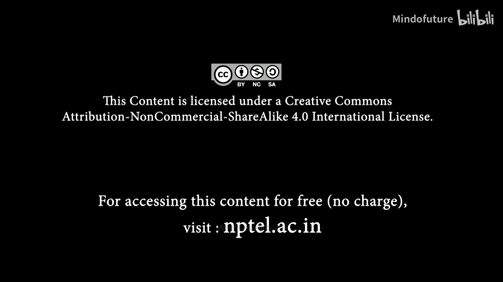
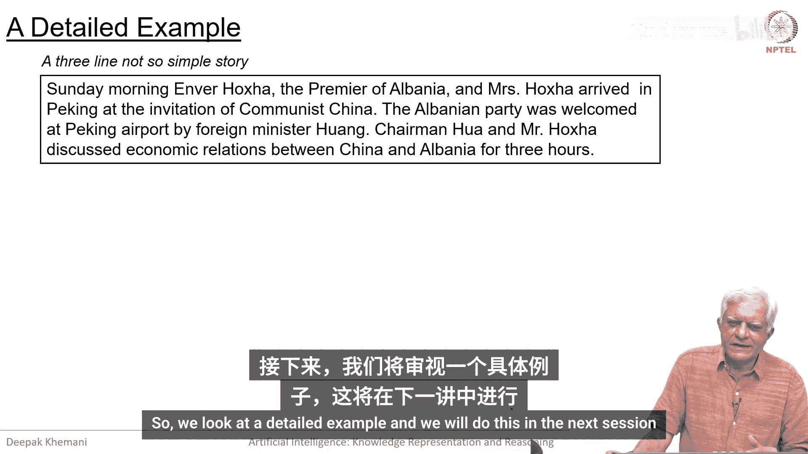

# 【印度理工学院】知识表示与推理 ｜ Knowledge Representation And Reasoning p85 P85_SAM脚本应用器机制 -BV1c4zNBmEyF_p85-

So welcome back， we have looked at this notion of scripts and we have seen a couple of small examples the last one was。

This road accident example and we saw how script how Sam which is a script prior mechanism。

Could answer questions by calling the relevant modules now scripts are only the beginning in the sense that that's not。

Not everything that we know about the world can be captured using scripts， essentially。😊，So。

 scripts embody patterns of stereotypical events in a situation a script based understand tries to map incoming information onto the script it is like a large data structure that you have and you are trying to match things into that。

There must be a mechanism to introduce other possibly different type of knowledge structures because scripts are just patterns of stereotypical activity you know you have to reason with other things in。

Real life situations， So the following story， even though it is situated in the restaurant can only be partially understood by the restaurant skip the fact that he went to a restaurant and so on。

 so what is this story。The billions。Stroll into cafe Budapest while the waiter was taking his order。

 the owner or notorious mafia figure approached them threateningly essentially now clearly you and I understand this theory that there is something more than routine that is happening in。

Here。The routine thing in the restaurant is to go place your order eat and come out that is the simplest thing that can happen but here we are talking about a mafia figure approaching them threateningly you need something else to understand these stories and we will look at this notion of coals and plans。

After we are done with scripts。Yeah。So， this is how SAM is structured。

 as I said it is a collection of programs。Okay。What you see in rectangles here。

 L PP memory and Apper。Our programs。What you see in over structures is the data essentially。

Sod lines will present。Flow of control。And dotted light represents flow of data or flow of information。

So， the first program to come into action is a that is to be expected because it generates。

 it converts。English language into conceptual dependency。Okay。

The next program is called PP memory in their list， but it is basically a semantic memory。

 it knows about props and roles and things like that which are applicable in the script。😊。

And the third program is actually mapping the input conceptualizations into specific patterns in the script essentially so for that of course it needs script data。

As input and it creates a story representation as output so what happens at the end when the whole thing works together。

Is that you input a story text which is in English and you get an output。

 which is a story representation。In conceptual dependency。Everything beyond El。

Is language independent essentially？So this whole idea that you can represent this。

Knowledge of scripts in in we represent it in English。

 but there is nothing to stop us from representing it in a different language as long as。😊。

We have this parser， which will take English and convert it。

Into our representation essentially and of course， we should have a generator which will take our output。

For example， question answering， which is not shown here， this is only the understanding phase。

And generate it into the target language。嗯。So， as we said。

 what a does it exacts conceptual elements that are explicit it avoids doing any inferences it is just。

Pasing， semantic passings。The PP memory。PP is member picture producers。

Is a memory of scriptal rules and props， it matches incoming tokens to expected ones essentially。

The PP memory has some idea of what are the roles and tops in the script and it is got some about some idea about the category of the incoming information。

And it doesn some。알 location there。It assigns tokens to PPs and acts， acts are actions， remember。

In the output of L also generates tokens for roles in the scripts。

Then there are also permanent tokens， for example， Manhattan， New Delhi and so on。

 these are permanent tokens which。Unknow too。Everyone。Yeah。So。

 if you look at this story that John took a BMT to Manhattan to see a play。

 then BMT and Manhattan are permanent tokens， so the program is expected to know about them。

Then at the theatre he walked over to the ticket counter and asked for a ticket the Uher took it from him and showed him to his seat。

 this is all part of the script， the play was so offensive that John decided to leave the theater refused to refund his money we are not going to process this just showing it as another example that Sam had actually processed but we cannot go through all the output that their programs generated。

So Ellie does not question where John came from or who did he ask for a ticket。

 it just translates from English to CD theory。Does not even try to fill in for pronouns it is the PP memory which creates a token for a cashier and usher and seed and infers that it in the sentence is the ticket。

And showed him to his seat means John's seat essentially。嗯。Its a semantic memory。

 as we have said it' is a bit like what we expect of first orological presentations and including things like frames。

It has some ontological knowledge about conceptual s and so on。In contrast。

 scripts have episodeic knowledge， they talk about events and episodes。In particular。

 in that given situation。So the script Apper is a program which takes over from PP memory。And。

It has three problems to solve。The first is locating new input in its database of scripts。

 so the script apply will have access to many scripts it has to somehow figure out as to which of those strict scripts are likely to be needed to understand this。

Input sentence and all the story which is being told so that's a script management problem which scripts are relevant to the given input scripts are picked based on various patterns that scripts also have some headers as we will see。

Scripps also have a preconditions that make a script active。

 for example patron is hungry would trigger a few scripts so the cooking script for example or a restaurant script for example the pattern matches sets up the desired context one at a time and tries to see decide later which of those scripts if think are applicable is actually applicable。

Yeah。Once it has chosen a script and it is trying to match that it has to set up predictions about the likely inputs to follow essentially so this would be useful in understanding the incoming sentences。

Yeah。Yeah。Instanantiating the appropriate segment of the script up to the point referred to by the input。

 so whatever story part you have heard。We must create an explicit representation of that study as well。

Including。The inferred sentences。Okay。So， an active script which means a script that is being used by Sam to try and match the information。

I is defined by a context apply which is a program that we are talking about tries active scripts one by one。

は。So， the context for the script is defined by a list of patterns which predicts what inputs will be seen at a given point in the study。

A binding list which links the tokens for PP is produced by the PP memory。With script variables。嗯。

So you should be able to figure out that John is a driver or John is a cashier or John is a patron as a case maybe。

A record of the script scenes that are currently active so scenes are。😊。

Smaller than scripts and so scenes are aggregated into scripts。

A list of scriptal inferences in particular events which have happened which interfere。

With the normal flow of the script， so this will give some clue as to whether one is working with the right script or not。

Okay。对。A script global strength indicator， which Sam uses to flag how strongly it believes in the inferences it is making。

 which means how strongly it believes。That the script as it is using is the right one。So。

 this is the overall structure of the script App program it has as you can see three components one is the pattern match controller which is the first thing which becomes active then the predictor which will you know generate expectations and and which will。

😊，Clear episodes， and itll load。New episodes which are to be expected。

And the third part is the episode iniator， which will create the actual story representation。

The first part sets up context one at a time as we have said。

Explicitly mentioned first explicitly mentioned onces and then the active ones and then finally the dominant script just in case we are not able to match with the existing ones。

The matcher does the backbone match of the stick that do we。

The main conceptualizations of the script are they matching with the input story？

And it does roll fit and roll merges， remember roll fit is identifying role and roll merge is conflating role。

Together， completing。Mention of individuals into the same role。

The inferencer will do things like check for degree of hurt so for example we know that in this accident story we inferred that Frank Miller was slightly injured。

That is an influence， right？One can make and the predictor will update as to what is it that we expect to hear next session。

😊，And it will clear earlier predictions because if they have already been met or they have not been met as a case maybe if there are branches in the script and it loads what to expect next decision。

😊，And finally the final story representation。So， this is a general。😊。

High level description of how the script applies。Os the applyer itself receives input from this program called P memory。

 which has got semantic knowledge about。The roles that the script uses。

 which itself uses input from L which converts English into conceptual dependency。

And this finally generates the story which is then taken over by question answering in case you want to answer questions or by generating a summary essentially。

But at the end of this， we have an explicit representation of the story。

 including the parts which have not been studied explicitly in the。😊，Verbal story。

 but which we have been inferred because we have said that this is a script which is active。

So we look at a detailed example and we will do this。In the next session。

🎼。