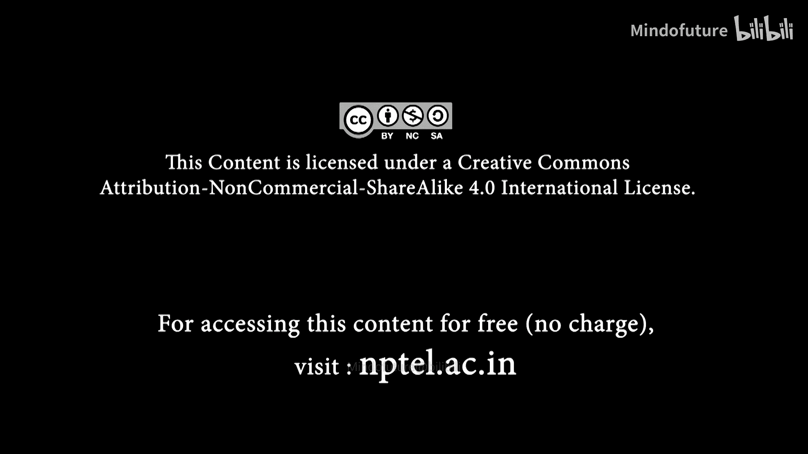
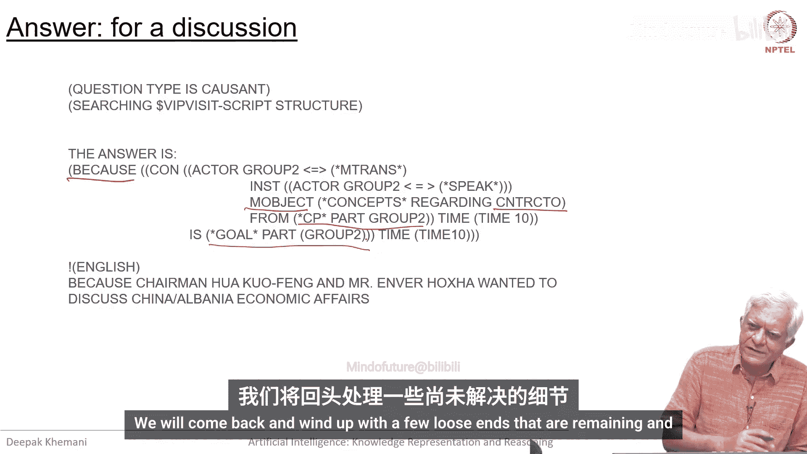

# 【印度理工学院】知识表示与推理 ｜ Knowledge Representation And Reasoning p86 P86_贵宾访问 -BV1c4zNBmEyF_p86-

So well come back。We have looked at。How Sam is structured。

With different components starting with LAE PP memory and script supplier。

Then followed up by question answering and paraphrase generation。

And we have said that this program SA has been input with certain sets of situations。

 it knows about certain things train lakes and political visits and so on state visits。

 this is what we are going to see now。And can understand stories if they conform to one of the scripts essentially。

 so let us look at the small story。Sunday morning Enal Hoxa， the premier of Albania and Mrs。

 Hoxa arrived in peaking at the invitation of the Communist China the Albanian party was welcomed at Peking airport by Foreign Minister Huang Chairman Hua and Mr Hoxa discussed economic relations between China and Albania for three hours so this is what is told to you essentially so you have to make connections for example the Albanian party is。

Mrs。 Hoa and Emma Hoka。Essentially。And this jailman。

Who is the chairman of the Communist Party in China。啊。

And it has been told to us that they discuss economic relations between China and Albania。So， let's。

Go over this story in detail。I will show you the output as was generated by Sam。

 we will not go into the specifics because they are just two vast essentially。

 but we will get a feel of how。Sam ends up creating the story。So this is some kind of。

Designed to give you a feel of。What's happening？It's happening in 1976， as you can notice。So。

 we have started this program called apply， which is the script applyer。And at this moment。

 it has got three scripts in its memory， one is a train Re script。

 one is a VIP visit script and one is a vehicle accident strip。😊。

And now it's going to wait for input。 So we have started the program and the program has got these three situations that it can。

Understand and hopefully the story that will come in will be one of these three。

The VIPs visit script， which is what we are interested in here。

 has component scripts for traveling for things like parades。

 maybe banquets and discussions of course。😊，嗯。So now it is waiting for input。

The first line is fitting。And the program here is called parser。Which is basically a。

And the story that we have just read， the first line is。Being converted into conceptual dependency。

 we have already seen how this kind of thing happens。

And you can hopefully recognize that we are creating conceptual dependency conceptualizations here。

So for example， there is an actor with some temp 32 then action called Ptrans and there is a sense of direction to the inside part of something which is a municipality with political name peaking so byjingangle used to be called peaking when this program was written。

And some things which you don't know， so you just leave it as blanks essentially。So there is a mode。

 there is some time。And so on and so forth， essentially it creates。Different tokens。To which。

Different conceptualizations are attached essentially。Yeah。So， for example， the time is。

Day part morning。😔，Bigday， Sunday。嗯。Okay。Yeah。Paser can kind of make out where there is some invitationation happening here。

And so there must be an invite， they must be an inviteee。

And there must be some object of the invitation。We know that the invite is communist China because that's what the sentence is。

Aived as the invitation of commmunist China， so it has created this representation。

The actor is a token called temp 32， which is。As follows， it is a group， it has got members。

 one is a feminine whose last name is Hoka， the other one is masculine。

 whose first name is Enver whose last name is Hoka， whose title is Premier。

 and he is the premier of Albania which is a nation。

So she just figured all this out and said that this is a。Actors who were invited。It's a group。

 it's not just one person。So， it creates some representations where will not go into those details here。

It creates tokens at different levels， so LA creates some tokens then PP memory which they call as token here。

嗯。Matches the token with his semantic memory。 and then the。A player。

Will create it its own tokens because it has got roles and props to be filled up。嗯。So。

 it is basically。😊，Putting together different tokens， we will not go into the details here。

So it has created these two tokens Hue 1 and Hume2， presumably from Mr。 and Mrs Hoxer。그。

There is some political thing happening here。And so on， so there are two entities one。

 pull it one and pull it2。It is simply creating new tokens。

By combining ones received from the parsif。嗯。The PP memory recognizes that we are talking about VIPs here。

 so it identifies some permanent tokens like the premier of our country and the chairman of the Communist Party and this kind of stuff。

 so it does that match。The passer has not bothered about where the Hoas came from or how they reached there P memory also has no idea how or why they have come as of now。

There are no suggestions for what script would be applicable at this stage。

 we only know that somebody has been invited。And the inviteor is。嗯在ina。啊。

Now the script supplier comes into action。嗯。And it's trying to search through its memory of scripts so remember it has got these three situations。

And it searches first through the C Re script and that fails and it goes to the VIP visit script and it found that something has been recognized。

Now there is a state invitation being done from one political entity， which is a nation to another。

So it's。VIP track of the VIP visit。Is activated， so it now knows what to expect essentially。

So we will skip some of those details。嗯。It still doesn't know how they came。你。

So there is a binding contradiction。😔，As to which。Organization transported this person。Well it knows。

That the invited group has。Betd themselves。To the inside part of their initial destination。

Successful match for derived pattern。嗯。Again， as I said， we will not go too much into detail。

 but hopefully it will give you a flavor of how this program is used to operate。😊。

The Albanian party was welcomed at Peking airport by Foreign Minister Hu so it is making that next statement it already has working with the VIP visit script so it knows that there is a welcome scene and there is going to be some banquet or parade and talks and things like that if all those things are possible。

😊，Now it is talking about who is a welcomer， it is Huang。And he is a foreign minister and so on。Yeah。

And the welcomed group is。From Albania。Yeah。And they arrived。Somewhere near。😔，Yeah。

Re peakking airport。So， this is recognized as a。😊，Welcome scene of the VIP visit App now needs。

To make sense of the fact that they。Are all at the airport， it will infer that the invites。

Flu in because you are being welcomed at the airport。You must have your。So， airport implies。

Plying is a means of transport。So again， it searches through its script and finds some match of some backbone。

 some part of the script。嗯。So there is a derived pattern。Yeah。That an airline was responsible。

For bringing them。Because they are near the airport。그。Yeah。Yeah。그。

So the welcoming event is happening and it can figure out that some airline has。Brought them。

And it is merging the two tokens， the Albanian couple。And Mr。 and Mrs。

 Hoka is the same is what it is saying now。Yeah。Then it reads the third line。The chairman Hu and Mr。

 Hoksa discussed economic relations between China and Albania for three hours。So。

 that is again translated into conceptual dependency。

 you can see that the main thing that is happening is m trans cell， which is mental transfer。And。

These are concepts regarding economy something， and there are two parties that are discussing this。

 so one is the Albanian Party and one is the Chinese party。And they。Ah？Using the speak。Action of。

Conceptual dependency。So， from the con。Conscious processor of one party to the conscious processor of the other party essentially。

그。And it was identified。Now， this is a group which was talking that these two individuals were talking to each other。

And they were talking about some economic contract or something。Yeah。So now you have the story。

which is represented， which of course doesn not look like a English language story here。

 it is just a collection of tokens and events which are put together inner structure。

So it's doing all this stuff， making defense subscenes， the subscene for arrival。

For welcome for talk。And all this is happening in VIP visit screen。

So it creates some kind of an event graph that these are the events which happened。So。As we said。

You can create a summary， this is a summary in English。嗯。Okay。嗯。Premier Emral Hoka。

 the Albanian government head and chairman Hua Kufeeng。你。

China government had discussed Albanian commmunist China economic affairs。

 so all these details which are not mentioned in the story are recognized because they recognize the permanent tokens。

And as you can see we have a summary in English， so this is one of the plus points of using something like conceptual dependency。

 which is a canonical representation of actions and states in a language is that you can now work with different languages and in fact machine translation can be done simply by reading the input story that we saw and generating this as an output so we have machine translation。

But there is a lot of machinery which goes behind this。😊。

Which is one of the reasons why it is not being used currently。

So let's look at question answering for this story。Again， this was the work of。Wendy Leonard。

So the question is given to the parser。Who went to China and it creates it passes the question and creates this structure that some a temp 8。

 be transd temp 82。Part of political type China。From it is not given as to from where they came。

 the question doesn not say from where it came and it doesn not talk about what is the instrumental act essentially。

😊，啊。The question is this。This people who went to China， who are these people。Okay。So。Yeah。No。

The input to question answer program， which is Wendy Lehanard's program。

Is to find a match for this conceptualization in which there is some variable sitting here and we want to know what is the value of the variable so this should take you back to。

嗯。The kind of things that we did with first our logic as well。嗯。Only thing is in this case。😊。

We are not using we are not doing deduction and making inferences what we are doing is that we have kind of created a story。

Based on the scripts that we have understood and we are using that to find an answer here。So。

 as you can imagine it has an explicit story representation， it will search through that。😊。

Pin the match and give out the answer。So this is the answer in English。Premier Enver Hoka and Mrs。

 Hosa， these are the people the question was who went to China and the answer is Premier Enver Hoa and Mrs Hoka。

 but to generate this answer。We have to go back to the explicit representation of the story that script Relier has made and in that you will find the answer to these kind of questions。

So， the story does not talk of anyone going to China。

 they said that they arrived at Peking Air and stuff like that。

 but in the explicit representation of the story we know exactly what is happening。Yes。

Here's another question。Which follows the first question presumably， how did they get to China？

So we already know who went to China， which is those two persons。And now we are saying。

 how did they go there， So again， we are。Saying that we are looking for this P trends。

And we are looking for the Instrual act which enable this speed trends essentially。

 so that instrumental act is what we are looking at。So the question is。To。

Generate this conceptualulation with this variable here and look for a match in the story and whatever this matches that is that is the answer。

Yeah。그。So there is some organization。Which。We trans them to。With patrons group02。

Where they were going。And the answer generated is that these two persons they flew to communist China。

 how did they go there they flew to communist China？The story representation。

Contains the inferred episode that they have flown to China and therefore it can generate this answer。

So， this should give us some idea we will look at one last question before we wind up our study of scripts why did they go to China。

 why did Emma Hoksa go to China？And then if you remember that we had。These kind of。Sorry。

Either between this。All there were states involved but basically what is a causal connection between two conceptualizations and that is the kind of thing that is being asked here essentially and that is what is it that leads to their going to China。

😊，は。So， that is， again。A blank。In the。Conceptulation。

 so you will look for this conceptualulation in the explicit story and whatever matches here。Will be。

Genrated into and。English language answer。嗯。그。Because。😔，They had this。😔。

I wanted to exchange information about concepts regarding some contracts。From。

A conceptual processor of one。And that is a goal。Of this group essentially so they had this goal of discussing about。

Contracts。Yeah。그。Okay， so here was a quick look at scripts。We'll come back and wind up for a。

With a few loose ends that are remaining and that should end our treatment of scripts。

。