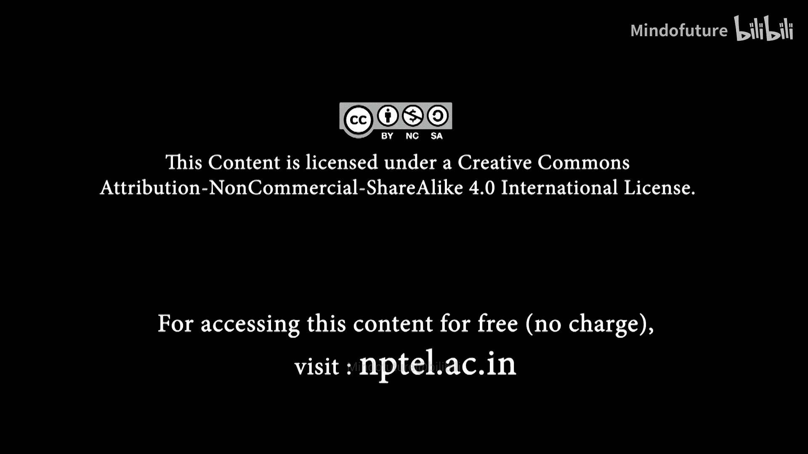
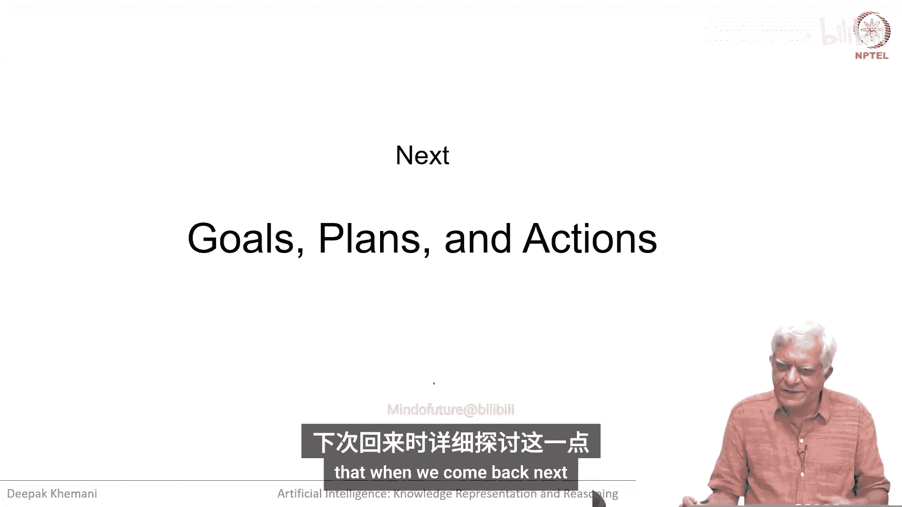

# 【印度理工学院】知识表示与推理 ｜ Knowledge Representation And Reasoning p87 P87_调用脚本 -BV1c4zNBmEyF_p87-

So we跟 back。We had a fairly。Baldwin tour of。This idea of scripts， which are knowledge structures。

 which are like。Concepts packaged into some large data structure， which represent typical。

Events in typical situations。And such knowledge can be used to understand when somebody is talking about those situations。

We started by looking at the subway script。And you can see that it uses terms like patron。

Which is patron group。Then of course P trans which is part of conceptualization and so conceptual dependency and so on。

 and there are other things that are being weighed， so there are things like。这是。Buy his ticket。

Then goes to the platform。And then a subway arrives。 and there's a driver。😔。

Who has brought the subway there then the patron enters the subway so this is typically what happens when you are going on。

So微。Journey， hello。Metro or a local train journey。I。So， as we said， scripts have roles essentially。

 so roles are the。It's like when you write a play， you have different characters。

And each character is a role in the play So if you have done。

Play in your school you would have got a particular role essentially。

 so in that sense there are roles in scripts essentially。So。

 there is a patron group to start with which is a group of subway riders。

 it can be one individual also。Then there is a cashier who。Well sell your ticket。

Then there may be a conductor。Which would be there in the subway。

 maybe who will check your ticket at some point。Then there should be a driver。

 the person controlling the train。And there should be an organization essentially。

 which is running the metro so in many countries。Trains are run by private organizations。

 and in India， in India， they are run by the government。But some metros in our work。

Counttry also are run by private organizations。Okay。

Each candidate for a role must match the semantic category we have been talking about this on and off even when we talked about。

Conceptual dependency conceptual analysis semantic passing we said that you want to match the semantic category so for example if you are eating something then that something better be food essentially even though we were forced to look at a sentence like Jack ate a book or something like that because there was no other meaning of the word8 we had to accept the fact that he is eaten a book even though book is not edible but in general one expects the semantic category to match and that is an important。

Aspect of natural language understanding。So， it' is not only that you have to understand the structure of sentences。

 which is syntactic passing。You have to also match the semantics of the different components of the。

Sentence essentially。And what we have shown with scripts is that there is a third aspect to which which some linguists call it pragmatics。

 which means you have to bring in the knowledge of the。😊。

Background knowledge of the world in the situation that you are operating in。

So in earlier times one would say that you know you first do the syntactic passing。

 then you do the semantic passing， then you do the pragmatics specifically but that as Shank and his group showed does not make sense you have to do everything at the same time essentially the moment you start listening to a story you start thinking of a particular situation so already the pragmatics or the situation is coming into play。

And then of course， that makes the task of searching through possible interpretations much simpler essentially。

 if you know that you are talking about restaurant scripts。You know。

 what does it mean that he ordered a burger， for example？So， semantic category is one thing。😊。

Situational knowledge is still a larger thing。And the sentence structure is also important because we saw the example of I saw the Grand Canyon flying to New York。

So it is only English which helps us to understand the fact that the relation between the fact that I saw the Grand Canyon and I was flying to New York is that one event happened when the other one was happening essentially。

Yeah。The semantics tells us that Grand Canyons don't fly to New York。

 but this English language tells us that what is the relation between the two subences。

 sub parts of the sentence？Okay。So， the riders， the cashiers， the conductors。

 drivers they must be human， of course we are talking about driverless trains already if you go to for example Dubai you might get into a driverless train and nowadays we are talking about driverless trucks they seem to be already operational in parts of the US。

And cars， of course， you know， graveous cars， everybody's。Yeah。Expectation of the future。

But this suborgue， it must be an organization because it is a company which is running the subry。

Then scripts have props so they have roles and they have props that means there these are the artifacts which one speaks about when one talks about scripts。

 so for example the counter it must be mentioned somewhere here。😊，Yeah。Okay。

 we talked about it in some earlier situation essentially so a survey involves following that。

There is a token which sometimes you use to enter the platform then the money far is the money that is paid for a token the turnst is the typical thing you cross through if you have been to a typical metro station you。

Insert your。Token or you show your pass and then you can go over the turnst。

Then may be seats on the platform so platform seat then of course there are subways then subways are made up of cars or bogegies or coaches。

 whatever you want to say that there is a different。

Cars in the train and you can get into one of them。Then in those scars， there may be seeds。

And there may be straps for page2 graphs if you are standing you can hold onto to a strap and there would be an exit gate missing。

You can see that。This is like describing the whole subway journey as what are the things that one can talk about when we are talking about this？

😊，So， obviously this is background knowledge that is useful if you want to hear somebody tell you of what happened when she was on this metro train。

 for example。그。嗯。We have events， of course， because scripts are。Collections of events。

Not only just collections， but they are sequences of events， maybe with launching and so on and we。

Even is what the sentences in the story talk about essentially。So， for example。

 the event that the patron group。Gave， remember arans abstract transfer or transfer of position。Yeah。

Fair， fair， if you see， is the money that you pay for a token。

To the cashier so this is an event that you expect to happen in a sek it may not be spoken about explicitly but if I say that I bought a ticket then you can expect that this would have been part of the set of actions which are unsaid a lot of things are unsaid when we talk about stories we never never。

Say everything that happens in total detail essentially。So。

 how about people represented we have tokens like Hume  zero， which was there earlier。

 there is a class。😊，Of category person， title， doctor， occupation。MD。Person name， first name markers。

 surname well be age implicitly in years， gender。Masculine and residing at a particular location。

Which is。Describe here。Its a class locale， it has a local type that it iss an address。

There is a street number， there is a street name。And there is a。Poality as to what is the。

Organization， what is the。Village of the town or the country that you are talking about。

So in this example。It is of class polity type， it is a municipality and its name is New York exactly。

 so you could describe a person using all these things。그。

Then there is this question of semantic mapping essentially。So。

What can be a patron group essentially the patron group？can either be a person or it can be a group。

And it must not have any other functionality in the script so a passenger is a passenger a driver is a driver a cashier is a cashier do not say that you know somebody can be both essentially not not in a script at least so when you say that a patron enters the session。

Then the pattern is that the Actele， which is a patron group。

 which can be either a person or a group of persons， they p trans。Themselves。

To the inside part of the substation。That is a pattern which is stored in the script。그。

Any one of the following should match that this pattern that we have just seen here。

John and Mary went into a subway station。John walked into a subway station。

John stroll out of a restaurant up the street into a subway station。

 the key part is into a subway station。Or John went into the BMT。

 so BMT one must know is of permanent token and it is of type subway station。

Or it is a type which runs this thing。是嗯设 service。I。So scripts have heads。Yeah。

You can have a direct header。😊，Which is that the subway script is what is happening here this is what is used to recognize which script2。

Misting。So， in that there is a patron group and there is a subway org and there is an origin。

 there is a destination， this is what happens typically in a subway script essentially。

John took us subway to Coney Island， will。Tgger this pattern。I will match this error。

The locale header。Okay。They went into the inside part of the subway station John walked into the borough hall subway station essentially this will also trigger a subway script so we are looking at ways in which you will try of presumably have many scripts in your repository which one to。

Wwhich is the one that applies to the current situation can be given by one of these clues either a direct header or a local header or an instrumental header。

😊，That。The IT took John to the Shi Sta， so for example it might be the case that John went to the C stadium and he took an IIT for that。

그。Yeah。Or a precondition heather that。The patron group had a goal。

To go to the inside part of the station， John wanted to go downtown。Yeah。And。That is why。

he p trans himself。To the inside part of the session because we had the goal of going to some place。

Okay， so with this， we come to an end。Talking about scripts， when we meet next。

 we will look at some other knowledge。Structures that can be stored。To when people talk about people。

 agents having goals and plans and actions。So agents can have goals。And to achieve those goals。

 they can have plans。So in the knowledge representation scheme。

 you might say that to achieve this goal you have these plan， so for example。

 if you have the goal of satisfying hunger， you could have a plan of going to a restaurant。

 you could have a plan of taking out something from the refrigerator， you could have a plan of。

Cooking something。Or you could have a plan of going to a friend's house and saying。

 giveive me some food。So goals have plans and plans， of course。😊，嗯。Are implemented。

By the actions that are part of the plan。And its often that when we are listening to stories。

 we have we listen about we get to hear about actions and maybe we have to infer the plans and the goals。

 but we will see that when we come back next。

🎼。