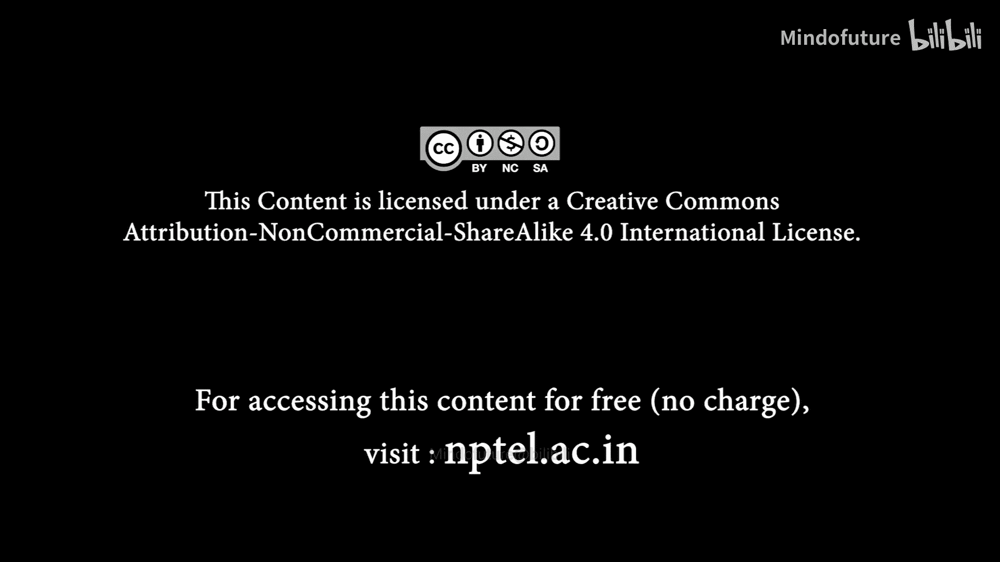
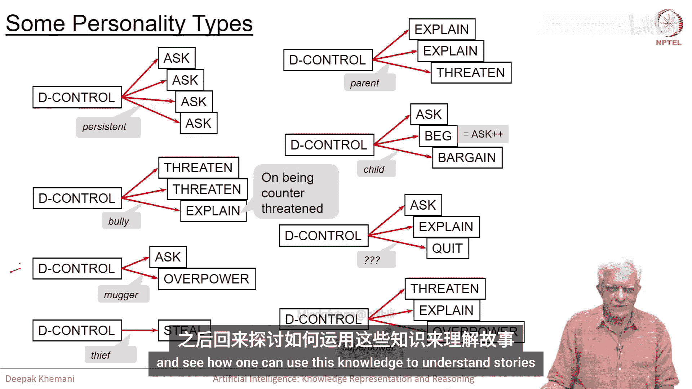

# 【印度理工学院】知识表示与推理 ｜ Knowledge Representation And Reasoning p88 P88_目标、计划与行动 -BV1c4zNBmEyF_p88-

Work from Yale University which is concerned with natural language understanding。In particular。

 they were interested in reading stories and understanding them in the sense that creating a semantic representation of what is happening。

😊，So that they could answer questions about the stories so we started with conceptual leency theory which is like a set of predicates which are conceptual in nature as opposed to being linguistic in nature and then we saw that we could have collections of such predicates to represent complex verbs and then which are called conceptualizations and then we could have conceptualization string together into scripts to capture stereotypical situations。

So， that is what we did earlier， what we are going to do today。Is to look at this program called Pam。

Which stands for plan Apper Mechan。Which is by Robert Wildinski。

PD work of Robert Walinsky and this material I have taken from this book Computer understandinging In Comp understandinging where Rogerger Shank and Christopher Reesbe。

😊，Yeah。No clips。Our stereotypical scenarios， they capture stereotypical scenarios。

 they read stories in a top down predictive manner。😊。

Sam reads stories about situations describing motor vehicle accidents and plane crashes and so on。

Situations are bigger than scripts and later an even bigger idea called mops or memory organization packets came up。

 which is closer to a combination of frames and scripts。😊。

A script is a pattern of connect conceptualizations which。😊，Variilables for roles and props。

 so you have to map the incoming characters in a story to these roles and props to whatever is being spoken about。

And each script provides pre stored expectations about what will be read。So。

 now we want to look at those stories where we have to figure out what the agents are up to or what the characters in the story are up to essentially。

Situation scripts and even scenes are all too encompassing you know you know they just capture huge。

😊，Steotypical scenarios and。Only if the scenario matches the story， then they work essentially。

The actions of the actors involved are scripted essentially and when they follow the script。

 one can understand the story。😊，However， in general。

 actors or agents are driven by immediate goals that they may have and of course。

 long term goals as well。And what they do or what the story is about is determined by the plans they have for adopting plans they are adopting for those goals essentially。

😊，So a repository of goals。😊，They are associated plans。

And the actions that are part of the plans can help understand why agents do things that are unscripted。

 which are not part of the typical script。When different agents have their own goals。

 the interaction between their goals and plans and actions cannot be captured by scripts because the number of such combinations would be far too many essentially。

 so the number of possible multiple goal interactions will be too many to write scripts for。So。

 here is an example of a non stereotypical situation。John wanted to impress his de。Now。

 at this stage， it's practically。Impossible to make predictions。

 especially for a listener who is not close to John so maybe people who know John they would know what to expect。

 but in general if you are reading a story then there is no basis for making any predictions。

Then we hear the second line， he says it says he called up his friend Bill and asked him if he could borrow his cadillac essentially。

😊，Now， the leader。Like us can now predict that John will use the car to pick up his date。

If the reader knows or assumes that this is a way of impressing people essentially。

And of course reader assumes that the second sentence is connected with the first。

 which is of course an assumption that we make at all times when we are trying to understand stories essentially so scripts just made them in a fixed manner now we are trying to find different ways of connecting sentences。

We also saw that this。When this assumption is violated that sentences follow from each other。

 we can get an element of surprise you know or garden path sentences or even jokes。Now。

 understanding must be flexible enough to cater to many situations。

 many actions that John might have attempted essentially。😊，Yeah。So。

 we need to reason about goals and plans and actions。So。

 let us look at this other another two line story， John needed money for a down payment of the house he called his sister。

There is probably no。Paying for the house。Down payment。

Sip the key thing in the first line is that you have to understand that there is a need for money。

 so John has a goal of getting hold of some money。The money could have been for any purpose。

 it could have been for a daughter's education， it could have been for paying off a bookuie or a hospital bill。

 that doesn't matter。😊，John has a goal of getting hold of some money and he is trying to see what plans he can。

Adot to get that money。So， we need to understand the intentions of actors， people have goals。

And plans are the means to achieve those goals。And plans are made up of actions。Now。

 in the work done at Yale in particular in Pam by Willenssky。😊。

All these things are represented as part of knowledge structures。

 so goals and plans and actions and we know that what goals are associated with what kind of plans and what are the actions which would go into such a plan so whether when you hear of goals or plans or actions we have a basis for linking them together to form a coherent understanding。

So， actions are related to goals。When we hear about an actor having a goal and then we hear about some actions that he did the two sentences can be connected if the actions are part of a plan that would achieve the goal essentially so the story that we just。

So。John needed money for down paymentment of the house， he called his sister。Can be understood。

If he has a plan to borrow money from his sister。So。

 these connections between goal plans and actions can be longer than just one step or two step so here below on this slide we can see an illustration is that if the line 1 talks about a goal and line 2 talks about some action which is the case in our story。

In our story we had only one plan and we understood that essentially。

 but it is possible that the plan may have sub goalsals and the sub goalsals may have subplans and the action that we are talking about would be part of a subplan so there could be a chain of gold goal plan interactions leading up to the actions that we are looking at research。

So let's look at a couple of more stories。😊，John wanted to become a full man or the full man in his firm。

He went to get some arsenic。Now， the connection may not be very obvious one essentially unless you imagine that there is some competition and some sinister design somewhere。

😊，John was hungry， he took out the yellow pages that is understandable because yellow pages often have information about restaurants。

 but what if we said John was hungry？And it took out popular mechanics， maybe there is a connection。

😊，But then it is left to our ingenuity to figure out what that possible connection could be essentially。

Yeah。Now， one particular kind of goal is called delta goal。

 which is the control of something essentially so delta goal can have different plans。😊。

For example you can ask for it， you can explain to the other person why you want it。

 you can bargain for it， you can set the other person。Or you can overpower the other person。All。

You can steal it。So， what we have shown here is this goal called d control which is。

A particular goal which is to get control of something essentially so if you want something you have a decontroroll goal essentially how can you achieve the decontrolll goal we have listed six possible plans here by their names So these are like plan boxes that。

Pam worked with that you had these scannedned plans。

And you knew that this plan is for this goal and then so on。So。

 the six possible plans are you can ask for whatever you want。

 you can explain to the other person as to why do you want it or why do you need it。

 you can bargain you can say if you give me this I will do something or Ill give you something else。

Or you can set in。The other person and say if you don't give me this then I will do something or you can actually overpower and lob the other person or you can be more devious and steal it so various plans could occur。

And these are the kind of plans that people have in general of getting hold of things and the order in which they are tried out are the traits of a character's personality。

😊，Yeah。At least we can make this。Hypothesesis。So let' us look at some personality types to solve the decontrol goal one is simply ask you know you ask and you ask again then you ask again then you ask again。

Another is that you explain then again you explain and if that doesn' not work then you certain essentially so this is the order in which you will try the goals。

😊，Or you can ask and you can beg， which is like asking very vehemently。And then you can bargain。

Another。Possibilities you set set and then you explain essentially。Yeah。

Then we have ask explain quit， you ask you try to reason with the other person and it doesn't work。

 you just quit essentially。Then there is a。Rather rough way of doing things which is two。😊。

Ask and then overpower and then take it。Stealing， of course， has been mentioned earlier。

Or you can say you threaten the other person， then you explain to the other person and if that also doesn't work。

 then you vote forward。So by hook or cook， you want to get that sufficiently。

So what are the typical people who would adopt these？😊，Strategies， so have you put in some， some。

Types here， this is simply speculation， it's not like it's come out of scientific research or something。

Well it could be something like this and this is the kind of knowledge that we keep in our head we know that there are people of different types and so on。

😊，So the last one which is still is obviously a thief。And。

The first one that we talked about is somebody who is very persistent， ask ask， ask， ask essentially。

Then there is a bully who threatens you and who threatens you again and then if you counter threaten the bully。

 then he explains as to why he was doing all this essentially。

Superpower is also kind of a bully so that they threaten that they explain and then they overpower essentially a mugger is somebody which says give me your wallet and overpowers you and takes it away essentially。

😊，A child would ask and beg again。Then bargain。Okay， if you give me this， then I will do my homework。

 you know， that kind of stuff。Parents are on the other hand they explain。

 they explain that you have to do this here to do this。And then they might threaten essentially。

 I have left one for you to figure out as to whether there are people of that kind。In this。

World里 thinking。So。What we are trying to say here is。Okay。That。Knowledge base。

 totally understanding system。Can be equipped with knowledge of goals。

And the plans that can be used to achieve the goals。And the actions that can be part of plans。

 essentially。对。So， we will take a break here and then come back and see how one can use this knowledge to understand stories。

