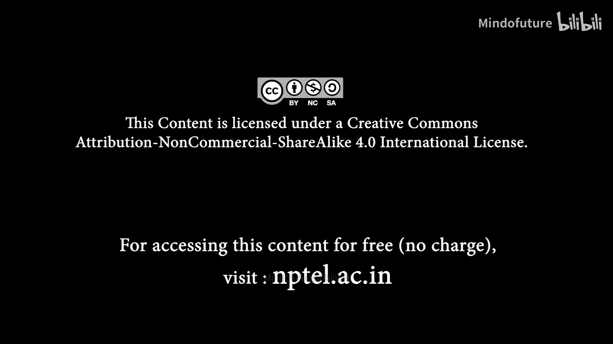
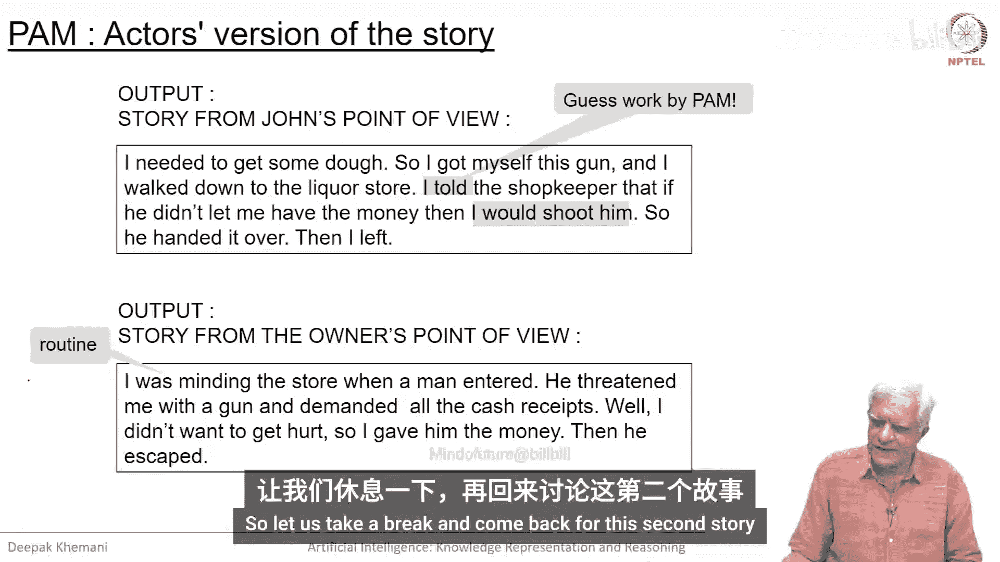

# 【印度理工学院】知识表示与推理 ｜ Knowledge Representation And Reasoning p89 P89_目标交互 -BV1c4zNBmEyF_p89-

小经病。Looking at this program called PAM， which uses knowledge of goals and plans and actions to understand stories。

Pamo sit。To understand stories in English language。But， we can imagine that。

This kind of knowledge would be useful。In other situations as well， So， for example。

 if you are designing a game playing program the character on the screen in this。

Cryptic diagram is the agent that you are designing and the person sitting outside is the game player or something so when a game player is playing a game。

The only input to the game。Agent insight is key strokes， which are like actions physically。嗯。So。

 for an intelligent game agent actions are the key key keyboard strokes it needs to understand your intentions from them now goals and plans are not linguistic entities one doesn not often talk about goals and plans sometimes we do。

Instead， they form long knowledge structures， so we want to represent them in a conceptual manner。

They are often not stated explicitly， but sometimes they are。

And instead what we most of the time see are sequence of actions essentially now this is a slide I had used when I was talking about conceptual dependency。

😊，So now you can see that we are tying up with the work。

 the study that we did earlier to what we are doing now。

Now goals can interact with other if you have just one goal then life is kind of simple that you have to do some kind of routine optimization and find a plan which will solve that goal。

😊，And the planning community does that to a large extent。

Real interesting situations involve multiple goals essentially often when I you choose between goals。

 you may have to make decide whether to achieve this goal or that goal or something。😊。

But sometimes solving one goal makes another simpler。If there are more than one players。

 then all these interactions they really increase。😊，Now。

 this slide is seen from the perspective of planning that if you want to。

Generate plans to achieve goals that you have。Then what is the kind of thinking that you would be doing？

Pm doesn't do planning Pam has knowledge about goals and plans and actions。

But it uses them to understand stories essentially。

 but you can see that if you have the knowledge about goals and plans and actions。

 you could very well use them for planning that we have a certain goal then you would consider certain plans and those plans will have certain actions and you would see the feasibility of those actions and then construct a plan essentially。

That' is what planners do to a large extent， though most planners don' not work in multiple goal scenarios。

So。We are talking about goal interactions now so the first thing we want to look at is gold substion an actor may plan for many recurrences of the goal at the same time so。

 for example John enjoyed drinking hot coffee and he bought a thermos。So。

 drinking hot coffee is a recurring goal and his plan is to use a thermos and the goal is to have a thermos。

And therefore， the action is to biothermals。And that is what the story is telling you is that you can understand the story if you look at this this relation between the idea of a recurring goal which keeps circling again and again and again。

And you can see that buying a thermois。A useful thing to do if you like to have coffee because you can have it very often。

Sometimes following one goal may provide the opportunity to solve another。

 so Jacob wanted went to the city for a medical jaup while there he also booked his train ticket。

This was written at a time。When people had to go to the railway station to book a train ticket。

 nowadays you don't have to do that， of course。Then goals may conflict essentially。

 so we are talking about one agent still the inical relations amongst goals of a single character。😊。

So here is a typical student like situation。Bunks had not finished his。Assignment。

His friends wanted to go and see a movie。And punkers flung the course。If you hear this story。😊。

You can understand it。From the fact that there was goal conflict that that Panage had two goals which are conflicting with each other in terms of the resources that were required to achieve those goals so one goal was a finished assignment and the plan would have been to go to the lab and implement the program assuming it is a programming assignment。

The second goal was to see a movie which would mean go to the theater and see the film with friends。

And you have only that much time in the evening so you can do only one of those things and then if somebody were to ask you the question。

 let did pununkkert see the movie。And after listening to the story， you could。

Might answer that probably yes， I think。Because you would see that Page has chosen one of the two goals that he could achieve。

Gold competition is。Spoken about when you talk about different agents， their goals are competing。So。

Typically in a household when people are watching TVv。John wanted to watch the football game。

 very stereotypical。But Mary said that she were going to watch the Volsh ballet。

John punched Mary in the mouth and put on the ball game。If you were to listen to the story。

 then you can understand that both of these。People。Unfortunately。

 confined in the same room with one television set had each had a different。

Goal towards a different channel on television and there was only one TV set。And。John adopted。嗯。

The method。Aop by bullies typically which is。Do。Somehow disable the opponents plan essentially。

So in this case， he kind of threatened her or overpowered her and punched her in the mouth。

And put on the ball game。Okay。Different agents may have goals which worked together in support of each other。

Then we call it say that it is gold conquerd， so， for example， Sukram wanted a new car。And。

Mukkesh wanted his papers signed。So presumably presumably Sukram had the power to sign those papers and some money changed hands if you hear this story which is not too uncommon。

 you would understand it。That these two people had goals。And they could enable each other's goals。

 essentially。So the plan that Mukesh adopted was to bargain with Sukram。And likewise， Sukram said。

 I'll bargain with money。So Mukesh offered some money to Sukram and Sukram offered to sign。

 and so both of them lived happily ever after。嗯。So， Pam is this program that willinsky wrote。

And it had this knowledge about goals and plans， it was this doctoral thesis。

So a goal may have many plans so plan1， plan two， plan three in this diagram and plans may have sub goals and sub goalsals may have subplans and eventually plans have actions essentially。

So， Pam works in three modes， one is a predictive mode it is in the predictive mode a known goal predicts certain plans and actions if you know that this person has a certain goal then you can predict that what what are the actions and plans that you can see。

It can work in the bottom up mode。😊，When you you can see the actions。

 but then you don't know what the plan that action is part of。

So you can try to do some kind of reasoning there。And the third thing that Pam does like Sam used to do in script is to create a story representation。

 which is an incorporation component building the story representation。😊，Okay。So。

 this shaded path here， goal plan to sub goal to plan to actions is possibly the story that you are hearing essentially。

Yeah。啊。So， let us look at an example。😊，Yeah。Don panm。John wanted money。

 he got a gun and walked into a liquor store， he told the owner he wanted some money。

 the owner gave John the money and John left。This is a text that is input to Pam。嗯。

Then you can ask questions and we already said that the the group was。

Aopted the strategy that if your program can answer questions about what stories they have heard。

 then you can accept the fact that they have understood the story； it has understood the story。

So why did John get a gun because John wanted to rob the liquor score？That is not stated essentially。

 okay， this word of lob doesn' not even occur in the。😊，Actual story essentially。

This is similar to what was happening with script that the story itself would be just a subset of what the whole script is talking about and you have to make influences to figure out the others。

😊，Why did John set in the shopkeeper？Because that was a plan for getting some money。

 because John needed to get some money and fitting is a plan。

 as we have seen the decoconed one of the plans was set。

Why did the shopkeeper give John the money because the shopkeeper did not want to get hurt So this shows kind of goal conflict in the shopkeeper on the one hand。

You want to keep your positions with you on the other hand you want to maintain。

Your health essentially and Pam assumed that there were certain long term permanent goals。

 for example maintaining health essentially and then there were certain recurringing goals that once in a while you know everybody feels hungry and then they want to go and look to eat something so that if somebody says I am hungry then that is you would understand it yes people often feel hungry and so on。

Why did John leave？Because John didn't want to get caught essentially。

So that's a long term goal that John had。Then Pam can produce。

The story from each of the two versions so here is a story from each of the two points of use first from John I needed to get some dough so I got myself this gun and walked down to the liquor store。

I told the shopkeeper that if he did not， let me have the money， I would shoot him。

So he handed it over， then I left essentially。Obviously， there is some guesswork going on here。😊。

That he told him that he will shoot him essentially。From the shopkeeper's perspective。嗯。是。

You can see that the shopkeeper is saying that I was minding the store when a man entered。

 he threatened me with a gun and demanded all the cash receipts。Well， I didn't want to get hurt。

So I gave him the money， essentially。Then he escaped。Oh。

So just like Sam would read stories and answer questions or create a paraphrase of the story。

 Pam also does that， its just that Pam uses different kinds of knowledge uses knowledge about goals。

And plans。The plans that are used to solve those goals and the actions that constitute those plans。

So there is a more complicated story， So let's take a break and and come back。For this second story。

 we will do that in the next video。

