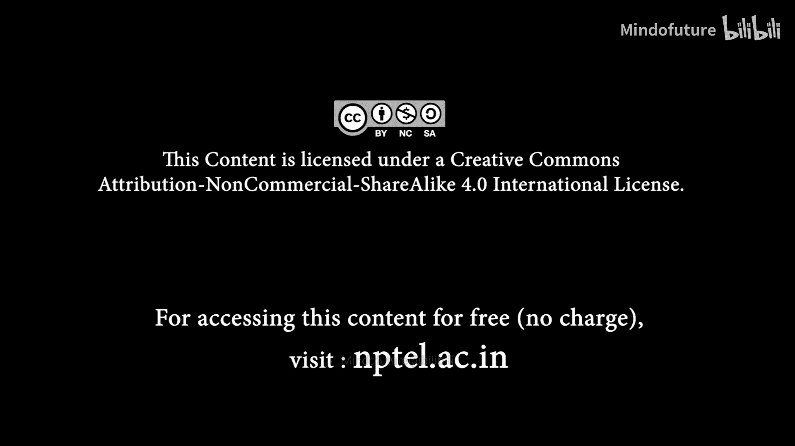
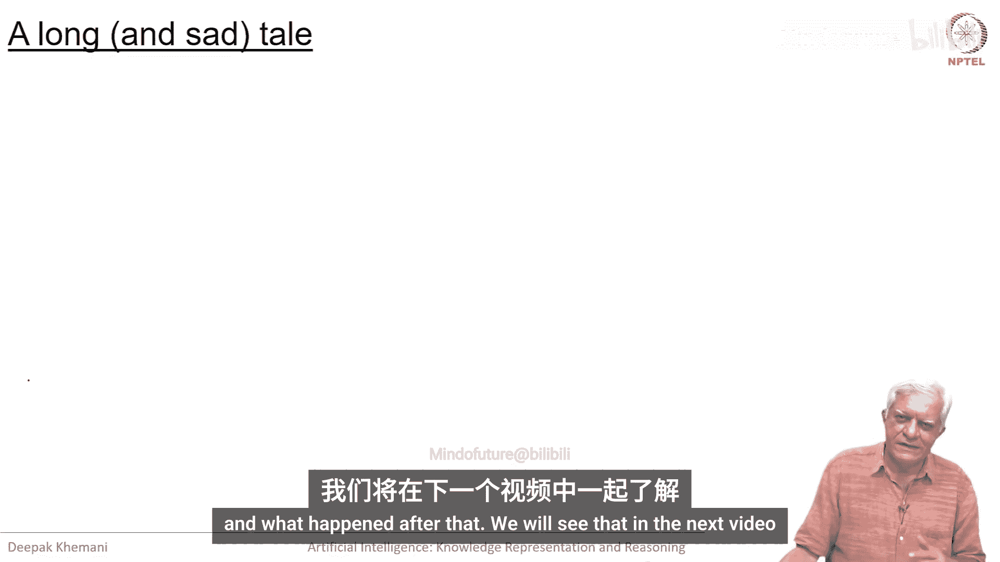

# 【印度理工学院】知识表示与推理 ｜ Knowledge Representation And Reasoning p90 P90_解释驱动的理解 -BV1c4zNBmEyF_p90-

个系。We're been looking at this program called PaM， which understands。English stories。喂。

Using its knowledge about goals and plans and actions。

 we have seen a couple of examples lets look at another example。Yeah。

This is a slightly more complicated story。And this is the input text it is not very long。

 but it is complicated John wanted to win the stock car case stock car race will also wanted to win the stock car race。

So， before the race John cut buildsign virus， so it is complicated because you have to figure out what is happening there essentially。

Okay。Then if you were to ask questions。Why did John break an ignition vi？

Because he was trying to prevent Bill from racing。Okay。So Venssky says。

That this this kind of activity is called anti planning when a character's actions can be understood in terms of preventing the goals of another。

Character， typically an adversary。Yeah。This football was the assignment similar to the movie story that we talked about earlier John wanted to watch the football game but hear a paper due the next day John wanted the football game and he failed in civics。

 why did he fail the course in Civics he failed to hand in an assignment。

The paper you know we have seen all these things about merging differences。

 paper due means an assignment。Okay。は。Yeah。Yeah。Now， what are the kind of inferences？

That Pam can me so Pam uses rules just like Eliot did。

They used to call the rules as requests essentially and it had about 100 rules of different kind so。

 for example， if a character has a goal of possessing an object。

That character probably wants to use the object for its intended purpose， essentially。

It's trying to understand why does this person want this object？So。

 Pam has 32 different plan boxes ranging from3 to undo conditions。For the decontrolled gu。Okay。Yeah。

Yeah。Now， when you look at scripts， you can think of scripts as doing frame finding。

 understanding an input is equivalent to finding a frame or a script。😊。

into which the input can be integrated essentially so it is like the larger story。

 you retrieve it and you see that what you are listen to is part of that larger story。

It's already scripted。Yeah。There may be problems with skip based understanding that there may not be a single frame to fit the input。

 so you may have to assemble together a sequence of。Scenes of scripts。

If even if one were to find a frame to fit an input， the input does not。

Amount to understanding that does not amount to understanding the input it is more like recognition that you are recognizing that okay this is a restaurant scenario this is a train wreck scenario this is a car accident scenario and so on Pam is designed for explanation of the kind why did people do why do people do some and that can be answered by the relation between goals and plans and actions。

The group at Yale called it explanation driven understanding。So。

 Pam is designed to understand stories without reference to any specific frame they could happen anywhere they don't have to happen in a stereotypical situation。

It however maintains a set of predictions to catch input so it has to figure out a way of how to say okay what do I expect to here next if some input fails to meet an expectation that is a prediction then it tries to find an explanation for the new input by using a bottom of approach to try to figure out what is happening。

So， it builds a bottom of inference and checks whether the inferred con is built。Yeah。

And the prediction could be at the long end of a long chain of inferences。So。

 either input matches an expectation or a prediction or something which can be abducted from it or inferred from it does essentially all inferences in the accepted chain are later added to the study。

😊，So， this is a basic algorithm， real input sentence in CD theory。

 so LAA or some such program will do that for you。Go to the predictive component。😊。

And see if you were expecting to hear that whatever that CD theory is talking about is a prediction that explains the input what you expecting it essentially？

😊，If the answer is yes， then incorporate that input into your story representation and any inferences that you have made on the way into the story representation。

 so that' is one thing which happens whenever an input meet a prediction。

We will see how predictions are generated。Then we have understood that yes。

 we expected to hear this and therefore we construct the story and on the way if you had made any inferences they are also added to。

The story。So， you go to the incorporation phase and read the next input essentially。

If the prediction doesn't。Match the input。Then you go up into the bottom of phase。

Can an explanation be inferred from the input？We are seeing something can this。

Whatever we are saying be explained by some rule essentially， if no。

 then of course you cannot do anything further， but if yes。

Then read the inference as if each further。New input and we will see examples of this。So。

If you are looking at an event， the first thing you ask is is the event a part of a known plan？

Then the plan is the explanation。If it's not part of a known plan。Then。Can a plan be inferred？

From that event essentially， if no， then you cant do anything further， you return failure。If yes。

Then you infer one of the possible plans。Can one of these plans be a plan for the known goal so you ask this question next？

If that is the case。Then the plan is an explanation else。

Can a goal be inferred from one of these plans？So， you are looking at。An event or an action。

And if you， if it's not matching an expectation， then you're inferfiling a plan。

And seeing whether that matches an expectation。If that doesn't match， then you infer a goal and see。

If that matches the expectation， and then of course。

 you can go to the subul sub plan relationship as well。So。

 if a goal or goals can be inferred from one of these then can one of these goals be instrumental to a known plan so is there a plan that you are expecting and can this goal be instrumental in that？

Then the gold plan sequence is the explanation。If no。

 then can one of these goals have arisen because of a known theme so themes are these constant things like hunger is a theme where you know you know that people periodically get hungry。

 then if you say that John is hungry then you don't have to think any further to understand why is John hungry。

 sad because people often get hungry。Finally， can a plan be inferred in which one of these goals is instrumental？

If yes， then you。Yes。Go through this cycle again。So theme is a set of constant goals， as we said。Yes。

So， there is a long story， so that will take a bit of time。 so what we will do is we will take a。

Quick break and come back and listen to this or read this story。which is。

About how one person wanted a bicycle， which the other person had。And what happened after that。

 we will see that。In the next video。

