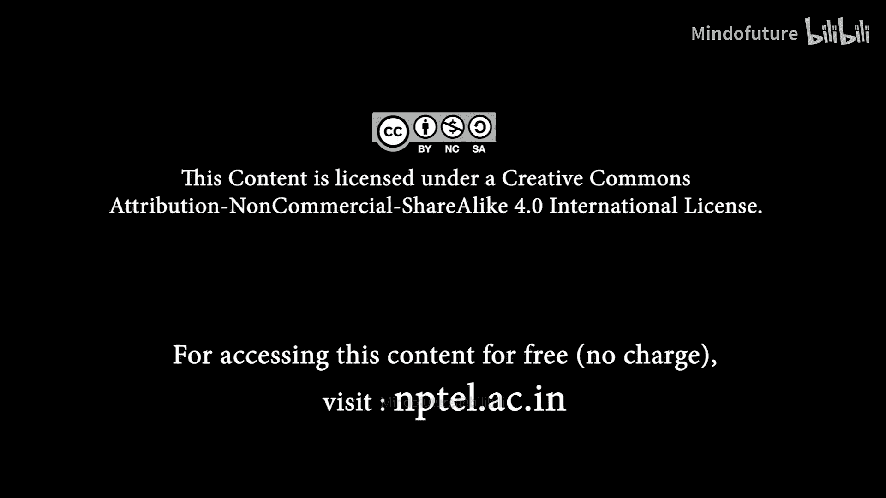
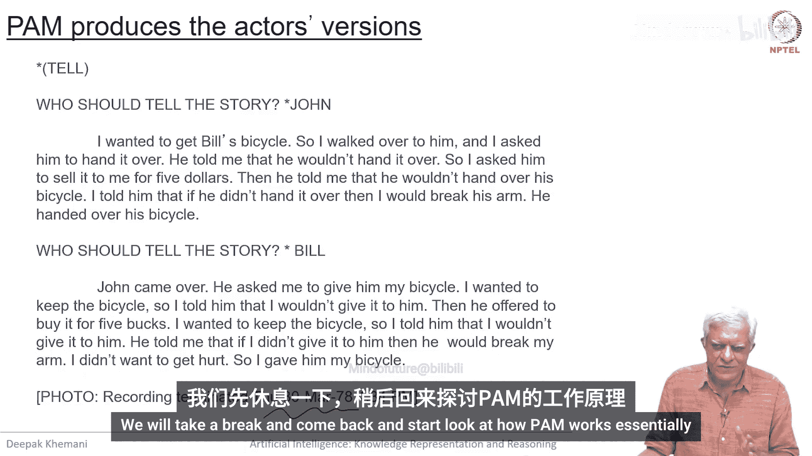

# 【印度理工学院】知识表示与推理 ｜ Knowledge Representation And Reasoning p91 P91_自行车争夺战 -BV1c4zNBmEyF_p91-

我跟说。We are back to understanding about Pam。So if you remember the way Pam works is that it knows that goals have plans and plans have actions。

So。If you hear a sentence in a story， if it is one of these things that you are expecting to hear about then you can say that yes。

 I know that I understand that otherwise if you are looking at an action you infer a plan and say that is this a plan that this character may have？

If that is an expectation or a prediction then you can accept it。

 otherwise you say can this plan be part of a goal that this character have and if that happens and that is met as a prediction then you understand the story so that was the general way of doing things。

😊，So， let's look at this story about。😊，是。Bicycle。John wanted Bill's bicycle。

He walked over to Bill this is a story that we are listening to how do you understand this story using goals and plans？

And asked him if he would give it to him， Bill refused。

Then John told Bill he would give him $5 for it essentially， but Bill would not agree essentially。😊。

John told Bill he would break his arm if he didn't let him have it。And will。

Let John have the bicycle。是。Now， if you are to if you have heard this story。

 then you should be able to ask answer such questions as to， okay， he wanted Bill's bicycle。

But why did he walk over to Bill？Then， if you know。How。

Things happen how goals and plans and actions interact then you would。

Be able to say that he walked over to Bill because he wanted to ask him for his bicycle。So。

 when we say John wanted Bills bicycle， we see that there is a conceptualization。That。

This bicycle which is possessed by Bill。嗯。Is is is。Desired by John essentially。

And that is a goal that John has that the bicycle which is possessed by Bill should be possessed by John and that is a goal that John has。

InThe second sentence is John walked over to Bill and asked him for it。

 so we have already said that ask is a plan box and it can be used。So。

 this is in general what is going to be happening there that there are two themes that either John likes the bicycle or John wants to ride the bicycle is one of the reasons why he may have wanted the bicycle and so we will not question beyond these as to why he wanted the bicycle。

So， the goal was that John wants to possess Bill's bicycle， the outcome was unknown at that point。

 then he used the plan of asking and the action was to John ask Bill。But for him to be able to ask。

 will， he would have to be。Near Bill。To be able to ask him。

 and that is why he walked over to Billy essentially。So。

 the explanation for the action of why he walked over to Bill is found。Is it？

He wanted to ask him for it and ask becomes a prediction。

The full story would be represented like this。😊，John wanted to possess Bill's bicycle。

And the first plan was asking the second plan was bargaining the third plan was threatening。

And the threatening was by saying that John telling Bill that if he doesn not give him the bicycle。

 he will break the arm， this invoked in Bill。The preservation theme， which is to maintain health。

 which led to the plan of complying with this request of please give me your bicycle。

And the complying with that request that plan involved giving the。Bicycle to John。

 so that was the action that we see in the end。So， we will quickly go through this like we did in the case of listening to seeing how Sam is solving stories。

 we will not go over the detail very much essentially。😊，So this is the same story that we just saw。😊。

And。The first input is John wanted bills bicycle。Then it goes through the same process as LA invokes conceptual dependency theory and then we start reason with them。

Conceptualization。 So we have already seen that。This statement is represented by saying that。1 actor。

Has。A goal。Humme zero is John。That in the future that。嗯。He wanted something。

That is not a predicted input。And it begins searching for an explanation。Using bottom up search。

And it。Looks at this rule。Of Dcon Eic。Request remember request is just another name for a rule。

Rule to handle decocontroroll episode。So， what is really happening in the story？Yeah。

The explanation is that there is a decocontrolled goal that one actor has。

So far nothing is confirmed。Why does he want it？Now we saw that there are two themes that could。

Explain that。Use vehicle fondness。And that that explains。

Why he wants it does he want to use it at all is he？Foonund of。 So there are two requests here。

 One is this。Use vehicle request and the other is this fondness request so there are two ways in which you can understand why he wants it。

 either he wants to use a vehicle or he wants or he likes vehicles。

So explanation found in the fondness list thing and so we don not question it any further we stop the bottom of inference process。

And。Yeah。Move forward from there。So we have a story now adding to the story representation loading predictions that some attempt。

To satisfy the decocontrolled goal will be made。And there is a planner。

That is John who would do something。So if you hear something about this goal。

Then that will be the explanation for whatever you are listening to。However。

 the next input is he walked over to Bill， which doesn not seem to be connected with that。And。

That of course we know by now that walking over is represented by this P transaction。

 so Uto to the proximity part of P1 and so on。We do not expect to hear about walking。

 so we try to go into a bottom of mode。Why is he walking towards Bill？Yeah。

Tam will find a series of explanations because he had a plan to be near Bill。

Because he had a goal of being near Bill。Because。That was instrumental；

 it is part of the plan to get the bicycle。Okay。So it' is inferring that there is a goal。

And he' is using a plan box called walk and so were understanding that when you say he walked over。

 then that's a plan that he is using。To get near。This other person who is bill。好。

And asked him if he would give it to him。So that we are now familiar with by now。

 this is an entrance event in which the。The object of E is this。It。

Think that Hue 4 should a trans some physical object to Hue 3。Ining。If that happens。

Then it would lead to this Hume tree going to a value of happiness。Which is。

We in by a certain amount。It would make John very happy。Okay。So this entrance。Is happening。

To the the conscious processor of Hume 4， essentially。Yeah。This is also not a predicted event。

 the predicted event was that he had this goal of。Wanting builds bicycle。Then we figure out。

That this is a plan that he is using， which is ask。2。Satisfy the goal of getting wheels bicycle。

So that's the explanation。There there is a plan box called ask。Which the planner is using。

So that this goal of。嗯。At tracing the bicycle will happen。Pam did expect to hear about a plan。

And this prediction was set up when the goalcon decon was recognized so whenever you see that you have a goal of getting hold of something。

You can create an expectation that there would be a plan which will be a plan to get hold of the thing。

And the plan was the ask plan。So， all that is then added to the story representation so the the story representation is that the plan is to ask this other person bill for list thing。

And then。We expect to hear two things。One is。That there would be a goal compliance or there could be a refusal of the goal。

Yeah。So at this stage， after understanding that John is asking Bill。

Pm will set up these two expectations that either the goal will be met or the goal will be refused。

Yeah。When one of these is met， the other is removed essentially。

So Bill declined or something like that Bill refused is this thing and。

Which is again an entrance event as you can see and the entrance of this thing is that he will。

Not do something which is that he will not give him the bicycle。

And this is from towards this conscious processor of John。So。

 that was not an expected event we expected to hear that either the goal would be succeed or it would be this thing。

Now it is looking for an explanation offered for wise。Bill telling note to John。

And then the explanation is that the Bill had this plan of telling。John， that he will。

Not a the object to him。Yeah。So， that knot is captured in the form here。Whi basically says negative。

 essentially。😊，And then you recognize that saying no is part of the plan of。Declining the request。

Which is the decision that Bill has made。So， informed decision is the。Gold that he has。 and he wants。

John to know that he will not give him the bicycle。嗯。So one of those expectations is met now。

So pan moves to the incorporation mode， it adds all that to the story。

Which we will skip over this a little bit。So in Pam story， all these things are。

Explicit that there was a plan， there was a goal and of course the same thing is repeated here as you will see。

 so everything is very explicit and detailed。😊，Okay。Pm also infers that。

Bill wanted to keep his bicycle that he has his school and his refusal。2。Part。

He was part of a plan to keep it， he doesn' not want to give the bicycle therefore he is saying that I will not give you the bicycles。

So then John tries bargaining， so again he tells build something。So。

 the sentences he told Bill he would give him 5 for that。

 so this is again an entrance event as you can see and it basically involves this a trance。And。

It says that if you a bike to me， I will entrance $5 to you。So that one object is money essentially。

Yes。So， there is this role merge which is happening， which we are not。😊。

Because every time it reads a sentence it creates tokens and then it has to figure out that you know。

 it is the same person that we are talking about。The processing for bargain is similar to that of ask。

And finally， he drawn resorts to a threat， so we have already seen how to represent a threat when we were looking at conceptual dependency theory。

Basically， you entrance something。Whi says。That if you do something， then it will lead to something。

If human does something， so remember these are actions。

Then Hume0 will do something which will lead to。Okay。Humans are being broken， for example。

So that'll become minus y or something。Okay。Yeah。Yeah。So。

 this is a talk event and eventually Pam has to figure out that this talk event is part of the plan of threatening him and then it will understand that why is he saying what he is saying eventually so he figures out that there is a plan box called threaten which is what John is using。

And the rest of the thing is repeated below。嗯。The found an explanation that there is going to be a threaten。

 so it goes into the incorporation mode。And adds all this to the story representation that there is a plan of seting bill。

嗯。Okay， so we'll skip some of that。John has made a fit。And Pam will look for again。Either compliance。

Awesome。Evasive action， essentially that Bill will either comply with the set or will。

Try to run away or whatever he is the action that' is available to him。嗯。Yes。And it is kind of。

Put in a marker saying that let me know the result of this。

Happening essentially so it so happens that in this case bill complies。So Bill gave him the bicycle。

Which is basically a tracing the bicycle to John。Yeah。And it confirms a prediction。So。

 the outcome is。That the goal。Of thecon of getting hold of the bicycle of the planner has succeeded。

But it still cannot understand why Bill give the bicycle。And so。

 it is not a predictor so John's goal has succeeded。

 but Pam has not understood why Bill give the bicycle。So， it goes to a bottom of mode。

 even though the prediction has been made。Yeah。So to cut a long story short。Bill。

They will have a plan of giving the bicycle to John。

Then he must have had the goal of giving the bicycle to John。And。嗯。Yeah。Yeah。

There was this threat comply request。That this plan is basically to comply with the threat essentially。

Okay。So the goal of John has succeeded。And you have inferred。A goal of maintaining health that。

Bill has essentially。So it would not have been possible for him to maintain his health if he had insisted on keeping。

His bicycle。At which point Pam has finished。Reading the story。And then as before。

 you can ask questions of Pam， why did John walk over to Bill？Because he wanted to get his bicycle。

Why did Bill give his bicycle to John？Because he didn't want to get hurt。

These are actual output generated by Pam。What were the consequences of Johns walking over to Bill this enabled him to ask him to give him Bill's bicycle；

 what were the consequences of John asking Bill to give him the bicycle Bill told him that he wouldn give it to him essentially。

Now we know that walking over to Bill is a sub plan which is part of a sub goal of being near Bill。

 but the long term goal is that because he wanted to the bicycle and Pam is actually giving you that answer why did John walk over to Bill？

Because he wanted the bicycle and he wanted to ask him for the bicycle and therefore he walked over to Bill to ask him for the bicycle。

Yeah。Then we can ask the two actors to。Produce the version of the story。So this is John's version。

 I wanted to get Bill's bicycle so I walked over him and then I asked him to hand it over he told me that he won't hand it over so I asked him to sell it to me for $5 then he told me that he wouldn't hand over his bicycle I told him that if he didn't hand over then I would break his arm and he hand it over his bicycle so that's John's version of the story。

And we can also listen to Bill's version of the story， this is all generated by Pam。John came over。

 he asked me to give。hiim my bicycle， I wanted to keep the bicycle so I told him that I won't give it to him。

 then he offered me offered to buy it for five bucks。

 I wanted to keep the bicycle so I told him that I won't give it to him；

 he told me that I if I didn't give him give it to him then he would break my arm。

 I didn't want to get hurt so I gave him my bicycle。So you can see that this run。

 which is reported in the book that I spoke about in the beginning。Was done in 1978。

This is two years after the run that I presented to you about SA， which was done in 1976。

 so all this work was happening in the late 70s in Yale。So having listened to this long and sad tale。

From Will's perspective。We'll take a break and come back and start look at how Pam works essentially。

🎼。