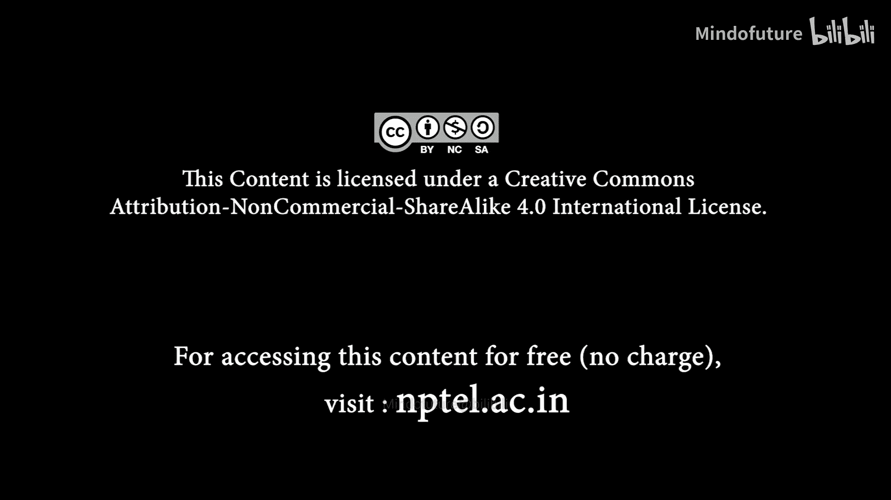
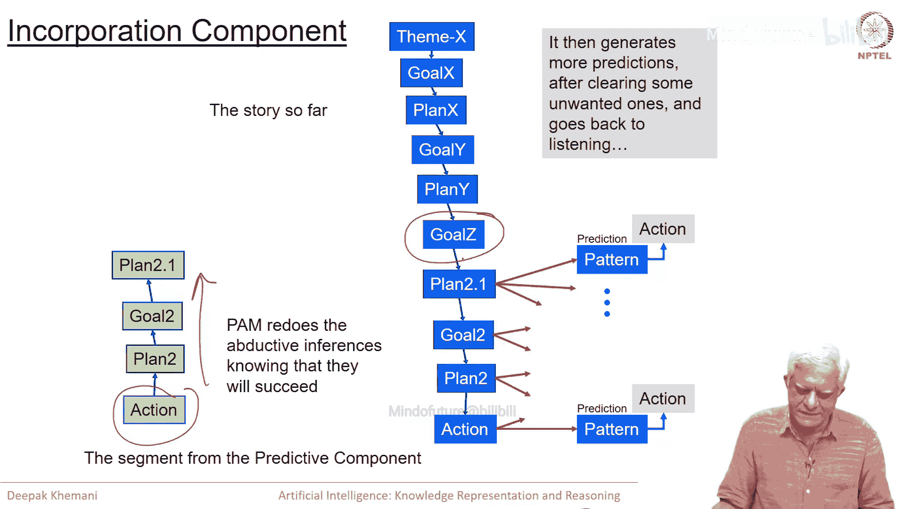

# 【印度理工学院】知识表示与推理 ｜ Knowledge Representation And Reasoning p92 P92_计划应用器机制PAM -BV1c4zNBmEyF_p92-

数为今日。We have been looking at this program called pan Pam， which stands for plan Apper Me。

And we have seen that it works in three phases， the predictive phase。

 the bottom of phase and the incorporation phase and what it has it has a knowledge base in which for every goal of every type of goal it has a set of plans that can be used to achieve that goal and those plans may have sub sub goalss and those sub goals may have subplan and eventually it will go down to the level of actions essentially so it has this knowledge in its knowledge base and basically when it。

Read the story。It is trying to figure out as to where does that sentence fit it into this whole goal plan hierarchy that it has and then tries to understand the story by。

Okay。If。By inferring as to which plan was active and which。Sub gold was active and so on。 So。

 for example， here what we have seen in blue is the。Plan2 with sub goal too。So。

 the predictive component。He is the first to try and explain the new input essentially。

It has access to a number of previous predictions made by Pam。

 so some of them come from themes like Hunger Drive。哦。

Maintaining health and that kind of stuff a prediction is a condition part of a rule that Pam guessed would be important it is doing abduction here。

It doesn not have to be necessarily true， but it could possibly be true the predictive component serially matches the input with precondition of each active rule essentially。

If a prediction is confirmed， then the rule is passed on to the incorporation component along with the match rules and any rules that were tied up in the bottom of phase。

It also keeps track of goals which are being fulfilled。And if no prediction is met。

 then it passes control to the bottom of component。

 which tries to infer something which will match the prediction。Yeah。

The bottom of component generates plausible explanations of inputs essentially。

So the bottom of company uses。Pm's knowledge of intentions。

And the rules are indexed in a discrimination net。Of the kind that we saw in the rating network。

It makes inferences in a test mode because the rule that matched may still lead to a blind all of some kind。

It does not make changes to the story representation instead， as it makes an inference。

 it passes it back to the predictive component， which tries to see whether a prediction was matched。

If it cannot find a rule then Pam。Has no way of understanding the story。嗯。

The third phase is the incorporation。F。So when a prediction is confirmed by an input which could either be the input received from in the story or it could be an inference made by the bottom of component。

Then the。Incor component integrates the input and the inferences into the story representation it takes as input the sequence of rules that led to the match predictions。

 it uses the rules again。And adds the inferences to the story as well。

After that it removes predictions that are no longer needed。

 including the one that was met and generates new predictions of what it expects to hear next essentially。

 and it passes the control back to the predictive component。So， you can see that what's happening。

 you start with a predictive component。And。Yeah。When you see something which is predicted。

 you give it to the incorporation mode。Otherwise。😊。

You call the bottom of mode and the bottom of mode will generate a new。Yeah。嗯。Inference。

And you see whether that influence was expected。In the prediction mode， if not。

 then you go back to the bottom of mode so you can go for this bottom of top down。

Prodtective mode cycle till you reach something which is predicted。

 then you give it to the incorporation mode。So let us say that at some stage of story reading Pam reads about an action。

嗯。So Pam has something called focus， so this rectangular box that you see called the input gap。

Gap is like a slot the Venssky's program talks of it as a gap essentially。

And anything that is being read is fed into this gap。

 so Pam is always looking at this gap to see what is the next input essentially。

So let us say that it reads an action， essentially reads about an action essentially。😊，What。

The predictive mode will do is to。Look at each of the predictions that are there on the top。

 there are three predictions。To see if。The input gap， whatever it contains。

 whether it matches the pattern or not， so it tries them one by one。If it doesn't match。

 then it will go to the bottom of mode essentially。So。

 note that the predictions are the antecedents of the rule that we are talking about so pattern action rules we have。

嗯。And。Yeah。Its going it is expecting to see those patterns easily。So。

 Pam was not expecting to hear about an action， so it needs to explore possible plans this action could have been part of。

So， it goes into the bottom of mode and looks at some take take and tries to see what possible plans this。

Action could have been part of， let us say there are three plans here。

And it will try them one by one to see whether plan one succeeds or plan2 is what we are looking for and so on。

 so now what it does is that it places that plan that it has picked up into that input gap and hands control over to the predictive component。

Which will， basically。Match them one by one as it did with the action that it burst so essentially。

So， in the predictive component again you look at all the patterns that are there in your prediction and again if it doesnt match then you give it back to the bottom of component which basically means that。

Pm will now to see that this plan one， is it part of some goal that was expected that we were expecting to hear about。

That's what happens in the next stage。In the bottom of mode。Yeah。

Let there be only one goal for this land one。What Pam will do is now place this goal into the input gap input gap is its focus that is always looking at it's got a set of predictions and it is looking at the input gap to see whether I am something comes in there which matches my predictions essentially so this goal one is placed in the gap and it goes through the predictive component and again it does the same process of trying the three patterns one by one so in this example let us say that。

It does not succeed again。So， again， it goes back to the bottom of mode and it will now try to infer a plan that this goal could be a subgo of essentially because it is searching along this path of action plan 1 goal 1。

Yeah。Yeah。Yeah。그。So， let goal1 have no further inferences that you can make which means it is a dead end so it will have to abandon that plan one and now it will try plan 2 which is another plan that this action that we as we started listening about so we are just heard about one action and we are trying to understand why the action is there so it will now go to plan2 and again go back to the predictive mode and in the predictive mode again we will try these things one by one。

Let see patterns that are representative of our predictions。And again。

 it says that no it doesn not succeed， so it goes back to this component and now it will try to look for a goal for plan2。

 whether this plan2 could have been part of some goal，That we were expecting to hear about。

So let's say this is goal 2。So again goal2 is played in the place in that gap and sent to the predictive component and in the predictive component again it will try the predictions one by one。

And again， let us say that it says no， so it goes back to the bottom of component and it will try to see whether this goal2 is part of some plan essentially。

Is this a goal in some plan？So in this case， there happen to be。

Two plans and one theme that this goal2 could have been part of so it takes the first one which is plan 2。

1。And adds it to the。Input gap。So， plan 2。1 has gone into the input gap and again it is gone into the predictive mode again it will try them one by one and in this example again no now it succeeds so now it is succeeded so it is found something that it was expecting so this plan 2。

1。Has a prediction waiting for it in particular this prediction and now it goes to the incorpoulation mode so its got those four chain of four things。

😊，This was a story that was built so far from the sentences that we saw earlier。

Now it has hurt this action and made these inferences。

And arrived at plan 21 and plan 21 was being expected it was。Plan for this goal Z。

 it incorporates the whole thing into the story。So this whole long chain of things is a story。

And it will now generate new predictions。Which it expects to see next essentially。

So these predictions are on the right hand side of the screen。So， there are two we have seen。

 but there could have been more so each of these things that we have understood。

Could predict something。I。So， we will take a break and look at one more example before。

We will soon wind up with Pam as well。

