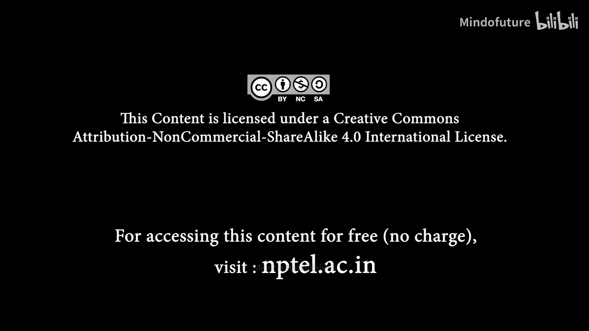
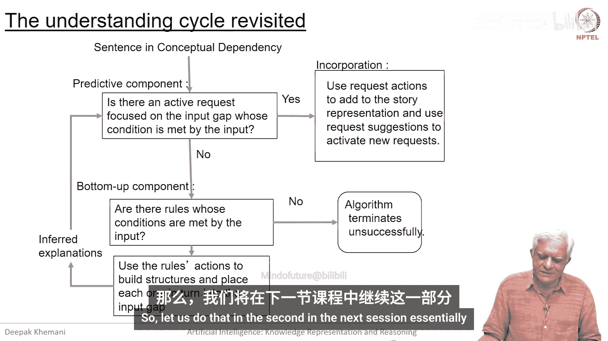

# 【印度理工学院】知识表示与推理 ｜ Knowledge Representation And Reasoning p93 P93_请求与规则实例 -BV1c4zNBmEyF_p93-

So welcome back。Given looking at how Pam works， it goes through this cycle of predictive top down understanding and bottom of inferencing till it reaches something which is predicted then it puts it into incorpoulation mode so what you saw in the last。

Example。Was there was part of the story had already been constructed。Then， this action。对。

Came up as the next sentence in the story。And to understand that action。

 Pam had to infer that this action could be part of plan 2 and this plan2 could be part of goal 2 and goal 2 could be part of plan 2。

1。And it finds that this plan 2。1 was expected because there was a gold Z。For which plan to。

1 is a plan。So now you know why this action that we。

Read about what is it doing in the story so the whole thing is now the story is extended to up to that action。

And。嗯。More rules are added to。Through the prediction set to what else do you expect to hear now essentially？

So let us look at another example。This says that John was hungry。So actor Hume  Ze stands for John。

And his hunger value is minus 3。And。Pm does not explain states。

 so it goes into a bottom up state component。It places that into the this thing but that did not work so now it goes into a bottom of mode and finds that there is something called a hunger rule。

That a hunger rule may happen because people often have goals to satisfy hunger and those goals will have planners and the planners would have plans and so on so planners source theme the theme is hunger drive。

There are two gaps in this goal， one is who is a planner and second is who what is a plan so that is what Pam expects to hear about next。

So， it has inferred this goal， so it adds this goal to the input gap if you remember how Pam works。

And it meets a general expectation that because there is a theme that people are often hungry。

 so it is not surprising that John is hungry so we add that to the story and it。

Re executes the rule that it used during the bottom of phase。And that is added to the story。Now。

These suggestions are also like rules。And it activates them as requests。

 so we we already said that they are they are。Sttoed as request essentially。

So essentially there were two gaps， one is the planner gap。

 one is the plan gap and it has said that fill the plan gap of the goal。

 look in the input gap to see what is the plan and check if the list of plans for satisfying the goal of hunger so if you see a plan and the plan is plan for satisfying hunger then that is what you are looking for and the other thing is look at wherever you are focusing to see whether you can figure out as to who is the actor in this tool essentially so these are suggestions which basically says these are activated as rules and add it to the representation essentially。

We will see the details in a little。Bit。So， this is the incorporation mode where。😊，It has said。Yeah。

That it knows that John is hungry and。That it is understood that that happens because people are often hungry and now it has expectations about plans that can be used for satisfying the hunger。

Because we know that there is a plan for satisfying hunger， there can be more than one plan。

 but if we see one plan for satisfying the hunger。Which is what it says here。Jick。

In the list of plans for satisfying the goal of hunger and if the plan if you are placing such a plan in the input gap。

 then you have understood as to why that has been placed。Because we expect such a plan。

So request or rules in Pam。They have a focus。A focuscus is a place where they expect to see their input。

Yeah。A request is considered only if the focus gets new data。

 the focus can be any place in the representation。Requests have a target。

The destination of when the inferences generated what will be populated requests have activation conditions。

As to when will that rule be applicable？The target and the focus of a request is they are set when it is activated so as soon as you activate a request。

 you know that this is the。Focus and this is a target focus is a place where it is reading this thing but it can be the input focus which is what we have been looking at all this while where the input is placed the English language sentence converted into conceptual dependencies placed in the input focus but focus could be something else also some other place which would be filled by some other part of the program and then this rule would get triggered。

Requests are routinely used for a role merch， for example， you know。

 that the patron and the actor of the plan are the same person and so on。Yeah。So。

 this inpo component creates the story representation that there is a goal of satisfying hunger。😊。

And。It is predicting that there would be a plan for satisfying hunger so that is a prediction so remember this is a notion of how we create predictions。

Yes。And。The first gap which is that of a planner is filled by the second request immediately because we already know that John is the one who is hungry。

 so he is likely to be the planner for this action。Now。

 we are looking for a plan for satisfying hunger。And that is placed in the input gap essentially that。

Or we are looking for it in the input gap。What we see is the next sentence of the story which is。

He ate at a restaurant essentially， this is an action， it's not a plan。

It was not expecting an action， so this action is essentially saying that。😊。

The actor has invoked the restaurant script essentially basically he ate in the restaurant。Yeah。

It is not expecting an action， so it goes into a bottom of mode。Places this action。

Looks for a rule which will match this action it says that。Yeah。This action。

Of eating in a restaurant， whichever that org zero is the name of the restaurant。Is part of a plan。嗯。

For satisfying hunger。So there there is a plan box or there is a plan called go to a restaurant if you are hungry。

 then one plan you can use is go to a restaurant。Essentially。

And eating in the restaurant is an action which is part of that plan。

 and then it places this plan into the。Input gap and it will find that yes。

 I was looking for a plan for hunger so。Your prediction that there would be some plan to satisfy hunger what is the plan the plan is to go to a restaurant and eat and thats what the sentence said that he went to a restaurant and eat。

So。对。That is now。😊，Add it to the story along with the suggestions。

As to who is the planner fill up the planner？As the customer of the script。Yeah。

Fill up the restaurant。As is the restaurant in the script。Using some focus request。

If there are any sub episodes。Then wherever you can read about them， you look for them。Yes。So。

 it needs to fill up this planar things， it needs to fill up what is a restaurant and any actions and some episodes that it might find。

The action is that he ate in the restaurant。Okay。So， that is added to the story。

 we had this goal of satisfying hunger to which for which we found a plan which is the plan box of dual restaurant plan。

And we know that the planner was Hume zero， the restaurant was org0 and the action was that he went to a restaurant and all these requests are activated as soon as they are created so all this gaps are filled in we know that John is the planner restaurant is whatever org zero is and the action is that he ate this。

What is left is this sub episode part。Pam would attempt to connect any subsequent sentences to this gap that if he hear about something else like he did not like the hamburger or whatever the story that we saw in the script。

 it would try to connect that。Which the sub episode is essentially so basically the idea of story understanding is to。

Connect。Different sentences of a story together so that you know what is a。How is the story coherent。

 what is the connection between those things？Okay。Okay， so。

With this second small example we we will take another break， we will come back and。😊。

Wind up our study of Pam。With some loose ends that are still hanging around。

 especially about no requests and so on， essentially。

So let's do that in the second in the next session essentially。

🎼。