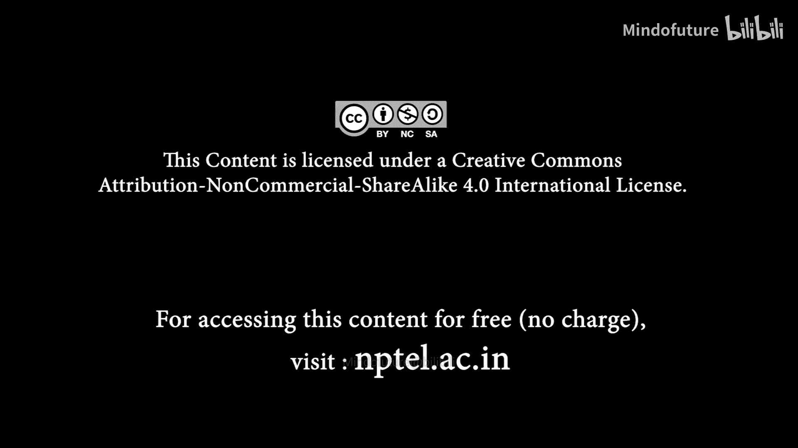
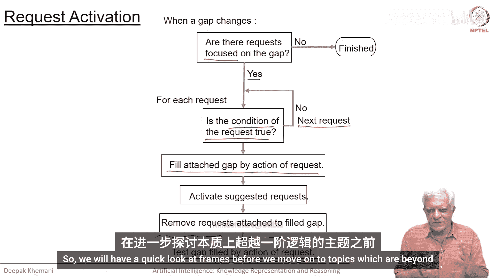

# 【印度理工学院】知识表示与推理 ｜ Knowledge Representation And Reasoning p94 P94_管理规则实例 -BV1c4zNBmEyF_p94-

系咪出埋。So I hope by now we have a fairly good idea of how Pam processes stories。

It generates a set of predictions。And it' looking to see whether what we are。

Hearing is what we are expecting to hear。If that's not the case。Then with what we are hearing。

 it goes into a bottom of mode makes an inference to see。

Whether that is what we were expecting to hear and so on。

 so bottom up it goes from plans to goals and from goals to sub plans and so on。

 so basically between plans and goals it goes of course if it sees an action。

Then that action has to be part of a plan。So this is what's happening here。

We input a sentence in conceptual dependency and go to the predictive mode。

 is there an active request？Focused on the input gap。That is a place where it is always looking。

Whose condition is met by the input essentially if that is the case。

 then it goes into an incorpo mode。😊，And it use the request actions to add the story representation and use request suggestions to activate new requests。

So， if you have met some if your expectation has been met。

 then generate more expectations about what else you expect to see。😊。

If the predictive component doesn not work， which means it says no。

 then you go into the bottom of component are there rules whose conditions are met by the input essentially。

So， if you have seen an input and can you now make an inference using that input。

 so use the rules actions to build structures and place each one in turn into the input gap。

And go back and to the predictor mode and keep going through this cycle。Till。A prediction is met。

If it cannot do this bottom up thing it may fail to understand the story and that is when the algorithm terminates unsuccessfully。

Yeah。So， we have said already that requests are normally activated。

Only when their focus gets new data。Then they fill up the。

Target essentially so Pam can set up a request chains with focus of one as a target of another so these boxes here this is the focus。

Of this particular request and this is a target。😊，出。Okay。So， when it places this request。

 it also says that when I get something into this focus。Then I will make an inference。

And add that influence to what I am calling is a target and the target could well be the focus of another request。

We should then get activated and then fill up the next target and so on essentially this process could continue。

😊，And Pam basically has this mechanism of setting up these requests。

 activating requests as in when things happen。Okay。So。

 goals and plans have outcome field that we have not spoken about。So。

 both of them have this field and then active request。😊，Relayase the outcome。

This is not an explanatory request， it does not terminate the search for an explanation；

 it simply says that if the plan has succeeded。Then the goal has succeeded if the plan has failed then the goal has failed essentially but whatever is the outcome of the plan is also the outcome of the goal that the plan was planned for essentially。

😊，We had seen that when John was asking Bill for。His bicycle。Pm would generate these。

Two separate requests， one would say if。There is success then I need to convey that to the rest of the program if there is failure also I need to do that if there is failure I will have to generate a new expectation that this plan did not work。

 then we should look for the next plan and so on。But if it is success。

 then you can add this thing saying that the goal has been fulfilled。😊。

A request that has outlawed label its useful should be removed essentially because there they are sitting waiting for information。

😊，Lest it fire by chance later。And if you remove it。

 then you will be saved all that processing program does not need to keep looking at the focus because you know。

Eventually the program has to keep checking whether every focus。😊，Of every request。

Is getting some input or not。So， requests are attached to their focus gap that we have already mentioned and when the gap is filled。

😊，Any request that has fired is removed from there。If a request fills a gap。

 then all requests targeting at that gap are also removed because now we have arrived at some conclusion if a request fills a gap。

That will not be filled again later。Then all requests focus on the gap are also removed after testing。

 so this is simply a matter of。Maintaining consistency and efficiency at the same time。So。

 this focus this target setting up request chains and removing requests。

 these are all devices used to make the program more。Effic。

And maintain relevant rules only which are active at any given point of time。Yeah。

So let's just end with how request activation happens。When a gap changes。So。

 remember that these gaps are places where。Information can come in and requests can be triggered and so on。

So when a gap changes。Are there requests focused on this gap？That means。Now you will have to。

Tgger those rules essentially。是。If the answer is yes， if the answer is no。

 then you don't do anything that。And we are talking about what happens after a gap changes which means new information has come into the gap and a gap is essentially a slot in the representation。

 an empty slot。😊，So， if you have got some new information and there are no requests or rules focused waiting for information there。

 then you dont have to do anything and you are finished with that part of processing。😊。

If there are requests which are focused on the gap。😊。

Then you want to have to check whether the condition of the request is true or not。Yes。And if no。

 then you go to the next request， so you look at each request and check whether the condition is met or not。

Then for each request。For which the condition is met。Fill the attached gap by action of request。

 so this request will fill up some other gaps somewhere。

And activate the suggested request from there so we saw。That when we added a plan to that。

 we said look for the planner， look for the name of the restaurant， look for the customer。

 customer and planner is the same。Look for the action and look for sub episodes。

 so all those requests are activated。Yes。Then after having done that。

 you remove any requests that are attached to the gap that was just filled so we started by saying that when a gap changes。

Then we activated some requests from there。And after that。😊。

If there were any requests that were attached to that gap。

 because the gap is not going to change again。Then you remove those requests。

And move on to the next gap that is filled by。The action of the request that was trigger decision。So。

 you can imagine that。😊，Program Pam is creating this large representation。which is。

Has got slots and fillers and things like that， and it's got。Many empty slots throughout。

And it has got requests， which are kind of。Focused on that slot。

 which means that when information comes in。Then it will trigger and go and fill up some of this gap and so on and this whole mechanism of managing request is essentially to see that。

All this data flow activity that when you read an input sentence。

 you create some changes in the internal representation。😊。

And there is some flow of information within that representation。😊。

And this flow is like this request which are like pipes connecting and one gap or one slot to another slot essentially and when something comes in here then something will go into the other slot as well and it is a very。

😊，Interesting mechanism of setting up something like a data flow system which will get triggered as and when you keep understanding。

Or reading new sentences in the story he。So with that。We will end our study of Pam。

 the idea of looking at conceptual dependency and SA and Pam。Was to see。First of all， how？

Knowledge representation can focus on the conceptual aspect of。

Knowledge rather than the linguistic aspect。And how to represent background knowledge or pragmatics in a manner in which we can use it profitably to make sense of any English language sentences that we are hearing now。

The work done net Yale was done in the context of understanding natural language or understanding stories。

But you can imagine that if you have this knowledge stored。Then you can also generate plans。

If you have goals to solve or you can even generate stories and that is what this program called Taspin which written by James Meh did then it used all this goal plan interaction knowledge and it would create some characters and say okay。

 this character has this goal this character has this goal and so on。And then， somewhat randomly。

Decide as to which plan each character is adopting and try to construct a story from there。

Essentially， the point that we have been making throughout this course is that knowledge is the key。

😊，To intelligent behavior。And you have to have knowledge about the domain that you are operating in essentially。

The question is， how do you represent that knowledge and how do you use it？Yeah。

So we will stop here with the Ya School of Work， we will have a quick look at frames because we have mentioned frames and scripts almost in the same way。

 they are similar in nature frames are more semantic in nature， scripts are more episodic in nature。

😊，But if you。Ignore the differences between the fact that you know we are talking about categories。

And。Actions because episodes means sequence of actions。

If you just think of them as elements in your representation scheme。

 then there is some similarity between both of them。So。

 we will have a quick look at frames before we move on to。Topics which are。

Beyond first order logic essentially。

