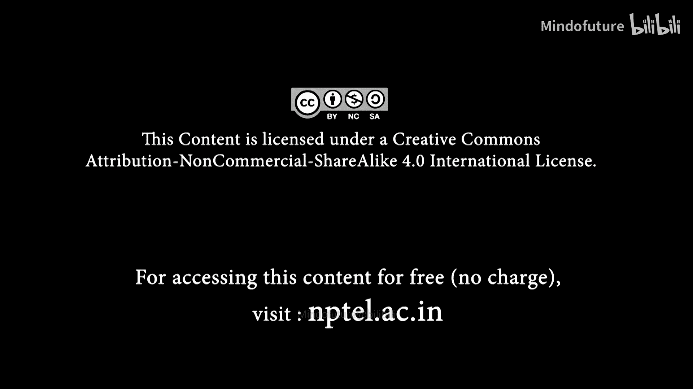
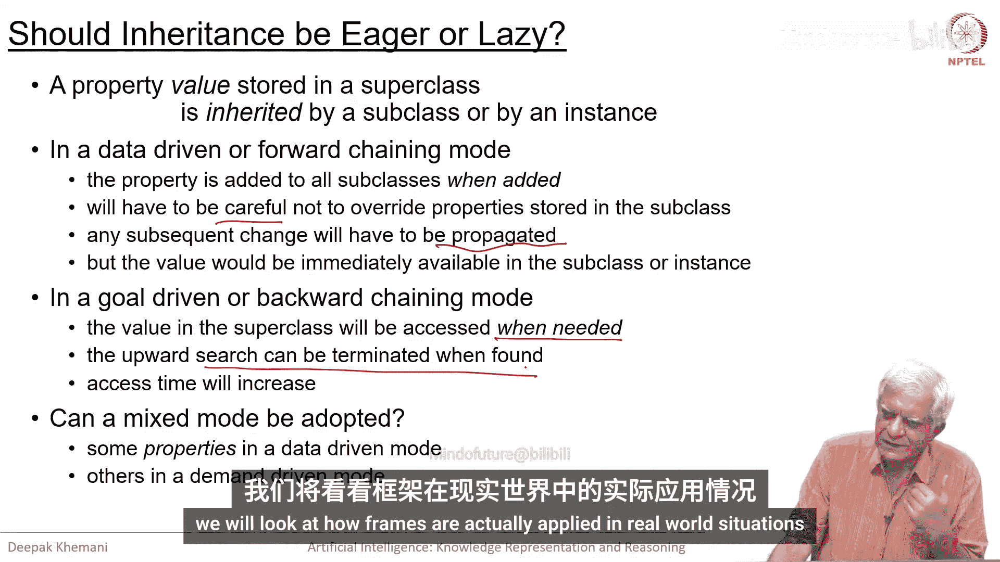

# 【印度理工学院】知识表示与推理 ｜ Knowledge Representation And Reasoning p96 P96_继承 -BV1c4zNBmEyF_p96-

So welcome back。We have started looking at hierarchies。

We are looking at frame systems and we want to see how frame systems。

Have been builtilt into the this notion of an abstract hierarchy and the notion of an aggregation hierarchy。

 we are focusing on abstractction hierarchies， and we。Are comparing frames， which are handcrafted。

Systems。2。Taxonomies with emerge out of description logics， so in description logics you describe。

Different concepts。And the descriptions enforce a certain。Class， subclass relationship。We saw those。

We saw that in the when you are looking at description logic that we can have a tablu method to decide whether。

A class。Is subsumed by another class。And I had said at that time。That if that is possible。

 then I can。Create a diagram。Let's say C1 is a surplus of D。D is a surplus of even。And so on。

 essentially。So， we can create a。Or taxonomy。One thing about representing taxonomy， sir。

Which are derived from description logics。Is that。This subtion relation is a transitive relation that if C is subsumed by D and D is subsumed by E。

Then C is also subsumed by E， but for compactness compactness purposes we do not draw the other links。

 just like when we draw has diagrams。So， let's look at how these。

Taxonomies are induced in description logics。So， given to concept c and D。

 there is a decable procedure we have seen the taboo method to check whether C is subsumed by D。

We can use this procedure。To arrange all concepts into a taxonomy。

 a taxonomy is basically a partial order。In which a surclassus superclass relationship holds。

Since the axonomy is induced by logic， inheritance is strict。And we will see。That。

 this is different from。And created taxonomies。In which。You can。

Override whatever you are inheriting from。Your superclass is a subclass cannot overwride。

In such a taxonomy， in the description logic based taxonomy。

Because the relationship is based on logic。Ohs。Class would be named as a subclass of another class only。

It is strictly and。Subclassus of that， essentially。So。

 we look at this algorithm called classify which inserts a new concept into a taxonomy so sosing you already have a taxonomy and we define a new concept where should it sit in the taxonomy and this is done by an algorithm called classify。

This procedure can be used to construct the taxonomy itself you start with the empty。Taxonomy。

 which contains only lets say the top concept and the bottom concept。

The top concept is the full set as you remember the bottom concept is the empty set and then as new things come in you keep inserting them by the procedure that we are about to look at。

And the taxonomy itself can be created by this process， but we look at。

A situation where we have already partially created taxonomy or we already have a taxonomy and we want to add a new concept to that。

So this is a situation。You have a taxonomy so notice that we have not drawn transitive links here essentially and that is a convention that we are following especially in these taxonomies because inheritance is strict so it does not need we don't need those extra links so we dont need a link which goes from here to here so all those things will not be allowed with。

So what you see is a taxonomy。And what you see is， is。Links。And now。

Let's say we are talking only of concepts for the moment we are only talking about the t box because the taxonomy is defined over the t box of course individuals if there are there then we could add add it to the most specific concept that belong so if there is an individual a which belongs to this concept we could add it there another individual could be added here and so on。

 but that comes later the taxonomy itself is，Created out of。

The concept definitions a little bit like how the datanet was created only by looking at the rules in the system。

It's not talking about individuals themselves。It's at a conceptual level。So。

 the problem that we have is that。If you are given this。This taxonomy。And we have a new concept C。

And we want to place it in its correct position。This is not。And we are given this。

Procedure to check for substion。So， we start at the top concept， we start from the top。

We just think here。So obviously， C will be subsumed by thing because everything is subsumed by thing。

 So we put thing。Into this set that we are constructing the set of all subsumers。offff sea。

Then we start going down and for every element we ask the question that this does this concept subsume C does this concept subsume C。

 does this concept subsume C and for whatever the answer is yes。

 we add to this set of subsumers so we in this way we construct the set of subsumers of C all those concepts。

Which subsum the concept C according to the definition。

 remember that C and all the other concepts are defined in de logic so。They have a structure。

Which will decide this subsumption relationship and we have seen this procedure。

For checking for this subtion。So in the first phase。We create this set of subsummerers。Of sea。

 actually。Then。We look at the most specific。Subsumers of C。

 which is shown in this rectangle and this set is called s。

What are the most specific subs subsumers which？Do not subsum any other。Subsumer， essentially。 So。

 for example， this one subsumes。Both this and both this， so this will not be added to the set。

 but these will be added to the set so these are the most specific from the set of subsumers the most specific we take and we call this set as s。

Then in the next phase we start with this S and again we traverse downstairs downwards from those set and keep checking at the conception remember we have this taxonomy in which all these edges are stored there。

嗯。We traverse downward and use the procedure again to check whether anything is subsumed by C。

And in that way， we identify all subsumes of c， all those concepts which are subsumed by c。

 which is shown here。This is done by the procedure， essentially。So so far C doesn't have any links。

 it has not been added to the taxonomy， it is not added to the graph。That we are。

Using to represent the taxonomy。 But we know that。This is the fit。From this。

 we find the most general subsumes sub。So subsum is。Which are not subsumed by anything else。So。

 the most general one we call this as the set G essentially。

 so we have the set of most specific subsumers and the most general subsumes in these two sets。

Shown in these two rectangles。And then。We simply established links from。

All the subsumers to C and from C to all the subsumers， but we do that only。

If the two sets are disjoint。Because if they are not disjoined。

 then they have at least one common element。And that common element subsumes c as well as is subsumed by c。

 so it must be the same as C with another name essentially then we don't have to add it to another name we can just add another label to that node essentially。

So， this is the process。By which we can construct taxonomies in description logics， and they are。

Well defined and inheritance is strict。Now let us talk about frame taxonomies frames are handcrafted。

So， basically the difference is that the inheritance is not strict。

 a direct benefit of organizing pres in an abstractstruction hierarchy is inheritance。

A property and its value in a superclass is inherited by all its subclasses。For example。

 the property number of wheels4。Can be stored in a generic frame which is called 4 wheelheeler。

And then that property would be inherited by all the subclasses or different kinds of cars that you can think of or or vehicles which have full wheels。

The main advantage we get is that we have a compactness of representation that we represent this fact。

That all these elements are classes of elements。Have objects which have four wheels。

 we just write it in one place and inherit it everywhere else。

They can serve as default values for the subplus。So。

 once we talk when we say that okay we are talking about a hatchback which is a kind of a car。

 then we can kind of say by default it has four wheels why because it is a subplus of some four wheeler class。

Which has four wheels。So， when we add subclasses to frame taxonomy。

 we only need to add something which is new， which is not already there。In a super class。 So again。

 I said that results in compactness。So if you are talking if you are creating a class called orthooppedics Surge and we could do this in description logics as well。

Then when we added a surplus of surgeon we say specialty is also pending。As I have been saying。

Inheritance in frames systems is not strict。 This means that a surplus can override an inherited value。

 So， for example， an heavy truck， which may be listed under。4 wheelers。

whichch is of course a kind of a contradiction， but supposing it is done then we can say that heavy checks have six or more wheels。

There is also an element of compactness here is that。Why not create four wheelers， six wheels。

 eight wheelers， 12 wheelers and so on？Essentially then we would have too many classes in the world。

 essentially。As we will see when we talk about default logic。

After having done with taxonomicies is that you want to create this class of things called birds and you want to be able to say that birds can fly。

But not all birds can fly， there are birds which cannot fly， so， for example， the ostrich cannot fly。

So， should we create a separate class of birds， birds which can fly and birds which which cannot fly。

 but then we would miss out on all a lot of other commonalities between two so it is basically a trade of between compactness。

And correctness， essentially。And。And man made taxonomies can override the correctness factor by saying that。

Subclasses can differ from super classes， so inheritance is not script。

So here's an example of taxonies that you can construct。 So in each of these nodes。

 we have some property which is inherited by its。Descendants。

So vertebrates are creatures which have a spine。Bippeds are vertebrates。

 but also they have number of feet too。Then homociens， that is us。We have a。

We inherit these properties。 We have two feet。 We have a spine， but we can add this property that。

 you know， we are。Active on the social media or we watch television all the time and things like that。

Hmocipiens will also inherit something from the fact that we are a surplus of mammals。

So we have our bones in the middle here， we have ma glands。That we maintain body temperature。

 so all those super classes would give us tell us more about homocipies。

That is inheritance essentially， she stole something at some higher level and inherited at a lower level。

But as I said， that。Sometimes we may want to overwride that so in default reasoning。

which is something again that we will look at from the logical perspective。

 but now we are at it looking at it from the perspective of frames。

That we can construct frame systems。In which we have default conclusions。

 and we can overwride those default conclusions and the example。

Is that a bird is an animal which can fly。A penguin is a bird。But which cannot fly。

And we can also add that penguins are natives of Antarctica。

Then we can say pepe is an instance of penguin。And we should take care of that。

It inherits something which is from the most specific super class。

 So penguin is more specific than bird。 So penguins also will not。Lei。

It is a native of Antarctica is inherited from the fact that penguins are natives of Antarctica what is Antarctica。

It's an incense of a continent。And what is the continent。I don't know， perhaps。We can。

Describe it as an anumated。Plus， you know。North America， South America。Europe， Africa， Australia。

Or there might be a geographic definition of a continent。

 but anyway we are not here to study geography。One question that you might want to ask is should inheritance be e？

Or should it be lazy so this is a question that keeps popping up all the time in reasoning when should you make inferences essentially inherits are kind of an inference。

Should you make it？When you can。Or should you make it when you need to essentially so that is the difference between e and lazy essentially e。

Initance corresponds to forward chain。Okay， so a property value stored in the superclass is inherited by this by the subclassus。

All by an instance。If you work in the data driven mode which is like forward chain。

 then the properties is added to the subclasses as soon as you add to a superclass so it's like you you say suddenly you realize that you have forgotten this property that。

Animals have two eyes， for example， so you added to that animals have two eyes。

 should we propagate it down all the way don all the animals and see that birds have two eyes and humans have two eyes and so on and so forth。

So， that that would be forward changing or data driven mode。

 but you would have to be careful that you don not overwride properties which have been mentioned at a lower level。

And if you make any change， the certainly， for example， if you。Change them。

You are transported to a world with humans everyone all animals have lets say four eyes。

Then you have to you know make the change everywhere， the change will have to be propagated。

 maybe that is not a good example， but you can think of something where you might change something at a superclass and then have it propagated to the low subclasses。

If you are working in a gold driven more on a backward sharing mode。

 then the value of the superclass will be accessed when you need it essentially。And。

Then you will start searching up in the taxonomy and you can see that the search will be terminated at the lowest level when its value is found essentially。

But access time will increase as this is the case with。嗯。Lazy evaluation， which is backward chain。

Maybe we can have a combination of。Two modes of some properties can be。

Implemented in data even more than others can be implemented in them。Demand driven mode。

So let's take a small break and then when you come back。We will look at。

How frames are actually applied？In。Real world situations。

