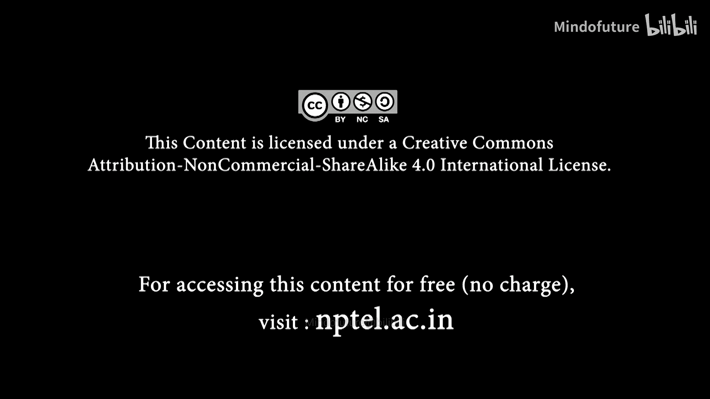
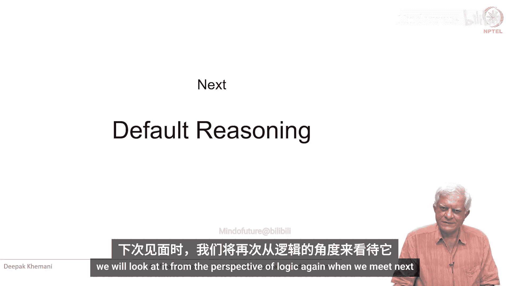

# 【印度理工学院】知识表示与推理 ｜ Knowledge Representation And Reasoning p98 P98_分类中的继承 -BV1c4zNBmEyF_p98-

So welcome back。We have been looking at knowledge structures。You know。

 which have aggregations and abstraction hierarchies built into them。

And one of the interesting things that they give us is this。

Process of inheriting information from super classes to subclasses and so on。

We have looked at fact that you can construct taxonomies in。Description logic。

But because you are giving logical definitions。And the notion of a subclass and superclass is logically defined in the sense that whatever is true about a superclass must also be true about the subclass。

The taxonomies there would be。Strict essentially so one doesnt have to worry about the fact that you can override this thing。

 but in the real world that is not always the case。

 so we often want to construct taxonomies in which overriding is possible。So。

There is a possibility that we have to address that what。

If there is conflict between what you can infer in a taxonomy。How do we handle that essentially？

So we are not taking a logical view here。 We are taking a kind of a treating it as a handcrafted structure and we want to see what we can infer。

From that。So let's look at this。Whole idea。喂。Assuming that you can have multiple ancestors and you can inherit from them。

 but sometimes they may be conflicting in nature then how do you address the problem？So。

 both in handcrafted taxonomies and in taxonomies induced by substion in description logics。

A concept or an individual may inherit features from multiple ancestors。

 so sometimes as we have seen it may not conflict， but sometimes it could conflict also。

So for example， we saw that homos are a subclassus of vis as well as of mammals。

But there may be a conflict between inheritance from different sources essentially then what do we do is a question。

We want to address now essentially。For example， we saw that pepee the penguin is a bird。

 birds can fly， but penguins cannot fly。But we have arranged them in the same taxonomy in the same parts in the taxonomy。

So， let us talk about inheritance hierarchies。As formal graphical representations。So。

 we will confine ourselves to abstraction hierarchies because inheritance is essentially tied up to abstraction hierarchies。

And we define this as graph。Made up of verrtices and edges and it is a directed graph。

where nodes in the hierarchy will stand for individuals or categories or properties。

 so we will not distinguish between categories and properties as we said in the very beginning when we started looking at first order logicic that both of them are represented by urinary predicates so we will also treat them in a similar。

We， as far as reasoning is concerned。So， an edge。X， y。Stands for x is a Y。So， x could be。Class。

 or it could be an individual。 So it's either x is a y or x is an instance of y。

 So these are the two kind of。Abstraction links we saw we can put in。Frame systems。

We will also introduce a negative edge。Which will stand for。

So this negative edge is represented by this here。X is。X， not y or something like that。

It's a negative edge。Which stands for x is not a y， or x is not an instance of y。Why do we do this。

We do this， so that。It makes conflicts explicit， essentially。So if we had， for example。

A statement that X is red and x is blue。 Then we may or may not。Recognize this as a conflict。

Because they are just belonging to different classes and unless we have additional。

Knowledge in the system， it says。That whatever is light is not blue and whatever is blue is not red。

We will not know that there is something inconsistent in the system。

But if we say that x is red and x is not red， then it is very clear and explicit that there is a conflict that we are saying that x is red and we are saying that x is not red。

 so that is a role that negative edges will play is to make conflicts explicit for us essentially wherever they exist。

In practice， one could have additional rules which should identify the inconsistencies。So。

 however to。Networks here， and。Which have conflict in them essentially so if you look at the one on the left hand side。

嗯。It' is talking about this individual called Nixon。And。The leftbl says that Nixon was a Quaker。

And then we know that Quakers are pacifists essentially。

And the right branch says that Nixon was a Republican。

And we know that Republicans are not precipists， so this edge。

Stands for not Republicans are not pacifists。So we have these two parts going from Nixon to pacifist。

 one part says Nixon is a pacifist because Nixon is a Quaker。

 the other part sayson Nixon is not a pacifist because Nixon is a Republican。

 which one should we believe in essentially。So we have on the right hand side another network which is talking about an individual called flight。

So first， we have said that。Clyde is a royal elephant。

Then we have said that loyal elephants are elephants。And then we have said that elephants are gray。

But we have also added an edge from royal elephant to green saying that royal elephants are not gray essentially。

So you can see that both of these networks are ambiguous。That we can。

Have both kind of conclusions that clyde is gray， Clyde is not gray。Nixon is a pacifist。

 or Nixon is not a pacifist。But the two networks are not identical。

If you look at the network on the left hand side， it is generally ambiguous has no way of saying that the left path。

Is correct or the rice path has more weight as a case maybe。But on the。

Network on the right hand side， which is about C。Perhaps we have reasons to believe in one of the two conclusions。

Maybe。You might prefer a shorter path。Which goes like this。

 which is only two hops for Clyde and conclude that。Clyde is not great。Maybe。

We want to make sure that we。Inherit something from the。More specific concept， essentially。

 So Royal elephant is more specific than elephant。 We know that royal elephants are。Gee。

But there is also a path which is going from lower elephant to elephant to gray。

 so there is also ambiguity about lower elephants。But there should be a way of。

Implementing defusible reasoning in the sense。That we should be able to decide。

As to which of the two conclusions are。Preferable， essentially。

Or we should be able to overwrite something which is said for a more specific thing for a more general thing。

 so for example elephants are gray and we should be able to overwride that by saying that but all elephants are not great。

But in the in the graph。There is。scopecope for confusion because we are saying that royal elephants are elephants and elephants are we。

 but at the same time we are saying royal elephants are not we so how do we handle that。

So we talk about parts in a。Taxonomy like this。 So here is a random taxonomy that we have drawn lowercase elements like A and B are individuals uppercase elements are concepts concepts or properties as the case may。

So we have we have various。Links here， so there either is or links or instance of links， essentially。

So， a sequence of positive edges。Is a positive part。And that's denoted by。

A positive path starting at A and ending at B。If there is a sequence of positive wages。

And it supports the conclusion that a is a V essentially。So here， for example。Is the conclusion。

A is a P in this example because there is a positive path going from A to P。

A sequence of positive edges。With a negative edge。Ending with a negative edge。Is a negative path。

 so that is the only kind of negative path we will allow when the last edge is negative。

So in this example on the right。Going from B to s is a negative path， so we can say B is not an s。

But going from B to T to S to p is not a negative part。

Because a negation of a negation doesn't make sense。And we can see this from an example。

That if we say。That slide is a royal elephant which is not a fish。

And fishes are not mammals would be meaningful， would be meaningless because if clyde is not a fish。

And fishes are not mammals。 That doesn't tell us that。Cdedess or mammals。

 because when you say clyde is not a fish， essentially you're saying that Clyde belongs to the complement of。

嗯。Class of fishes， essentially。And that fishes are complement of the class of mammals。

 so that doesn mean that light becomes mammals essentially。So。

 if you think about that a little bit you will see that two negative edges。Like this one。

This doesn't make a sense。 And you cannot assert。You can not inherit to。Values from there。

So to get around all these problems of ambiguity， Lioninstein。G us。A definition of admissibility。

 which we will look at。So what are the conclusion at the end of a valid path so remember there are two kinds of path。

 one is a positive path and one is a negative path。But。Are there conclusions。Aowed or admissible。So。

 we see。That a positive path。Going from a to B supports the conclusion that a is a v or a negative path also going from a to v。

 but with the last edge as negative supports the conclusion that a is not a v。

If every edge in the path is admissible。With respect to a so all this admissibility is with respect to a that what can we say about a。

Now we want to define as to when is an edge admissible。An8。

From x n to v or x n to naught v that is the last edge is admissible with respect to a。

If there is an admissible path going from A to XN。Leading up to the edge。 And it's a positive part。

Only the last search remember can be negative。Each edge in this path going from a to XN should be admissible with respect to a。

No node X on that same path must preemp。The edge。Which is the last stage。

So what I have written here in red is for negative parts。

 what I written in black is for positive parts。So no node X。

On the path must pre the edge going from X n to v。Which means that there must not be an edge of the kind going from X to not v essentially so that is preempting what the。

Positive path is trying to see， essentially。And the third condition is that no edge in the path must be a redundant edge。

With respect to a。So let's look at the definition of what do you mean by redundant edge。你 say。

That an edge x y in a path is redundant with respect to a if there exists a positive path going from x to Z1 to z 2 to Z k up to y。

So there is one direct h from x to y， but there are also another path going from x to y。

Such that every edge in the positive path going from through all these heads。

Is admissible with respect to a。And there is no。See somewhere in the network。

And which goes and impinges upon some zi in the path with a negative edge in this example。

All it impinges upon the last node in the past， which is why that we talked about。

With a negative bit。So if you look at this example。Baof。😔，Clyde so Clyde is a fat royal elephant。

 fat royal elephants are royal elephants， royal elephants are elephants and elephants are Greek。

But royal elephants are not gray。And fat flower elephant is also an elephant。

You can see that this edge。Fair soil elephant to elephant is a redundant edge because there is a positive path。

Which also arrives at the same conclusion。What is the positive path it goes from pet Royal elephant to royal elephant and from royal elephant to elephant。

And therefore， this s is redundant。And we cannot consider it。In our admissible parts。

If there was a node somewhere， see。As shown in this figure here。

Such that there was a negative edge going from C to royal elephant。

 then this would no longer be then we can。Because now we are saying that either Clyde is a royal elephant or Clyde is not a royal elephant。

And therefore， we are allowed to accept the fact。That fat soil elephants are elephants。

There is no ambiguity about that。So， here' is an example。Of an inheritent psyarchche。

 about three individuals and Bob and Sue。And you can see that we can identify。Some redundant edges。

 essentially。 So going by the definition。The edge going from n to p is redundant because there is a positive path n to S to p essentially。

The edge going from n to t is also redundant because there is a positive path n to v to t essentially。

And likewise， the edge going from su to R is redundant because there is a positive path going from su to w to u to R。

Well， let' us talk about admissible edges。So， what you see in green are admissible edges with respect to Su。

And you can see that we can draw two conclusions about Su one is that she is an R。

We can also of course draw a conclusion that su is a W and su is a U and su is R。

And that she is also a cu， essentially。What about the red edges。

 the red edges are with respect to and。And you can see that we can draw a conclusion that n is a P because there is a positive path going from n to S to p。

We can also draw a conclusion that an is not a。Bi。Because there is a negative path which is going all the way like this。

Even though we ignore this。Rundant H， we still have another negative path。

 which takes you from an to v to T2。Not B。 So then it is ambiguous。

We can also conclude that n is not a Q because there is a negative path going from n to Q。

Of course we can still infer that n is a V and and n is also a T or an s。So， here is the。呃。

Admisssible address for Bob。You can see。That。You can conclude that Bob is not a P。

And you can conclude that， Bob。Is not a Q。This particular edge Tq is preempted by the edge v notq essentially should be v notq。

Likewise in the previous example I forgot to mention。

That we can conclude that n is a Q because there is a negative path。

But we cannot conclude that n is a Q。we can conclude that n is not a Q because there is this negative path here。

But we cannot conclude that n is a Q because this edge is preempted by that negative h。So。

 this is about Bob So what can we say about Bob so we can say。That Bob is not a P。We can say that。

Bob is。Not a queue。And we can say that Bob is a T essentially。

We can define the notion of an extension as a credible。Sub network， essentially， as follows。

If the inheritance hierarchy is potentially ambiguous。

 then how do we arrive at a set of consistent beliefs for an individual？So。

 a set of consistents believed will be captured in an extension。We define an extension。

As a sub network that holds a set of consistent beliefs。A network。

Gammma is said to be a connected if there is a path from a to every node in the network。

That is a connected。So， we only select those。Notes。For which there is a path from a to those nodes。

It can be a positive path or it can be a negative path。

A network is potentially ambiguous with respect to a。If there exist a node x says that both a。

Is an x can be shown and a is not an x can be shown can hold in the sense both are admissible parts。

So， a credulous extension。Of an inheritance hierarchy。

With respect to a node a is a maximal that means you cannot add any more node to that。Unambiguous。

In the sense that you cannot derive that a is an x and a is not an x。

E connected subhiki of that node decision。So because it is maximal， you cannot add any other。

Edge to this extension because it would either make it ambiguous or it would make it。Not a connected。

So， this part will hold if， for example， you have a here。And。You have not be here。😔。

You cannot add an edge C to that essentially because that would not be。

A connected because from A to C is not a path。A negative path can only have a negative edge at the last stage。

So， this network that we just saw about pops， you can see that there are two extensions to this。

They are both credible。In the sense。That they are a connected or above connected in this case。

They are maximal that you cannot add any more edge to that。

And they are not ambiguous they are two different extensions in the extension on the left hand side you can conclude that Bob is a P is not a P is not a Q and is not a U essentially。

But on the network on the right hand side， you can conclude that Bob is a P。And Bob is a cu。And Bobs。

 not are you。But notice that there is an edge which has not identified as admissible because if you remember。

There was this thing which was preempting that essentially， but nevertheless。

 if we have removed that from。嗯ん。The extension， it is no longer。Ambbiguuous。

 so we have two separate extensions， one in which Bob is a cube。And one in which Bob is not a queue。

 so on the left hand side。It is the extension in which Bob is not a queue on the right hand side is the extension on which Bob is a cu。

If you had to make a choice。Then we would say that the left hand side extension is a preferred extension。

And why is that because it has。Admissible edges only the right hand side has an。Edge， which is Tq。

Which is not in the left hand side。Extension and Tq is not admissible whereas。

The edges in the left hand side are all admissible。

 so we would prefer to believe that Bob is not a cube。Because that's an admissible path。

In the original network。But we are willing to believe that Bob is a queue if we take this particular extension。

So what are the kind of conclusions that we can draw？About individuals here。

Is Bob a cu or not a cu is a question？In one extension， he is a cube。

 but in the other one he is not essentially。So we can think of the following forms of reasoning。

 one is called credulous reasoning。That you accept a conclusion about an individual if there is an extension supporting the conclusion。

 so it can be anything Bob is a cube Bob is not a cube。In skeptical reasoning。

 we can accept a conclusion about an individual if it is supported by all the extensions essentially。

So， all the extensions would agree on this particular conclusion， essentially。

And in ideally skepticical reasoning， we accept a conclusion。In which all the extensions agree。

 but not only do they agree。They have the same path， which is talking about that conclusion。So。

 these are three different ways in which you can。Reason with the system essentially So in the example that we saw about Bob。

W is here。You can believe that Bob is a P。Bob is not a P。

Because that is extra acceptable in both the。Extensions and in fact it is the same part。

 this is a small network。In any case， you can also believe that Bob is not a you because both the extensions agree upon that。

But you cannot believe that Bob is a cu or Bob is not a cu because。It is not supported by。

Both extensions this is if you were to be doing skeptical reasoning if you are doing credulous reasoning then you would accept both the confusion that Bob is a cu because there is an extension which is showing that Bob is a cube。

You would also accept the conclusion and Bob is not a queue。So。

 with that we end our study of taxonomies， the next topic that we will look at is default reasoning。

Which， as we have mentioned earlier， is that under the open word assumption。

There are certain inferences that you would like to make。Which are reasonable。

But which could be defeated later when more information comes to light。

 so that is also called as non monorononic reasoning。

We will look at it from the perspective of logic again。When we meet next。

