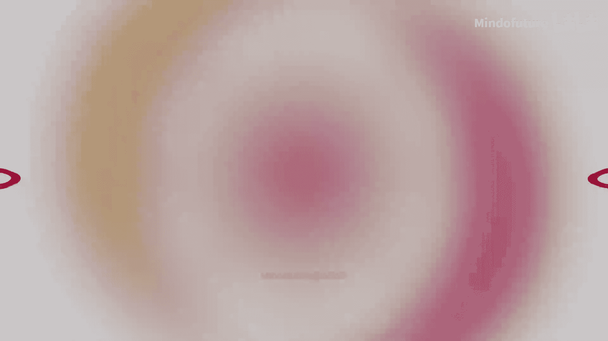
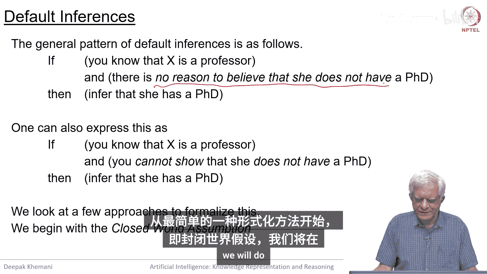

# 【印度理工学院】知识表示与推理 ｜ Knowledge Representation And Reasoning p99 P99_默认推理 -BV1c4zNBmEyF_p99-

So welcome back。We have been looking at taxonomies and one of the things we saw in taxonomies was this。

Process of inheritance。And when we were looking at inheritance， we also saw。

That one could do some kind of default inferences in the sense。That a high level concept。

Would give you a default property or an inference， but you could override it with a。

Inference which came from a node which was lower in the taxonomy。Now we want to take a look at。

Default is from the perspective of logic。And see how we can make inferences。In a world。

which is full of uncertainties recently。It is very rarely that you can make inferences which are deductive in nature essentially very often you are faced with some degree of uncertainty and。

Logic is not quite suited to happening to handling uncertainty and inconsistencies。So。

 we will see how we can extend logical reasoning to do what we call is default reasoning。So。

 this is a older slide we had said。That if you are using the implication statement that。

For all X px implies  Qx。When all x bird eggs implies p x。And then you get an instance of a bird。

For example， pepe who could be a penguin。Who does not play。So。

The moment you add that to your knowledge base that there is a bird which does not fly。

 it makes a knowledge base inconsistent。And we have observed earlier that we do not like。

Our knowledge base is to be inconsistent because from inconsistency。

 you can derive anything that you want。Wellas we would like our knowledge base to be meaningful。So。

 we had said that we will look at how to incorporate this kind of reasoning later in the course。

 so this is what we are doing。No。So， the problem is with the universal quantifier if you express your world knowledge in terms of universal quantifiers。

Then。The statement has to be true for every instance in the domain essentially so one facet of reasoning under uncertainties known as default reasoning。

 this involves making inferences that are plausible or likely but not entailed by the knowledge base。

So， the need for default eveninging arises because of our desire to generalize connections between categories so our favorite example is going to be birds。

And flight， we would like to associate birds with flight， but as we saw。

If we say that all birds can fly， then the moment you get an exception， your whole system crashes。So。

 we cannot work with universal statements like for all X birdex implies flyx the moment we came up with an exception for example。

 a bird called Pepi we could this thing and our knowledge base become。😊，Inconsistent。

Or unsatisfiable。So， instead we would like to have a mechanism by which。Given a knowledge base。

 we can make the set of plausible inferences。With the caveat that if more knowledge arrives or if the knowledge base grows then some of those inference may not hold any longer。

 so we should be prepared to do that。This implies that a set of inferences that we can make does not always grow monotonically with what we know and could in fact become smaller when we add more facts to the knowledge base so for example we we can say that pepe is a bird and only later we can say that we might say that pepe is a penguin。

Then of course， we would have to withdraw the conclusion there。嗯。The pig can play。

This form of reasoning is also called non monotononic reing because the set of inferred sentences does not grow monotonically with the。

Kown facts with a set of known facts。So， we want to move beyond deductive inference essentially。Now。

 one thing that we would like is that our knowledge base is a collection of true sentences。

We don't want a knowledge base to be inconsistent to start with。

We have seen that we often tend to distinguish between facts and rules。

Facts are basically propositions， they may be。Statements about individuals in the domain or even universal statements which are true。

But they。generally they they often don not have logical symbols connecting them though they could still have so we could say that pepe is a palate or pepe is a penguin that is a fact and we have used the distinction there。

The inferences are made using rules and rules are in firstal logic at least universally quantified statements。

And we have seen that we can reduce first order logic into a logic with works only with the implication statement we have shown。

 for example in Frege's proportional calculus that the set of connectors of negation and implication is a complete set and with using motor componentss we can build a complete logical system。

So， we will focus。On rules which are implications as we have been doing quite a bit。

So now to contrast general statements with universal statements。

 universal implications are not always the known， so sometimes they are but not always so consider the following that all men are model now that is true of course because it is said that the only certainties are death in taxes。

So， everyone is。Destined to die。We might say all roses are red。

 but that is not a true statement because you can have roses of other colors too。

White roses or pink roses or even black roses。We can say that all trappiiums are quadlet that is true。

 but that is by definition because geometry is something which we have invented。

All parents are older than their children that is also true and that is true because of the way procreation happens you first have to be born and then you have a child later so obviously you will be older than your children some things are universally true。

But if you say all birds fly and that is our favorite example that is false because there are exceptions。

😊，Like penguins and ens and ostriches。All aquatic creatures are fish that is also false because we have whales which are not fish for example。

 and snakes。😊，So， if you were to express knowledge as universals。

 then some of them would turn out to be false essentially。

Nevertheless as we have said such associations are useful。

 so we would still be like to be able to express them。

 so we will express them as general relations and not universal relations so what we really mean is that in general for example birds fly essentially in general aquatic creature are fish。

S may or may not be true。Because they allow us to make useful inferences。

What are the kind of inferences that we would like to make？So。

These inferences are called default inferences。So， for example。

 you might say x is a bird and we should be able to infer that x can fly。Or if we say x is a leaf。

 we should be able to say x is green。X did not go to college； we might infer that x is not bright。

X is a professor。We might infer that x has a PhD degree now these are inferences which would normally be true。

 though they may have exceptions。Such inferences though true in general may turn out to be false if one gets to know more about text essentially。

They are known as defusible inferences in the sense that conclusions that can be defeated。

In the sense that made false。So， for example， in the case of x。

 you might come to know that x that you are talking about is an ostrich。

if you are talking about leaves of a plant， then it might turn out that you are talking about the Indian pipe。

Plant with whose leaves are white。If you are talking about x not going to college。

 then this x could be one of those people who。Started a software company and became one of the richest men in the world。

X is a professor。But I had one of my favorite professors when I was a student was JR Isaac。

Very reered and respected。But he did not have a PhD because。At that time， one could。

Become faculty members without having PhDs I think。So。

 such instances are true in general but may turn out to be false when you get to know more about x。

The question that we want to ask is how to make such inferences。

 how to build a machinery that will make such inferences。So。

 the general pattern of default inferences is as follows。That if you know that x is a professor。

And there is no reason to believe that she does not have a PhD。Then in further that she has a PhD。So。

 the important thing is。😊，That unless you know otherwise。

Then typically you would say if x is a professor， then x has a PhD essentially。

We can also rephrase this as follows。You can say that if you know that x is a professor and you cannot show that she does not have a PhD。

Then infer that she has a PhD。So， this is going to with a general pattern of this thing that we would like to express。

😊，K knowledgeowledge in the form of rules which allow you to make inferences but also put in a condition that unless this condition holds usually。

We will look at some approaches to formalize this and we will begin with the simplest of all such formalism。

 which is closed world assumption。

We will do that in the next session。