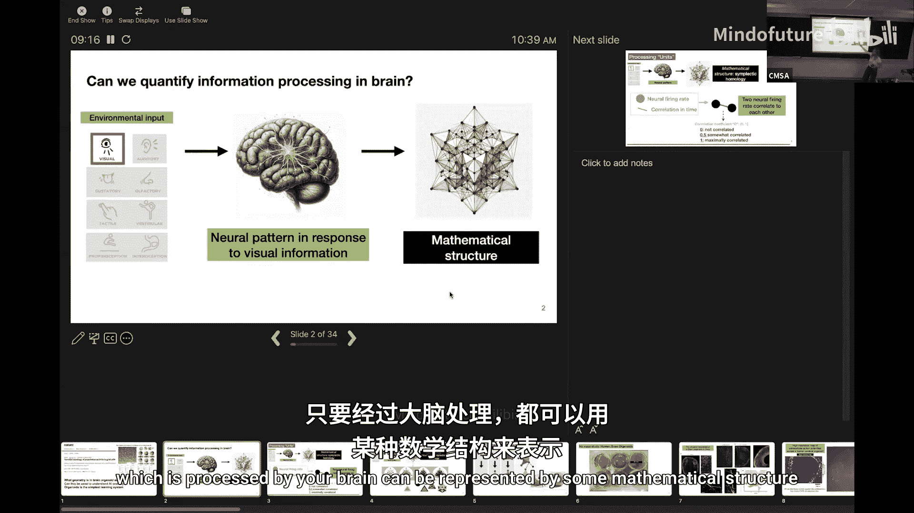
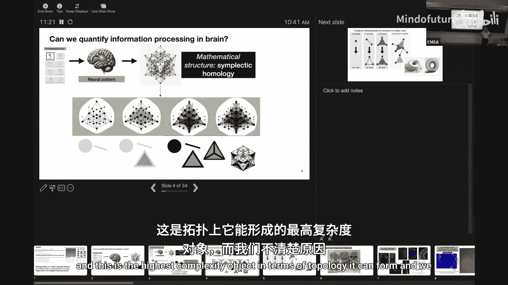
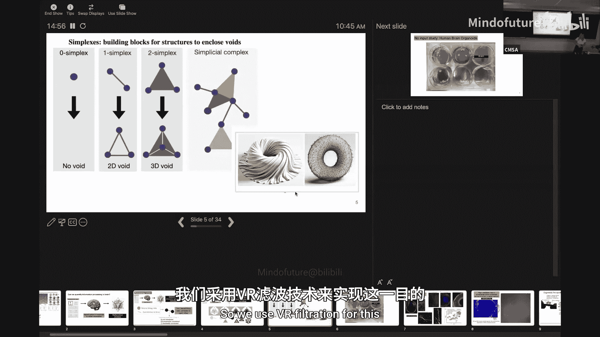
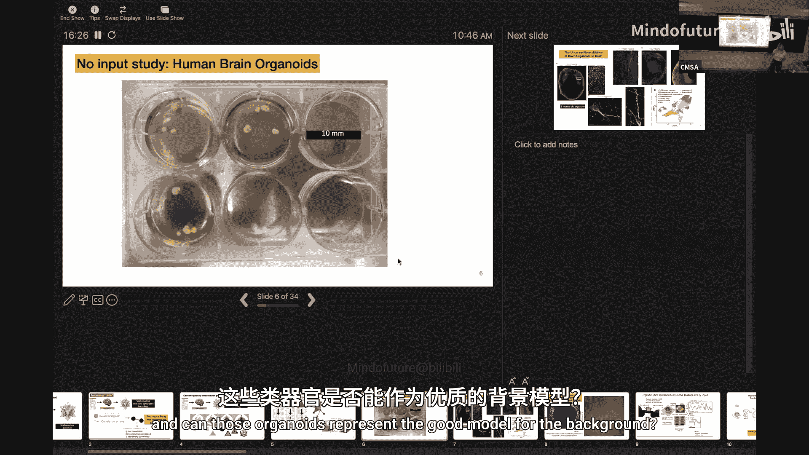
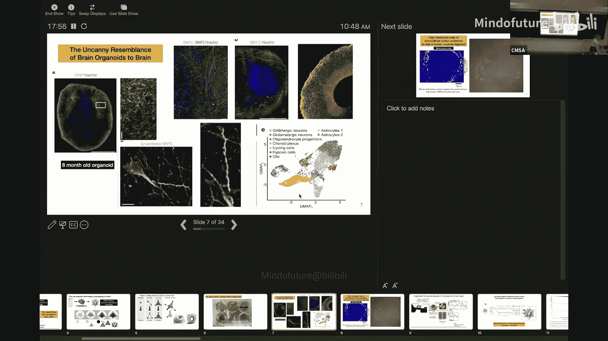
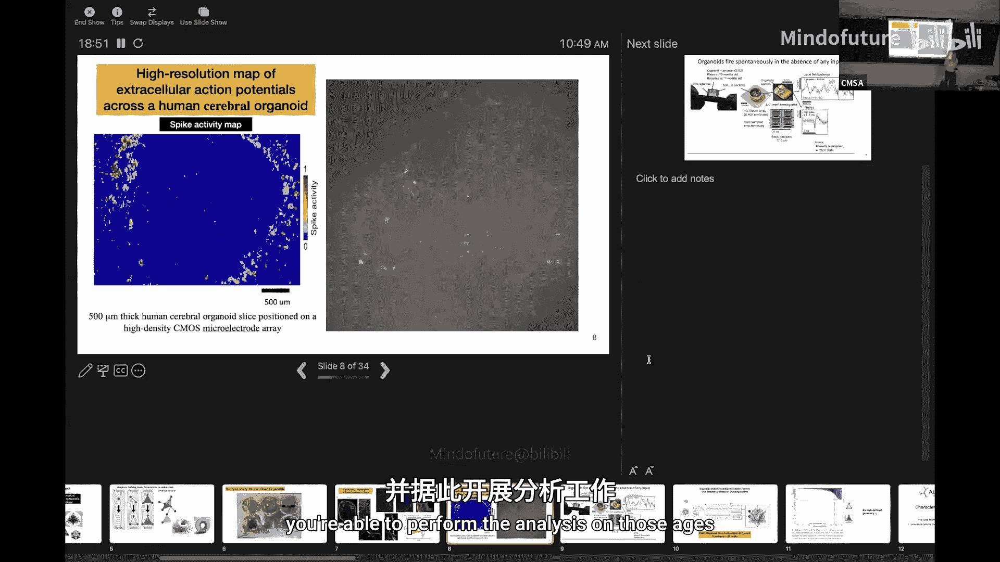
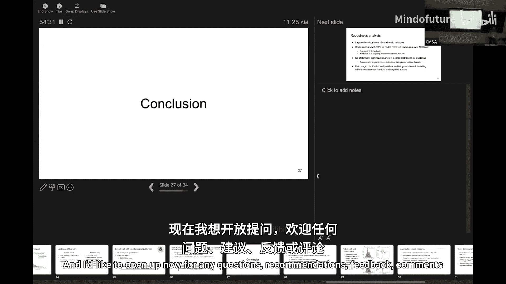

# 【哈佛大学】机器学习几何学 ｜ Geometry Of Machine Learning 2025 p06 P06_Eve_Bodnia-机器学习几何研讨会讲座 -BV14uq3BiEEB_p6-

Okay， I guess let's begin。 Thank you so much for inviting me to give this talk。

 I was telling Mike address before like I don't know how is it gonna to be useful for AI community。

 but I guess you know all this work brought me to start logical intelligence and for full disclosure。

 this is not what logical intelligence does but this is where the inspiration came from and I'm just going to speak for first half an hour and give the next half an hour to a graduate student Margo who picked up this work when I graduated So this is the paper in progress we haven't submitted yet。

 but please give us any useful feedback So。Yeah， so let's begin the story started with this paper which was sent to me by Mike when I was a graduate student。

 is basically how people from neuroscience start using persistent homomology for as the methodology tools and they studied brain activity and like what's the overall topology of that brain activity in temporal and spatial domains and what's interesting about it。

 you know， no matter what you do to this brain， they see a taurus。And we were like。

 I personally wonder like why， why is it Tourus。 So this paper is just one example。

 but there's like a bunch of other papers when they look at activity of neurons in visual cortex。

 And if they perform topological analysis on that you also see it Taurus。

 So we start having this discussion during know our collaboration with Google quantum AI and we like maybe。

 you know， if you take a bunch of AI models， the same size。 and you know。

 you know that they train the same way。 but you also know like one of them learns better than another。

 maybe there's some topological or their private。 So we don't know that。

 And I was thinking maybe this talk is gonna to inspire some people just to look at topological structure of different AI models and see。

 you know if it has any specific geometry for those which learning the best。Yeah， so。Basically。

 during my time at UC Santaa Barbara， I was a part of a neuroscience group when we did brain chip development。

 used brain organoids and it's a really interesting systems and all systems can learn and they represent like the best。

 simplest background possible so I just want to like you know educate people about the systems and say that there's a lot of cool things can be done。

So where it starts is you know as I'm speaking to you right now。

 your brain is processing lots of information like you're probably thinking about your own stuff。

 you're listening to what I'm seeing， there's a lot of visual input for you So your brain is able to process all of this information in less than 20 wts and if you're trying to encode all of this into like the machine you need like several orders of magnitude higher in terms of the energy So you know our brains are doing something really amazing and we don't really know how it works。

 there are different theories and one of my favorite theory which is connects to the manifold hypothesis is that brain process information and some some kind of highdial space and then you know as we thinking and we projected to the language this higher dimensional space gets reduced and you know when we actually study that reduction of the space there's a lot of information lost and the big question is can we recover it and。

The second big question is， do you see the same in AI and how can you test it？Yeah。

 so basically this is just you know this schematic so far how the data analysis goes。

 basically any any sensorial input which is processed by your brain can be represented by some mathematical structure and the question here is how do you study this mathematical structure There's a lot of methods there's a lot of graph theory ametthologists so I personally prefer like anything related to splication homomology or persistent homomology or a combination of both。

 So the way we've done this analysis is。

Just studying the neuro firingring rates， so basically we pick the patterns of brain in time and we see what the pattern of patterns it creates and what's like statistical significant patterns stands out Yeah so I know like many people doing this in a spatial domain but we were like interested in doing this in the time domain exclusively just because of you know as you process information it relates and like a lot to like how fast you able to do so I felt like it's the most important part So the building blocks for this analysis is the neural firing rates which the notes of the graph and eventually the hypergraph and the edges connecting this as a correlations at time。

So if you say that the neurons are strongly correlated。

 it means they fire at the same time and then if they weak correlated。

 it means there are some synchronous behavior going on。Yeah， so basically the next question was like。

 what's the shape of the structure formed by brain organoids， by the data？

And I used persistent homology on this basically you're studying holes and you see what kind of homology groups showing up in there and then you quantify topological complexity by you know seeing what's the highest homology group present and a little bit of a spoiler here for brain organoids。

 there's not that much complexity that the second homoology group is the largest we've seen so in a normal language it would be like you know the temporal neural activity represents a sphere and this is the highest complexity object in terms of topology it can form and we don't know why。

And just a little bit of prerequisites on， you know what's s complex。 So from yes。

Is neurons being connected？So it's over time and so。

I'm trying to understand like there's a timescale that you have to wait and so could there be like a wave of activity and all those neurons aren't connected but then once there's no activity for someone on time。

any new activity a disconnected。 Yeah， yeah。 So basically。

 I'll get a little I have a couple of slides to express this idea a little bit。

 but just to answer your question ahead of time。 So there is indeed organoids。

 I'm gonna show you the actual data。 they behave like waves。

 They like all light up at the same time and it spreads instantaneously。

 So we we were trying to like look for interference patterns and see if it's actual like the true like classical wave mechanics involved in there。

 But we didn't have enough methodology。 We used to be microscopy in a combination ofs like 20000 electrodes。

 And that was not enough to pick that up。At least at my time during my PhD。

 but what we try to do is we build this graph of the overall connectivity and we had this idea of zooming in and zooming out on this graph by introducing the lag windows so the lag windows went from as little as 10 millisecond representing two neurons connected together to like 200 milliseconds so it's like multiple So it least you have a chance to like zoom in and zoom out on the temporal scale and actually see like what's the correlations of correlations going on in there Does it answer your question。

so because you take longer legs like the holes in the donuts clothes or something。 Yeah。

 we just wanted to see like what's overall happening there。 you know。

 basically that's the whole point of this slide is you studying the space and you don't know like unknown space to you and you want to understand the shape and topology of that space。

 So as a result， you need to be able to zoom in in locally and globally and just see how the dynamics changed as you do that。

 So in our case， the dynamics was de baiting numbers is the number of the generator of homoology groups and how it changes as a correlation function we have like a couple of plots to show about this。

 but more plots coming in this paper when we publish like in the next couple of months or so。 Yeah。

 but that's a good point is like because this overall brain activity shape is yes。

This slide before said simple e tyypo because that means something else。Okay， so maybe a subtype。

 So I'll tell you a little bit。It'll be very specific。Okay。

 let me tell you what I meant We're here and we can we can talk about it。 Okay， so basically。

 the whole idea was to use persistent homology。 but you need to be able to construct the simplelicies。

 And the whole idea here is like you study the space you don't know and you take you and you you have to take the space you really know and love and understand how it behaves and you kind of map it on the space you don't know and see how it behaves on that unknown space。

 And then it tells you a little bit about the shape。 So we use like VR filtration for this。😊。

嗯。Okay， so now's the fun part what are the brain organoids， So brain organoids are really tiny。

 tiny brains， they're at the size of my nail， sometimes it' less they can grow this is probably the highest you've ever seen grown they grown from their stem cells of humans or animals so nobody gets like killed and you have to keep them in a very sterile environment in order for them to grow and fire there are two ways to grow them there's loncaster and pasca protocols so if you see the big organoids also loncasts。

 it's a very specific protocol those organoids start to fire pretty early like when theyre three months old。

 sometimes even like rare cases when they two months old they start already showing some activity and they're sitting in a dish and you know not connected to any visual inputs just the media which surrounds them and if you put them on microscope there。

show you some spontaneous activity and that's spontaneous activity like we don't understand like what does it mean。

 is there like any information， whatever you call information gets processed in there。

 can those systems be used as you know understanding the background like you know when you when you're doing the actual brain chip interface you need to understand very well what's your background and what's your signal and can those organoids represent like the good model for the background And the answer is maybe but not not really So if you look at like the chemical analysis of what kind of cells those organoids have So there's a lot of cells which like seen in the typical brain but the way they assembledsem is very far from what the actual brain is like the actual brains are like very well definedfin structure very well defined geometry and those things are like all over the place。

 So it's just a bunch of collection of cells which you see in the brain but you know。

It's not really a brain。And another problem with this organoids is， like。

So eight months old organoid is considered old。 We typically don't do measurements on those Its like four months。

 five months is when they just start firing and maybe once months later。

 that's the best data you could take on them。 So the middle is dead。And if。

 if you lucky and you get the organoids going until it's one year old， you know。

 most of it is gonna be dead in the middle。 and you know， only the age is gonna be firing。

 So that's a problem。 Like many people try to figure out how to solve。 You know。

 they try to like insert some you know， devices like microfluidity the center。

 like engineering kind of an idea that nutrition is gonna go inside and maybe this organoids can can evolve into something bigger。

 But so far， you know， nobody solve this problem yet。

嗯。So the next slide I have is the actual data， so this is from 2 P you could see， I don't know。

 given the lights， but you could see it's like mostly looking like just regular networks。Okay。

 this is a little bit better， so you can see like individual neurons and there are some connections you could see it visually。

 but if you're just doing2p microscopy it's like3 millisecond per frame it's still like not enough to give you a good idea of what kind of data you're actually analyzing so we went with MEEAs those microelectro 2000 of them and it can sample in a pretty fast rate and as I said the middle is pretty much dead all the time so you could just like sense the ages and you're able to perform the analysis on those ages。

And just a little bit about how the overall you know data taken。

 so youll have to start by taking organoid in the agriros。

 it's just the liquid which surrounds it and protects us during the experiments and then you slice it on the very thin layers。

 typically 500 micrometer size and then we play them on the MEs and。

AWe hoping that it's gonna to get attached so that's like one of the biggest problems in brain chip development so far in like industry and academia is brain cells are very hard to attach with two different surfaces so it's like a rocket science how to make them get stuck a little bit and then if you're lucky you know it can stay there for like a few weeks and detach again and we tried all different kinds of chip there's like a bunch of wireless chips people making right now so still an open problem but there's good solutions start emerging right now so yeah those chips are really good they fabricated that Switzerland and they already have like the data processing packages in there and Margo can go over these details because'm out of time。

Yeah， so basically， once this organoids， we put them on chips。

 and then we select the signals from each individual neurons。 We start having this。

The firing rate diagrams for each individual neurons so for example。

 this brain organoid had only 40 neurons and this is the times in cycle and the scale so then we convert the firing activity of each individual organoid into a graph when you know each node is this firing rate and edges correlations in time and here Mike Mallig you asked this question about theimmin and zmin out so here we ensure this lag time possibility like just to see how this graph is changing as you start logging the correlation window。

Yeah， and you know， this was a big chapter in my thesis PhD。 just basically the big conclusion is。

 you know， I couldn't find any well definedfined topology in those organoids what do you see like ideally here in this paper I showed you in the very first slide you saw like one big lines for the first for the zero homomology group then two big lines for the first homology group and one line for the second homology group and for the organoids is like no matter how many we looked into them。

 we didn't see any welldefined topology and。We tried mice sagonoids instead of humans。

 so it sounds like， you know there is nothing in there。

 I know there's like a lot of papers when people try to like teach organoids to do specific tasks。

 there's like pong paper when organoids play pong so it's a very famous paper but honestly if you know me if you tell me how to like figure out this signal of background situation without understanding background。

 please let me know。We spend like a few years studying this and we see there is no well defined aology so you can't really quantify the background。

Yeah， so I kind of like made a conclusion in my my paper that， you know， it's。

I see basically nothing topologically exciting in there but then Margo and her advisor Kimmo is uncle Calonif don't give up too soon we know different methodology and we know how to do it so I pass this to Margot right now to give a follow up on the study and thank you so much。

great question， the tourist that you discussed at the beginning， so that was。Absol to see。 Yeah。

 noorious and great organize。 Unfortunately。 So the big idea was like。

 I was inspired by this con favor with the organizers played that by you maybe stimulations on them through the chin and。

I was thinking， you know， maybe if we can see like no tos before you stimulated。

 but once it's actually started learning， you see some kind of emerging autoparner。

 like some kind of torous or some other shape。 And if you understand this idea of it。

 maybe you could study the brains which are disease like Alzheimer's disease brain。 maybe you know。

 Alzheimer has a technologyology in there。 But in order to quantify statistical significance of that effect fact。

 we need to understand the overall background very well one of your early slides did show some tora what were those Yeah。

 those words were the paper， you send me all the breed cells。

 So it's just an example how typically the signatures look like in brains or brainorgan。

 but we were we were the first people who actually apply this methodology of temporal face and you know。

Basically proving that it was the instruments we had at the moment。

 it's either impossible to make a conclusion or the conclusion is like。It's just was' not there。

All right， so like youve said， no well definedfined geometry coming out of these brain organoids。

 it's not not based on the bety number plots that we were looking at。

 but my project was kind of focused on like there's not no information in these systems So kind of like can we still get some significant amount of information out of these brain organizedoid like how can we further characterize them to understand them as the most simple model of。

嗯。Of the brain and of learning so。m just。Quick rundown of the data processing pipeline you've kind of talked about the MEA and the data collection so I won't focus too much on that once we get the data from the electrodes that's an electrode array of I think 26。

000 electrodes so it goes through a spike sorting algorithm called killos sort to identify with which of those electrodes are actually measuring realistic physical neuron signals versus which are just collecting noise that puts out a spike train just a binary spike train where。

Each row is corresponding to different neuron from there to compute the correlations。

 we first apply a Gaussian smoothing kernel and this is kind of the first place that we have a parameter choice that is significant to our analysis so for the width of that Gaussian kernel we're just doing that so we can actually compute the cross correlation。

And actually have some overlap between the neuron signals that are being seen and for that width where we went with a width of 50 milliseconds。

 which has some reasoning in。Biology with synaptic connection time。

 but also it doesn't go too wide so as to。Based the results towards stronger correlations than we're actually seeing。

 And then once we have that。That spike matrix， Gaussian smooth。

 then we use this equation to compute the cross correlation。

And as you've talked about a little already and like some questions came up about the lag。

 that's kind of another parameter choice that's going to impact what features we're seeing。

 still figuring out how to optimize for that in this context。And。

Compare between different lags and kind of what what lag window is actually helpful to look at and optimize for。

 but once we compute the cross correlation for。All of the pairs of neurons。

 we get an all to all correlation matrix and from there we can。First construct our graph。

 that's kind of the third place that parameter choice comes in with what strength of correlations we're including in our graph as weighted edges。

But then once we have that graph defined， we can compute any standard network features or network measures。

 so strength distribution， clustering distribution and path length distribution are the main ones that we're focusing on and mostly what I'll be talking about today but we're still considering what other potential graph measures could be helpful in fully characterizing these systems and identifying any other interesting structure。

 and then with that correlation matrix we can also use that and put that into the Python module Rsster to compute the cohomology and from there we can get the topological features which can be shown in persistence diagrams。

 I'll talk a bit more about persistence histograms specifically today and then also betty numbers like like what E've already showed。

Before getting into actual data， I just want to mention the control models because that was something that we considered。

Spent a lot of time considering of how do we actually show。Significance over a random network。

 what does that random network look like？Okay， that's a little weird。But。Basically， we found that。

You know。Standard ideas of random networks weren't really providing good or like super accurate backgrounds。

To an actual physical neurological system， so the models that we'll be using first is constrained randomization。

 which I'll basically just refer to as shuffling because it's just shuffling2 by2 sub matrices in the spike matrix so that way it's constraining the number of spikes per neuron and then also the number of spikes per time bin。

And so that that's kind of like shuffling the edge weights between different nodes but then just averaged over the full time range and then the other model we'll be using is an ensemble bootstrapping model so we took。

 for example， all the spike trains of all of the mouse organized put them into one ensemble and then bootstpped a data set out of that and saw how many。

How many topological features and what network features we're seeing。

 so idea behind that is looking at。act， like physically and functionally independent neurons from different organoids and seeing if those have the same behavior as organoids or different。

 and that way we're looking at unconnected neurons。

 but we're still looking at realistic neuron activity as opposed to， let's say。

 generating randomly generating spike trains to simulate。

And then one last thing to contextualize is the network size we're looking at。

 these are very small networks compared to what network analysis has typically done on。

We're only looking at 100 to 200 or so nodes， so this is a very like。

Veryry small scale network study compared to like usually you'd be looking at thousands。

 tens of thousands， hundreds of thousands of nodes with these measures。

 so that does kind of impact the the scope of this study we determined that with less than 100 nodes we were seeing a pretty significant drop off in the number of。

Feature topological features in the first homomology group。

 so we excluded those from analysis and that leaves us with four human organoids and nine mouse organoids to look at。

And。We expect that if we were to have networks with more nodes。

 we would see this trend continue up with more more features in the first homoology group and then we also think。

As youve said， we see a couple of features in the next homomology group， but nothing higher。

 nothing indicating higher complexity， so we also expect that potentially we would see more H2 features and higher if we were to。

Have larger or more complete measurements of networks。All right。

 so first thing I'll talk about from a network measured perspective is looking at the strength distribution and what it can tell us about these brain organoids。

嗯。So we're not seeing a power law out of the original data。 we kind of don't expect to， again。

 really small sample size。 it's a little hard to。Have enough statistics to actually see a power law and that's something kind of a separate question that we're still investigating is is that would that even be a helpful measure in such a small network。

But what we are seeing in the original data when compared against the ensemble control is we're seeing that there's。

More nodes that have more more and stronger connections than we would expect in the randomized data set。

 so that's indicating that our mouse or the organoids mouse and human， sorry。

 but the organoids do have some。Some amount of hubs that are stronger than what we'd expect to see in randomized ensemble and what that corresponds to physically is larger amounts of firing synchronization in neurons。

Then， again， then you'd expect toancy in a random network。A problem that's going to。

 I'll kind of keep mentioning throughout this is。Do more comparing to the ensma model。

The shuffled control model is a little more data set dependent because it depends on the。You know。

 it's shuffling the number of spikes within or the number of spikes location of spikes within each data set。

 so if there's any difference in the distributions from data to data set。

 the shuffling tends to follow that， so it's a little hard to make。

broader conclusions about the shuffled control， so i'm not going to say too much about that here。

 but just that is another problem that we're we're thinking about and that I'll kind of mention throughout this talk。

Next up， we looked at cluster stringing distribution， which you can think of as。

Looking very locally at neurons and immediate neighbors。

And what we see in the organoid data is we are seeing moderate to high clustering in general and kind of nothing in the lower clustering。

 so in general these neurons are pretty well connected to each other。

The ensemble control model is tends to be less connected at peaks a little earlier。

 so that's indicating that our organoids do have。More efficient signal propagation and more robust signal propagation than we would expect out of。

A randomized network， again， the shuffling， same issue， more organized independent。

 so I'm not going to make any strong claims or observations of pattern against that control。Okay。

 and then looking more at。Communities on like the full graph scale rather than clustering。

 which is very localized。嗯。We're seeing in the path length。

 it's being very exaggerated by the two control models， which I thought was interesting。

 but it does still show up in the underlying original data is we're seeing kind of these two overlapping length scales that are coming out of。

The models and the original data。 so that's indicating that there likely is some。

Some amount of community structure。 And that's something that we're still investing a little bit to see if that actually is there if that's。

 if that's only showing up in this plot。 So we kind of need to verify that some other ways。

But it is likely indicating that we have some regions of neurons which are more densely interconnected within the community。

 and then there's some sparse connections between different communities as far as physical interpretation that would match up with function specialization。

And groups of neurons being。Optimized for。Efficient。Execution of very specific functions。

what path length is I was thinking maybe it's an integer number of steps， but I see fraction oh yes。

 so for this we're considering weighted path length so that's。Two different ways to look at。

Path length is either unweighted where it's just number of hops with such a small network。

 it basically ended up that everything was like。Like two or three or four hops away it wasn't really an interesting histogram so yeah。

 so it's yes， so have them up in absolute value it's yeah so it's it's looking at。At the distance。

 so just one minus the correlation and kind of like minimizing。Thats the， I guess。

 most strongly correlated path between。Between any sets of neurons。Diagrams zero lag。Yes。

 but the nerve impulse system needs some3 second out a zero。

This kind of goes back to the parameters that I mentioned and again， something that we're still。

Still figuring out， certainly still in the process of you know working on this data and making sure that we're interpreting everything correctly。

But。Part of that is when we do the Gaussian smoothing we are we are smoothing with a 50 millisecond window。

 so that will allow for some amount of synaptic delay and then adding in the lag。Kind of。

Gives us another way to。I guess kind of make some of the correlations more obvious and see it that way。

So that's all that I have on network features right now again we're still considering other network other standard network features that are going to be helpful for characterizing these organoids it's certainly something as far as looking at sparse networks that we're open to suggestions on if anyone has any ideas but now i'm going to look at what we can get out of the topological features because again we weren't seeing any。

Any well defined geometry but that doesn't mean there's no information in looking at the topology。

 so first off， what you'll see in a lot of papers on persistence homoology is these like birth death diagrams or persistence diagrams。

Where。The points that are closer to the diagonal are going to be。Are going to。

Have short correlation windows over which they exist for when sweeping through。U。

The correlation threshold in the process of persistent homology。

The points the blue points aren't are pretty much trivial they're just looking at connected components so we're ignoring that because it doesn't really mean anything。

 but what we are interested in is but saying there's always one connected component is no it's it's showing that。

I guess it's just showing like。If we're considering only things that are 100% correlated。

 like nothing's going to be connected and then as you like sweep down。

Through and like start considering a lower threshold of correlations like things are going to start connecting。

So it's not really in。It's not really an interesting result of the persistence homomology because it's kind of just like which edges are we considering and so as we。

As we see John through。The correlation threshold like things start connecting into connected components。

 and I guess that is a note we do generally see。Most of these all or most of the the nodes do end up connecting into。

Um。Or do end up as one connected component sometimes but that's not interesting I mean it's people do study the space transition in random graphs I see。

 I see cluster there have been little pieces so I think that's I think there's I see yes zero yeah。

 I guess as far as looking at。As far as looking at topological complexity， I guess we're not。

 we weren't considering the number of those features， but I guess yes， in a different context。

Perhaps that's something we'll look at a little more at just in terms of looking at。Yeah。

 I guess the。Kind of interesting like higher dimensional， it's only H1。

 but looking at those features。Um。But something about the persistence diagrams。

 it's kind of hard to interpret。What what we'd see comparing between a random network。

 what we see out of like random noise in a random network versus what's actually like a significant number of features or significant correlation window。

 so we translated that into a persistence histogram。

 which is basically looking at the perpendicular distance from the diagonal line to the points or you could think of it as the lifetime if you're thinking at birth death。

In terms of the birth death correlation coefficients kind of。

That's kind of abstracted away from like actual physical interpretation。

 but binning based on these correlation windows and how long these features are existing for and then plotting those against the control。

So。As far as what we're generally seeing in these persistence diagrams。

 we are seeing some significance in over control models， specifically in the。

Number of features in the first homomology group that we're seeing。Something to know is， again。

 these features。They are very close to that diagonal line。

 they're existing and appearing in persistence homoology in very short correlation windows。

So the significance is mostly coming out of just the number of features that we're seeing。

 but this is consistent。Across all the data sets。We are seeing。

More features than we would expect to see。Um。Andの。We haven't had time to investigate this yet。

 but we would we do。Expect that we would see wider correlation windows and features that are。

Existing for， you know。A longer amount of， or I guess a wider correlation window and persistentence in the homology。

But we haven't had time to investigate that yet， but that's kind of a standing hypothesis we have so that we'd see wider windows as we were as we get into larger more complete data sets and as far as physical interpretation of。

This class of topological features。It's looking at。Loops in the neurons。

 so it could be indicative of recurrent circuits of neurons or of neurons that information is passing through。

Something else that I've done kind of as a part of this just to Tesla avenues is we did a study of robustness based on the concept of the robustness of small world networks。

So first off， looking at random note removal， we see that。If we randomly remove 10% of nodes。

 we see less H1 features， which is as expected， but there is still an amount that's。

Somewhat significant over the original control models。

 so we're still seeing more than we would expect to compared to those models。

But then when we switch to looking at targeted removal。

 so targeting nodes that are specifically involved in。H1 features。It。

Pretty much just destroys the topological complexity， so that's not too surprising。That we're seeing。

嗯。When we do target removal of。The nodes that make up the H one feature those features quickly go away what we're trying to test with that is seeing if there are kind of multiple。

Multiple paths in the nodes that these H1 features would take so if you take out a node from a loop is it going to kind of rewire or not rewire。

 but will you still see that feature through another loop in the data or not we're seeing that that's not really happening at least in our measurement of the data and I also did I won't go into the network measures on this stuff but we do actually see something interesting specifically in the path length distribution。

 we see that there's some indication that the nodes involved in the H1 features。In。

The nodes involved in the H1 features do play some。Extra significance， I guess。

 in the connectivity of the network， because when we look at the random。

Random removal versus targeted removal we see a significant change in the path length distribution with the targeted ones。

 but I won't go too much into the network measures that's called kind of。

But we did look at all of the measures that I've talked about。

 we've considered all of that with look kind of this little robustness study。

So now i'm going to talk about limitations of this study， there are a lot of them first off is。

Like youve said， there are a lot of difficulties in measuring brain organoids and like making sure that it's fully contacting the electrodes。

 measurements are noisy and it's difficult to determine what electrodes are corresponding to neurons if multiple electrodes are contacting the same neuron and that's all。

Handled by the spike sorting algorithm that we used。

 but there are kind of constant improvements being made to spike sorting algorithms。

We're looking at a 2D slice versus there are some other methods that can look at 3D volumetric scans。

Those have their own downsides as far as。As far as imaging rate in。Or guess， sampling rate。啊。

And time resolution and then another issue we run into is just。The number of data sets again。

 only four human organoids， only nine mouse organoids that we analyzed。

 so it's hard to really make any conclusive statements kind of everything that I talked about here is patterns that we're seeing generally across all the data sets that we analyzed。

 but it's just not enough statistics to make any。Hard conclusive。

Statements about brain organize as a whole。 and it would probably require some some further measurement。

 And then another thing is just the accuracy of our control model。 again。

 that's assuming that the neurons that we're pulling out of the ensemble。

Is resulting in a data set where the neurons are。Actually uncorrelated。

 but if we're only pulling from， for example， in the case the mouse organized， if we're only pulling。

Neuron spike trains from 12 of the data sets， there's going to be some neurons that are coming from the same data sets。

 so there could。Actually be some organization that's kind of sneaking into that control model instead of being truly randomized and then limitations of this being a preliminary study。

Again， we're still figuring out how to best。Best compare the results from the different lag windows across both the distributions and looking at the topological features。

The graph is constructed from the 50th percentile of correlations， as I said。And。

Something that I'm currently working on is ensuring that any interesting features we're seeing are appearing regardless of how we're defining the graph。

 so making sure that it's actually features of the network and not。U。

Anything that's coming out of that graph isn't just an artifact and。

What we're seeing so far is it's not just an artifact， but again， still still kind of working。

Working on。Looking back at the network features。For that graph definition。

 and then the last thing is just reconciling control models。

 making sure that the control models are well suited。

And if there are any other control models that we need to include， again， the ensemble one。

 we're seeing more。Definitive patterns across multiple data sets with the shuffled control that one's a little more data dependent so figuring out how to accurately or accurately represent our data and make sure that those control models aren't biased or aren't aren't misconstruing our results is something that we're we're still working on ensuring。

And then I just want to give。A brief idea of some other projects that at least I'm working on to continue this work and。

 you know， kind of what's the point of looking at brain organized like this。

So we're currently working with the Loser group out of the University of Maryland and trying to see if there's anything interesting or any interesting geometry or network differences between brain organoids that have mutations so looking at brain organoids that are non transduce。

 but then also that are mutated with progeria mutated with Alzheimer's and seeing if。We can。Oh。

Kind of tell the difference between those mutations based on these network features， so basically。

In this study that I've talked about we've。Identified that there is some significance over control models in these small。

 noisy， sparsely sampled real world networks。 But what can we actually use these network measures for aside from just showing significance over some。

Randomized control background。And then we're also working with the shaves and lifer groups out of Princeton and the Leer lab did a bunch of one photon imaging of Cgons like worms and with that you can get the full connectome of。

All of the neurons in the organism because I think it's only。300 something neurons。

 So that's fully mapped。 So we're planning on。On。You know。

 looking at that complete network of neurons and。Seeing what types of features and kind of what are the limits of the features that we can see if we do have a very complete recording versus some 2D slice of data and then Cgons is also just a good background in general。

 it's another thing in。In other neurological studies that have been used as kind of a model of like。

A very simple model of computation， so that's something that can be seen in other studies being used as kind of a background for。

嗯。For what kinds of features you just inherently see。In。Physical systems。All right。

 so this is pretty much where I leave off again， we're just looking at brain organoids as。

Kind of the most simple model of。Of the real thing of real brains。

Didn't see any super well defined geometry， but we are seeing out of the network measures and looking some more into the topological features。

 we're seeing some suggestions of。Some higher order organization。

 some suggestions that the neurons are still wiring together。In a manner that。

Optimizes for efficient signal propagation and we know that the brain is very energy efficient。

 so kind of broader motivation for this is we think that if we can better understand the brain and how neurons are。

Wired together at a very low level that there can perhaps still be some inspiration that can be taken from physical systems somewhere further down the line to。

Maybe help improve AI or our understanding of。You know what。

 what network features are necessary to kind of。Take that to the next level。

 but I don't know too much about how that looks like just kind of some ideas for potential inspiration in the future。

 So with that， thank you all for your time and I'd like to open up now for any questions。

 recommendations， feedback。😊。

Comments， anything。